# Orreryq — the Orrery Queue

<p align="center">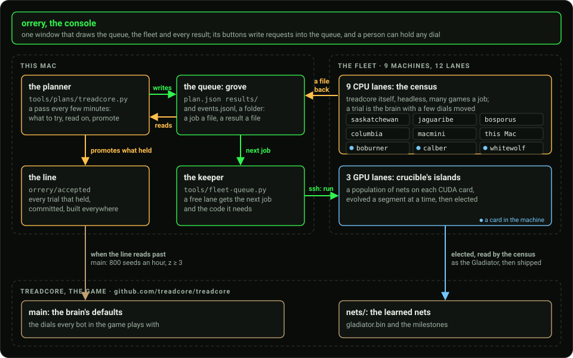</p>

**A room of ordinary machines, one queue, and the console that runs them.**
Orreryq is the fleet that trains the bots of
[treadcore](https://github.com/treadcore/treadcore), a tank game, and this
repository is everything on the fleet's side of that: the console, the keeper
that hands out the work, the planner that decides what the work is, the tools
that film and report what came of it, and the site at
[orreryq.com](https://orreryq.com).

An orrery is a clockwork model that shows many bodies at once and lets you turn
a handle to see where they will be. The Q is the queue. Every job the fleet
runs is a file in one folder, and every answer comes back as one. **There is
no server, no database and no message bus: a folder, ssh, and a program that
reads both.**

The program is still called `orrery`. Orreryq is the project, its site and its
repository.

- [A guide to Orreryq](#a-guide-to-orreryq): the idea, the pieces, the two roads into the game, a day of it, the words
- [What you see](#what-you-see): the console, a picture a page
- [What it makes](#what-it-makes): every new generation on film, a card beside every net, a lab report a question
- [The console underneath](#the-console-underneath): where orrery began, and how it is built

## A guide to Orreryq

### The idea

treadcore's bots are a hand-written brain with about 150 numbers in it, and
beside it a small learned net. Nobody can say from an armchair whether a bot's
`margin` should be 0.0375 or 0.575. The only way to know is to play thousands
of games, on seeds and maps nobody chose to suit the answer, and to count.
Orreryq is that playing, organised. **A planner guesses a number, the machines
read it, and what holds goes into the game.**

Two things make it a fleet rather than a script. The first is that a guess is
cheap and a proof is dear: most guesses are dropped after a few dozen games,
and the few that survive are read again on games no search has seen. The
second is that the machines never wait. A free lane takes the next job at
once, and when a step of a chain returns, the keeper asks the planner for the
step after it.

### The pieces

| | where | what it does |
|---|---|---|
| **the planner** | `tools/plans/treadcore.py` | reads every result each pass and writes the next jobs: what to try, what to read on, what to hold out, what to promote. It is read fresh each pass, so a change to it needs no restart |
| **the queue** | `build/queue/grove`, in the treadcore checkout | `plan.json`, a job a file, `results/` and `events.jsonl`. It is the only state there is |
| **the keeper** | `tools/fleet-queue.py` | hands each free lane its next job over ssh, ships the code the job needs, copies the answer back, and keeps its running jobs across its own restart |
| **the lanes** | nine machines, twelve lanes | nine CPU lanes play treadcore's census; three CUDA cards, in three of the same machines, run crucible's islands |
| **the line** | `orrery/accepted`, in treadcore | every trial that held, committed and built on every machine; it goes to `main` when it reads past it |
| **the console** | `src/`, `orrery --gui` | one window that draws all of the above, with a button for each thing a person may do and none for anything else |
| **the films and reports** | `tools/report/` | footage of every new generation, a card beside every net, the montage, and a lab report a question |

Three other repositories take part. **treadcore** is the game and its brain,
with the census scripts the CPU lanes run. **crucible** is the CUDA trainer:
whole populations of tanks played on one card. **copal** is the Linux the
fleet's nodes began on, with the fleet's certificate authority; the console
was first written for it, and the last part of this README is that story.

### Two roads into the game

<p align="center">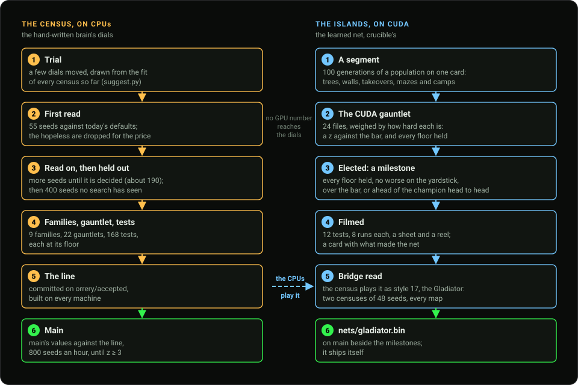</p>

**The census, on the CPUs, tunes the hand-written brain.** A trial moves a few
of its dials, drawn from the fit of every census so far. It plays 55 seeds
against today's defaults, more until it is decided, and then 400 seeds no
search has seen, which is the only fair read of a winner. What is left must
hold in 9 scenario families, 22 gauntlets of single decisions and 168 tests,
each at its floor, before it is committed on the line. The line goes to `main`
when main's own values, read against it at 800 seeds an hour, fall behind by
three standard errors.

**The islands, on CUDA, evolve the learned net.** crucible plays a whole
population of tanks on one card, a segment of 100 generations at a time, on
trees, walls, takeovers, mazes and reward camps. A generation is elected a
milestone only when it holds every floor of crucible's 24-file gauntlet, is no
worse on the yardstick, and clears the bar or beats the champion head to head.
Every milestone is filmed and given a card.

**No GPU number reaches the dials.** The one bridge is the census itself: an
elected net is played as a style, the Gladiator, in two censuses of 48 seeds
on every map, and ships as `nets/gladiator.bin` when it holds.

### A day of it

In the 24 hours to 19:35 on 6 November the keeper finished **4,592 jobs** on
nine machines: 3,710 of them the search's first reads and read-ons, 436
censuses, 315 crucible segments, and 131 others (builds, recordings,
gauntlets, families, a promotion). Results, Generations draws the hours
themselves, the GPU's in blue and the CPUs' in orange:

<p align="center">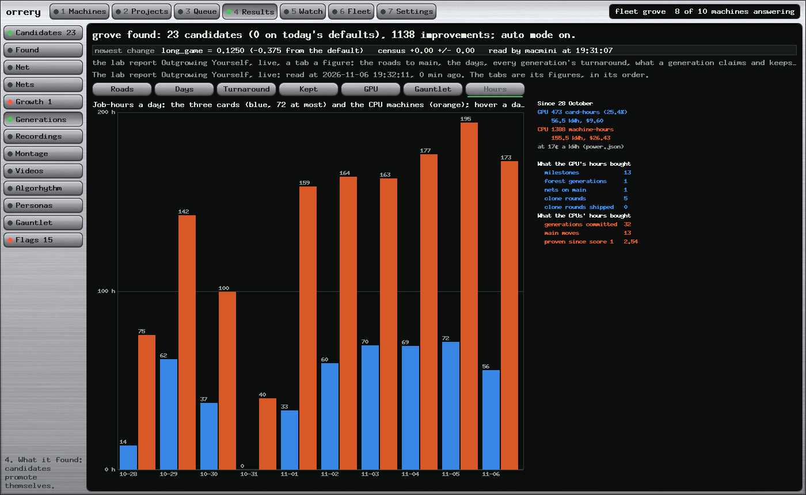</p>

### The words

| | |
|---|---|
| **seed** | one game's dice: the map's layout and every roll in it. Two runs on one seed are the same game |
| **census** | a brain played against today's defaults on many seeds and maps; its answer is a margin and its standard error |
| **trial** | the brain with a few dials moved, waiting to be read |
| **first read, read on, held out** | 55 seeds; more until the answer is decided; then 400 seeds no search has seen |
| **family** | a scenario family (`scenarios/*.toml` in treadcore) with a floor every candidate must hold |
| **gauntlet** | single-decision tests, a file each: fire at an enemy in reach, take a depot, cover the leader |
| **the line** | `orrery/accepted`: the commits that held, waiting to be read past `main` |
| **generation** | on the CPUs, one promotion onto the line; on the GPUs, one elected milestone |
| **island** | one CUDA card's population in crucible; it trains a segment at a time |
| **the bar** | how far a GPU generation must step on the weighed gauntlet, in z; it eases while the islands are dry and tightens after each election |
| **the Gladiator** | style 17 in treadcore: the newest elected net, played as a style a person can pick |
| **lane** | one thing a machine runs at a time; a machine with a card has two |

## What you see

The console is one window with seven chapters: Machines, Projects, Queue,
Results, Watch, Fleet and Settings. Every picture here is a frame the console
drew of the running fleet with its own `--frame` renderer, no screen involved.

<table>
<tr>
<td width="50%">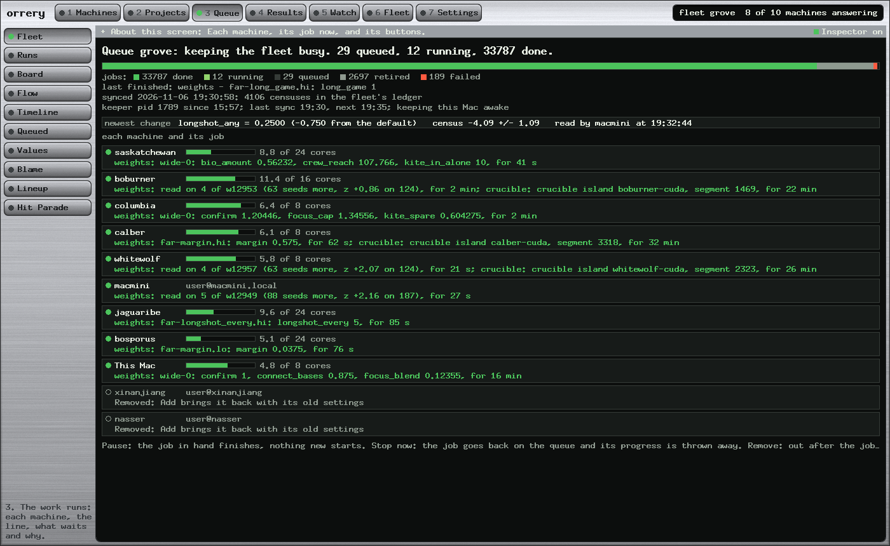<br><b>Queue, Fleet.</b> Each machine and its job now: 33,787 jobs done, 12 running, 29 queued.</td>
<td width="50%">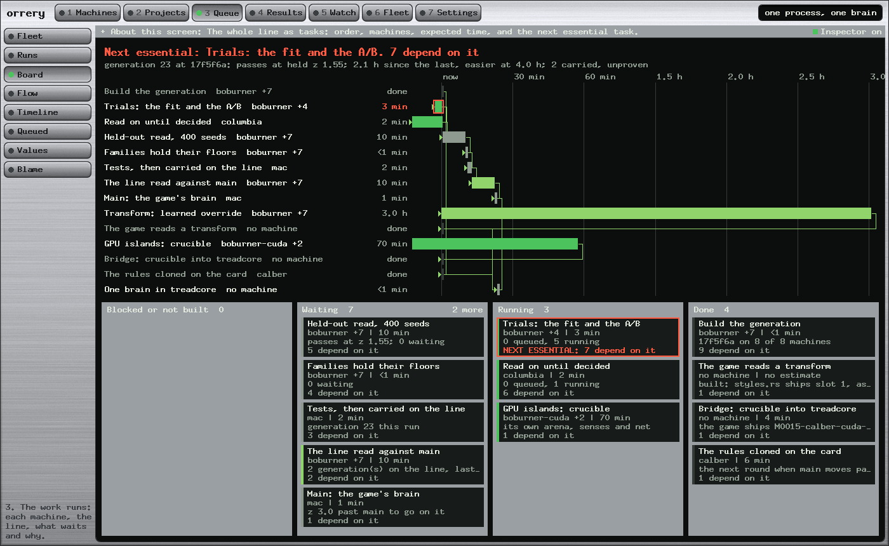<br><b>Queue, Pipeline.</b> One process on one screen: the line as a Gantt chart, the tasks as a kanban.</td>
</tr>
<tr>
<td>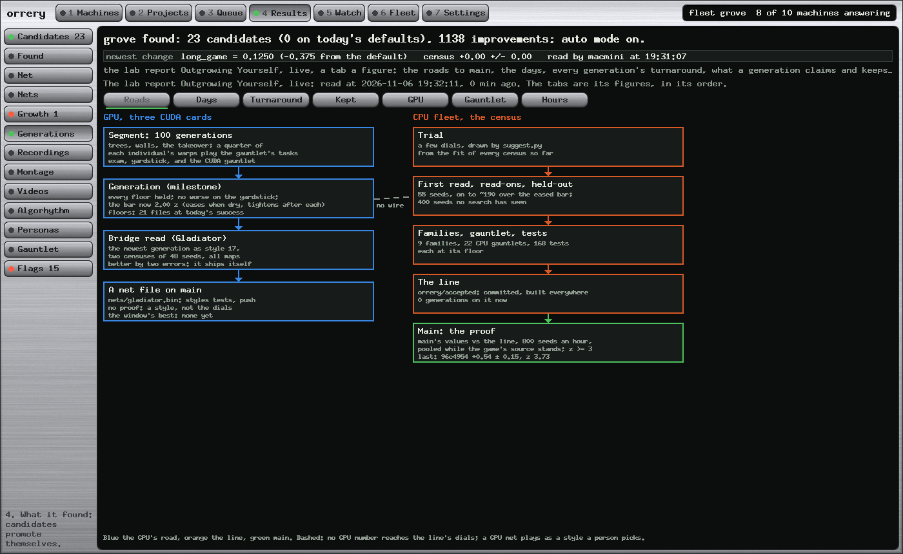<br><b>Results, Generations.</b> The two roads, live, with today's numbers in every box.</td>
<td>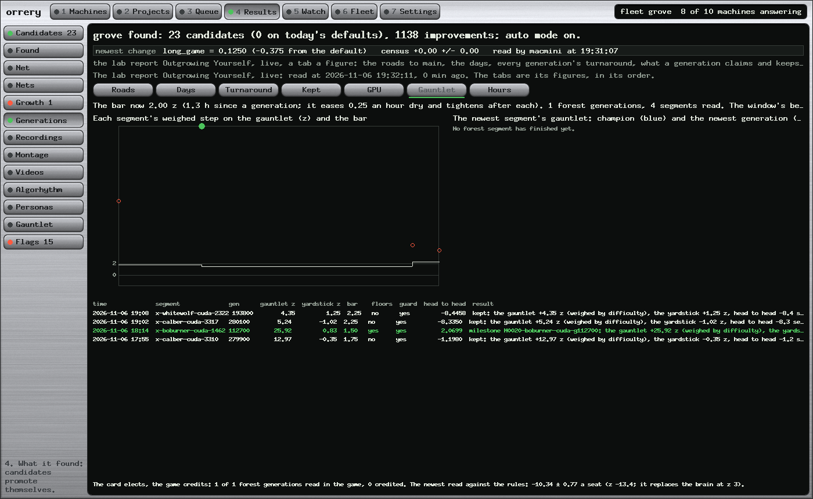<br><b>Generations, Gauntlet.</b> Each GPU segment's step against the bar, and why it was or was not elected.</td>
</tr>
<tr>
<td>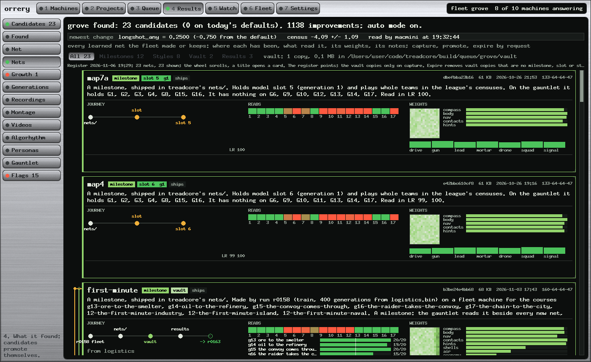<br><b>Results, Nets.</b> Every learned net: where it has been, what read it, its weights.</td>
<td>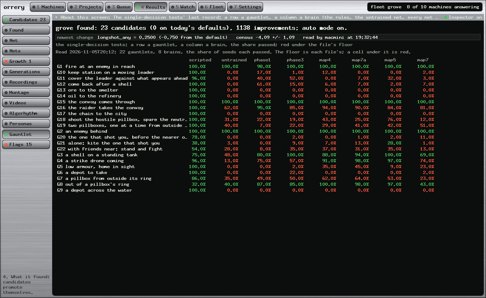<br><b>Results, Gauntlet.</b> A row a test, a column a brain, red under the floor.</td>
</tr>
<tr>
<td>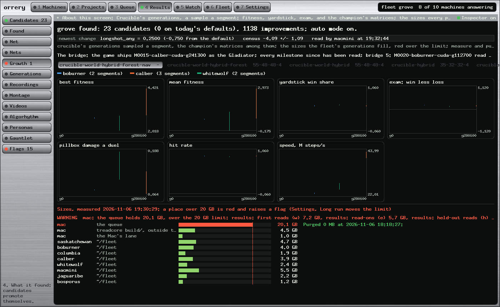<br><b>Results, Growth.</b> crucible's islands as they grow, and the disks they fill.</td>
<td>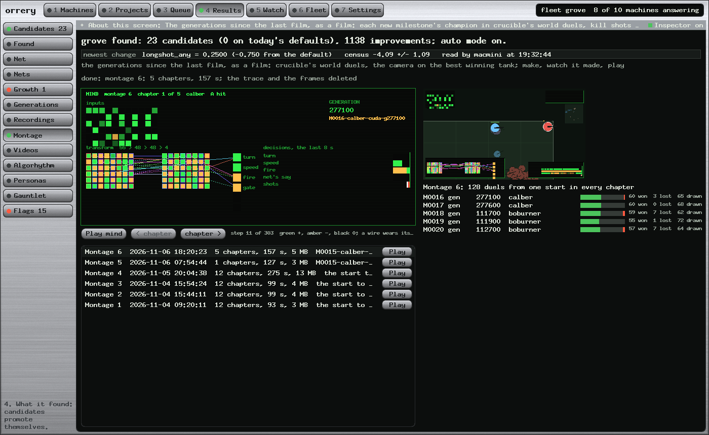<br><b>Results, Montage.</b> The generations as a film, the net thinking in the corner.</td>
</tr>
<tr>
<td>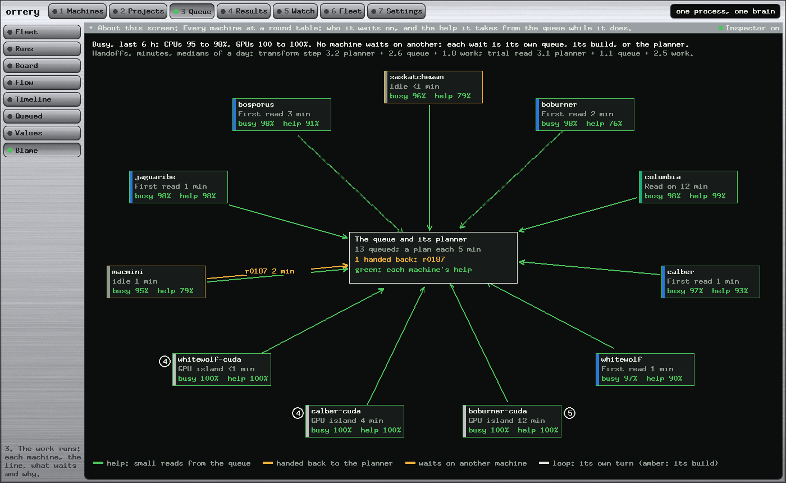<br><b>Pipeline, Blame.</b> Who waits on whom, and who helps.</td>
<td>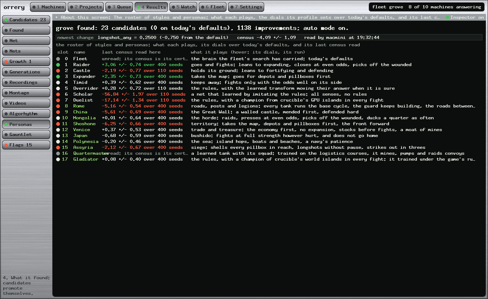<br><b>Results, Personas.</b> The styles the census plays against, the Gladiator among them.</td>
</tr>
</table>

[docs/FEATURE_GUIDE.md](docs/FEATURE_GUIDE.md) tours every chapter and every
page in pictures, from the live queue; [orreryq.com](https://orreryq.com) has
the rest.

## What it makes

The fleet's work ends in a commit, but on the way it leaves pictures, and they
are how a person can tell whether a generation learned anything.

<table>
<tr>
<td width="50%">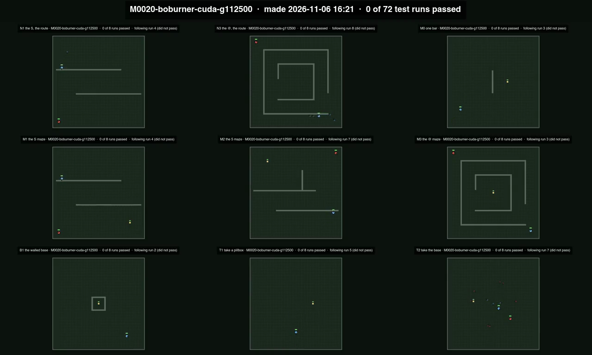<br><b>Every generation on film.</b> Each new GPU milestone is traced on twelve tests, eight runs each, and filmed as a sheet; the reel adds each one as it comes. <code>tools/report/footage.py</code></td>
<td width="50%">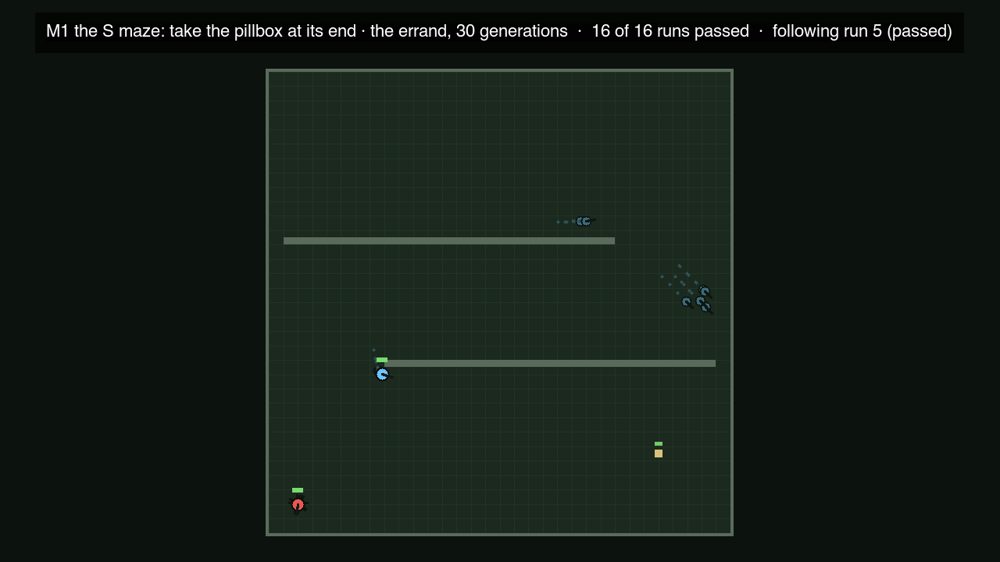<br><b>Round the corner.</b> A trained net in the S maze, its route drawn: crucible's mazes teach a tank to find a way it cannot see.</td>
</tr>
<tr>
<td>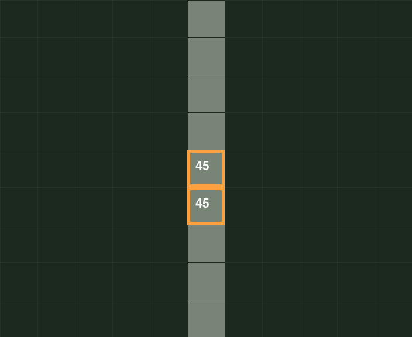<br><b>The wall rule.</b> Two aimed shells fell a wall tile and its neighbour, in crucible and in the game alike.</td>
<td>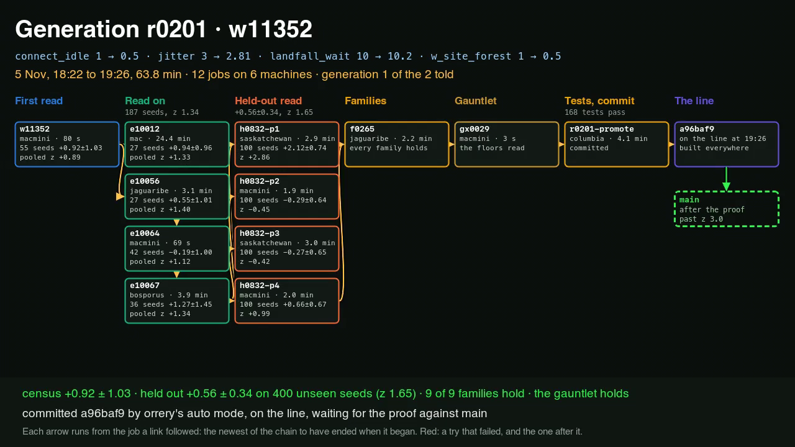<br><b>A generation's road.</b> One promotion's jobs as a chain, each box a job with its machine and its minutes.</td>
</tr>
</table>

Each net also gets a card (`tools/report/netcard.py`): its forebear, the
election that made it, its shape, the build's flags, the seed, the crucible
commit, the tasks it trained on and each gauntlet file's share. The lab
reports, one question each and IEEE in form, are collected at
[docs/reports.html](https://orreryq.com/docs/reports.html); every report page
has a **Read along** button that scrolls it at reading speed and plays each
film as it comes into view, and `tools/report/teleprompt.py` turns the same
page into a small video.

## The console underneath

The console began as something else: the console of the Copal fleet, a
museum's room of small Linux machines — the wall, the seat, the museum
interface, and the verbs that act on a room full of machines. The queue grew inside it, and
everything below is still true of it.

### What it is

§12 of `copal-alpine-linux/docs/fleet-plan.md` names three faces on one read
model. This repository is two of them and then some:

| | | |
|---|---|---|
| **the wall** | `orrery --listen` | the web console: a page the gallery screen and a phone can open |
| **the seat** | `orrery --seat ID` | one node, full screen, in the terminal you are already in |
| **the museum interface** | `orrery --gui` | a native window: a room of machines, a row of verbs, and the panes they open |

All three render the same read model, and that model is `copal fleet state` and
nothing else.

[docs/MUSEUM_GUIDE.md](docs/MUSEUM_GUIDE.md) is a tour of all three in pictures, taken from the demo fixture.

### The rule it inherits

`copal-fleet-console.py`'s acceptance test was architectural: it opens no
socket, holds no credential, knows no subject names, and every screen is a
rendering of a command a person could have typed.

**Two of those four are no longer true, and the change was deliberate.** The
seat opens a socket to one node's screen; the museum interface opens SSH, SFTP
and RDP with the operator's own certificate. What is intact is the part that
mattered: **how the console learns things.** Every node id, address and fact
comes out of `copal fleet state`; a node that is not in that document cannot be
dialled, and there is no second way of knowing anything. A console that
discovered nodes for itself would be a second fleet.

### Two postures

Read-mostly is a default, not a ceiling. A gallery screen and a phone on a
lanyard are two audiences with different rights.

| | | |
|---|---|---|
| **gallery** | default | State, thumbnails. No verb that changes anything. |
| **operator** | `--operator TOKEN` | The write verbs as well. |

Without a token the write route **does not exist** rather than answering 403 —
a route that says "forbidden" tells a scanner it is there. In the native
window the same rule takes a different shape: the gallery posture's dispatch
table is empty, so a keystroke that would have been a verb finds nothing to
call.

### No dependencies, and that is the design

`copal-build` compiles the checkouts in `~/code` on the node itself, and a
fleet node is on a LAN that invariant 6 says never reaches the internet. A
dependency is therefore a crate fetch that fails on the one machine this is
meant to run on.

So everything is here: HTTP, JSON, Wayland, AppKit through the Objective-C
runtime, a software canvas, two bitmap fonts, SHA-2, X25519, Ed25519,
ChaCha20-Poly1305, AES-GCM, SSH-2, SFTP, TLS 1.3, X.509 and RDP. **42,400
lines of Rust and an empty `[dependencies]`.**

| | |
|---|---|
| Binary, release, stripped | 1.7 MB |
| Resident, serving the wall | 1.1 MB — against 22 MB for the Python prototype |
| Tests | **436** in the source, the compositor's among them, which run on Linux |

The honest exception is declaring functions from libraries the machine already
has: `src/sys.rs` names nine libc functions for Wayland, `src/mac.rs` names
AppKit and CoreGraphics, `src/pty.rs` names `openpty`. Nothing is fetched and
nothing is vendored.

### The museum interface

```sh
./target/release/orrery --gui --demo --operator x
```

A room of machines. Click tiles, or click a scene or a tag in the rail to
select everything running it. The bar under the lab shows the verbs that can
apply to *that* selection, and the footer says how many are not built.

| verb | | what it opens |
|---|---|---|
| **Control** `c` | one node | the node's desktop, over RDP with mutual TLS |
| **Terminal** `t` | one node | a shell, in a pane, with no password asked |
| **Exchange** `e` | one node | a two-pane file browser over SFTP |
| **Send** `s` | many | one file to every selected node, with a per-node result |
| **Message** `m` | many | a banner on every selected screen |
| **Run** `r` · **Scene** `S` | many | the CLI's own verbs, per node |
| **Snapshot** `k` · **Power** `p` | many | as above, and `power on` is the supply rather than ssh |
| **Observe** `o` | — | **refused**, and §5 of `docs/console.md` says why |

A verb with no transport is **absent rather than greyed**: the status line says
how many, and the bar never draws a button that cannot work. There is one pane
at a time and never a window inside the window.

Command and a digit opens a chapter: 1 Machines (with Media and Storage),
2 Projects, 3 Queue (with the Pipeline), 4 Results, 5 Watch (the Lab and
Sessions), 6 Fleet (Orchestrate and Chat), 7 Settings. **Media** is the SD-card
ledger: which card carries which token, which have been written, and a pane
that runs `copal-prep.sh` on a real terminal so that its two typed `ERASE`
confirmations happen where they always did. Nothing is answered on the
operator's behalf and there is no `--yes`.

**Machines** is a fresh install to a fleet node. After the stick
(Copal, or Ubuntu 24.04 with OpenSSH) and `ssh-copy-id`, a machine is added
by its address; orrery reads it (system, CPU, GPU, driver, CUDA, Rust, the fleet's
tools) and shows each of its setup recipes (`tools/fleet-node.sh` or, on
Copal, `copal-node.sh`, `cuda-node.sh`, `fleet-login.sh`,
`fleet-poweroff-setup.sh`, and the errand `fleet-update.sh`) as applied or
not, read from what each leaves behind. **Apply** is hard to press: a
screen with the machine, what the recipe does, its files and their sha256
and the exact command, and its button lit only when the machine's name is
typed. The files are copied and checked on the machine; the command is
typed into the machine's Sessions tile, in a window of its own, where the
operator types the sudo password; orrery never holds one. **Join** adds it
to the queue and the Sessions grid, with the same kind of confirmation.
`tools/machines.py` does the work.

`--frame PATH` renders any of it to a PPM and exits — no compositor, no window,
no node. Every screenshot in `docs/` is a file this produced.

### The wire

Five protocols, written by hand, each proved against somebody else's
implementation rather than against a fake of its own assumptions.

| | | proved against |
|---|---|---|
| `src/crypto.rs` | the primitives | published test vectors — RFC 7748, 8032, 8439, FIPS 180-4 and 197, the NIST GCM cases |
| `src/ssh.rs` | SSH-2, certificates only | **a real `sshd`** in a container, plus a hand-written server for the lies a real one will not tell |
| `src/sftp.rs` | SFTP v3, pipelined | **OpenSSH's own `sftp-server`** over a pipe — no fake at all |
| `src/tls.rs` + `src/x509.rs` | TLS 1.3, one suite | **`openssl s_server`**, including mutual TLS and an AES-only server being refused |
| `src/rdp.rs` | RDP over TLS | **xrdp** — 1024×768, 137 rectangles, all of them RLE compressed |

`src/profile.rs` is the whitelist: one key exchange, one host-key algorithm,
one signature algorithm, one cipher offered. A test fails the build if `sha1`,
`cbc`, `rc4`, `ssh-rsa` or `ecdsa` ever appears on a list, and
`orrery --profile-sshd` prints the same list as `sshd_config` lines —
which `copal-prep.sh` writes into the node and `make lint` checks for drift.
**A whitelist that exists in a Rust file and again in a shell heredoc is two
whitelists.**

The host key must be a certificate signed by the fleet CA, naming that node,
valid now, with the far end proving it holds the key. There is no
trust-on-first-use, no prompt, and no bare-key branch to fall back to.

### The seat

The wall is eight nodes at a glance. The seat is one node, full screen, in the
terminal you are already in.

```sh
./target/release/orrery --seat museum-01
```

| | | |
|---|---|---|
| **Observe** | `o` | the node's screen, read-only |
| **Control** | `c` | keyboard and pointer as well; `Ctrl-]` lets go |
| **Exchange** | `e` | not built here — the native window has it |
| **Terminal** | `t` | not built here — the native window has it |

It renders with half-blocks (`U+2580` and 24-bit colour) anywhere, and with
sixel where the terminal has it. `--fps` asks the node for a frame rate; the
default is 6, because §III-B's finding is that frame rate is the expensive
axis.

The seat speaks RFB security type `none`, or VNC authentication with the
fleet's screen password: `COPAL_FLEET_REMOTE_PASSWORD` in the copal checkout's
`answers.txt`, the one copal-remote starts x11vnc with. That scheme is 56-bit
DES and an eight-character password — a lock, not security — so it lives in
`rfb.rs` alone, off every list in `profile.rs`, proved against a real x11vnc by
`tools/vnc-check.sh`. It asks for Raw and CopyRect only, because every
compressed encoding wants zlib.

### The native window, underneath

`--gui` is a Wayland client on a node and an AppKit window on a Mac, behind one
`Surface` trait. **The drawing is all software and there is no renderer
underneath it**: a shared-memory surface is a flat array of pixels, so
`draw.rs` writes them. On a Zero 2 that is the right trade twice — a wall of
flat rectangles and small text costs almost nothing to rasterise, and the EGL
stack it avoids is both a dependency and a thing that fails differently on
every board.

**The letters are baked in.** `src/font.rs` carries two faces of the X.Org
*misc-fixed* font, generated from the PCF by `tools/mkfont.py` and committed,
because `copal-build` on a node must not need Python or a font package. Past
Latin-1 exactly seven characters are baked, each one the console actually
prints — and a test fails the build if the interface reaches for an eighth.

**The session word decides the protocol, and that used to be unresolved.**
`/etc/copal/session` holds one word: `x11` means x11vnc and RFB, `wayland`
means an RDP server and `rdp.rs`. Neither is a fallback for the other. The
console reads the node's own `remote` reading rather than probing a port —
`off`, `not installed`, `vnc:5900` and `rdp:3389` are four different sentences.

### Running it

```sh
cargo build --release

# the lab report's museum, from a fixture -- no fleet required
./target/release/orrery --demo                       # the wall, on a port
./target/release/orrery --gui --demo --operator x    # the museum interface

# against a fleet
./target/release/orrery --listen 0.0.0.0:8080
./target/release/orrery --gui --operator x --copal ~/code/copal-alpine-linux
./target/release/orrery --seat museum-01

# the node's sshd policy, rendered from src/profile.rs
./target/release/orrery --profile-sshd

cargo test
```

The suites that need somebody else's server run in containers, one script
each, and they step aside when what they need is absent:

```sh
docker run --rm --platform linux/arm64 -v "$PWD":/w -w /w \
    -e CARGO_TARGET_DIR=/tmp/t rust:alpine sh /w/tools/wl-check.sh   # weston
#                                             ... /w/tools/ssh-check.sh  # sshd
#                                             ... /w/tools/tls-check.sh  # openssl
#                                             ... /w/tools/rdp-check.sh  # xrdp
```

#### On a Mac, as an application

```sh
make install OPTIONS="--operator paul --fleet grove \
    --fleet-cmd '$HOME/.local/bin/copal fleet' \
    --queue '$HOME/code/treadcore/build/queue/grove'"
make install        # after pulling: the same options, the new build
make uninstall
```

builds orrery (under `tools/mem-guard.sh`), installs `~/.local/bin/orrery`,
and makes **Orrery.app** in `/Applications` (or `~/Applications` where that is not writable), signed ad hoc, which opens the
window with those options from Finder, Launchpad, Spotlight or the Dock. The
options are kept in `~/.config/orrery/app-options`, so a plain `make install`
keeps them. orrery's output goes to `~/Library/Logs/orrery.log`. On Linux,
`make install` puts the binary in `~/.local/bin`.
`docs/mac-app-lab-report.md` records how the app is made and what an ad-hoc
signature allows; `docs/appkit-gui-lab-report.md` teaches the window itself,
from `cargo new` to the app, with a 602-line example to start from
(`docs/appkit-example/`).

### Layout

| | |
|---|---|
| `src/main.rs` | argument handling, the routes, the two postures, the frame loop |
| `src/http.rs` · `src/json.rs` | the subsets of HTTP/1.1 and JSON this needs |
| `src/fleet.rs` | the read model, the timed subprocess, the museum fixture |
| `src/verbs.rs` | the allow-list, which is the security boundary |
| `src/profile.rs` | the crypto whitelist, versioned, shared with the node |
| `src/crypto.rs` | the primitives, every one with a published test vector |
| `src/ssh.rs` · `src/sftp.rs` | the transport, and files over it |
| `src/tls.rs` · `src/x509.rs` | TLS 1.3, and the certificates it checks |
| `src/rdp.rs` · `src/rfb.rs` | the two remote-desktop protocols |
| `src/surface.rs` | the seam: a window, its pixels, and its input |
| `src/wl.rs` · `src/mac.rs` | Wayland by hand, and AppKit through the runtime |
| `src/draw.rs` · `src/font.rs` · `src/ui.rs` | the canvas, the glyphs, the toolkit |
| `src/lab.rs` · `src/nav.rs` | the museum interface and the view strip |
| `src/media.rs` · `src/pty.rs` | the card ledger, and a child on a real terminal |
| `src/files.rs` · `src/screen.rs` | the file browser, and a desktop in a pane |
| `src/seat.rs` · `src/paint.rs` | the terminal seat: the tty, the keys, the pixels |
| `src/keymap.rs` · `src/sys.rs` | the keyboard, and the syscalls `std` does not expose |
| `src/training.rs` · `src/pipeline.rs` | the Queue and Results chapters, and the Pipeline: one process on one screen |
| `src/generations.rs` · `src/nets.rs` · `src/growth.rs` | Results: the generations, the learned nets, crucible's islands as they grow |
| `src/montage.rs` · `src/videos.rs` · `src/recordings.rs` | the films, and the recordings the nets are cloned from |
| `src/analysis.rs` · `src/line.rs` | the Algorhythm page's terrain and spectrum; the line, in words |
| `src/machines.rs` · `src/projects.rs` · `src/storage.rs` · `src/sessions.rs` · `src/orchestrate.rs` | a fresh node, the projects, the disks, the terminals, the fleet as commanders |
| `tools/fleet-queue.py` · `tools/plans/treadcore.py` | the keeper, and the planner it asks each pass |
| `tools/report/` | footage, net cards, the montage, the lab reports and the read-along |
| `tools/mkfont.py` | turns an X11 PCF font into `src/font.rs` |
| `tools/*-check.sh` | the suites against a compositor, an sshd, openssl and xrdp |
| `assets/wall.html` | the page — one file, no CDN, no build step |
| `index.html` · `docs/site/` | orreryq.com: the landing page, its pictures and the guide's diagrams |
| `docs/` | the design set; `docs/plan.md` is the board, `docs/writeup.html` is the account of the build, `docs/refactor.md` is what to do next |

### What it does not do, deliberately

- **The wall does not proxy VNC.** §III-B priced eight VNC sessions on 512 MB
  boards that are also computing and refused them. The page hands the browser
  the node's own server; a console that tunnelled pixel traffic would put
  itself in the exhibit's frame budget.
- **It does not cache state.** `copal fleet state` is the answer, and a cache
  is a second place the fleet's state lives and a thing that goes stale.
- **It does not offer Control on a selection.** Broadcasting keystrokes to
  eight machines produces divergent state nobody can see; the operation
  actually wanted is Scene or Run, which are declarative and report per node.
- **It never mints a credential.** The fleet CA signs; this console
  distributes and verifies. A program holding both would be a program worth
  stealing.
- **It does not decode H.264.** A video codec has no small correct subset and
  `libavcodec` is not on an Alpine node, so RDP negotiates plain bitmaps with
  RLE. `docs/wire.md` §6 has the arithmetic.

### Still open

- **Nothing here has run on a Raspberry Pi.** The whole program cross-compiles
  to `aarch64-unknown-linux-musl` and its Linux suite passes in a container on
  this Mac, which is not the same claim.
- **No node has ever run `hypr-rdp`.** `rdp.rs` is proved against xrdp, which
  is a different implementation by other people and is not the one a Wayland
  node will run. R1 and R2 in `docs/wire.md` are unchanged.
- **An RDP server may refuse an Ed25519 certificate.** FreeRDP's does: it
  derives channel bindings by hashing the certificate with the digest named in
  its signature algorithm, and Ed25519 names none. R5 in `docs/wire.md`.
- **The operator has no X.509 certificate yet.** Mutual TLS works and the fleet
  CA is an SSH CA; issuing X.509 from it needs an ASN.1 writer beside
  `sign_one()`. Until then Control refuses with a sentence naming the file it
  wanted.
- **AES-256-GCM runs at half a megabyte a second.** It is a constant-time
  circuit rather than a table, and it is the compatibility path rather than a
  transport. R4 in `docs/wire.md`, and `tls.rs` offers ChaCha alone because of
  it.
- **Observe is refused rather than unbuilt**, and the difference matters:
  nothing produces a thumbnail and nothing will, because a node capturing its
  screen every few seconds is a capture daemon on every machine in the museum.
  `fleet-control.md` §9 records the shape that would fit instead.
- **A console served *by* the warden disappears when the warden does.** The
  election exists, so the fix is a second instance or a name that follows the
  role. Unresolved — and the native window sidesteps it by running on the
  operator's own machine.

MIT. Copyright (c) 2026 Paul Richeson.
