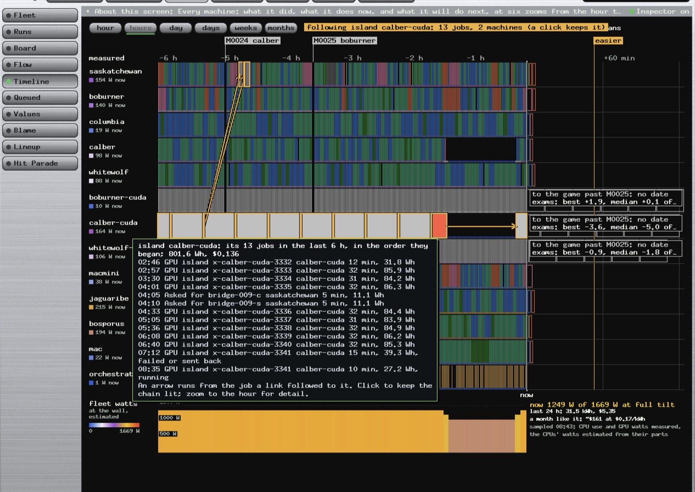
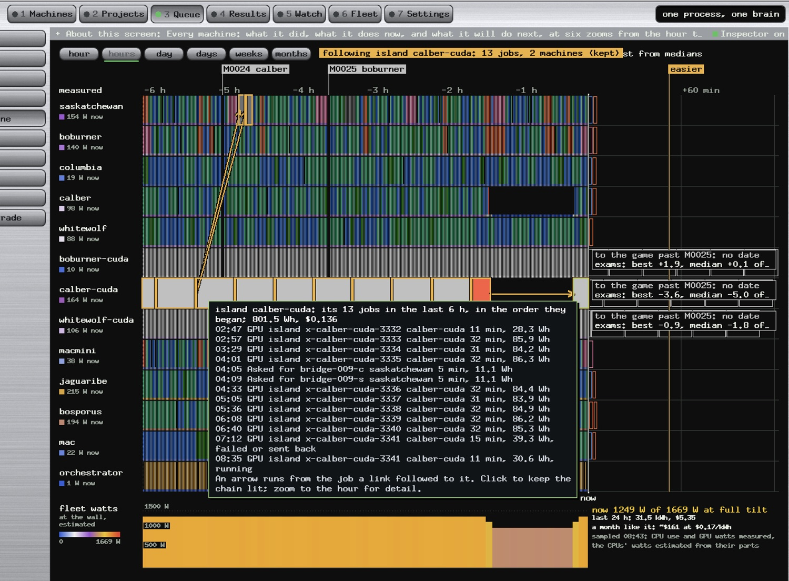

# The Orange Bar Was the Power Cut: What calber Was Doing When It Lost Power, and Where It Picked Up Again

*Paul Richeson · Lab Report — IEEE Format · 7 November 2026*

Copyright (c) 2026 Paul Richeson. MIT licensed, as orrery.

Companions: `docs/calber-bios-recovery-lab-report.md` (the repair: the CMOS clear, the BIOS put back, the checks after a power cut), which follows this report; `tools/fleet-queue.py` (how a lost machine's jobs go back on the queue); `src/pipeline.rs` (the Timeline and its colours); crucible's `src/crucible.cu` (the island's checkpoint).

---

## Abstract

calber lost power at about 07:27 PST on 7 November with both of its lanes busy: the CPU lane had started a census seconds earlier, and the GPU lane, `calber-cuda`, was 14 minutes into the 32-minute crucible segment `x-calber-cuda-3341`. The orange-red bar on the Timeline is that CUDA segment. **It is not another kind of task.** The Timeline paints any job that ended "failed or sent back" in its alarm colour instead of its stage colour, and the keeper sent this one back at 07:27:50 when calber stopped answering. calber did not cause the cut, and the job had not finished. The last power sample, at 07:25:52, read the GPU at 140.6 W and 100% busy, the same as every segment before it. The last boot's journal holds no error after 04:11. The kernel logged no GPU fault. The segment before it had ended normally at 07:13:01.

calber's own disk dates the cut more closely than the keeper can. The census it began at 07:26:43 left twelve files whose names and times reached the disk but whose contents never did. **The last timestamp written is 07:26:47.68. Everything written at 07:26:43 should have been flushed by about 07:27:18, so the cut came between those two times.**

The fleet is recovering where it left off. The island's checkpoint, `island.state`, was written at 07:13:00.98, fourteen minutes before the cut, and is intact. The rerun of segment 3341 started at 08:36:15 and resumed at generation 282,400, the first generation after segment 3340's last. About 49 generations were lost, roughly 14 minutes of the GTX 1080 Ti's work and 39 Wh. The interrupted census was rerun on jaguaribe within two minutes.

The picture changed in two ways. Its six-hour window slides forward, so a job at its left edge shrinks, and every clock time in the tooltip can read up to a minute early. Then there is one true repaint after the fact: until 07:27:50 the segment was drawn as running, and after that it was drawn as sent back.

The clear also changed some firmware settings that Linux can see. The firmware TPM and SGX went off, and CSM probably went on. The boot entries and the clock survived, against what the recovery guide expected. One risk is left open: crucible writes the island's only checkpoint in place, so a cut during the half-minute after a save would lose about 14 hours of the island's work.

## I. Introduction

calber is the fleet's Gigabyte Z370 machine with an i7-9700F and a GTX 1080 Ti. It runs two lanes: a CPU lane that takes census and weights jobs, and `calber-cuda`, which runs crucible's maze-navigation island one segment at a time, 100 generations a segment. Paul found it hung at the BIOS banner after the power cut and brought it back with a CMOS clear. The companion report records that repair. This report asks what the queue's records and calber's own logs say about the hour. Paul's questions, in his words:

> "I see the calber has some orange, I'm wondering did calber create an issue, or did it just finish just before the power was cut."

> "Find out if we are recovering where we left off. Explain how and why calber was working on an orange task instead of CUDA."

> "Or did the image of the way I see change retroactively?"

He means the black stretch on both calber lanes. It is the time between the cut and the repair, "my lab report response time".

## II. Method

Everything was read without root and without changing anything on calber, except one `fwupdmgr get-updates`, which only reads:

- the queue's `events.jsonl` (when each job started, ended or was sent back), `plan/power-samples.jsonl` (the 5-minute power samples) and `logs/x-calber-cuda-3341.log` (both attempts of the segment);
- calber's journal for three boots: the one that lost power (`-b -2`, 1 to 7 November), a two-minute boot at 08:28 (`-b -1`) and the boot that came back (`-b 0`); `journalctl --list-boots`;
- file times on calber, to the nanosecond, under `~/fleet/q-grove`, and the header of each `island.state`;
- the kernel's boot log before and after the clear, compared line by line; `nvidia-smi`, `efibootmgr`, `mokutil`, `lspci`, `lsblk`, `/proc/meminfo`, sysstat's memory history;
- the Timeline's code: the colour rule and the tooltip's clock (`src/pipeline.rs:1247`, `:1611`); the keeper's ssh options and its requeue rule (`tools/fleet-queue.py:128`, `:952`); crucible's save and load (`src/crucible.cu:3099`, `:2788`).

calber keeps its clock in UTC and the fleet's records use the Mac's PST, eight hours behind. **Every time in this report is PST.**

**What could not be read.** Root-only checks: the NVMe and SATA SMART logs and `sshd -T`. `dmidecode` was read later by Paul (Section III.G). The BIOS screens themselves. The first attempt's own output: the job's `gens.tsv` and `console.txt` were overwritten by the rerun, and its `# ` lines were still in a pipe's buffer when the power went.

## III. Results

### A. The minute of the cut

| Time | Event | Basis |
| --- | --- | --- |
| 07:13:00.98 | Segment 3340 saves `island.state` (141,705,260 bytes, generation 282,400) | file time on calber |
| 07:13:01 | 3340 done, 1,911.7 s | event |
| 07:13:08 | 3341 starts on `calber-cuda` | event |
| 07:14:09 | GPU 21.2 W, 0% busy: the segment loading its state and ladder | power sample |
| 07:19:39 | GPU 85.0 W, 100% | power sample |
| 07:25:01 | Last line in calber's journal (a cron session) | journal `-b -2` |
| 07:25:52 | GPU 140.6 W, 100%, CPU 41%: the last sample answered | power sample |
| 07:26:37 | Weights job `w13627` done on calber's CPU lane | event |
| 07:26:43 | Census `e12793` starts; calber creates its trial file and census folder | event; file times |
| 07:26:47.68 | The last time written to calber's disk: two game logs created | file times |
| about 07:26:48 to 07:27:18 | **The cut** | inferred, below |
| 07:27:50 | The keeper's shared ssh connection gives up; both jobs are sent back, "host unreachable" | event |
| 07:28:39 | `e12793` starts on jaguaribe; done at 07:30:32 | event |

calber's disk records the cut in the files that census `e12793` wrote in its first four seconds. The trial file and all twelve files of its census folder exist with correct names and times, and **every one of them is 0 bytes**. That is how ext4 loses a file whose data were still in memory. A file's name and times reach the disk at the journal's next commit, within 5 seconds. Its data are written only when they have been dirty for 30 seconds (`vm.dirty_expire_centisecs` 3000, checked every 5). The time 07:26:47.68 reached the disk, so calber was running then. The contents written at 07:26:43 did not, so the power was gone before about 07:27:18. The journal ends at 07:25:01 because nothing logged in the two minutes after that, not because anything was lost.

The keeper heard about the cut late, and about both lanes at once. Every ssh to calber shares one connection (`ControlMaster auto` in `~/.ssh/config`). The keeper's `ServerAliveInterval=30` with ssh's default three tries allows up to 90 seconds of silence before giving up. When that connection gave up at 07:27:50, both sessions ended with ssh's code 255. The keeper takes 255 as the network's failure, not the job's, so it put both jobs back on the queue (`fleet-queue.py:952`).

### B. What the orange bar is

*Fig. 1. The Timeline at about 08:43, following the island `calber-cuda`. The bar before calber's black gap is the first attempt of segment 3341. The amber arrow runs from it, across the gap, to the same segment's rerun at 08:36. The tooltip lists the island's 13 jobs, including the two bridge reads on saskatchewan that belong to its chain.*

The Timeline colours a bar by its stage. A job that ended badly gets the alarm colour, `#ff723e`, instead:

    ui.c.rect(r.x, r.y, r.w, r.h, if j.ok == 0 { t.alarm } else { line::colour(&j.stage) });

The key under the hour zoom says so: "Red: failed or sent back." The orange-red bar is the CUDA job `x-calber-cuda-3341`, "crucible island calber-cuda, segment 3341", the same command as the ten grey segments before it. **calber's GPU never ran anything else.** The tooltip line "07:12 GPU island x-calber-cuda-3341 calber-cuda 15 min, 39.3 Wh, failed or sent back" is that job's first attempt. The line "08:35 ... running" is its second.

The colour cannot say which of the two endings happened. The events can: this one was sent back for "host unreachable". A job that failed on its own would be logged `failed` with its exit code.

### C. Did calber cause it, or had the job just finished?

**Neither.** The evidence:

| Question | Reading |
| --- | --- |
| Had 3341 finished? | No. It had been running 13 min 40 s to 14 min 10 s when the power went, against 1,911.7 s (31.9 min) for 3340 and 1,933.5 s for 3339. The job that had just finished was 3340, at 07:13:01, fourteen minutes earlier. |
| Was the GPU doing anything unusual? | No. The samples in the 3340 and 3341 segments read 136.3 to 144.1 W at 100% busy. The last one, 07:25:52, read 140.6 W. The ten segments before it took 31 to 32 minutes and 83.9 to 86.3 Wh each. |
| Did the GPU fault? | No Xid line in the boot that lost power or in this one. `nvidia-smi` now reads 59 °C, 141 W, P2, PCIe gen 3 ×16, with no error. |
| Did Linux see trouble coming? | No. The last boot's journal has one error after midnight, `motd-news` failing at 04:11, and no warning at all after 07:00. It has no thermal message and no out-of-memory kill. It also has no shutdown sequence: it simply stops. |
| Did the job fail by itself? | No. The keeper logged `requeued ... host unreachable` for both lanes at the same second. A job that crashed would have been logged `failed` with its own exit code, and would not have taken the CPU lane's census with it. |
| Was it the whole fleet? | No. No other machine reported unreachable, and every other lane kept finishing jobs through the hour. |

From the logs, a mains cut, a tripped strip or breaker, and a supply that switched itself off all look the same. Each is local to calber. Paul's reading at the machine is mains. The load at the moment of the cut was the load calber had carried all day.

### D. Did the picture change after the fact?

*Fig. 2. The same view a few minutes later, with the chain kept by a click. The same 13 jobs, in the same order, with three small differences, explained below.*

Comparing the two pictures:

| Row | Fig. 1 | Fig. 2 | Why |
| --- | --- | --- | --- |
| 3332 | 02:46, 12 min, 31.8 Wh | 02:47, 11 min, 28.3 Wh | It began at 02:25:41, before the six-hour window. The window's left edge moved, so less of the job falls inside it. |
| 3334, bridge-009-s | 03:30, 04:10 | 03:29, 04:09 | They began at 03:30:27 and 04:10:28. The tooltip's clock reads up to a minute early and can change between redraws (below). |
| 3341, rerun | 10 min, 27.2 Wh | 11 min, 30.6 Wh | It is still running, so it grows. |
| Total | 801.6 Wh | 801.5 Wh | The 3332 trim (−3.5 Wh) against the rerun's growth (+3.4 Wh). |

**Nothing in the past was rewritten between the two pictures.** The window slides, and the job at its edge shrinks.

The clock is a small fault of its own. `clock()` (`src/pipeline.rs:1611`) adds a job's offset in minutes to the minute the planner wrote the page, dropping that minute's seconds, and then truncates. So a start time reads up to a minute early: 07:12 for 07:13:08, and 08:35 for 08:36:15.

**There is one true repaint after the fact.** A bar's colour depends on how the job ended, and the ending is known only at the end. Looked at between 07:13 and 07:27, the first attempt of 3341 would have shown as a growing bar in the island's own colour, marked "running". From 07:27:50 on, the same span is drawn in the alarm colour. The arrow across the black gap appeared with the rerun at 08:36. It is the chain link from the job to the next job in the island's chain, here the same segment again.

The black on both calber rows is not a colour the Timeline chose. It is the background showing where no job ran: from 07:27:50 to 08:36:15 on the GPU lane, and to 08:36:28 on the CPU lane. The fleet watts graph drops by calber's share over the same stretch.

### E. Are we recovering where we left off?

**Yes, from the last segment boundary.**

| Check | Reading |
| --- | --- |
| The checkpoint | `crucible-world-hybrid-forest-nav/island.state`, written 07:13:00.98, header: v3, 5,766 weights, population 2,048, hall 4,096, generation 282,400. It is fourteen minutes older than the cut, long since on disk. |
| The rerun read it | Its console: "resumed .../island.state at generation 282400, 4096 in the hall of fame". Its first row is generation 282,400. Segment 3340's last was 282,399. |
| The rerun's pace | 49 generations (282,400 to 282,448) by 08:50:00, 13¾ minutes after it started. That is the normal pace. GPU 142 to 144 W at 100% busy in the 08:43 and 08:49 samples. |
| What was lost | The first attempt's progress past 282,400. By the rerun's own pace, about 49 generations in 14 minutes and 39.3 Wh (the Timeline's estimate). Then 68 minutes with nothing on either lane. |
| The CPU lane's job | `e12793` was rerun whole on jaguaribe, 07:28:39 to 07:30:32. Nothing of it was lost. |
| The job's record | The segment carries `ssh_tries: 1`. The keeper sends a job back for ssh's failure three times at most, then counts it failed. |
| Left behind on calber | `~/fleet/q-grove/trials/e12793.weights` and the census folder `c/fd7b36d/wt/build/census/20261107-152643`, thirteen 0-byte files. They are harmless: a census takes the newest folder, and this is the oldest. They are not removed. |

**The rerun is not a copy of the lost attempt.** It reads the same checkpoint with the same seed, 8275, but the two imported champions are sent fresh from the Mac's `latest/` at each start. So it is a new run from the same point, which is all a segment needs.

### F. What the 69 minutes held

| Time | Boot | Reading |
| --- | --- | --- |
| about 07:27 | — | The cut |
| 07:27 to 08:28 | — | Paul at the machine: the hang at the AMI banner, the CMOS clear, the board cycling |
| 08:28:34 | `-b -1` | First boot after the clear. **No SATA drive linked (ata1 to ata6 down), and the network port had no carrier.** It was minimal hardware, as the recovery guide's one-piece-at-a-time order says. The clock was right: the chip read 16:28:28 UTC. |
| 08:28:34 | `-b -1` | First boot's checks: the EFI partition's FAT had its dirty bit set (it was mounted when the power went), and fsck removed it. Root ext4 was checked in the initramfs and mounted cleanly. |
| 08:29 to 08:30:43 | `-b -1` | An orderly power-off. The log does not say what asked for it. |
| 08:35:48 | `-b 0` | The boot that came back: all six SATA SSDs, gigabit link, kernel 7.0.0-42 |
| 08:36:11 | — | Keeper: "host back" for `calber-cuda`; 3341 restarts at 08:36:15 |
| 08:36:28 | — | Keeper: "host back" for `calber`; `w13686` starts at 08:36:32 |

From power back to work was 23 seconds once Ubuntu was up: the keeper's lanes had been waiting on the host and took it at once.

### G. What changed under the clear

The kernel's boot log before the cut (`-b -2`, 1 November) and after it (`-b 0`), compared:

| Setting or part | Before the cut | Now | How it shows |
| --- | --- | --- | --- |
| Clock | right | **right**: the chip read 16:28:28 UTC on the first boot after the clear | `PM: RTC time`; `timedatectl` synchronized |
| Boot entries | Ubuntu (`Boot0007`) and old ones | **kept**: `Boot0007* Ubuntu` is current and first; the old Windows, Qubes, debian, endeavouros, XCP-ng and Commodore entries remain | `efibootmgr` |
| Secure Boot | off | off | `secureboot: Secure boot disabled` both times |
| Firmware TPM (Intel PTT) | **on** (ACPI TPM2 table) | **off** ("No TPM chip found") | kernel log |
| SGX | on (launch control locked) | **off** ("disabled or unsupported by BIOS") | kernel log |
| CSM | probably off | **probably on** (a legacy MP table appears now) | kernel log; inferred |
| The PCIe SATA card | JMicron JMB58x (197b:0585) at 04:00.0, 2 ports, carrying one DVD writer (HL-DT-ST GH24NS95) | **out** | `pci` lines; `ata7.00: ATAPI` |
| Memory | 4 of 4 slots, 64 GB | the same (MemTotal 65,778,576 kB); the map below 4 GB is laid out differently | `DMI`, `e820`, `/proc/meminfo` |
| Kernel | 7.0.0-38 | 7.0.0-42, installed by an earlier update and waiting for a boot | `Linux version` |
| GPU driver | 580.178.04 | 580.178.04 | `NVRM` |
| XMP | unknown | **off**: 2400 MT/s at 1.2 V on four 16 GB sticks sold as DDR4-3200 | `sudo dmidecode -t 17`, run by Paul at 09:20 |

So the clear reset setup's own choices, the TPM, SGX and probably CSM, to Gigabyte's defaults. It left the boot list and the clock alone. Nothing on calber uses the TPM: its one encrypted volume, on the HP EX900, is not opened at boot in either log. The guide's settings table covers CSM. It does not mention the TPM or SGX, so the companion report adds them.

## IV. Findings

1. **calber did not cause the cut.** The load, the GPU, the kernel and the journal were all ordinary up to its last minute. Only calber's two lanes went down, and they went down together.
2. **The job had not finished.** Segment 3341 was 14 minutes into 32. The segment that finished was 3340, at 07:13:01.
3. **The orange is CUDA work drawn in the alarm colour.** It is the first attempt of `x-calber-cuda-3341`, sent back at 07:27:50.
4. **The picture's past does not change, except for one thing.** A running bar takes its colour from its ending when it ends. Between Fig. 1 and Fig. 2 only the sliding window and a minute-early clock differ.
5. **We are recovering where we left off**, at generation 282,400, the checkpoint of 07:13:00.98. The loss was about 49 generations and 68 idle minutes.
6. **calber's disk dates the cut** to between 07:26:47.68 and about 07:27:18. The keeper, listening over one shared connection with a 90-second allowance, heard it at 07:27:50.
7. **The island's only checkpoint is written in place.** `crucible.cu:3100` truncates `island.state` with `fopen(..., "wb")`, writes 141.7 MB and closes, with no temporary file, no `fsync` and no rename. A cut in the half-minute before those bytes reach the disk would leave the file short or empty. The next segment's load would then refuse it ("not a crucible state for this --pop and --cap"), and the island would stop. No other copy of the population exists: the Mac keeps the champions, ladder and milestones. The command's fallback is the forest home's state, at generation 279,800 and from an older net shape, and it is used only when the nav home's file is missing, not when it is damaged. One save every 32 minutes, exposed for about 30 seconds, puts roughly one cut in sixty inside that window. The price would be 2,600 generations, about 14 hours of the card.

## V. What Needs a Person

Nothing below has been built. Each item is a proposal for Paul. Every item, with the BIOS visit and the commands, is also kept as one checklist in `docs/calber-todo.md`.

1. **An atomic checkpoint (crucible).** Save to `island.state.tmp`, `fflush` and `fsync`, rename over `island.state`, and keep the previous one as `island.state.prev` so the load can fall back to it. That costs 141.7 MB more on calber's 1.7 TB of free space. This is crucible's code, so it waits for Paul's word.
2. **Say "sent back" apart from "failed" (orrery).** The events already know which happened. The bar could be hollow alarm-coloured for sent back and solid for failed, and the tooltip could say "sent back: host unreachable". Then a power cut would no longer read like a crash.
3. **The tooltip's clock.** Keep the seconds of the planner's time, and round instead of truncating, so 07:13:08 reads 07:13.
4. **The checks that need root**, from the companion report's Section VII: `nvme smart-log` on both NVMe drives (`unsafe_shutdowns` up by one is expected), and `smartctl -a` on the six SATA SSDs. These need Paul's password; both tools are now installed. `dmidecode` is done: XMP is off, and the companion report's Section V weighs turning it on.
5. **The firmware settings the clear reset.** The companion report's settings table, with the TPM and SGX rows it adds. None of them stops calber working. CSM and XMP are the ones to put back first.
6. Optionally, remove the 0-byte debris listed in Section III.E.

## VI. Limitations

- The minute of the cut is inferred from ext4's default timings (5-second commit, 30-second expiry) as calber was configured (`vm.dirty_*`). A burst of other I/O could have flushed earlier, which only narrows the window.
- Mains, strip, breaker and supply cannot be told apart from inside the machine. Paul's account is mains.
- How many generations the first attempt reached is estimated from the rerun's pace, because its output was overwritten and its last lines were still buffered.
- CSM's state is inferred from the legacy MP table, which a board publishes when its compatibility module is on. The BIOS screen would settle it.
- The power-off at 08:29 to 08:30 is in the log as orderly, with nothing saying what started it.

## VII. Future Work

- The atomic checkpoint, and perhaps a daily copy of each island's state to the Mac, so that one disk is not the only record of an island.
- A Timeline mark for "machine lost", drawn across both lanes of a box, separate from a job's own failure.
- A UPS for calber, and the keeper shutting the box down cleanly when the UPS says it is on battery (the companion report, "Preventing a repeat").
