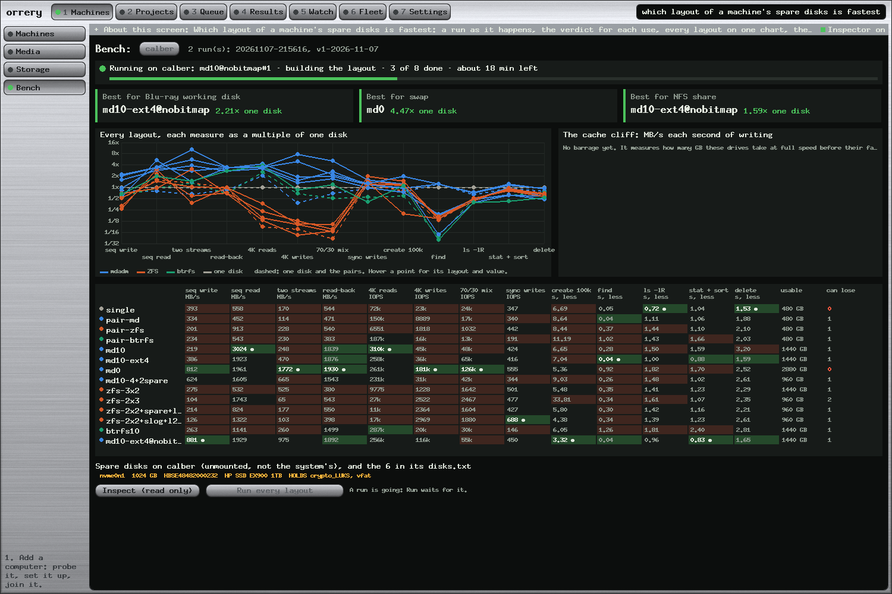

# Six Cheap SSDs, Thirteen Ways: the Fastest Layout for calber's Blu-ray Working Disk

*Paul Richeson · Lab Report — IEEE Format · 7 November 2026 · draft: both runs, the barrage and the corrected sweeps are complete; the share over the network is its own report, docs/network-lab-report.md; twelve versions of the winner are staged*

Copyright (c) 2026 Paul Richeson. MIT licensed, as orrery.

Companions:
- `tools/disk-bench.py`, the bench, run on the machine as root;
- `tools/disk-report.py`, the charts and the conclusion matrix;
- `docs/calber-disks/`, every result file and figure;
- `docs/calber-todo.md`, what is left;
- `docs/storage-lab-report.md`, the fleet's storage plan, which first listed these disks as unmounted.

---

## Abstract

calber has six 480 GB SATA SSDs: Phison-controller OEM drives, firmware SBFM61.2, each about 4.8 TB written and 99% life left. Paul wants them as "a swap disk or working disk for Blu Ray Writer", a workload of "lots of directory path listings, and sorting files". A new bench, `tools/disk-bench.py`, built thirteen layouts of them in turn on 7 November and measured each with the same fixed suite:
- single disk;
- three mirrored pairs on ZFS, btrfs and mdadm;
- six-disk mdadm RAID10 on xfs and on ext4, and RAID0;
- RAID10 of four with two spares;
- ZFS three mirrors of two and two mirrors of three;
- btrfs RAID10;
- ZFS with a hot spare or a write log, plus a read cache.

The suite covered:
- sequential, two-stream, read-back, random, mixed and synchronous I/O;
- 100,000 files created, listed, sorted by size and deleted, with the caches emptied before each.

The first run took 50 minutes and left the disks blank, their health counters unchanged.

**mdadm RAID10 on ext4 is the best layout for the Blu-ray working disk (1.53× one disk), and it scores best as an NFS share (1.46×),** a score weighted from local measures that the network test has yet to check (Section VIII). It reads 1.9 GB/s and 258,000 4K reads a second. It lists 100,000 files in 0.04 s and stat-sorts them in 0.88 s, the fastest of any layout. And it survives a lost disk.

**mdadm RAID0 is the fastest at everything that writes:**
- 812 MB/s sequential;
- 1.77 GB/s with two streams;
- 181,000 4K writes a second, its slowest 1% within 1.7 ms;
- 4.47× one disk for swap.

It has no redundancy, and swap needs no RAID at all.

ZFS at its defaults lost every random-I/O measure by ten to forty times: its 128K record makes every 4K read a 128K one. Its write log did win synchronous writes, 688 a second.

The write speeds of these drives depend on what they did a minute before. A second run repeated the finalists twice with a pause after each build, and its writes came in at twice the first run's. Without mdadm's write-intent bitmap they were no faster, so the bitmap stays. A barrage then measured:
- the point where the fast write cache runs out: 6.1 GB on one disk, then 85 MB/s;
- three file trees, searched by name and by content: RAID10 on ext4 fastest in every listing;
- block sizes and queue depths, the regions written whole first: one thread drew 230,000 4K reads a second from the arrays, and one request takes about 95 µs on any layout.

## The Film

!html(calber-disks/film.html)

*Film 1. The report in forty seconds (`docs/calber-disks/film.mp4`, 1920×1080). Its numbers are read from the same summary the figures below are drawn from, so the two cannot disagree. Every frame is a function of its time: the thirteen layouts are thirteen boxes, keyframed as cards, then a list, then the bars of three charts, eased between keyframes, with a camera for the zoom (`tools/report/ssd_film.py`).*

| Film | Scene | Report |
| --- | --- | --- |
| 0:00–0:04 | Six cheap SSDs, drawn in | I |
| 0:04–0:11 | The opponents: thirteen layouts, each with its disks, mirrors and stripes | I, III |
| 0:11–0:17 | The test: the suite run down the list, layout by layout | III.B |
| 0:17–0:22 | Find 100,000 files, and the zoom on ext4's 0.04 s | IV.I, V.6 |
| 0:22–0:25 | 4K random reads: ZFS sinks, a whole record read for every 4K | V.5 |
| 0:25–0:31 | The selection: the Blu-ray working disk's score, the winner in green, the three verdicts | VI |
| 0:31–0:38 | Then the wire: 1.85 GB/s narrowed to 117 MB/s, and small files' cost over the share | *The Share and the Wire* |
| 0:38–0:40 | The winner | VI |

## I. Introduction

Paul's words set the problem and the method:

> "We want to find the fastest configuration of these SSDs. Their intended use is a swap disk or working disk for Blu Ray Writer. So lots of directory path listings, and sorting files type activity is expected as a workload. We can ZFS, btrfs, or perhaps use simple mirror mdadm … mirror stripe 2 groups of three or three groups of 2."

> "I want to use this calber computer to run a series of sequential write, butterfly writes, and writes then reads, and many thread of reads, so all the types of benchmark, only taking up to a few minutes … or maybe also a speed test with a mirror stripe with 2x spares, or also mirror stripe with 4x and 1x spare, and 1x ARC or cache or write."

And, an hour into the first run:

> "We want this for N disks, but our N is 6 today. We want to have some tools such that after running the benchmark next time we can use the data and make a clear comparison, show trendlines, max speed, worse latency, and help us generate a conclusion matrix and show us best options in green."

### The machine and its disks

| | |
| --- | --- |
| Machine | calber: Gigabyte Z370 AORUS Gaming WIFI, BIOS F15, Intel i7-9700F (8 cores), 64 GB at 3200 MT/s, Ubuntu 24.04, kernel 7.0.0-42 |
| The six | 480 GB SATA SSDs, "Phison Driven OEM SSDs" (smartctl), firmware SBFM61.2, on the board's six SATA ports (ata1 to ata6) |
| Cooling | the CPU on liquid; the SSDs at 33 °C |

| Disk | Serial | Hours | Written | Bad blocks, late / factory | CRC errors | Unsafe shutdowns |
| --- | --- | --- | --- | --- | --- | --- |
| 1 `sda` | 18080648001999 | 14,833 | 4,783 GiB | 0 / 252 | 0 | 278 |
| 2 `sdb` | 18080648003305 | 14,805 | 4,790 GiB | 0 / 486 | 0 | 278 |
| 3 `sdc` | 18080648001987 | 14,807 | 4,740 GiB | 0 / 421 | **495** | 277 |
| 4 `sdd` | 18080648001997 | 15,251 | 4,782 GiB | **1** / 487 | 0 | 280 |
| 5 `sde` | 18060148001268 | 14,821 | 4,876 GiB | 0 / 391 | **22,347** | **746** |
| 6 `sdf` | 18080648003316 | 14,760 | **9,519 GiB** | 0 / 465 | 0 | 280 |

All six pass SMART, with 99% life left.

- **"Crappy, high use" is half right.** About ten full drive-writes each is light wear. Their quality is what Section V finds.
- **The CRC errors on disks 3 and 5 are history.** No boot calber has logged shows a SATA link error, and the counts did not move during an hour of heavy I/O. An old cable or another machine is the likely source.
- **Disks 5 and 6 are listed last on purpose.** In the four-plus-two layouts the last two become spares, logs and caches, so the weakest disks get the lightest roles.

### What they held

The six were one btrfs filesystem, `raid10-array`, unmounted since at least 29 October. Mounted read-only, it held one file: `test_4k`, exactly 1 GiB, dated 20 November 2025, the leftover of an earlier speed test. Nothing else was lost when it was erased.

## II. History of the Day

| Time (PST) | What | Who |
| --- | --- | --- |
| 12:25 | The bench written: disks by serial only, refusing anything mounted or the system's own | Claude |
| 12:32 | `sudo python3 disk-bench.py inspect`: SMART for all six, the btrfs mounted read-only (one test file) | Paul |
| 12:34 | `apt install fio zfsutils-linux`: already there. ZFS tools 2.2.2 against kernel module 2.4.1: it worked | Paul |
| 12:35 | `sudo systemd-run --unit=disk-bench … run --erase all`: the first run | Paul |
| 12:35–12:40 | Each disk alone, raw: all six alike, 499–500 MB/s write | bench |
| 12:40–13:25 | Thirteen layouts, 3.0–4.4 min each, none failed | bench |
| 12:47–13:20 | While it ran: the bench's second version (N disks, Alpine, live bars, the barrage, `@record size` for ZFS, `@nobitmap` for mdadm, `--repeat`, `--settle`, live `progress.json`) and the report tool | Claude |
| 13:25 | Done: the disks blank, the health counters unchanged but for GiB written (+88 to +145 a disk) | bench |
| 13:28 | The follow-up typed. The terminal wrapped the long command into three lines, `/bin/sh` took each line as its own command, and the bench refused a `run --erase` with no layouts (exit 127). Nothing erased, nothing measured | Paul |
| 13:36 | The follow-up as a script, `followup.sh`, one short line to start; the bench made safe to stop (a stop takes the layout apart) | Claude |
| 13:56 | `sudo systemd-run --unit=disk-bench3 --collect /bin/sh …/followup.sh`: the second run | Paul |
| 13:56–14:15 | While it ran: `disk-report.py status` and `stage`, and Orrery's **Machines → Bench** screen, built, tested (409 tests) and installed. The large font's m, w, M and W drew as blocks in bold mode; redrawn | Claude |
| 14:19 | The repeated trials done. Writes came in at twice the first run's: the 30 s pause, not the bitmap | bench |
| 14:26–15:03 | The barrage: one bare disk, RAID10 ext4, RAID0, and ZFS 3×2 at 16K and at 1M records | bench |
| 14:33 | Two faults in the barrage, found from its own numbers. The cache-cliff calculation read fio's first second as the cliff, and is fixed. The filesystem read sweeps read holes: RAID10 at 5.2 GB/s, past six SATA links and the chipset. Both tools are fixed (the sweep's region is written whole first), and `sweeps.sh` reruns the sweeps alone | Claude |
| 15:44–16:06 | `sweeps.sh`: the corrected sweeps, each region written whole before it is read (Section IV.J). They overturn one claim of the first draft: one thread is not limited to 46,500 4K reads a second | Paul |
| 16:10 | The next two tests staged: twelve versions of RAID10 on ext4 (`tune.sh`), and the share measured over the network from the Mac and the VM inside it (`nfs.sh`, `nfs-client-bench.py`) | Claude |

The wrapped command is a lesson worth keeping: **a command longer than a terminal line belongs in a file.** The bench's own refusal turned the mistake into a no-op.

## III. Method

### A. The bench

`tools/disk-bench.py` runs on the machine, as root, typed by a person. It finds its disks by the serials in `disks.txt`, never by `sdX`. It refuses if any is missing, mounted, holds swap or the system, or differs in size, and unless `--erase` is given. For each layout it:
1. discards the disks (`blkdiscard`, so every layout starts from fresh flash);
2. builds the layout and mounts it at `/mnt/bench`;
3. runs the suite;
4. takes the layout apart.

The settings:
- mdadm arrays are built with `--assume-clean`, so no first resync runs under the measures, with 512K chunks and the near-2 layout for RAID10.
- ZFS uses ashift 12, compression off, atime off and `primarycache=metadata`, so reads come from the disks and not from memory.
- btrfs is mounted with `ssd` and `discard=async`.

### B. The quick suite

| Measure | What it does | Stands for |
| --- | --- | --- |
| seq write, seq read | 1 MiB, queue 32, 20 s, an 8 GiB file | a disc image written, and read back to the burner |
| two streams ("butterfly") | two 1 MiB writers, from the file's start and its middle | two jobs at once. On flash it tests the controller, not seeks: there is no head to move |
| read-back | 2 GiB written, then read back and checked (crc32c) | staging an image and verifying it |
| 4K reads | 8 threads × queue 16 | many threads reading |
| 4K writes, 70/30 mix | 4 threads | swap, and small-file churn |
| sync writes | 4 KiB, fsync after each, one thread | what an NFS client or a database does |
| files | 100,000 × 4 KiB in 1,000 directories: create; then, caches emptied each time (ZFS: the pool exported and imported), `find`, `ls -lR`, every size read and sorted, and delete | the directory listing and sorting Paul named |

All I/O is direct, with incompressible data. The order is fixed, so the first write measure meets an empty fast-write cache and the later ones a full one: the layouts are comparable with each other, not each measure with a drive's datasheet.

### C. The report

`tools/disk-report.py fetch calber` copies the results back, and `draw calber` makes the figures below. Colour is the technology:
- mdadm blue, ZFS orange, btrfs aqua;
- one disk gray.

These three hues are the most that stay apart for every reader when they share a chart. Dashes mark pairs, and dots mark layouts with spares, logs or caches. "Best" is always green with a star, and never a series colour.

## IV. Results of the First Run

### A. Each disk alone

!html(calber-disks/raw.html)

All six are alike, 499–500 MB/s writing to fresh flash, so no layout is held back by a weak member. Sequential reads of freshly discarded flash run at 283–295 MB/s. Reads of data that is really there run at 558 MB/s (single disk, below), so the low number is the controller answering for empty blocks, not a slow disk.

### B. Every layout on one chart

!html(calber-disks/overlay.html)

### C. Each measure, ranked

!html(calber-disks/bars.html)

### D. Worst latency

!html(calber-disks/latency.html)

### E. The conclusion matrix

!html(calber-disks/matrix.html)

### F. The numbers

| Layout | Seq W | Seq R | 2 streams | 4K reads | 4K writes | Sync/s | find | ls -lR | stat+sort | Usable | Survives |
| --- | --- | --- | --- | --- | --- | --- | --- | --- | --- | --- | --- |
| one disk, ext4 | 393 | 558 | 170 | 72,379 | 23,250 | 347 | 0.05 s | 0.72 s | 1.04 s | 480 GB | 0 |
| pair, mdadm, ext4 | 334 | 452 | 114 | 150,341 | 8,889 | 340 | 0.04 | 1.11 | 1.06 | 480 | 1 |
| pair, ZFS | 201 | 913 | 228 | 6,551 | 1,818 | 442 | 0.37 | 1.44 | 1.10 | 480 | 1 |
| pair, btrfs | 234 | 543 | 230 | 187,123 | 16,198 | 191 | 1.02 | 1.43 | 1.66 | 480 | 1 |
| RAID10 ×6, xfs | 219 | **3,024** | 248 | **310,029** | 44,788 | 424 | 0.28 | 1.50 | 1.59 | 1,440 | 1 |
| **RAID10 ×6, ext4** | 386 | 1,923 | 470 | 257,863 | 36,341 | 416 | **0.04** | 1.00 | **0.88** | 1,440 | 1 |
| RAID10 ×4 + 2 spares, xfs | 624 | 1,605 | 665 | 231,268 | 30,820 | 344 | 0.26 | 1.48 | 1.02 | 960 | 1 |
| **RAID0 ×6, xfs** | **812** | 1,961 | **1,772** | 260,871 | **180,653** | 555 | 0.92 | 1.82 | 1.70 | 2,880 | 0 |
| ZFS 3×2 | 275 | 532 | 525 | 9,775 | 1,228 | 501 | 0.35 | 1.41 | 1.23 | 1,440 | 1 |
| ZFS 2×3 | 104 | 1,743 | 65 | 26,851 | 2,522 | 477 | 0.34 | 1.61 | 1.07 | 960 | 2 |
| ZFS 2×2 + spare + L2ARC | 214 | 824 | 177 | 11,314 | 2,364 | 427 | 0.30 | 1.42 | 1.16 | 960 | 1 |
| ZFS 2×2 + SLOG + L2ARC | 126 | 1,322 | 103 | 16,665 | 2,969 | **688** | 0.34 | 1.39 | 1.23 | 960 | 1 |
| btrfs RAID10 ×6 | 263 | 1,141 | 260 | 286,522 | 20,063 | 146 | 1.26 | 1.81 | 2.40 | 1,440 | 1 |

Speeds are in MB/s, 4K in operations a second, and times are cold-cache seconds over 100,000 files. "Survives" is the disks that can be lost for certain.

### G. The second run: four finalists, settled

The second run measured four finalists twice each, and paused 30 s after every build. **Every write came in at about twice the first run's.**

| Trial | Seq W | Seq R | 2 streams | Read-back W | 4K reads | 4K writes | Sync/s | find | ls -lR | stat+sort |
| --- | --- | --- | --- | --- | --- | --- | --- | --- | --- | --- |
| RAID10 ext4, trial 1 | 822 | 1,935 | 884 | 818 | 255,998 | 123,053 | 437 | 0.04 | 1.43 | 1.07 |
| RAID10 ext4, trial 2 | 869 | 1,934 | 765 | 824 | 257,135 | 80,801 | 409 | 0.04 | 0.97 | 0.91 |
| RAID10 ext4, no bitmap, 1 | 881 | 1,929 | 975 | 926 | 255,848 | 115,733 | 450 | 0.04 | 0.96 | 0.83 |
| RAID10 ext4, no bitmap, 2 | 793 | 1,933 | 809 | 917 | 257,326 | 81,908 | 459 | 0.04 | 1.47 | 1.04 |
| RAID0 xfs, trial 1 | 1,771 | 1,948 | 1,958 | 1,749 | 260,991 | 242,145 | 550 | 0.86 | 2.05 | 1.93 |
| RAID10 xfs, no bitmap, 1 | 964 | 1,923 | 890 | 920 | 255,680 | 79,723 | 469 | 0.26 | 1.01 | 1.99 |

!html(calber-disks/finalists-20261107-215616.html)

1. **The pause, not the bitmap.** RAID10 on ext4 wrote 386 MB/s in the first run and 822–869 in the second, with its bitmap. Without the bitmap it wrote 793–881: no more than the gap between two trials. The first run's writes met drives still busy with the last layout's.
2. **Reads are steady:** 1,923–1,948 MB/s and 255,000–261,000 4K reads a second in every trial of every finalist.
3. **ext4 still lists fastest:** find in 0.04 s in every ext4 trial, against 0.26 s on xfs and 0.86 s on RAID0's xfs.
4. **Trials agree within 5–15% on most measures,** but 4K writes moved from 81,000 to 123,000 between two trials of the same layout. A single trial of a write measure on these drives is a sample, not a number.

### H. The barrage: the cache cliff

!html(calber-disks/barrage-cliff.html)

| Layout | Fast write | Fast for | Then |
| --- | --- | --- | --- |
| one bare disk | 483 MB/s | **6.1 GB** | **85 MB/s** |
| RAID10 ×6, ext4 | 861 MB/s | 19.7 GB | 154 MB/s |
| RAID0 ×6, xfs | 1,941 MB/s | 17.3 GB | 325 MB/s |
| ZFS 3×2, 16K records | 107 MB/s | none seen | 56 MB/s |
| ZFS 3×2, 1M records | 105 MB/s | none seen | 91 MB/s |

**The bare drive takes 6.1 GB at full speed, then writes at 85 MB/s.** That is the size of its fast single-bit write cache and the speed of its native cells. RAID10 of six holds about three disks' worth (19.7 GB), and then 154 MB/s, every block written twice. The later layouts met drives whose caches were not yet empty, because the barrage gave them 30 s between layouts. RAID0's 17.3 GB is short of six disks' 37, and ZFS's runs show no fast stretch at all. **The cliffs after the first are lower bounds:** a cliff measures how rested the drives are as much as the layout.

### I. The barrage: file trees

Each tree was written, then read cold: the caches emptied, and a ZFS pool exported and imported, before each step.

| Tree | Step | RAID10 ext4 | RAID0 xfs | ZFS 16K | ZFS 1M |
| --- | --- | --- | --- | --- | --- |
| 100,000 × 4 KiB | find | **0.05** | 0.87 | 0.35 | 0.34 |
| | find -name (search by name) | **0.28** | 0.92 | 0.35 | 0.34 |
| | ls -lR | **1.14** | 1.82 | 1.87 | 1.44 |
| | du | **0.68** | 2.24 | 0.80 | 0.94 |
| | sort by size | **0.92** | 2.27 | 1.08 | 1.27 |
| | grep -r (search every byte) | **14.16** | 14.78 | 59.10 | 54.73 |
| 300,000 empty | find | **0.12** | 3.09 | 0.97 | 0.96 |
| | ls -lR | **3.69** | 6.32 | 4.37 | 4.44 |
| | sort by size | **2.90** | 7.27 | 4.50 | 4.42 |
| 256 × 16 MiB (4 GB) | grep -r | **3.62** | 4.38 | 4.36 | 25.32 |
| | cp -r | 50.27 | **0.06** | 2.68 | 0.15 |

Times are seconds.

!html(calber-disks/barrage-tree-100kx4k.html)

**RAID10 on ext4 is fastest at every listing, search and sort,** in every tree. Two things went the other way, and they matter for the Blu-ray work:
- **Copies:** xfs and ZFS copied 4 GB of files in 0.06–2.68 s, because a copy within the filesystem shares the blocks (a reflink, or ZFS's block cloning) rather than writing them again. ext4 cannot share blocks, so it copied for real: 50 s, at the drives' tired write speed.
- **Searching inside files:** `grep -r` over 100,000 small files took 14 s on mdadm and 55–59 s on ZFS. The bench keeps ZFS's cache for metadata only, so every file is read from the disks, with ZFS's checksum on each.

### J. The corrected sweeps: block sizes and queue depths

The first barrage's read sweeps read a file written only in part: a filesystem answers a hole with zeros and no disk, and RAID10 "read" 5.2 GB/s, past six SATA links and the chipset. **The corrected sweeps (15:44–16:06) wrote each 8 GB region whole before reading it,** on the bare disk as well, where it replaces discarded flash. Each step ran with one fio thread, at queue 32 for the block sizes.

!html(calber-disks/barrage-block-read.html)

!html(calber-disks/barrage-block-randread.html)

!html(calber-disks/barrage-depth.html)

| Layout | 4K random reads | 64K reads | 1M reads | 64K writes | 1M writes | 4K reads, queue 1 | queue 64 |
| --- | --- | --- | --- | --- | --- | --- | --- |
| one bare disk | 77,507/s | 480 | 492 | 269 | 276 | 9,899/s | 77,288/s |
| RAID10 ×6, ext4 | **188,070/s** | 1,817 | 1,915 | 792 | 254 † | 10,325/s | **229,827/s** |
| RAID0 ×6, xfs | 150,967/s | **1,980** | **1,962** | **1,774** | **1,934** | **10,961/s** | **233,753/s** |
| ZFS 3×2, 16K records | 4,426/s | 109 | 417 | 73 | 213 | 2,525/s | 2,595/s |
| ZFS 3×2, 1M records | 148/s | 18 | 229 | 96 | 122 | 210/s | 196/s |

Speeds are MB/s. † past the drives' fast cache, see 3.

!html(calber-disks/barrage-block-write.html)

1. **One thread is not the limit.** One fio thread asked RAID10 and RAID0 for 230,000 4K reads a second at queue 64, and the curve was still rising. The bare disk stops near 70,000–77,000 because SATA's command queue holds 32: deeper requests wait in Linux, not in the disk. **The first draft's "one thread levels off at 46,500" was the bare disk reading discarded flash,** which the controller answers by a different path; written, the same disk reached 77,288.
2. **One request costs about 95 µs, whatever the layout.** At queue 1 every layout read 9,900–11,000 4K blocks a second. RAID multiplies the requests in flight, not the speed of one.
3. **RAID10's large writes fell at 256K and 1M (300 and 254 MB/s), and this is the cache cliff, not the block size.** The sweep writes in order, 4K first, after the 8 GB fill. By the 256K step RAID10 had taken some 25 GB, past the 19.7 GB its mirrors' fast caches hold (Section IV.H). RAID0 spreads the same writes over six caches, not three, and held 1.9 GB/s to the end. Past 64K, a write sweep here measures how full the drives are.
4. **ZFS, as the bench sets it up, meets the disks on every read, in whole records.** With `primarycache=metadata`, a 4K read under 1M records reads 1 MB: 148–210 a second. Under 16K records it reads 16K: 2,500–4,400 a second. A deeper queue bought nothing. The flat line says the reads were served one at a time, though the reason is reasoned, not measured: fio's 7–9 µs "latency" at queue 1 is only the submit's return, which suggests ZFS (module 2.4.1) completes the read inside its submission. ZFS configured for this work would cache data in its 64 GB of memory, and these numbers are its disks, not its use.
5. **One oddity, one trial:** RAID0's 4K sequential writes ran at 21.5 MB/s, against 155 on RAID10 and 346 on the bare disk, while its 4K random writes ran at 697. Not explained; not rerun.

## V. Why These Drives Behave as They Do

1. **The SATA link caps one disk at about 550 MB/s,** and one disk read 558. Every gain past that comes from striping. RAID10 on xfs reached 3,024 MB/s (5.4×) and 310,029 4K reads (4.3×), because Linux md reads from both halves of each mirror. The CPU was not the limit at 3 GB/s: the chipset's link to the CPU carries about 3.9 GB/s. No CPU limit was met: one thread drew 230,000 4K reads a second from the arrays at queue 64, still rising (Section IV.J).
2. **These drives have a fast write cache of about 6 GB, and it runs out.** The barrage measured it directly. A bare drive writes 483 MB/s for 6.1 GB, then 85 MB/s (Section IV.H). That is the signature of flash written first in its fast single-bit (SLC) mode, then folded into its slower native cells, and the fold also runs after the writing stops. Drives like these usually have no DRAM of their own, and smartctl's family name and the SBFM firmware suggest a Phison S11. That is from memory, not checked.
3. **A flush costs about 2.9 ms** (347 synchronous writes a second on one disk). Consumer drives without power-loss protection must commit their cache on every flush. Anything that flushes often pays it: NFS's synchronous writes, ZFS's transaction groups, and mdadm's write-intent bitmap.
4. **It was not the bitmap.** The first run's writes were halved by the drives' own background work from the layout before: with a 30 s pause, RAID10 on ext4 wrote 822–869 MB/s with its bitmap and 793–881 without (Section IV.G). The bitmap costs nothing measurable here, and it makes a rebuild after a crash a matter of minutes rather than a full resync, so it stays. **These drives want rest:** after heavy writing they need idle time before they write fast again.
5. **ZFS's default record is 128K.** A 4K random read reads and checksums a whole 128K record, so ZFS made 6,551–26,851 4K reads a second against 72,379 for one bare ext4 disk. Its 4K writes were worse still, a read-modify-write of a record each, with the slowest 1% beyond 0.3–1.3 s. For a Blu-ray staging disk of large files, a 1M record would suit; for small-file churn, 16K. The second run measures both (`zfs-3x2@16k`, `zfs-3x2@1m`).
6. **ext4 lists directories faster than xfs.** Cold `find` over 100,000 files took 0.04 s on ext4 (RAID10, the pair, and one disk) against 0.26–0.92 s on xfs and 1.26 s on btrfs RAID10. Stat-and-sort was also fastest on ext4, at 0.88 s. For Paul's listing-and-sorting workload, that is the deciding measure. xfs won large reads on RAID10 (3,024 MB/s against 1,923), probably by aligning to the array's stripe. That is reasoned, not measured.
7. **A write log on the same kind of disk helps synchronous writes, a little.** The ZFS layout with a write log made 688 synchronous writes a second, the best of all, against 501 for three plain mirrors. The log is the same flush-bound SSD, so the gain is modest. A log only pays on a share whose clients write synchronously.
8. **A single request waits about 95 µs, on any layout.** At queue 1 the bare disk and both arrays read 4K at 9,900–11,000 a second; one thread with 64 requests in flight drew 230,000 from the arrays (Section IV.J). The speed is in the depth. A program that reads one file at a time runs at queue 1, as `grep -r` does: 7,000 files a second on RAID10. **A search spread across threads is the faster search here** (`find … -print0 | xargs -0 -P 8 grep -l PATTERN`, or a parallel tool). The first draft put the limit at 46,500 4K reads a second for one thread. That was the bare disk reading discarded flash.
9. **xfs and ZFS copy without copying.** A copy inside the filesystem shares the blocks (a reflink, or ZFS's block cloning): 4 GB in 0.06 s on xfs and 0.15–2.68 s on ZFS, against 50 s on ext4.
10. **The read cache could not show anything.** An L2ARC fills at a few MB/s and needs hours, and with 64 GB of memory the ARC itself is the larger cache. A few minutes measure only what it costs: a disk.

## VI. Conclusions So Far

| Use | Best | Score (×one disk) | Why |
| --- | --- | --- | --- |
| **Blu-ray working disk** | **mdadm RAID10 ×6, ext4, bitmap kept** | 1.53 (first run) | the fastest listing, filename search and sort in every tree; 1.9 GB/s reads; about 840 MB/s writes when rested, and 19.7 GB at full speed before 154 MB/s; survives a lost disk; 1.44 TB. If whole folders are copied often, xfs on the same array copies in an instant and lists 2–17× slower: the trade is Paul's |
| **swap** | **RAID0 ×6**, or no RAID at all | 4.47 | the best writes and latency. Linux stripes across swap devices of equal priority by itself, so six swap partitions at one priority do the same, with no array to build |
| **NFS share** | **mdadm RAID10 ×6, ext4** | 1.46 | a share must survive a lost disk. ZFS with a log wins synchronous writes, but loses everything else |

A 12× Blu-ray burner takes 54 MB/s. Every layout here feeds several burners at once, so the disk's speed matters for building and checking images and for walking their directories, not for the burn itself.

### Why RAID10 on ext4 wins

The working disk's day is mostly reading and walking. Files are gathered, an image is built and checked, the disc burns at 54 MB/s, and between those the folders are listed, searched by name and sorted. RAID10 of six on ext4 is the layout that does all of it well, and gives up only what this work rarely asks for.
1. **It lists fastest, by the widest margin in the report.** A cold `find` over 100,000 files took 0.04–0.05 s on ext4, against 0.26–0.92 s on xfs, 0.34 on ZFS and 1.26 on btrfs, and ext4 also led `ls -lR`, `du` and sort-by-size in every tree (Section IV.I). Why ext4 lists faster is reasoned, not measured: its directories are hashed trees in few blocks, and its inode tables sit in fixed places near them. These listing measures are the ones Paul's use repeats most.
2. **It reads as fast as RAID0.** Linux md reads either copy of a mirror, so reads reach all six disks: 1.9 GB/s, and 188,000 4K random reads at queue 32, within a few percent of RAID0 (Section IV.J). Only writes pay for the second copy.
3. **It survives a disk.** RAID10 keeps 1.44 TB and can lose any one disk, and two if they sit in different mirrors. RAID0's one lost disk loses everything, and disk 5 carries 22,347 old link errors.
4. **Its writes are enough.** It writes 800–870 MB/s rested, for 19.7 GB, then 154 MB/s (Sections IV.G–H). A single-layer 25 GB disc mostly fits in the fast stretch, and even the slow rate is three times a 12× burner.
5. **It is the plain choice.** mdadm and ext4 are in every Linux kernel, Ubuntu's and Alpine's, with no module to build (ZFS needs one). The array assembles on any machine. Its write-intent bitmap makes the resync after a crash a matter of minutes.

**What it gives up:**
- instant copies: xfs and ZFS share blocks, and ext4 copies for real, 4 GB in 50 s on tired drives;
- RAID0's doubled writes;
- ZFS's checksums, which find a flipped bit, where md and ext4 trust the disk.

If whole folders are copied often, xfs on the same array is the one change worth weighing.

**Confirmed by the second run:** RAID10 on ext4 kept its lead in every listing and sorting measure across two trials and three file trees. The bitmap stays, since dropping it bought nothing measurable. Practical settings for the working disk:
- rest after heavy writes, so the drives fold their caches;
- a weekly `fstrim` rather than continuous `discard`;
- parallel `grep` for searches inside files.

## VII. Bringing It Back to Orrery

The data has a fixed form, so its route back to Orrery is now built.

| Step | Where | What |
| --- | --- | --- |
| Bench | the machine, root, typed by a person | `results/runs/STAMP/*.json`, `results/LOG` with live bars, and `results/progress.json`: the layout and step running now, done of planned, an estimated finish. `candidates --json` lists spare disks without root |
| Collect | the Mac, `tools/disk-report.py status` | fetches each machine's results (every 30 s while a run is live, every 10 min otherwise), folds repeated trials to medians with their spread, scores the uses, prints one JSON document |
| Draw | Orrery, **Machines → Bench** | reads that document as the Storage view reads storage.py's |

The Bench screen shows:
1. the live strip: layout, step, done of planned, and the finish;
2. three verdict tiles, one per use;
3. the overlay;
4. the conclusion matrix, best green;
5. the barrage curves;
6. each machine's spare disks, from the probe.

**Inspect** and **Run every layout** copy the script to the machine and type its command into the machine's Sessions tile. Run asks twice and names the serials it would erase, and is greyed out while a run is going. **Orrery holds no root:** the person types the sudo password at the machine, and that is the safeguard the format commands need. The report and the screen draw from the same table, so they cannot disagree.

*Fig. 6. Machines → Bench during the second run, as installed on 7 November:*
- *the run strip: trial 2 of 8, about 26 minutes left;*
- *the three verdicts, with the first trial without mdadm's bitmap already leading (2.21× one disk, a single trial);*
- *every layout on one chart, and the cache cliff waiting for the barrage;*
- *the matrix, the best of each measure on green;*
- *the spare disks: the EX900, which HOLDS an encrypted volume, is marked as not free.*

The screen's code is `src/bench.rs`; its data is `tools/disk-report.py status`; a frame of it is `orrery --frame-view bench --frame-state FILE`.

## VIII. What Is Next

- [x] **The second run and the barrage,** 13:56–15:03: Sections IV.G to IV.J.
- [x] **The corrected sweeps,** 15:44–16:06: Section IV.J.
- [ ] **The share, measured over the network:** under way, in its own report, `docs/network-lab-report.md` (The Share and the Wire); the plan as staged: The matrix's "NFS share" row is a score weighted from local measures; nothing has crossed the network yet. Over 1 GbE, a share tops out near 117 MB/s for large files, about a sixteenth of the array's local reads. Small files pay a network round trip each: 0.58 ms from the Mac, 1.0 ms from the VM. Steps:
  - calber: `sudo sh ~/fleet/disk-bench/nfs.sh sync`, which builds RAID10 on ext4 and shares it;
  - each client mounts it and runs `nfs-client-bench.py`: the wire (iperf3), large files, 4K, write-with-fsync, and a tree of small files made, listed, sorted, moved, read and removed;
  - then `nfs.sh async`, and again.

  The columns: calber on its own mount, the Mac, and the VM inside the Mac, through its NAT.
- [ ] **Twelve versions of RAID10 on ext4** (`tune.sh`, staged, about 60 minutes): chunks 64K–1M; layouts n2, f2 and o2; the journal off; `data=writeback`; `commit=60`; a denser inode table. The plain build runs first and last, to measure the drives' drift.
- [ ] **A rested cliff test,** optional: each layout's cache cliff after several minutes' rest (`--settle 300 --only cliff`), so the cliffs compare layouts and not how tired the drives were.
- [x] The Bench screen in Orrery, per Section VII: built and installed. Quit and reopen Orrery to see it.
- [ ] Build the winner for real: RAID10 of six, ext4 (with or without the bitmap, as the second run says), mounted at boot and shared through Machines → Storage. Its commands come after the second run.
- [ ] A Blu-ray writer needs a SATA port: all six onboard ports hold these SSDs, and the two-port card is out.

## IX. Limitations

- **One trial a layout in the first run, and no pause.** Its write measures are about half what the drives give rested (Section IV.G), and it is compared only within itself.
- **The barrage's later cliffs met tired drives** (Section IV.H). Its first filesystem read sweeps read holes, and were measured again with the region written first (Section IV.J); past 64K, the write sweeps measure the cache cliff as much as the block size.
- **The CPU's share was not recorded.** At 310,000 4K reads a second it may matter.
- **The benches ran on a cold loop, a few minutes each.** The liquid-cooled machine's heat soak is not in them.
- **ZFS ran at its defaults:** a 128K record, and `primarycache=metadata` so that reads met the disks. Both are fair for a disk comparison and unkind to ZFS as it would be configured for a known workload.
- **The drives' controller is inferred,** from smartctl's family and the firmware's name.

## References

[1] fio, Flexible I/O Tester, version 3.36. [Online]. Available: https://github.com/axboe/fio

[2] OpenZFS, "Workload Tuning: recordsize" (OpenZFS documentation). [Online]. Available: https://openzfs.github.io/openzfs-docs/Performance%20and%20Tuning/Workload%20Tuning.html

[3] Linux kernel, "md: Multiple Device driver, write-intent bitmap" (Documentation/admin-guide/md.rst). [Online]. Available: https://www.kernel.org/doc/html/latest/admin-guide/md.html
