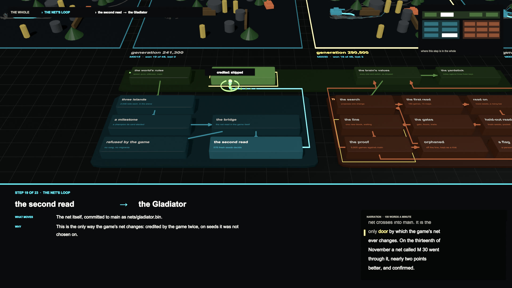
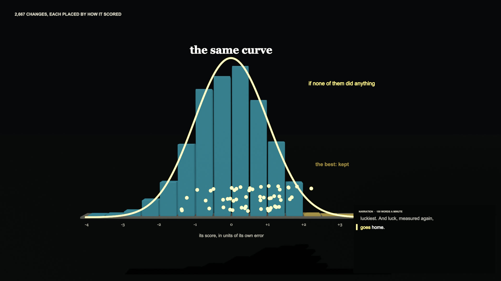
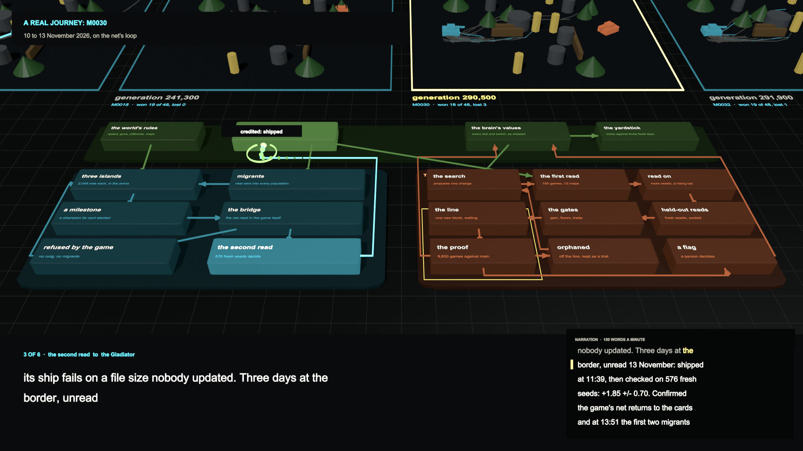

# A Film Beside Every Report: Narration-Timed Scripts, One Storyboard Drawn Twice, Recordings Reenacted Behind the Diagram, and a Standing Directive

*Paul Richeson · Lab Report — IEEE Format · 13 November 2026*

Paul Richeson, treadcore.org: producer, animator, writer, coder, implementer, developer, founder; Claude Code (Claude Fable 5.2) as the team pair. Copyright (c) 2026 Paul Richeson. MIT licensed, as orrery and treadcore.

Companions: orrery `tools/report/film.py` (the engine), `tools/report/process_film.py` (the drawn film, its page, its YouTube kit), `tools/report/process_blend.py` and `tools/report/process_blend_film.py` (the same film in Blender), `tools/report/battles.py` (the recordings), `tools/report/filmdoc.py` (this report's diagram); `docs/process/storyboard.json`, `docs/process/battles.json`, `docs/process-film.html`; the directive, `docs/film-directive.md`.

## Abstract

Paul, in the afternoon of 13 November, after six reports in a day: "I really need only diagrams showing step by step transitions ... describe the arrows, from source to destination, each step in context to the whole ... Movement of context, moving across borders ... explain the process outside in, top down." Over the next four hours that became a film of 12 minutes 44 seconds, *How the Game Learns*, made twice from one file: drawn, as 18,350 SVG frames, and built in Blender, where the same diagram is a place the camera flies over, the words a viewer reads hang one unit in front of the lens, and four generations of the cards' own recorded duels are fought again on fields behind it. This report sets down how, with the code. **The method is seven rules**: the words first, one stage drawn once, every frame a function of its time, a move that gathers, goes and lands, outside in, a border as an event, and words that stand on a plate. **The cost is stated**: three renders thrown away, one of them for a mistake a still would have shown, and a render loop that ran at 5 frames a second on eight cores until it forked. **And it becomes a directive**: from this day a film script is written beside every lab report, kept parallel to the documentation, with the finished film for publishing in a folder that is not the repository. The directive and its prompt are `docs/film-directive.md`.

## I. What was asked, in order

**The film was specified a sentence at a time, and each sentence changed the design.** The order matters because the directive of Section VIII is this order made a habit.

| About | Paul | What it became |
|---|---|---|
| 15:10 | "only diagrams showing step by step transitions ... each step in context to the whole ... moving across borders ... outside in, top down" | one map, 23 arrows, a camera, a small map of the whole on every step |
| 15:20 | "in the corner, at a certain words per minute ... a carl sagan to the point style teleprompt ... like closed captioning but for a teleprompt scroll" | narration for every scene, 150 words a minute, and scenes as long as their words |
| 15:28 | "what framework for the tweens ... generalize the script ... timing, pacing, and introduction outside in" | `film.py` split from the film, and the film's content moved to `storyboard.json` |
| 15:32 | "in the style of 3blue1brown with a carl sagan veritasium like intro" | the palette, written-on words, and a cold open from the reports' own numbers |
| 15:50 | "is there something we can make in blender in the mean time" | Blender installed; the diagram as a place, from the same file |
| 16:05 | "redo them all in blender ... a way to get the teleprompt scrolling in front of the camera" | `process_blend_film.py`: every effect, the words parented to the camera |
| 16:45 | "the generations of the recording showing the bots and their traces ... 3d assets that run from the recording files. design it in the easy way, simply" | `battles.py` and four fields behind the map |
| 17:00 | "It needs to be in the background, so some clear way to make words on the screen stand out" | a plate behind every word; fields that follow the script |
| 17:00 | "an animation script per html markdown combo of lab reports from this point forward as a general directive" | Section VIII |

## II. The pieces, in one picture

!html(film/dia-pipeline.html)

*Diagram 1. Above, what a person writes: the report, the storyboard made from it, and a recording where there is one. In the middle, what draws it: one engine and two renderers, the second taking all its timing from the first. Below, what comes out and where it is kept: the page and the small film in the repository, the kit for YouTube outside it.*

**The storyboard is the film.** `docs/process/storyboard.json` is 26 kilobytes: three territories, 19 blocks with their places, 23 arrows each with what moves, why, the rule, the border and its narration, the cold open's numbers, two journeys, the closing shape, the credits. The scripts are only how such a file is drawn. One step of it, whole:

```json
{
 "id": "c8", "act": "cpu", "a": "proof", "b": "brain",
 "pts": [[1030, 682], [1006, 682], [1006, 296], [1230, 296], [1230, 240]],
 "moves": "proved: pushed to main",
 "what": "The block itself: the commit becomes main, and the fleet builds from it.",
 "why": "This is the only way the game's brain changes. What ships is what was measured, to the commit.",
 "rule": "Three errors past main over 9,600 games.",
 "border": "the line to main: the proof. On 13 November: +3.96 a seat, 34 errors clear.",
 "say": "If it leads by three of its own errors, it crosses. The commit becomes main. This is the only door by which the game's brain ever changes, and what goes through it is exactly what was measured."
}
```

## III. The method, with its code

### A. The words first

**A scene is exactly as long as what is said over it.** Nothing in the film is timed by hand. `Timeline.say` counts the narration's words, and a `|` in the narration is a cue: the second at which the word after it is spoken. The picture's moves are written against cues.

```python
def say(self, kind, narration, least=0.0, **kw):
    words, cues = [], []
    for w in narration.split():
        if w == "|":
            cues.append(self.lead + len(words) * 60.0 / self.wpm)
        else:
            words.append(w)
    dur = max(least, self.lead + len(words) * 60.0 / self.wpm + self.tail)
    self.scenes.append(dict(kind=kind, t0=self.t, t1=self.t + dur, words=words, cues=cues, **kw))
    self.t += dur
```

At 150 words a minute with 0.8 seconds before and 1.8 after, the film's 1,671 words make 12 minutes 44 seconds. The opening's narration reads "... The gain was zero." with a cue before "The gain", and the dashed column of what was expected collapses on that word because its collapse is `seg(u, c[3], c[3] + 1.6)`. Change the sentence and the picture moves with it. This is Mayer's temporal contiguity [2] made a property of the code: a word and its picture cannot drift apart.

### B. Every frame is a function of its time

**One tween does everything.** `seg(t, a, b)` is 0 before `a`, 1 after `b`, eased between; a position, an opacity, a colour or a share of a path drawn is that, times a range. No state passes from one frame to the next.

```python
def smooth(p):                      # slow away, slow arrival: anything that travels
    p = clamp(p)
    return p * p * p * (p * (p * 6 - 15) + 10)

def seg(t, a, b, ease=smooth):      # the one tween everything is built from
    return ease((t - a) / (b - a)) if b > a else float(t >= b)

def swell(dt, dur=0.5):             # a single rise and fall: a landing, a pulse
    return math.sin(math.pi * dt / dur) if 0 <= dt <= dur else 0.0
```

Three things follow, and each was used the same afternoon. A still for the page is a frame of the film, the same call. Frames render in any order, so they render a core each. And a film can be shared between processes by frame number, which is how three Blenders render one film.

### C. A move gathers, goes and lands

**The token's journey is the step, and it has the animator's three parts** [1], [5]. The source block dips as the token sets out (anticipation), the token eases away and in with a trail behind it so a still shows its direction, and the destination swells as it arrives (follow-through). While the step is still being told the token sets out again every 5.6 seconds: the frame is never quite still, and the movement is always the thing being explained.

```python
GO, TRAVEL, CYCLE = 2.6, 3.4, 5.6
v = (u - GO) % CYCLE if u >= GO else -9.0
scales[cur["a"]] = 1 - 0.035 * swell(v + 0.25, 0.5) + 0.05 * swell(u - 0.5, 0.7)   # the source gathers
scales[cur["b"]] = 1 + 0.06 * swell(v - TRAVEL + 0.15, 0.55)                        # the destination lands
```

### D. A border is an event

**What Paul asked for by name, "movement of context, moving across borders", is two lines of geometry.** An arrow's path is walked once to find where it leaves its source's territory and where it enters its destination's. Between the two the token is on the border: a ring opens at each, and the token's colour turns from the first territory's to the second's, because what crosses is no longer the first territory's.

```python
leave = next((p_ for p_ in ps if region_at(along(pts, p_)[0]) != a), 0.5)
enter = next((p_ for p_ in ps if p_ >= leave and region_at(along(pts, p_)[0]) == b), leave)
...
col = mix(col, REGIONS[N[s["b"]][0]]["col"], seg(p, cr[0], cr[1]))
```

### E. Outside in

**The film opens on a thing that should not be possible, then on the whole from far off, and goes in by steps.** The order of scenes is fixed by `timeline()`: three scenes of cold open, the title, the whole (three territories, four arrows, the camera coming in over the first sentence), the borders and the price of each, then each loop one arrow at a time, the two real journeys of the day run over the same arrows, the one shape every border shares, the close and the credits. Every step carries its own context: top left, the path down to it ("the whole › the brain's loop › the gates → the line"); top right, a small map of the whole with its arrow lit.

The cold open is from the reports' own numbers and nothing else: the ten generations of 6 to 13 November that each tested as a gain, +6.49 points together, and measured −0.02 ± 0.10 over 10,400 games [6]; the 2,667 trials of *Where the Seeds Went* lying on the curve of no effect at all [7]; and 8.1 points of one game's luck drawn to scale beside 0.25 of a real improvement.

## IV. The same film, in a place



*Fig. 1. Step 19 of 23 in the Blender film. The diagram is slabs and blocks; the arrow just walked is the tube from "the second read" to "the Gladiator", its token labelled on a plate. Behind the map, the fields; generation 290,500's is lit because the step is about the net it made. Everything read is in front of the camera.*

**`process_blend_film.py` decides nothing about what is said or when.** It imports `process_film` and asks it for the scene at a time, the cues, the camera's target, which arrow is lit and where its token is; it only builds that in three dimensions and sets every object from the time alone, as `apply(t)`. So the two films cannot disagree about the script.

**The teleprompt in front of the camera.** Paul's question, "is there a way to get the teleprompt scrolling in front of the camera", has a short answer: everything read is a Blender object parented to the camera one unit in front of a 30 mm lens, where a pixel of the drawn film is a known size. The camera flies; the words do not move on the screen.

```python
HK = 1.2 / 1920            # a pixel of the drawn film, one unit in front of a 30 mm lens

def H(px, py, layer=0):
    return Vector(((px - 960) * HK, (540 - py) * HK, -1.0 + layer * 0.002))

def hud(s, px, py, size, col, k=1.0, weight=400, align="LEFT", layer=2, serif=False, line=None):
    return text(s, size * HK, glow(col, k), H(px, py, layer), align=align, weight=weight, serif=serif, parent=S["cam"], line=line)
```

The word being spoken is lit without a second object: a Blender text carries a material for each character, so one text object holds the visible lines, with three materials for to come, being spoken, and spoken.

```python
for l in lines[first:last]:
    for kx, w in l:
        body_ += w + " "
        fmt += [1 if kx == int(pos) else 2 if kx < pos else 0] * (len(w) + 1)
...
for bf, mi in zip(tx.data.body_format, fmt):
    bf.material_index = mi
tx.location = H(tp["x"] + 26, tp["y"] + 50 + 34 * 1.2 - (li - first + frac) * 34, 4)
```

**The camera is the drawn film's camera, given a height.** The drawn film's camera is a centre and a zoom. In Blender the same two numbers become a point to look at and a distance, on a line 44 degrees up from the ground (84 when far off, so the opening looks straight down).

**The opening's charts are boards.** The tower of ten gains, the histogram and its curve, and the two bars to scale stand upright beside the map at the distance where a pixel of the drawn layout is a pixel on screen, so the layouts were not redone. The camera travels along them and then rises and flies to the map.

## V. The recordings, reenacted



*Fig. 2. The cold open's second board. The bars are the trials' first reads; the yellow tube is what the same number of trials worth nothing would give; the beads are the ones that scored best, on their way back to the middle when measured again.*

**The recording is the cards' own.** crucible's `--trace` plays a champion's duels in one arena from one start, the dice choosing each duel's opponent, and writes every step of every one: both tanks' place, heading and armour, both shells, the pillboxes. `tools/report/battles.py` asks a GPU island for that trace of four generations and keeps what a reenactment needs.

| Field | Generation | Won | Lost | Drawn |
|---|---|---|---|---|
| M0001, the first champion | 200 | 12 | 34 | 2 |
| M0015, the net shipped for a week | 241,300 | 19 | 0 | 29 |
| M0030, the net shipped now | 290,500 | 18 | 3 | 27 |
| M0032, the newest standing | 291,900 | 19 | 1 | 28 |

48 duels each, traced on whitewolf in seven minutes; `docs/process/battles.json` is 0.8 MB.

**A field is the arena, the fan, and two tanks.** Each generation has a field behind the map, oldest on the left. On it stand the arena's pillars, pillboxes, groves and walls. The champion's path in every one of its 48 duels is drawn faint from the one start: the same moment, taken 48 ways, which is what Paul called the "multidimensional battle decision". And its four best duels are played by two small tanks, one after another at three times the speed they were fought, the path of the duel in hand drawn behind the champion as it goes. Between two recorded steps a tank is interpolated, its heading by the short way round:

```python
f = min(len(rec) - 1.001, u * PLAY / bt["dt"])
i = int(f)
a, b, fr = rec[i], rec[i + 1], f - i
o.location = A(g, lerp(a[off], b[off], fr), lerp(a[off + 1], b[off + 1], fr), 0.03)
dh = (b[off + 2] - a[off + 2] + math.pi) % (2 * math.pi) - math.pi
o.rotation_euler = (0, 0, a[off + 2] + dh * fr)
```

**The fields follow the script.** A step or a journey of the storyboard may name a generation (`"field": "M0030"`), and while it is told that generation's field is lit in yellow and the others stand back. Steps 14 to 21 name one: the first champion while the film says a net is grown in the world it will fight in, the newest while a milestone is elected, the shipped net while it crosses to main.

## VI. Words over a moving picture



*Fig. 3. M0030's journey, leg 3 of 6. Three plates: the header top left, the leg's words bottom left, the teleprompt bottom right. The token's name over the map has a plate of its own.*

**Nothing a viewer reads is laid straight over the picture.** With tanks moving behind the diagram, Paul's instruction was direct: "It needs to be in the background, so some clear way to make words on the screen stand out." Four rules now hold in both films. Text has fixed places. Every place has a dark plate under it, including the header, the legend of the borders and the token's name. Yellow is kept for what the eye should go to: the border, the word being spoken, the thing just landed, the field being talked about. And the fields are quiet by construction: the fan of paths glows at a tenth of the strength of an arrow on the map. This is Mayer's signalling and coherence principles [2] as layout rules.

## VII. What it cost

**The afternoon's mistakes are part of the method, because each is now a line of the directive.**

| What happened | Cost | The rule it became |
|---|---|---|
| The first three full renders were stopped for a change of design | about 12 minutes of render | stills before film |
| The render loop drew frames in threads: Python took turns, 5 frames a second on eight cores | a render that would have taken an hour | a process a core (`render_film` forks): 15 frames a second |
| The first Blender render was stopped for the battles, the second for the plates and the credits | 3,825 and 878 frames | settle the look on stills of every kind of scene first |
| The encoded 1080p film was 53 MB; a page carries 15 | one re-encode | the page's film is 720p at a fixed bitrate (13.7 MB); the master goes to the kit |
| Captions (`.vtt`) cannot be attached to the published page | captions only in the repository's copy | the narration is in the picture itself |
| Blender frames as PNG would be about 30 GB | none: caught before | frames as JPEG |

| Film | Frames | Render | Size |
|---|---|---|---|
| Drawn, 1080p, 24 a second | 18,288 at the time; 18,350 with the credits | about 20 minutes, eight processes | 53 MB master, 13.7 MB for the page |
| Blender, 1080p, 12 samples | 18,350 | about 2 hours, three Blenders, 2.4 frames a second | rendering as this is written |

**What has not been checked.** The drawn film was watched in part and checked on stills of every kind of scene. The Blender film has been checked on 24 stills and not once in motion: its camera flights between boards and map, and the tanks' motion, are untested until the render in hand is watched. The drawn film in the repository does not yet have the credits under its close; its next render will.

## VIII. The directive

**From 13 November 2026, every lab report is followed by an attempt at its film.** Paul: "an animation script per html markdown combo of lab reports from this point forward as a general directive ... to follow up and attempt animations after lab report. We should definitely keep the animation scripts parallel to documentation." The directive is a file of its own, `docs/film-directive.md`, so that it can be given to a session as it stands. Its substance:

- **Parallel files, one name.** `docs/NAME-lab-report.md` and `.html`; `docs/NAME/storyboard.json`; `tools/report/NAME_film.py` where the shared script is not enough; `docs/NAME-film.html`; `docs/NAME/film.mp4`.
- **A separate folder for publishing.** `output/youtube/NAME/`, which the repository ignores: the 1080p film, `title.txt`, `description.txt` with the chapters as YouTube reads them, `captions.srt`, `thumbnail.png`, `teleprompt.txt`. Made by `process_film.py youtube MASTER.mp4`. Nothing is uploaded by a script; a person takes the kit.
- **The order.** Report, storyboard, narration read aloud, stills, film, page, kit, and a plain statement of what was rendered and what was only attempted.
- **Titles and credits.** Reports keep the IEEE house form. A film ends on four lines, which are also the last four of its YouTube description:

```text
Orrery  ·  treadcore.org
Paul Richeson: producer, animator, writer, coder, implementer, developer, founder
Team pair: Claude Code (Claude Fable 5.2)
MIT License  ·  Copyright (c) 2026 Paul Richeson
```

The kit for this film was made the same hour, and its description opens:

```text
How the game learns

How a game learns to play itself, as one block diagram walked arrow by arrow, from the outside in: ...

0:00 Ten gains, worth nothing
0:25 The same curve
0:55 Signal and noise
1:19 Title
1:32 The whole, in one picture
2:17 The borders
2:50 The brain's loop
```

## IX. What is open

- **The shared script is one kind of film.** `process_film.py` now reads its overview arrows, its borders, its territories' entrances and its optional scenes from the storyboard, so another block diagram is another file. A report whose argument is not a block diagram (a chart that grows, a timeline) needs its own scenes on `film.py`; the cold open's three scenes here are this film's own.
- **The Blender script still assumes this film's boards.** Its map, camera, head-up words and fields are general; its opening and closing boards are written for these charts.
- **Sound.** There is none. The narration is written to be read aloud at the teleprompt's pace; a voice track is not made.
- **The game's own recordings.** What is reenacted is the cards' arena, where the net is grown. The game's recordings are recipes, a seed and settings; to reenact them the game must be run to give positions.
- **A scaffold.** A command that writes an empty storyboard for a new report's name is not written.

## X. How to make it again

```text
python3 tools/report/process_film.py list                     the scenes and when each begins
python3 tools/report/process_film.py still 300 /tmp/a.png      one frame
python3 tools/report/process_film.py page                      docs/process-film.html, the stills, the captions
python3 tools/report/process_film.py film                      every frame, then docs/process/film.mp4
python3 tools/report/process_film.py youtube MASTER.mp4        output/youtube/process/
python3 tools/report/battles.py QUEUE                          docs/process/battles.json, from a GPU island
blender -b -P tools/report/process_blend_film.py -- stills DIR 100,300,500
blender -b -P tools/report/process_blend_film.py -- frames 0 6117 DIR 12
```

Any of these takes `--story docs/NAME/storyboard.json` for another report's film.

## References

[1] F. Thomas and O. Johnston, *The Illusion of Life: Disney Animation*. New York: Abbeville Press, 1981.

[2] R. E. Mayer, *Multimedia Learning*, 2nd ed. Cambridge: Cambridge University Press, 2009.

[3] G. Sanderson, "Manim: an animation engine for explanatory math videos," software, 2015–. [Online]. Available: https://github.com/3b1b/manim

[4] Blender Foundation, "Blender Python API reference." [Online]. Available: https://docs.blender.org/api/current/

[5] J. Lasseter, "Principles of traditional animation applied to 3D computer animation," *Computer Graphics (Proc. SIGGRAPH '87)*, vol. 21, no. 4, pp. 35–44, 1987.

[6] orrery, *Always Forward*, lab report, 13 November 2026.

[7] orrery, *Where the Seeds Went*, lab report, 13 November 2026.
