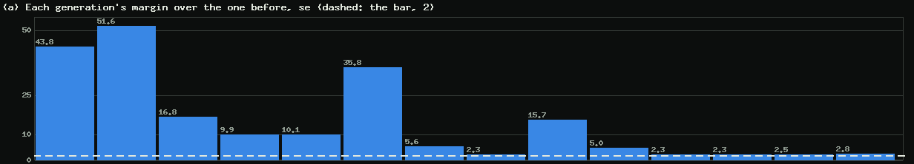
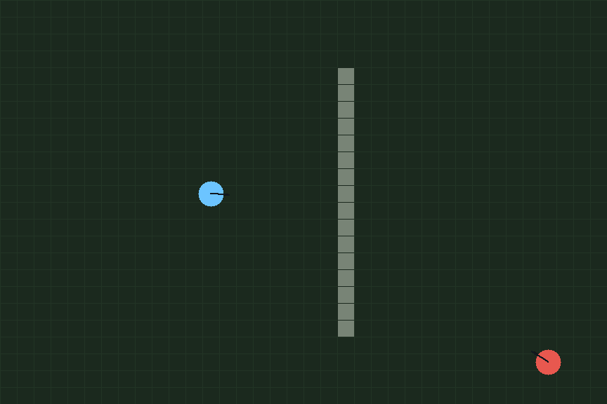
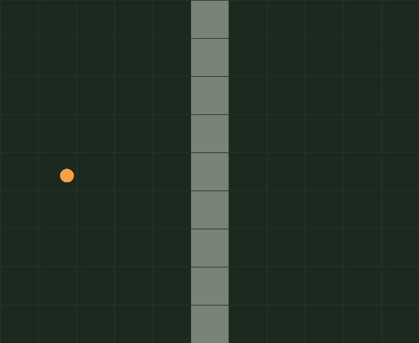
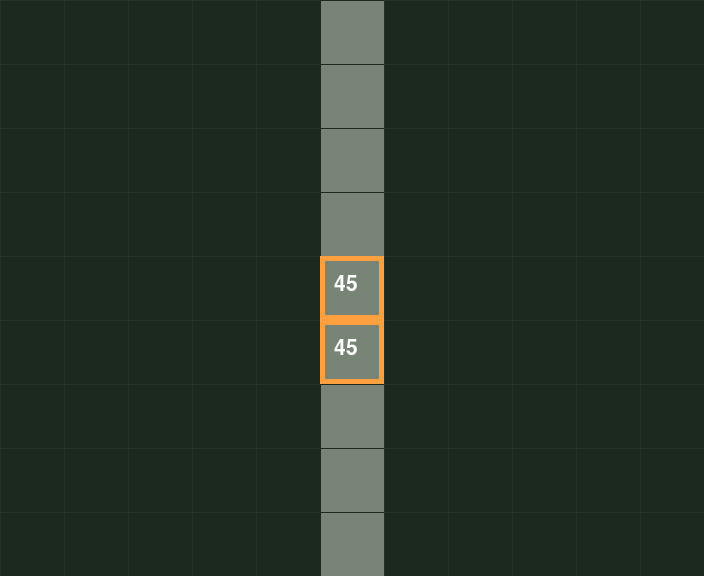
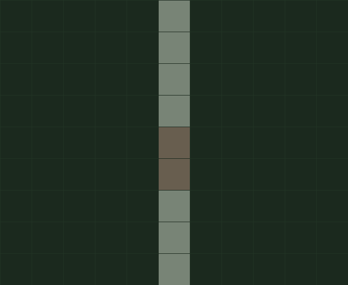
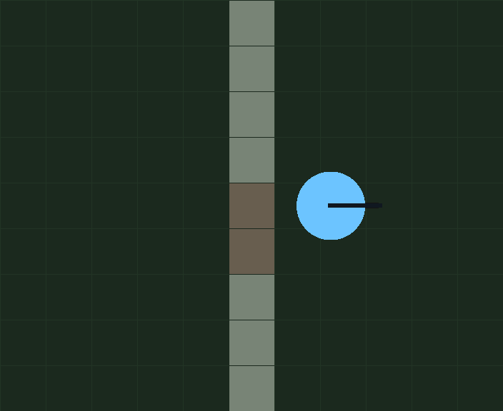
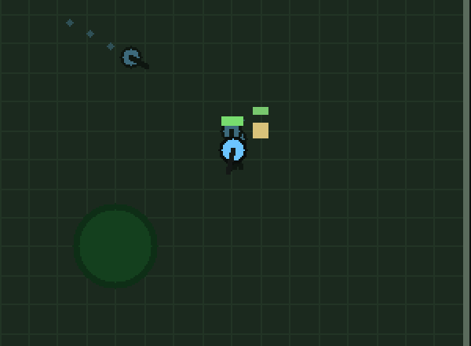
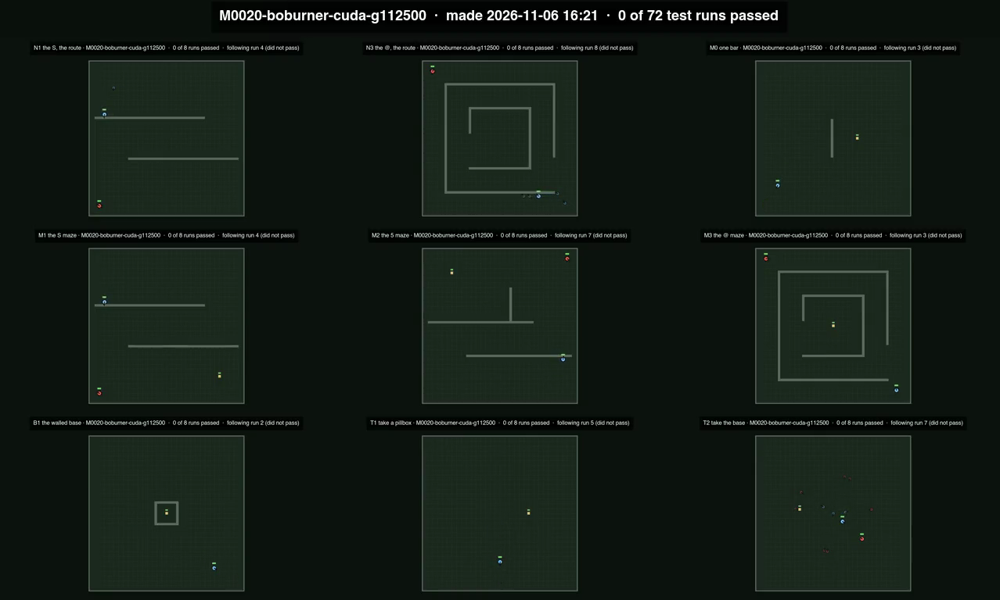
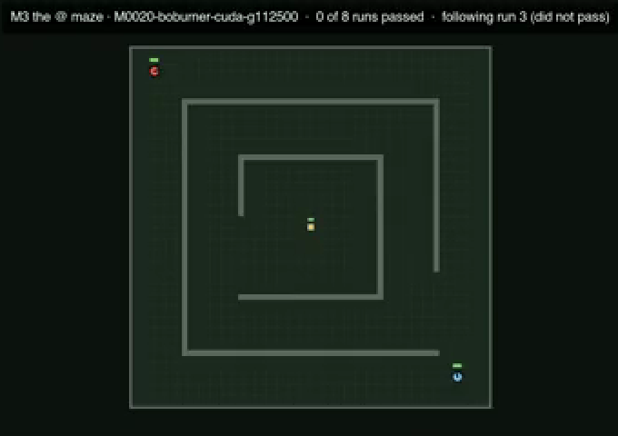
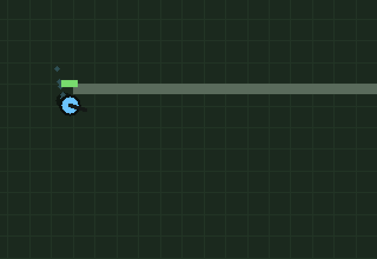

# Every Generation on Film: the Maze Home on the Fleet, One Wall in Two Games, a Camp of Rewards, a Full Card, and a Machine That Reads the Page

*Paul Richeson · Lab Report — IEEE Format · 6 November 2026*

Paul Richeson, treadcore.org; Claude Code (Claude Opus 5.5) as the pair. Copyright (c) 2026 Paul Richeson. MIT licensed, as orrery and treadcore.

Companions: crucible `src/crucible.cu` (the camp: `[[stage]]`, `camp_spawn`, dormant pillboxes; every wall breakable, `WALL_GAP`; castles in the scenario trace) and `gauntlet/k1` to `k3`; treadcore `source/treadcore-sim` (`WALL_HEALTH`, `wall_shot`, `hit_wall`, game 9) and `source/treadcore-brain` (`nav_senses`, `w_breach`, `breach_wall`, `wall_in_sight`); orrery `tools/report/footage.py`, `teleprompt.py`, `netcard.py`, `seed_sense.py`, `wall_frames.py`, `full_card_figs.py`, `page.html` (Read along), `tools/plans/treadcore.py` (`footage_watch`), `src/generations.rs` (`gpu_home`). The report before it: *Round the Corner* [1].

## Abstract

On the evening of 6 November the maze build went to the fleet, and Paul asked for six things more.

- **The walls of the two games made one.** A wall now takes the gun in the game as on the card (treadcore LR 154, game 9). Two direct hits aimed at a wall tile bring it and its neighbour down, a gap two tiles wide; crucible's walls open three, for its wider tank. The mortar still fells a wall at once.
- **The card filled.** Each block keeps its net's weights in shared memory, so a Pascal SM holds two blocks; a second population on the card would add none. Two hundred and fifty-six duels a net instead of 128 double the threads that share the weights, 12% occupancy to 25%. A generation plays twice the duels in 1.57× the time, and the islands play 256 since that evening.
- **Every new generation filmed.** When the GPU's home makes a generation, an island traces nine tests eight runs each, this Mac films them, and the nine play at once on one sheet; the sheets join into a reel. The forest home's own generations of the day, M0016 to M0020, passed none of their 72 test runs: the baseline the maze home's footage will be read against.
- **A camp of rewards.** A test can now be a chain of stages: reach a beacon, and a castle rises to be taken; take it, and a second rises to be razed. Each stage pays its reward, twice it if done at once, falling to the reward itself at its quick time. The trained maze champion passes the beacon camp and the corridors in all 128 runs, and the unravelling in 30. M0016 passes 0, 128 and 10.
- **Telling a verdict sooner.** Over 10,793 stored censuses, a naval seed tells a candidate's verdict about four times as well as a europe seed. The proving ground, which LR 151 put into the census's rotation, tells nothing.
- **What to keep about each net.** A card now sits beside every GPU generation: its lineage, its election, how much weight it puts on each group of senses and how far each moved, the game's read and its footage.
- **A machine that reads the page.** A report scrolls itself at reading speed and stops to play each film. The same timeline makes its video: *Round the Corner*, 44.7 minutes, is 26 MB as an MP4, and 3.2 MB as a bundle of WebP tiles, timeline and films.

*Index Terms*: neuroevolution, CUDA occupancy, shared memory, reward shaping, curriculum, sequential testing, item response, screen-content video coding.

## I. The asks

Paul, on the costs: "i'm ok with doubling the number of computations per step. expecially if we can fill up more of the GPU's available ram. Or perhaps run parallel methods on CUDA to be more efficient."

On the walls: "continue unifiying the motor and the types of direct fire to take down a wall. Treadcore's rules should match crucible. Crucible is made for Cude GPU equivalanet to train and compare with existing gladdiators and ai brinz."

On the films: "write a lab report with all the animateions we made from the generations, and the multi path finding animations, we want to see just about every generation have a set of tests be monitored, then we take those recordings and colelct them to show generations of footage. We dont need to show old generations, just the newly trained ones."

On the page: "from the webpage, can we create something that scrolls the webpage with enough reading time, which then it starts the animation when its in view, stops scrolling to view it, then continues scrolling to more text until enough time per word can be read like a teleprompt ... add that special something to the process which helps doing this repeativlely from an HTML to an MP4 (or your prefered animation, this could be some new format). I want really small or compressable filesizes."

On the camp: "we should have a good set of rewards and cookies for after correctly soving the maze, and even best chosing a pre setup list of corrdors which unlike a maze have many choices ... the first items done right should score good reward, and at that point we can step through milestones like a maze that unravels in complexity. Like driving onto a spot, then spawning castles at a predictable location after stepping on the beacon, or taking over base, or castle. We need events that a human would feal accomplished over ... is there a way to find a sensitivity analsys to its seed such that we can disquality certain changes quicker ... What kind of information should we store about the net and weights we are training."

And on the documents: "show diagrams about architecture, about blocks and diagrams and different types of computations represented by icons and symbols ... feed many zoomed in and conecpt level articulate what the crop shows."

## II. The fleet now

The figures that follow mark each kind of computation with one icon, the same everywhere.

!html(full-card/fig-legend.html)

*Fig. 1. The icons: rays cast from a tank, a wave over the route's grid, the tank's own motion projected along three arcs, a rule's choice, the net's multiply-adds, numbers read back at the next step, the net's gate, and frames encoded.*

!html(full-card/fig-architecture.html)

*Fig. 2. The fleet as it runs since the evening of 6 November. This Mac plans: the keeper runs the planner each pass, and every island segment takes crucible's working copy with it. Three GPU islands train the maze home, read each champion on the CUDA gauntlet and elect a generation when it clears the bar; the same islands trace the footage. The CPU machines play the game: the line's census of the rules' dials at game 9, and the bridge, which reads a GPU generation as the Gladiator and credits it when it holds.*

**What changed on the fleet that evening, in order:**

1. Crucible's working copy fast-forwarded to the forest branch (18f21f0, then bf0c99d with the wall rule), and `crucible.nav = true` in plan.json. The planner made the home `crucible-world-hybrid-forest-nav`, carried the forest home's 19 milestones into it and widened them as crucible loads them.
2. The eight forest-home segments still queued were stopped, so the islands began the maze home at their next segment instead of an hour later.
3. Treadcore LR 152, 153 and 154 pushed to main (0212f47, afb6e7a, e499699). Game 9's census does not count game 8's, so the fourteen game-8 `weights` jobs still queued were stopped; the planner retired the rest and prepared game 9's builds on five machines.
4. `crucible.eps` 128 to 256.
5. Orrery's Generations page follows the GPU's home by name (`gpu_home`), and shows the maze home once it is on.

*Fig. 3. Orrery, Results, Generations, the GPU tab, cropped to its first chart: each generation's margin over the one before, in standard errors, against the bar of 2 (dashed). The first generations of the world home cleared it by 44 and 52; the newest clear it by 2 or 3. The chart reads the planner's ladder, now of whichever home the GPU trains.*

## III. One step of the maze build, and what a card holds

!html(full-card/fig-step.html)

*Fig. 4. One tank-step of the maze build and where its time goes, measured by the GPU's own clock over ten generations on a card with nothing else on it. The route sense (a third of a decision, its wave included) and the arcs (6%) are the maze build's own; the senses and the net are the forest build's too. Played alone, the maze build plays 22.5 million tank-steps a second and the forest build 21.5: the new senses cost about what the shorter task runs save.*

**Beside another process the maze build runs at half speed.** An island's segment has its card to itself. A test run beside it does not, and that is where the first timings of *Round the Corner* were made [1]. Sharing boburner's card, the forest build held 21 million steps a second and the maze build fell to 10. The maze build carries a 6.5 KB stack a thread against the forest build's 0.8 KB (its route fields and the wave's queue), and the other process's kernels evict it from the cache.

!html(full-card/fig-inputs.html)

*Fig. 5. The 64 inputs of a maze net, as crucible feeds them and as treadcore's `nav_senses` now does (LR 152). The first 55 are the world's: twelve rays that meet walls and the enemy, the tank and the enemy, the rules' answer, the pillboxes' rays and the nearest pillbox, the ammunition. The nine after them are the maze's: the bearing and length of the route and whether the enemy is walled off, the three arcs, and the two numbers the net kept from its last decision.*

!html(full-card/fig-card.html)

*Fig. 6. Why a second population cannot fill the card, and what does. A block keeps its net's 5,766 weights in shared memory, 46 KB of a Pascal SM's 96, so the SM runs two blocks. At 128 duels a net that is 256 threads, 12% of the 2,048 it can hold. Another population brings blocks of its own that need the same 46 KB, so none fits. At 256 duels a net the same two blocks run 512 threads sharing the same weights: 25%, with the register file exactly full (128 registers a thread). Beside the island's segment a generation took 72.6 s for 46.1 at 128: twice the duels in 1.57× the time.*

**Why not two homes a card.** Paul chose two homes per card from a list that offered it; the measurement above showed it would only split the card, and the islands took 256 duels a net instead. Every duel more a net is also a steadier fitness: the generation's choice of champion rests on twice the games.

## IV. One wall in two games

!html(full-card/fig-wall.html)

*Fig. 7. The wall rule of game 9 and crucible's. In treadcore a wall tile has 90; a direct hit aimed at it takes 45 from it and from its neighbour along the wall, on the side of the tile the shell met, so the second hit leaves rubble two tiles wide. In crucible two hits open a gap of three tiles in the bar where they struck, and both ends stand, whole again. The mortar's splash still fells a wall at once, in treadcore; crucible has no mortar.*

The pictures below are of the game's own simulator, not of its window: a scratch program steps a treadcore World with a wall across a tank's way, orders two direct shots at the wall and then a drive through, and writes every tile, tank and shell each other tick; `tools/report/wall_frames.py` draws them tile for tile.

*Fig. 8. The field: seat 0's tank (blue) twelve tiles from a wall sixteen tiles long; the other tank (red) far off. Nothing between the tank and the wall stops fire, so a shot aimed at a wall tile is taken (`wall_shot`).*

*Fig. 9. Zoomed six times on the wall: the first shell (orange) on its way, 1.2 s in. A direct shell flies in a straight line at 40 tiles a second and strikes where it was aimed.*

*Fig. 10. The first hit, 1.3 s in. The shell was aimed a little south of the tile's middle, so the tile and its south neighbour each lose 45 and show what is left. The wall still stands: a tank still cannot pass, and still cannot see through.*

*Fig. 11. The second hit, 5.3 s in, after a reload: both tiles reach nothing and turn to rubble (brown). Rubble is ground a tank drives over. What was struck is forgotten (`wall_hits` empties), so a wall rebuilt there would start whole.*

*Fig. 12. Through the gap, 8.2 s in. The gap is two tiles; treadcore's tank is a tile and a half wide, so it fits. Crucible's tank is two wide, which is why its gap is three.*

**What stayed different.** A treadcore tank fires at a wall only when it aims at it; a shot at a tank behind a wall is still refused, so the rules' own fire is as it was. Crucible's tank fires along its hull with no aim point, so its shells strike any wall they meet. The CUDA gauntlet read the trained maze champion and M0016 again under the rule: 0.660 and 0.501, the same, since neither ever shot a wall outside B1.

## V. Breaking in by choice

!html(full-card/fig-breach.html)

*Fig. 13. The intrusion dial (treadcore LR 153, its gun since LR 154). A tank storming a base, with no hostile gun left to shell, looks along the straight line to the base. If the first thing it cannot cross is a wall, and the way in is shut or more than `w_breach` times that line, it shells the wall: with the gun when the wall is within direct range and in sight, with the mortar beyond, and from a firing position otherwise. The press row of the temperament matrix moves the bar as it moves `press_odds`. At 0, the default, it never breaks in by choice.*

The rules already broke into the proving ground's compound (G33) 95.5% of the time, by shelling the pillbox inside with the mortar, whose splash brings the wall down. The dial is for the cases that never made it happen: a walled base with no gun inside, and a gate a long way round. Its value is the census's to find; until one is promoted, the brain plays as it did.

## VI. The Gladiator reads a maze net

A maze net's 64 inputs and 6 outputs reach the game through `nav_senses` (LR 152, Fig. 5). The way to the enemy comes from the map's own route (`route_kept`, the planner the rules drive by) where crucible searches a grid. The walled flag is an empty route, and the arcs are stepped against the map's tiles. The two kept numbers live in the Duelist between its decisions and are forgotten when no enemy is in reach. When the straight line to the enemy is shut and there is a way round, the rules' answer the net reads turns toward the way's next point at full throttle, as crucible's errand and the Commander do.

Six tests hold it: among them, a maze champion widened from a world one (every new weight zero) answers as the world one did, within 1e-5. Crucible's trained maze champion then played eight census games of 300 s as the Gladiator, on this Mac, without a fault. That is a check that it plays; the read is the bridge's, 192 seeds on every map, once the fleet's line includes LR 152.

## VII. The camp

!html(full-card/fig-camp.html)

*Fig. 14. A camp is a chain of stages (crucible `[[stage]]`): reach a point, take a pillbox, or destroy one. A pillbox marked dormant is not in the arena until the stage that spawns it begins: the castle that rises when the beacon is reached. A stage pays its reward, twice it when done at once, falling to the reward itself at its quick time; done late it still pays the reward. Progress toward the stage it stands at is paid as before, measured from the moment the stage began.*

**Three camps.** Every position in them is a line in the file, so a reward can be moved:

- **K1, the beacon camp.** A beacon past a grove (8 s for the most of it). On it, a castle rises to be taken (25 s); taken, a second rises to be razed (20 s).
- **K2, the corridors.** Nine blocks of wall with corridors five tiles wide between them: many ways through, no dead end. Two beacons in turn, then a castle rises in the far corner.
- **K3, the unravelling.** Round one bar to a beacon. On it, a castle rises inside a ring of wall with no gate, to be broken into and taken: the corner, then the breach.

| Camp | Trained maze champion | M0016 |
|---|---|---|
| K1 the beacon camp | 128 of 128 | 0 |
| K2 the corridors | 128 of 128 | 128 |
| K3 the unravelling | 30 of 128 | 10 |

*Table I. Passes of 128 runs, the maze build. Paired, the champion is +0.385 ± 0.026 over M0016 (154 runs gained, 6 lost).*

!html(full-card/vid-k1-camp.html)

*Fig. 15. K1 played by the trained maze champion. The beacon is not drawn (the trace records where things are, not where the stages point); the tank drives to it past the grove, the first castle (sand) rises and is taken, and the second rises south-west.*

*Fig. 16. Zoomed: the moment after the first castle is taken. The castle stands again beside the tank as the tank's own, whole, and the second castle has risen where the file put it. In the film a castle not yet risen is not drawn at all: crucible writes -999 for its health until its stage spawns it.*

!html(full-card/vid-k2-camp.html)

*Fig. 17. K2, the corridors: two beacons in turn among nine blocks, then the castle in the far corner. Every one of the 16 runs passes, by different corridors.*

!html(full-card/vid-k3-camp.html)

*Fig. 18. K3, the unravelling: round the bar to the beacon, then the ring. 4 of these 16 runs pass; the castle inside the ring is the hard part, as B1 was before the errand learned it.*

**Gladiator style, with last chances.** The camp pays every stage done, even when the run fails the next, so a net that gets the beacon and the first castle is paid for them and can adapt toward the rest. A last chance proper, a second life that starts at the last beacon with the stages done kept and paid less, is the next step and is not built.

## VIII. Every generation on film

!html(full-card/fig-footage.html)

*Fig. 19. The footage of every generation (`tools/report/footage.py`, asked by the planner's `footage_watch`). When the GPU's home makes a generation of its own (not one carried from the home before) and it has no footage, an island builds crucible with that home's flags and traces nine tests eight runs each: the routes N1 and N3, the mazes M0 to M3, the walled base B1, the takeovers T1 and T2. This Mac films each, every film sped to twelve seconds, and the nine play at once on one sheet under a card. The sheets join into a reel, output/treadcore-footage.mp4.*

!html(full-card/vid-footage-forest-reel.html)

*Fig. 20. The reel of the forest home's own generations of 6 November, M0016 to M0020, a sheet each: 416 KB for 65 seconds. Every one passes none of its 72 test runs. These nets were trained under the old script, without the errand, and they meet the mazes, the walled base and the takeovers as M0016 did in Round the Corner: they make for what they can sense and stop at the first wall. The maze home's generations will be filmed the same way as they are made, and read against these.*

*Fig. 21. M0020's sheet, twelve seconds in: N1, N3 and M0 across the top, M1 to M3 in the middle, B1, T1 and T2 at the bottom, each with its own caption and runs passed.*

*Fig. 22. Zoomed on M3, the @ maze: the forest generation's tank waits outside the outer ring's gap at the bottom right, and the castle sits at the centre behind three rings. A net with no route sense sees the castle and not the way to it.*

## IX. Every animation so far

**From the generations.**

!html(full-card/vid-montage-0004.html)

*Fig. 23. Montage 4 [3]: three generations of the line, each chain of jobs with an arrow from every job to the one it followed, the duels spread so their ghosts are different games, every wire of the net in its node's colour.*

!html(full-card/vid-montage-0005.html)

*Fig. 24. Montage 5: the world ladder's milestones to M0015, the line's commits, and the duels of each.*

!html(full-card/vid-trailer-0001.html)

*Fig. 25. The first trailer, forty seconds: the line's newest two generations at speed, the dials they moved, one champion's duel.*

**Finding the way (the mazes of *Round the Corner* [1]).**

!html(full-card/vid-rc-m1-script.html)

*Fig. 26. M1, the S maze, under the old script: the tank makes for the pillbox through the first bar.*

!html(full-card/vid-rc-n1-errand.html)

*Fig. 27. N1, the same S without the pillbox, under the errand: the route end to end.*

!html(full-card/vid-rc-n3-errand.html)

*Fig. 28. N3, the @: three rings, their gaps on alternate sides, to the centre.*

!html(full-card/vid-rc-m0-errand.html)

*Fig. 29. M0, one bar: round the corner, shell the pillbox from outside its ring, drive onto the rubble.*

!html(full-card/vid-rc-m1-trained.html)

*Fig. 30. M1 after 30 generations on the errand: the S and the pillbox at its end, 16 of 16.*

*Fig. 31. Zoomed on Fig. 30: the tank at the west end of the S's second bar, where the route's next point turns it south round the end. The ghost behind it took the same corner a moment earlier. This is the two-part move round a corner that the senses alone never learned.*

!html(full-card/vid-rc-m2-trained.html)

*Fig. 32. M2, the 5 maze, trained: round the first bar's end, up past the bowl's stroke, along the top to the pillbox, 15 of 16.*

!html(full-card/vid-rc-m3-trained.html)

*Fig. 33. M3, the @ maze, trained: the tank follows the outer ring to its last corner and stops there, every run.*

!html(full-card/vid-rc-b1-trained.html)

*Fig. 34. B1, the walled base, trained: the wall shot down from outside the pillbox's ring, the pillbox destroyed through the gap, the rubble taken, 16 of 16.*

## X. The machine that reads the page

!html(full-card/fig-teleprompt.html)

*Fig. 35. One timeline, two players. The report page computes its own timeline (`window.teleprompt.timeline()` in tools/report/page.html): each block read at 180 words a minute past a reading line a third of the way down, each figure held for three seconds plus its caption and its size, each film held and played to its end. The Read along button plays it on the page. `tools/report/teleprompt.py` asks headless Chrome for the same timeline at 1280 × 720 and for one photograph of the whole page, and FFmpeg slides a window down the photograph a whole pixel a frame, each film laid over its place for its time.*

**The special something.** Three choices make it repeatable and small:

- **One timeline.** The page and its video pace alike, because the recorder asks the page's own function. A film's length comes from ffprobe and is written on the page, so nothing waits on a video to load in a headless browser.
- **No screen recording.** The page is photographed once. Nothing depends on the machine's speed, and the same page and options give the same file every time.
- **Small by construction.** Every frame is the one before it moved by whole pixels, or the same. The encoder finds each block of it in the frame before, a motion vector with nothing left over, and a held frame costs nearly nothing.

| *Round the Corner*, read along | Size |
|---|---|
| The MP4, 44.7 minutes, 1280 × 720, 15 frames a second, x264 | 26.3 MB |
| The bundle: the page as seven WebP tiles (2.1 MB), its 9 films (1 MB), the timeline (32 KB), the player | 3.2 MB |

*Table II. A minute of the video is 0.59 MB; the bundle, which a browser plays as smoothly, is an eighth of it. The bundle is the new format Paul allowed for: `index.html`, `timeline.json`, `page-NN.webp` and `films/`.*

## XI. Telling a verdict sooner

Every census of the line's search plays fresh seeds (its `SEED0` is the job's number times 10,000), so no seed has been played by two candidates and a seed's own telling power cannot be read from what is stored. The maps are shared, so a map's can (`tools/report/seed_sense.py`). For each map, over every census, the correlation between the map's mean and the mean of the other maps tells how well it agrees with the verdict; its seeds' spread tells how many it takes.

| Map | Censuses | Agrees with the rest | A seed's spread | Telling |
|---|---|---|---|---|
| naval | 10,793 | +0.249 | 3.62 | 0.69 |
| constanine | 10,793 | +0.289 | 4.32 | 0.67 |
| island | 10,793 | +0.322 | 5.21 | 0.62 |
| industry | 10,793 | +0.311 | 5.10 | 0.61 |
| generated | 10,793 | +0.304 | 5.28 | 0.58 |
| atlantic | 10,793 | +0.234 | 5.39 | 0.44 |
| fortressislesx | 10,793 | +0.202 | 4.72 | 0.43 |
| fortressisles2 | 10,793 | +0.212 | 5.61 | 0.38 |
| fidos-airstrip | 10,793 | +0.183 | 5.10 | 0.36 |
| big-lizard | 10,793 | +0.207 | 8.63 | 0.24 |
| europe | 10,793 | +0.140 | 7.74 | 0.18 |
| flame-war-modified | 161 | +0.032 | 5.28 | 0.06 |
| proving | 161 | −0.057 | 3.92 | −0.15 |

*Table III. "Telling" is the agreement over the spread (times ten). Information goes as its square: a naval seed is worth about fourteen europe seeds toward the verdict.*

**What it says to do:**

1. **Play the telling maps first.** The census already stops in stages when a candidate cannot win. Ordering a census's first stage naval, constanine, island, industry, generated would bring that stop sooner, and a sequential test [4] stops a loser sooner the more each sample tells.
2. **A probe set of seeds.** Give the first eight seeds of every census the same numbers for every candidate. Then each seed's difficulty and discrimination can be read over thousands of candidates, as an exam's items are [5], and the census can play the most telling seed next.
3. **The proving ground out of the rotation.** LR 151 put the proving ground and A Flame War Modified into the census's "every map" (MAP=all). The proving ground was built as a test map. Its scores agree with nothing, so for now it only adds noise to every verdict: the decision is Paul's.

## XII. What to keep about each net

A milestone is 20 to 23 KB of floats and nothing else. A card now sits beside each one (`tools/report/netcard.py`: `MILESTONE.card.json`, and `cards.json` for the home):

- **lineage**: the milestone it had to beat, its segment, island, generation, when;
- **election**: the weighed gauntlet z, the yardstick z, the bar, the shares;
- **shape**: its inputs, hidden layers, outputs and weights;
- **senses**: the L2 norm of each group of inputs' first-layer weights, what the net leans on;
- **moved**: the same, of the difference from the milestone it beat;
- **game**: the bridge's read of it as the Gladiator;
- **footage**: its tests' passes.

| Generation | Rays | Body | Rules | World | Moved, rays | Gauntlet z | Game |
|---|---|---|---|---|---|---|---|
| M0016 | 431 | 284 | 177 | 184 | 191 | +166.5* | −1.35 |
| M0017 | 432 | 284 | 176 | 184 | 26 | −2.09† | −0.44 |
| M0018 | 280 | 193 | 112 | 154 | 505‡ | +5.92 | −4.72 |
| M0019 | 280 | 193 | 112 | 156 | 25 | +5.99 | −5.82 |
| M0020 | 281 | 195 | 113 | 159 | 32 | −4.11† | — |
| M0021 | 281 | 194 | 112 | 156 | 36 | +13.87 | — |

*Table IV. The forest home's own generations, from their cards. \* Read with the plug-in variance of the first election; the planner's McNemar variance reads it +16.3 [2]. † Elected by the old rule, two standard errors ahead head to head, with the weighed gauntlet below the one it replaced. ‡ M0018 came down boburner's line, not M0017's calber line, so it moved far from the milestone it beat.*

**Two things the cards showed at once.** The senses' norms are the whole story of *Round the Corner* in one column: in a maze generation, a route and arc norm near 1 against the rays' 280 says the senses are not yet used. And the elections: two of the day's generations were elected on head to head while the weighed gauntlet read them worse (†). The election accepts either rule; whether a generation worse on the card's gauntlet should be elected on head to head alone is a question for Paul.

**What else is worth keeping.** Each card could also hold:

- the crucible source tree it was trained on, its build flags and the rules' numbers;
- the task mix and duels a net;
- the segment's seed;
- each gauntlet file's share, not only the weighed step;
- the mutation step size each block of weights had.

With these, a later look can ask which training made which change, and which blocks are worth mutating.

## XIII. What comes next

1. **The maze home's first generations**, read on the gauntlet, filmed, and read in the game once the line includes LR 152.
2. **A last chance in the camp**: a second life at the last beacon, the stages done kept and paid less.
3. **The camp files in the gauntlet and the tasks** (K1 to K3 are in crucible's gauntlet directory: the maze home will train and be elected on them from its next build).
4. **The census's map order and a probe set of seeds** (section XI), in treadcore's census, with Paul's word.
5. **The proving ground out of the census's rotation**, and **the head-to-head path of the election**, if Paul says so.
6. **AV1 for the read-along video**, measured against x264 on the same page.

## References

[1] orrery, *Round the Corner: What a Net Needs to Pass a Maze, the Senses That Were Not Enough, the Errand That Was, a Proving Ground, and the Breach*, lab report, 6 November 2026.

[2] orrery, *One Rule, Two Machines*, lab report, 6 November 2026.

[3] orrery, *Three Generations, Filmed*, lab report, 5 November 2026.

[4] A. Wald, "Sequential tests of statistical hypotheses," *The Annals of Mathematical Statistics*, vol. 16, no. 2, pp. 117–186, 1945.

[5] F. M. Lord, *Applications of Item Response Theory to Practical Testing Problems*. Hillsdale, NJ: Lawrence Erlbaum, 1980.

[6] R. S. Sutton and A. G. Barto, *Reinforcement Learning: An Introduction*, 2nd ed. Cambridge, MA: MIT Press, 2018.

[7] Y. Bengio, J. Louradour, R. Collobert, and J. Weston, "Curriculum learning," in *Proc. 26th Int. Conf. Machine Learning (ICML)*, 2009, pp. 41–48.

[8] A. Y. Ng, D. Harada, and S. Russell, "Policy invariance under reward transformations: Theory and application to reward shaping," in *Proc. 16th Int. Conf. Machine Learning (ICML)*, 1999, pp. 278–287.

[9] ITU-T, *Recommendation H.264: Advanced video coding for generic audiovisual services*, 2003.

[10] Alliance for Open Media, *AV1 Bitstream & Decoding Process Specification*, version 1.0.0 with Errata 1, 2019.
