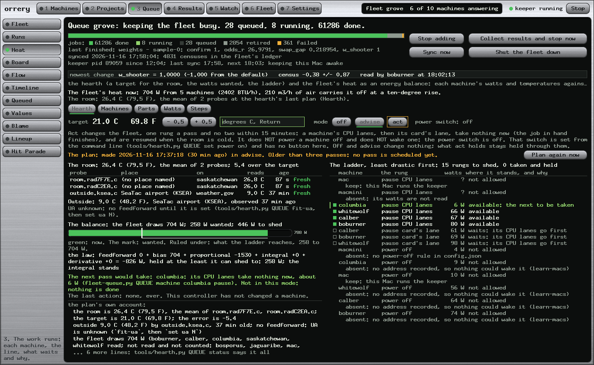
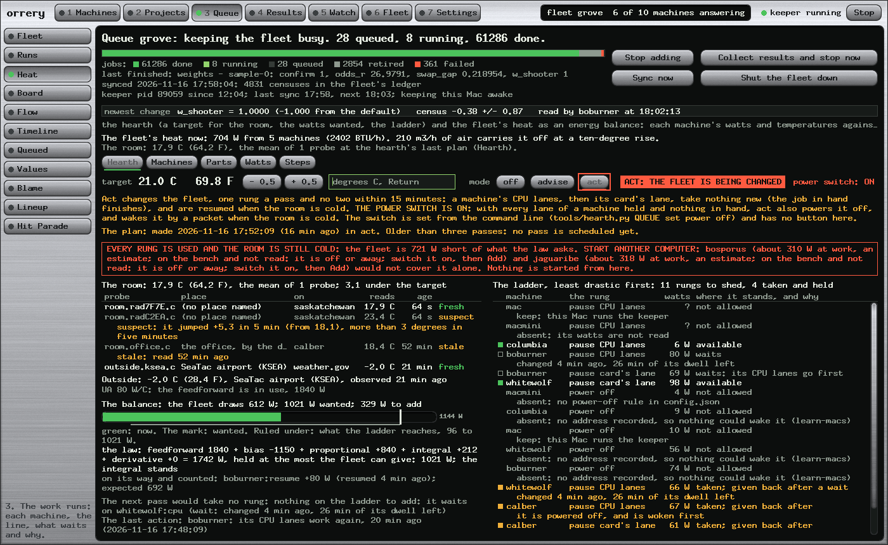
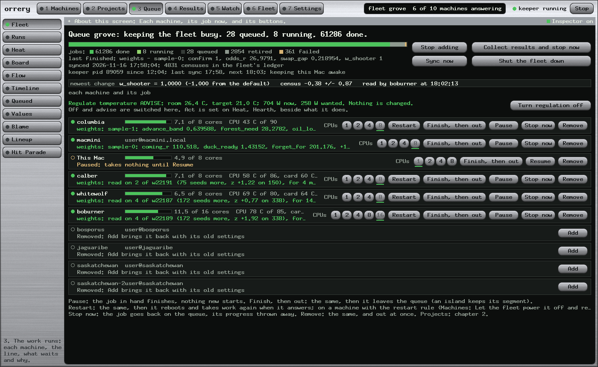

# Holding the Room: The Fleet's Watts Set by a Target, the Room's Thermometers and SeaTac's Air

*Paul Richeson · Lab Report — IEEE Format · 16 November 2026*

Copyright (c) 2026 Paul Richeson. MIT licensed, as orrery.

Companions: `tools/hearth.py` (the controller) and `tools/hearth-check.sh` (its proof); `tools/fleet-probes.py`, `tools/fleet-probes.sh` (finding Geiger counters on the fleet's machines and serving them) and `tools/fleet-radbeeper-root.sh`, `tools/fleet-cpu-cap.sh` (the two recipes that need root, written and not run); `docs/hearth-controller.md` (the guide, with the plan's fields); `src/heat.rs` (the Heat screen's Hearth panel) and `src/fleet.rs` (the Fleet screen's switch); `docs/hearth-lab-report.md` (yesterday's report, which this one follows); `tools/hearth-house.py` (the house's heat balance fitted from the records) and `docs/hearth-measure-plan.md` (the plan for measuring it).

## Abstract

Paul, 16 November 2026: "this will be additions to orrery which sets a dynamic heat target, which scales back like a PID controller, which sets the CPU core throttling, until it shuts down systems. If the house is cold, we can boot, but systems should unschedule and stop accepting new queue jobs while we reduce total wattage, appropriate to maintaining steady heat. You can also have a WOL type effect to turn systems back on." And: "the auto method on the fleet screen with a regulate temperature, configurable on the heat screen, for target temp. use wattage and use external temperature, our current configuration is at seatac airport temp."

Yesterday's report ended with no thermometer in the room. Today there are two: the Geiger counters on saskatchewan each carry one, and radbeeper now reads it. With a room temperature to hold, the fleet can be told how many watts to burn. `tools/hearth.py` does that. It reads the room's probes and the outside air at SeaTac airport, works out the watts the room wants from a target, and compares them with the watts the fleet draws. The difference becomes one step on a ladder: a machine's CPU lanes take no new jobs, then its card's lane, then, only if a second switch is on, the machine is powered off. When the room is cold it goes the other way: lanes are resumed first, and a machine that was powered off is sent a wake-on-LAN packet and then given its lanes back.

It runs in one of three modes. In *off* it does nothing. In *advise*, the default, it works everything out, writes it down and changes nothing. In *act* it carries out at most one step a pass through the queue's own commands. A proof script drives it through sixty claims on a scratch queue and a simulated room, and it passes. Against the live fleet it has run in advise only. Its first pass read the room at 26.4 °C against a target of 21.0 °C and said to shed 446 W, beginning with columbia's CPU lanes. Nothing was done.

It has never acted on a real machine. Wake-on-LAN has not been tried, no machine's BIOS was read, the house's own time constant is not measured, and the loss of the house per degree is not measured, so the outside temperature is read and shown but not yet used in the law.

That evening the house's own heating was switched off, which leaves the fleet as the heat that is known. Section XI, added then, writes down the house's heat balance, shows that the three things it needs are already recorded, and takes from the first six hours the one thing they give: the room is cooling with the fleet at 749 W, so the house loses more than 42 W for each degree. It then sets out what two days and one step in the fleet's watts will give, with the arithmetic.

## I. The question

1. Given a room temperature and a target, how many watts should the fleet be burning?
2. How is that many watts reached without throwing work away or flapping machines on and off?
3. What does the outside temperature add, and where does it come from?
4. Where is it switched, and what must stay in a person's hands?

## II. What the reader needs

**A machine is a heater.** Every watt a computer draws leaves it as heat into the room. The fleet's wall watts are the heater's output.

**A probe** is one thermometer with a name, a place and a role: *room* (what is being held), *outside*, *intake*, *exhaust* or *other*. It arrives in a machine's telemetry as a key such as `room.radC2EA.c`, a reading every five seconds.

**A lane** is one stream of jobs on a machine. A machine with a graphics card has a CPU lane and a card lane, and their watts are separate. A lane that is *paused* finishes the job in hand and takes no new one. That is the queue's own verb and it throws nothing away.

**The ladder** is every such step the fleet has, in order of how little each disturbs.

**UA** is the house's loss in watts for each degree the inside is above the outside. A house at 21 °C with 9 °C outside and a UA of 100 W/°C loses 1,200 W.

## III. The probes

### A. Room

| Probe | Where it comes from | Reading at 17:37 |
|---|---|---|
| `room.rad7F7E.c` | GMC-320 Re 4.26 on saskatchewan | 26.8 °C |
| `room.radC2EA.c` | GMC-320+V4 Re 4.83 on saskatchewan | 26.0 °C |

Both are inside a counter's case, on the same machine, and 0.8 °C apart. Neither has been compared with a thermometer in the air, and neither has a place named yet. The controlled temperature is their mean.

A probe is not believed one sample at a time. The controller takes the median of a probe's last five minutes. It discards `85.0` and `-0.0` outright: both are what a counter says when its thermometer has no reading to give, and the +V4 counter sent `-0.0` forty-two times in the first day's telemetry before radbeeper and the collector were changed to drop it. A probe whose median moved more than 3 °C in five minutes is left out of that pass and named. A probe not heard from in ten minutes is stale. With no fresh room probe the pass does nothing at all.

### B. Outside

The outside probe is the latest observation at SeaTac airport, station KSEA, from the US National Weather Service [1]. One request returned 9.0 °C, observed at 01:00 UTC on 17 November. It is fetched at most every twenty minutes, kept in a small log, and treated as stale after two hours or a failed fetch. The station is one word of configuration. The request carries a program name and nothing about the house.

The airport is not the house's own wall. It is the nearest reading that needs no hardware.

### C. Finding more

`tools/fleet-probes.py` looks at every fleet machine for a USB serial device and says what each is from its USB identity, without opening the port, because opening a port restarts some devices. Only one that could be a GQ counter is asked. On 16 November:

| Machine | Device | What it is |
|---|---|---|
| saskatchewan | two | a GMC-320+V4 and a GMC-320, both with thermometers, both served by its boot service |
| columbia, calber, boburner, whitewolf | none | |
| bosporus, jaguaribe | not reached | their names did not resolve; they were off |

A GMC-300, 500 or 600 would be read for counts and gives no temperature; only the GMC-320 answers the thermometer command [2]. Installing radbeeper as the ordinary user was tried on whitewolf, which has no counter, and took 44 seconds. Starting a service for a free counter has not been tried, because there is no free counter.

## IV. The law

The watts wanted are

    W = bias + UA × (target − outside) + Kp × e + Ki × ∫e dt

with `e = target − room`, in degrees.

| Term | Default | Why |
|---|---|---|
| `Kp` | 300 W/°C | four degrees of error asks for the whole 1.2 kW |
| `Ki` | 25 W/°C per hour | an integral time of twelve hours |
| `Kd` | 0 | a probe in tenths read every five minutes gives a derivative that is mostly noise |
| deadband | 0.3 °C | inside it nothing changes and the integral stands |
| `UA` | unknown | so the second term is zero until it is set |

The gains are slow on purpose. The room's time constant is not measured, and a controller faster than the thing it controls oscillates.

Three details keep it honest. The integral does not grow while the output is held at a limit and the error pushes further, so it cannot wind up over a night the fleet cannot heat through. The bias starts at the watts the fleet draws, and absorbs the feedforward when the outside reading comes or goes, so losing the airport does not move the fleet. And no step is taken against the room: heat is not added to a room above its target nor shed from one below it. Without that last rule the simulated room shed one rung and gave it back half an hour later, for days.

**UA from the record.** `hearth.py fit-ua` looks for three-hour stretches in which the room moved less than 0.3 °C and takes the fleet's mean watts over the mean of room less outside. It reports the figure and the hours behind it and does not adopt it. It wants twelve steady hours; the room has been read for one afternoon. The fleet is also not the house's only heat, so what it finds is watts of fleet per degree with everything else as it was. A house with its heating off and the outside moving does not hold within 0.3 °C, so this rule may never be met; section XI replaces it with a fit of the moving room.

## V. The ladder

Each rung is priced in watts: what the part draws now, less an idle figure that is an estimate. The prices move with what each machine is doing. This is the ladder as `status` printed it at 17:44; the picture in section VI is the plan made seven minutes earlier, at 17:37, when the same CPU rungs read 6, 66, 67 and 80 W and the cards 61, 69 and 98 W.

| Step | Watts | State |
|---|---|---|
| columbia: CPU lanes take nothing new | 5 | open |
| boburner: CPU lanes | 64 | open |
| calber: CPU lanes | 67 | open |
| whitewolf: CPU lanes | 72 | open |
| boburner: card's lane | 0 | waits for its CPU lanes |
| whitewolf: card's lane | 37 | waits |
| calber: card's lane | 151 | waits |
| columbia, whitewolf, calber, boburner: powered off | 9 to 73 each | not allowed: the power switch is off |
| this Mac | | kept: it runs the keeper |
| the Mac mini | | absent: its watts are not read |

**Pace.** One step a pass, fifteen minutes between any two changes, thirty minutes before the same machine is touched again. The seven lane rungs therefore take at least an hour and a half to shed, and the whole ladder with the power rungs about three hours.

**What is never touched.** A machine marked *keep*; this Mac; a machine a person paused, or one that is restarting or leaving the queue; a machine on the bench; a machine whose watts are not read. A machine that carries a room probe is never powered off, which today means saskatchewan.

**Power.** Powering a machine off and waking it sit behind a second switch, `set power on`, which is off. With it off, *act* pauses and resumes lanes and does nothing else. The queue has no command to power off one machine, so that rung sends the machine's own power-off rule over ssh, as the queue's whole-fleet shutdown does, and only when it has no job in hand.

**Waking.** `hearth.py wake NAME` sends the usual 102-byte packet to the address `learn-macs` read from each machine. On whitewolf and boburner that address is the 10 GbE card on the default route; whether those cards wake their machines is not known.

**CPU throttling.** Without root, throttling means lanes taking no new work, and that is what the ladder uses. A real cap on a CPU's watts or clock needs root. It is written as a recipe, `tools/fleet-cpu-cap.sh`, for Paul to run with his own password; it has not been run and the controller does not call it.

**Another computer.** When every rung is used and the room is still cold, the plan names the shortfall and which benched or powered-off machine would cover it. In the proof's scratch fleet, 1,410 W short, it names bosporus at about 249 W. The made-up plan pictured in section VI is a different one, 721 W short, and says the same thing with its own figures. It is a line in the plan and nothing more.

## VI. The two screens

Paul asked for the switch on the Fleet screen and the target on the Heat screen. Both are in Orrery, and both run the queue's `hearth` verb, which passes four things on to `tools/hearth.py` and no others: `target`, `mode`, `step` and `status`. The power switch, the gains, the probes and the machines' addresses are not reachable from a button.

### A. The Heat screen: the Hearth panel



The panel is the first of five on the Heat page. From the top:

| Part | What it shows, and what it runs |
|---|---|
| The target | in °C and °F; `- 0.5` and `+ 0.5`, and a field that takes `21.5`, `21 C` or `70 F`; each runs `hearth target` |
| The mode | three chips: off, advise, act. Act is framed in the alarm colour and asks to be pressed twice |
| The power switch | its state, and no button. The paragraph under it says what act will and will not do |
| The room | the controlled temperature, and each probe with its place, reading, age, and whether it is fresh, suspect or stale; then the outside probe and whether the feedforward is in use |
| The balance | the fleet's watts as a bar with a mark at the watts wanted, and the law's terms in one line |
| The ladder | every rung in order with its watts and where it stands, the next to be taken marked |
| The plan | the last action, and the controller's own account |

A plan older than three passes is drawn in amber, since no pass is scheduled yet. A button that fails says so on the panel and stays there.



The second picture is a made-up plan in a scratch queue, to show the states the live fleet has not been in: act in force, the power switch on, one probe suspect and one stale, the feedforward in use, four rungs taken, and across the top the line that says every rung is used, the room is still cold, and which machine would help.

### B. The Fleet page: the switch



On the Queue's Fleet page, above the machines it would pause, one line says the mode, the room, the target and the watts now and wanted, with one button: turn regulation off, or on to advise. Going to act is done only on the Heat screen, where the consequences are written out. The same two choices are in the Fleet menu.

Both screens were checked as rendered pictures. No button was pressed.

## VII. What the proof shows

`tools/hearth-check.sh` builds a scratch queue, fabricated telemetry and a stand-in for the queue's command, and makes sixty claims. It ends `PASSED`, and it asserts that the live queue's files were not written.

| Claim | Result |
|---|---|
| off writes nothing; advise plans and runs nothing | holds |
| 85.0, a `-0.0`, one wild sample, a five-degree jump | none is taken as the temperature |
| a stale probe, no probe, or unknown watts | the pass does nothing |
| a warm room | sheds in order, one a pass, dwell kept: the scratch fleet fell from 1,220 W to 232 W |
| a cold room | adds back in reverse: lanes that were paused first, then each powered-off machine by a wake packet, its card's lane and its CPU lanes |
| a machine a person paused; a *keep* machine | never touched |
| UA 80 and the outside five degrees colder | 400 W more is asked before the room has moved |
| a failed fetch; a stale observation | not fatal; the feedforward drops out and the plan says why |
| eight hours held at a limit | the integral stays at 0 W; unbounded it would reach 979 W |
| the wake packet | 102 bytes, read back off a local socket |

**The simulated room.** First order, 0.008 °C/W, outside at 14 °C, begun at 24 °C with the fleet at 1,220 W:

| Case | Third day stays within | Changes that day |
|---|---|---|
| time constant 6 h | 0.45 °C of 21 | 5 |
| time constant 24 h | 0.17 °C | 0 |
| 6 h, outside swinging 10 to 18 °C, UA set to 125 | 0.53 °C | 14 |
| the same, no feedforward | 1.35 °C | 12 |

The outside temperature, once UA is known, more than halves the error in a room that follows the weather. The simulated room has no delay, an ideal thermometer, and watts that fall the moment a lane is paused. The house has none of those.

## VIII. The first pass on the live fleet

Advise mode, 16 November, 17:37:

```
the room is 26.4 C (79.5 F), the mean of room.rad7F7E.c, room.radC2EA.c; the target is 21.0 C (69.8 F); the error is -5.4
outside 9.0 C (48.2 F) by outside.ksea.c, 37 min old; no feedforward: UA is unknown (`fit-ua`, then `set ua N`)
the fleet draws 704 W (boburner, calber, columbia, saskatchewan, whitewolf read; not read and not counted: bosporus, jaguaribe, mac, macmini); wanted 257 W (bias 704, P -1529, I +0), held at the least it can shed to (the law alone asks -825 W; the integral stands)
to shed 446 W: columbia: its CPU lanes take nothing new, about 5 W (the CPU's watts read now, less its idle (an estimate))
    fleet-queue.py QUEUE machine columbia pause
advise: nothing was done
```

The figures in this account are cut to whole watts where the plan's own fields are rounded, so the panel in section VI shows 258 W wanted, −1530 and −826 for the same pass, and 704 less 258 is the 446 W to shed.

Four things in it are worth a decision.

- **The target of 21.0 °C was set to give the first pass something to say.** Paul has not chosen it.
- **The room reads 26.4 °C from inside two counters' cases on one machine.** A target meant for the air of a room will ask the fleet to shed everything against that. The probes want places, and probably an offset or a probe in the air.
- **The fleet drew about 700 W, not 1.2 kW.** bosporus and jaguaribe were off and saskatchewan idle. Without the power switch the whole range the controller can shed is about 500 W.
- **Cheapest first sheds columbia's 5 W first**, for almost no heat. An order can be set for each machine.

## IX. Method

The controller was written and proved on a scratch queue; the live queue was read and never commanded. The check was run twice, once by its author and once for this report. The live pass, the weather fetch and the fleet look were each run once on 16 November. The screens were checked as rendered pictures and not used.

## X. What is not done

- *act* has never run against the real queue. No lane was paused, no machine powered off, no wake packet sent to a machine.
- Wake-on-LAN is untried and needs enabling in each machine's BIOS; none was read.
- The CPU cap recipe and the radbeeper boot-service recipe are written and not run.
- UA is not measured. One evening bounds it: more than 42 W/°C (section XI). The feedforward is therefore not in use on the live fleet.
- The house's time constant is not measured. The gains are a guess made slow; section XI gives the rule that will replace the guess.
- The fleet's watts are a model of each box and not a meter's reading. UA will be wrong by whatever fraction they are.
- The controller is not scheduled. It runs when asked. The natural hook is the queue's five-minute telemetry pull, and it is not added.
- All room probes are averaged into one temperature. There are no zones.
- A finer dial than a whole lane, such as a machine's count of busy cores, is not on the ladder.
- Pausing a machine's CPU lanes alone is two queue commands on a machine with a card, and the queue rehomes pinned jobs at the pause. A single verb for it in the queue would be cleaner and is not written.
- The outside reading is the airport's and not the house's.

## XI. What the house loses, and how it will be measured

*Added the evening of 16 November.* Paul: "I have turned heating to the house off, so temperatures should be related to system wattage. Confirm that you have the data necessary to calculate heat loss, the UA value ... show math. if its unknown show future calculation."

### A. The balance

The room is treated as one lump of heat:

    C dT/dt = P + P0 − UA (T − To)                                   (1)

T is the room and To the outside, in °C. P is the fleet's watts. P0 is every other watt the house gets: people, the refrigerator, lights, the sun. UA is as in section II. C is the joules that warm the room one degree. Where the room settles, and how fast:

    T_ss = To + (P + P0) / UA                                        (2)
    T(t) = T_ss + (T(0) − T_ss) e^(−t/τ),      τ = C / UA           (3)

### B. Is the data there

| Quantity | Record | Rate | Since |
|---|---|---|---|
| T | `room.rad7F7E.c` and `room.radC2EA.c` in saskatchewan's telemetry on the Mac; radbeeper's own temperature log on saskatchewan | 5 s; 30 s | both probes from 15:05, 16 November |
| P | every machine's CPU energy counter and card draw in the same telemetry, made wall watts by `tools/plans/power.json` | 5 s | 15 November |
| To | KSEA's observations, kept by `tools/hearth-house.py` in `QUEUE/hearth/outside-history.tsv` | about hourly | the last seven days; 500 observations |

All three are recorded and none depends on the controller being scheduled. The controller's own `record.tsv` has one line; `hearth-house.py` rebuilds the record from the telemetry instead, a line each ten minutes. The weather service keeps about a week, so the tool must run at least weekly.

### C. What six hours give

| Hour, 16 Nov | Room °C | Outside °C | Room over outside | Fleet W |
|---|---|---|---|---|
| 15:30 | 26.50 | 10.8 | 15.7 | 756 |
| 16:30 | 26.48 | 9.8 | 16.7 | 743 |
| 17:30 | 26.43 | 8.9 | 17.5 | 752 |
| 18:30 | 26.45 | 8.5 | 17.9 | 752 |
| 19:30 | 26.20 | 7.8 | 18.4 | 748 |
| 20:30 | 25.98 | 8.0 | 18.0 | 749 |

The room held until about 18:30 and has fallen since, 0.24 °C an hour over the last two hours. A cooling room has the right side of (1) below zero:

    UA (T − To) > P + P0 ≥ P     so     UA > P / (T − To) = 749 / 18.0 = 42 W/°C     (4)

That is a floor. P0 is not zero and the room is still falling, so the true figure is higher by an amount these hours cannot give. Nothing else can be taken from them: a slope needs four hours to stand clear of a probe that reads in tenths, and two such hours exist.

Fleet watts here are 749 W where the pass of section VIII said 704 W. Both are the same model; the pass used one reading of each machine and this is an hour's mean.

### D. What the days will give

Divide (1) by C. It is a line in three recorded things:

    dT/dt = a P + b (T − To) + c,      a = 1/C,   b = −UA/C,   c = P0/C     (5)
    UA = −b/a,     C = 1/a,     P0 = c/a,     τ = −1/b                      (6)

*b* needs the room's height over the outside to change, which night and day do unasked. *a* needs the fleet's watts to change. While they are level, `a P` cannot be told from `c`, and (5) gives two numbers only:

    dT/dt = k + b (T − To)     gives     τ = −1/b,     rise = −k/b = (P + P0)/UA     (7)

By (2) that rise is how far over the outside the room settles at those watts. So **two days with the fleet left alone give the steady temperature for the present fleet**, and the time constant. They do not give UA.

UA comes from a step. Change the fleet by a known ΔP, hold it about a day, and let the fit find the new rise:

    UA = ΔP / Δrise,      P0 = UA × rise − P,      C = τ × UA               (8)

With UA and τ in hand the guessed gains of section IV are replaced, for a loop about as fast as the room:

    Kp = UA,      Ki = UA / τ                                               (9)

and `set ua N` brings the outside term into the law.

**An example with invented numbers**, to show the arithmetic and nothing else. Two days at 750 W give τ = 30 h and a rise of 16.0 °C. The fleet is stepped to 450 W and the rise becomes 12.5 °C. Then UA = 300 / 3.5 = 86 W/°C; P0 = 86 × 16.0 − 750 = 626 W; C = 30 × 3600 × 86 = 9.3 MJ/°C. At 5 °C outside and 750 W the room settles at 5 + 1376/86 = 21.0 °C. Holding 21 °C at 0 °C outside wants 86 × 21 − 626 = 1,180 W. Kp = 86 W/°C and Ki = 2.9 W/°C per hour.

### E. What will be wrong with it

- **The watts are a model.** `power.json` adds an estimated figure for the rest of each box and divides by an assumed supply efficiency. UA inherits the error whole. A plug-in meter on each box corrects it.
- **P0 moves.** The sun and the household add watts by day. The fit is made a second time on 22:00 to 06:00 alone, and the two must agree before either is adopted.
- **The house was warm when its heating went off.** For a day or more the walls and the other rooms give that back, and the room reads as better insulated than it is. The fit is read from the second day.
- **The probes are inside two counters' cases.** A constant offset cancels in every slope and in Δrise, so UA, τ and C are not moved by it. T_ss is high by the offset until a room thermometer is stood beside them once.
- **The airport is not the house's wall,** and one lump is not a house. If the residuals show two time constants, the model wants a second lump.

`tools/hearth-house.py QUEUE` does all of this and adopts nothing. It will not call a three-number fit believable under 48 fitted hours, or with the watts standing less than 80 W apart. `docs/hearth-measure-plan.md` has the days, the size of the step and the list of things to do. The step is Paul's to order; no lane was paused for this section.

## References

[1] US National Weather Service, "API Web Service: station observations." https://api.weather.gov/stations/KSEA/observations/latest

[2] GQ Electronics, "GQ-RFC1201: GQ Geiger Counter Communication Protocol," command 24, Get temperature.

[3] P. Richeson, "The Fleet as the Hearth," Orrery lab report, 15 November 2026. `docs/hearth-lab-report.md`

[4] P. Richeson, "The thermometer," radbeeper lab report, 16 November 2026. https://vonglurt.github.io/radbeeper/docs/the-thermometer.html
