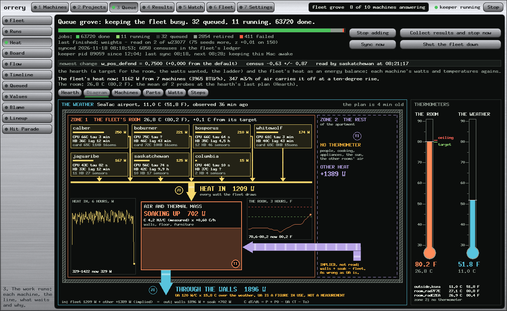
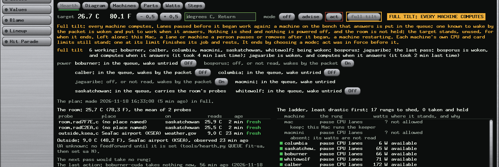

# The hearth controller: probes, a target, a ladder, and what it has and has not been tried on

Paul, 16 November 2026: "add the concept of thermal probes ... in general this will be additions to orrery which sets a dynamic heat target, which scales back like a PID controller, which sets the CPU core throttling, until it shuts down systems. If the house is cold, we can boot, but systems should unschedule and stop accepting new queue jobs while we reduce total wattage, appropriate to maintaining steady heat. You can also have a WOL type effect to turn systems back on. We can see about also creating a 'start a new computer to reach your target temperature'." And, the same day: "use wattage and use external temperature, our current configuration is at seatac airport temp."

This is the guide to `tools/hearth.py`, built that day. It is not a lab report. **THE CONTROLLER HAS NEVER CHANGED A REAL MACHINE.** It has run against the live queue's data in `advise`, which reads and says; everything that acts was proved against a queue directory made for the purpose and stand-in commands (`tools/hearth-check.sh`). It stands on `docs/hearth-lab-report.md` (the house as a model, the probes) and `docs/thermal-telemetry.md` (the record it reads).

## What runs where

| Piece | Root | What it does |
|---|---|---|
| `tools/hearth.py QUEUE ...` | no | the controller: probes, target, mode, one pass (`step`), `status`, `wake`, `learn-macs`, `outside`, `fit-ua` |
| `tools/hearth-check.sh` | no | the proof, on a scratch queue: 60 claims, about a minute |
| `tools/fleet-cpu-cap.sh` | **yes** | a real cap on a CPU's watts or clock, run by hand on a machine. Not installed, not wired in, never run |
| `QUEUE/hearth/` | | everything the controller writes. Nothing outside it is written by `hearth.py` |

## A probe

A probe is a key in a machine's telemetry that is a temperature of air, with a place and a role. The registry is `QUEUE/hearth/probes.json`.

- **Found by itself:** any `room.NAME.c` in a machine's newest telemetry line becomes a probe of role `room`.
- **Named by hand:** `hearth.py QUEUE probe KEY role room|outside|intake|exhaust|other` makes any key a probe or changes its role; `probe KEY place "the office"` says where it is.
- **Roles.** `room` is what the controller holds: the controlled temperature is the mean of the fresh `room` probes. `outside` feeds the feedforward. `intake`, `exhaust` and `other` are shown and not used.
- **Adding one.** A reader on a Linux machine that writes `room.NAME.c` into `/run/fleet-sensors/*.kv` is picked up by the collector and found here at the next pull. A probe on a Mac needs a reader of its own: the Macs run no collector.

**One sample is not the temperature.** A probe's value is the median of its samples in the five minutes before its machine's newest line, after `85.0` and `-0.0` are thrown out: both are what a GMC-320 says when its thermometer has no reading, and saskatchewan's record of 16 November carries `-0.0` 42 times among readings of 26. A probe is **not a temperature**, and is never averaged, when:

- its machine's newest line is older than `stale` (10 minutes), or does not carry it, or the machine has no telemetry;
- every sample in its window was a non-reading;
- its median is outside 0 to 50 (a room) or -50 to 55 (any other role);
- its median moved more than 3 degrees in five minutes since the last pass (more, in proportion, over a longer gap). It is then *suspect for that pass*, named in the plan with the jump; if it stays where it went it is taken at the next pass.

With no fresh room probe a pass plans nothing and does nothing, in every mode.

**The outside** is the airport's. `hearth.py QUEUE outside` fetches the latest observation of station KSEA (SeaTac) from the US National Weather Service and `step` renews it at most every 20 minutes. It is the probe `outside.ksea.c`, with a history in `QUEUE/hearth/outside.tsv`. An observation older than two hours is stale; a fetch that fails is said in the plan and changes nothing else. The request carries a generic client name and nothing of this house. `hearth.py QUEUE station KBFI` names another station. A probe of role `outside` at the house, when one is fresh, is used before the airport's.

## The control law

    e      = target - T_room                                  degrees C
    wanted = UA x (target - T_outside)                        the feedforward, watts
           + bias + kp x e + integral(ki x e dt) - kd x dT_room/dt      the correction, watts

`wanted` is the watts the fleet should be drawing at the wall. It is compared with the watts the fleet draws now (`QUEUE/plan/thermal.json`, the sum of the machines read in the last ten minutes), corrected for changes on their way: a lane shed whose job in hand still runs, a lane resumed in the last ten minutes.

| Setting | Default | Unit | What it is |
|---|---|---|---|
| `kp` | 300 | W/C | watts for a degree of error |
| `ki` | 25 | W/C/h | watts added each hour a degree of error stands |
| `kd` | 0 | W per C/h | watts taken off for the room's own rise of a degree an hour, from a line through its last half hour. Off |
| `deadband` | 0.3 | C | an error inside this is no error; outside it, only its excess counts |
| `ua` | unknown | W/C | the house's loss as the fleet sees it. Unknown: no feedforward |
| `gap` | 900 | s | the least time between two changes to the fleet |
| `dwell` | 1800 | s | the least time between two changes to one machine |
| `stale` | 600 | s | a probe older than this is not a temperature |
| `outside_stale` | 7200 | s | the same, for the airport's observation |
| `outside_every` | 1200 | s | the least time between two fetches |
| `watts_stale` | 900 | s | `thermal.json` older than this: the fleet's watts are not known, and nothing is planned |
| `settle` | 600 | s | how long a change counts as not yet in the watts read |
| `wake_wait` | 1200 | s | how long a woken machine is waited for |
| `floor` | 0 | W | the fleet is never asked below this |
| `power` | off | on, off | whether `act` may power a machine off and wake it |

`hearth.py QUEUE set` lists them as they stand; `set KEY VALUE` changes one; `set ua unknown` takes UA away.

**Why they are slow.** The room's own time constant is not measured: the house's step test of `docs/hearth-lab-report.md`, Section VIII, has not been run, and the only room readings are a day old. So the defaults assume nothing about it but that it is hours. kp 300 means four degrees of error asks for the whole fleet, about 1.2 kW. ki 25 is an integral time of twelve hours (kp / ki), longer than the time constant a house this size is likely to have, so the integral trims and does not drive. kd is off: the probe steps in tenths of a degree and is read every five minutes, and a derivative of that is noise. And whatever the law asks, the ladder moves one rung a pass, no two changes within 15 minutes, none to one machine within 30. Shedding the whole ladder takes about three hours.

**The bias** is what makes the controller begin where the fleet is: at its first pass, and after any change of mode or of UA, it is the watts the fleet then draws less the feedforward at that moment, and the integral is nothing. When the feedforward comes or goes (the outside reading returns or goes stale) the bias takes its size up, so the watts wanted do not move for it.

**Anti-windup.** `wanted` is held between what the ladder can shed down to and what it can add up to. While it is at a limit and the error pushes it further, the integral does not grow.

**No rung against the room.** Heat is not added to a room over its target nor shed from one under it, whatever the watts say. Without this rule the check's simulated room sat on the edge of the deadband shedding one rung and giving it back thirty minutes later, for days.

**The feedforward and UA.** A house loses heat in proportion to how far it is above the outside, so a colder outside should raise the watts before the room has fallen. UA is the watts for each degree. **It is unknown, and the feedforward is nothing until it is set.** `hearth.py QUEUE fit-ua` estimates it from `QUEUE/hearth/record.tsv` (a line each pass: time, room, outside, watts): over each three hours in which the room moved less than 0.3 degrees and stood at least three over the outside, UA is about the mean watts over the mean difference. It prints the median, the hours it rests on and the spread, and the command that would set it. It adopts nothing.

Two things about that number. **The fleet is not the house's only heat**: people, sun, cooking and whatever else heats the house are in the room's temperature and not in the fleet's watts, so UA fitted this way is "watts of fleet for a degree, with everything else as it was in those hours". And **there is not enough record to fit it**: the room has been read since the afternoon of 16 November and `record.tsv` began with one line that evening. It wants at least twelve steady hours, and means little before it has seen several days and nights.

## The ladder

Least drastic first. To shed:

1. **A machine's CPU lanes take nothing new.** The queue's pause: the job in hand finishes. Every machine's CPU lanes go before any card's, the machine whose CPU draws least first.
2. **Its card's lane takes nothing new**, after its CPU lanes.
3. **The machine is powered off**, once all its lanes are held here and none has a job in hand. Only with `set power on`.

To add, in the other order: the lanes held are resumed, newest held first; a powered-off machine is woken only when nothing is left to resume on a machine that is up; then its card's lane, then its CPU lanes.

**What a rung is worth.** The CPU lanes: the CPU's watts read now, less its idle. The card's lane: the card's watts read now, less its idle. Power-off and wake: the machine idle. The watts read now are measured (the CPU's own counter on the five Linux machines in the queue, the card's own figure). **The idle figures are estimates** from `tools/plans/power.json`, and each rung in the plan says where its figure is from. `hearth.py QUEUE machine NAME busy_w W` and `idle_w W` override them when a meter says otherwise. A rung resumed is priced at what it was worth when it was shed. A rung is taken only when taking it leaves the fleet nearer the watts wanted than leaving it: when the difference is at least half the rung.

**Never:**

- a machine marked keep (`machine NAME keep on`), and this Mac, which runs the keeper;
- a machine any of whose lanes a person paused, or that is restarting or leaving. The controller knows its own pauses from `state.json`; a paused lane it does not hold is a person's;
- a machine on the bench;
- a machine whose watts are not read (the Mac mini: no collector);
- a power-off of a machine that carries a room probe (saskatchewan), that has no power-off rule, or that has no hardware address recorded, because nothing could wake it;
- more than one rung a pass.

A lane a person resumes is dropped from what is held here and not shed again inside its dwell. To keep the controller off a machine for good, mark it keep.

**When every rung is used and the room is still cold** the plan says how many watts the fleet is short of what the law asks and names the benched machine whose estimated draw at work would cover it, or all of them if none would alone, with how to bring it back. That is a sentence in the plan. Nothing is started.

## CPU throttling: what there is without root, and what needs it

**Without root** the fleet has two dials, both the queue's: a lane takes no new job (`machine NAME pause`), and a machine's jobs are told fewer CPUs (`machine NAME cpus 1|2|4|8`). The ladder uses the first. The second is the finer dial and is **not on the ladder**: what a machine draws at each setting has not been measured.

**With root** the kernel can hold a CPU that goes on working to fewer watts (Intel's RAPL limit, `/sys/class/powercap/intel-rapl:N/constraint_0_power_limit_uw`) or to a lower clock (`scaling_max_freq`, any CPU). `tools/fleet-cpu-cap.sh` is that recipe: `show`, `watts N`, `clock PERCENT`, `off`. It writes nothing to disk, so a reboot removes every cap. It is run on the machine by a person, under doas or sudo, the machine asking for its own password, as `fleet-sensors.sh` is. **It is not installed on any machine, not part of `fleet-root-round.sh`, not called by `hearth.py`, and has been checked for syntax only.** A controller that set it would need root at its call on every machine, which is the passwordless-root decision `docs/thermal-telemetry.md` leaves to Paul.

## Modes, and turning it on

    hearth.py QUEUE target 21.0      the target, degrees C (it answers in F as well; 5 to 35 is accepted)
    hearth.py QUEUE mode advise      the default: step computes, writes the plan, changes nothing
    hearth.py QUEUE mode act         step does at most one rung a pass
    hearth.py QUEUE mode off         step reads nothing and writes nothing
    hearth.py QUEUE mode full        full tilt: every machine computes, the room is not held (below)
    hearth.py QUEUE set power on     act may also power off and wake
    hearth.py QUEUE step             one pass
    hearth.py QUEUE status           one screen; changes nothing in any mode

A change of mode starts the law again where the fleet is. What is held stays held through `off` and `advise`, and is given back only by `act` or by hand; `mode` says what is still held.

**What `act` does.** Pause and resume are the queue's own commands, run as a subprocess: `fleet-queue.py QUEUE machine NAME pause|resume`. No queue file is written by `hearth.py`. A command that fails is recorded with what it said and is not tried again in that pass; the gap then applies. Each thing done is a line in `QUEUE/hearth/log.jsonl`.

**What `act` cannot do through the queue, and how it is done instead.**

- **The CPU lanes alone.** The queue pauses a machine's lanes all together, or a card's lane alone. So "the CPU lanes of calber" is two commands: `machine calber pause`, then `machine calber-cuda resume`. Between the two the card's lane is paused for a moment; it has its job in hand, so it loses nothing, but the queue's rehoming runs at the pause, and a queued job pinned to `calber-cuda` that names another place it may run would be moved there. A `machine NAME pause cpu` in `fleet-queue.py` would remove this. It was not added: saving that file restarts the live keeper.
- **Power-off of one machine.** The queue has `shutdown-now` for the whole fleet and nothing for one machine. The rung sends the machine's own power-off rule from `config.json` over ssh, as the keeper's shutdown sends it. A machine paused and off raises no flag in the keeper: paused comes before reachable. This is the one thing `act` does outside the queue's commands, which is why it has its own switch.
- **Wake** is a packet from this Mac; see below.

## Wake-on-LAN

`hearth.py QUEUE learn-macs` reads each machine over ssh, read-only (the interface of its default route, that interface's hardware address and broadcast address), into `QUEUE/hearth/machines.json`. `hearth.py QUEUE wake NAME` sends the magic packet, 102 bytes (six of FF, then the address sixteen times), three times, to the broadcast address on UDP port 9. `machine NAME mac|broadcast|port` sets them by hand.

**A machine wakes only if its BIOS has wake-on-LAN enabled and its network card stays powered when it is off. This has not been tried on any machine of the fleet, and no setting was read.** Read on 16 November: columbia, calber, whitewolf, boburner, saskatchewan and the Mac mini. On whitewolf and boburner the default route is the Mellanox 10 GbE card, so that is the address recorded; whether a ConnectX-2 wakes its machine is not known, and the board's own port may be the one that does. Bosporus and jaguaribe were off and are not recorded. A machine woken that does not answer within 20 minutes is said in the plan and tried again after its dwell.

## The files, field by field

Orrery's Heat panel and the Fleet screen's switch are to read these two and to call `target` and `mode`. Every key is present in every file; a key a pass did not reach is null, an empty list or an empty string.

**`QUEUE/hearth/state.json`**

| Key | What |
|---|---|
| `mode` | `off`, `advise` or `act` |
| `target_c` | the target, or null when none is set |
| `outside_station` | the weather station, `KSEA` |
| `set` | the settings changed from their defaults, by name; one absent is at its default |
| `held` | machine to what this controller holds of it: `cpu`, `card`, `off`, each `{t, w}` (when, and the watts it was worth); `off` gains `woke` once a wake is sent |
| `added` | machine to `{t, w}`: a resume not yet in the watts read |
| `changed` | machine to when it was last changed (the dwell) |
| `integral_w`, `bias_w` | the law's integral and bias; `bias_w` null until the first pass |
| `feedforward_w`, `ff_on` | the last feedforward and whether there was one |
| `last_step_t`, `last_action_t`, `outside_tried_t` | epoch seconds; absent until there is one |
| `last_action` | the last rung carried out, as a line of `log.jsonl`: `t`, `at`, `rung`, `side`, `what`, `watts`, `ok`, `ran` (each command, whether it succeeded, what it said) |
| `probe_last` | probe to `{t, c}`: what each said at the last pass, for the jump rule |

**`QUEUE/hearth/plan.json`**, written by each `step` unless the mode is off

| Key | What |
|---|---|
| `t`, `made`, `mode`, `target_c` | when, and the settings of the pass |
| `stopped` | why nothing was planned (no target, no fresh room probe, watts unknown), or empty |
| `probes` | every probe: `key`, `role`, `machine`, `place`, `c`, `age_s`, `ok`, `why` (why it is not a temperature, or empty) |
| `temp_c`, `temp_from` | the controlled temperature and the probes it is the mean of |
| `outside_c`, `outside_age_s`, `outside_from` | the outside, its age, and which probe |
| `ua_w_per_c` | UA, or null when unknown |
| `feedforward_w`, `feedforward_why` | UA x (target - outside); 0 with the reason when there is none |
| `correction_w` | bias + P + I + D |
| `terms` | `bias_w`, `p_w`, `i_w`, `d_w` |
| `gains` | `kp_w_c`, `ki_w_c_h`, `kd_w_per_c_h`, `deadband_c` |
| `error_c`, `error_past_deadband_c` | target less room, and its excess over the deadband |
| `unclamped_w`, `floor_w`, `max_w`, `wanted_w` | what the law asks, the limits, and the watts wanted between them |
| `clamped`, `integral_held` | which limit it is at, or empty; whether the integral stood this pass |
| `now_w`, `read`, `not_read` | the fleet's watts now, the machines in that sum, and the machines not read |
| `pending`, `expected_w` | changes on their way (`rung`, `w`, `why`) and the watts with them counted |
| `diff_w` | wanted less expected |
| `ladder` | every rung: `id` (`calber:cpu`), `side` (`shed`, `add`), `kind` (`cpu`, `card`, `off`, `resume`, `wake`), `machine`, `what`, `watts`, `from`, `state` |
| `would`, `why_not` | the rung this pass would take (`rung`, `side`, `what`, `watts`, `from`, `cmds`), or null and the reason |
| `did` | in `act`, the rung carried out, as `last_action`; else null |
| `shortfall` | `w`, `would_cover` (`machine`, `about_w`, `how`), `covers`; or null |
| `said` | the account in words, a line an entry |

A rung's `state` begins with one of: `open` (it can be taken now); `wait` (it opens by itself: a dwell, a job in hand, a less drastic rung first); `after` (it opens once another rung is taken); `keep`; `by hand`; `on the bench`; `absent` (it cannot be priced or done); `not allowed` (power is off).

The other files: `probes.json` (the registry), `machines.json` (name to `mac`, `dev`, `broadcast`, `port`, `keep`, `busy_w`, `idle_w`, `order`), `log.jsonl` (what was done), `record.tsv` (each pass), `outside.tsv` (fetch time, degrees C, the observation's time in epoch seconds and as given, the station).

## What the check proved

`sh tools/hearth-check.sh`, 60 claims on a scratch queue under the real machines' names with made-up addresses:

- the wake packet's bytes, and that `wake` sends them (read back off a socket on this machine);
- a `room.NAME.c` is found by itself; a key becomes a probe by naming its role; 85.0, a `-0.0`, one wild sample and a jump of five degrees are each not taken for the temperature;
- a failed fetch of the outside is not fatal; UA unknown means no feedforward; with UA 80 and the outside five degrees colder the watts asked rise 400 W before the room moves; a stale outside drops the feedforward and does not move the watts wanted;
- off writes nothing; advise plans and runs nothing;
- a warm room sheds one rung a pass in ladder order, with the dwell kept; power-off only with the switch, only with nothing in hand, never the probe's machine, never a keep machine, never one a person paused, never the bench;
- a cold room resumes before it wakes, and wakes the last powered off first;
- every rung used and still cold: the shortfall and a benched machine named;
- the integral does not grow at a limit; a failed command is recorded and not retried; a stale probe, no probe, and unknown watts each stop everything;
- a simulated room, first order, R 0.008 C/W, outside 14, begun at 24 with the fleet at 1,220 W: with a time constant of 6 hours its third day stays within 0.45 of 21 on 5 changes; with 24 hours, within 0.17 on none. With the outside swinging 10 to 18 over a day and UA set to the room's own 125 W/C it stays within 0.53; without the feedforward, within 1.35. `fit-ua` on the first room's record finds 123 W/C;
- the live queue's `config.json` and its `hearth` directory were not written by the check.

The simulated room is one first-order lag with no delay, a thermometer that reads the room's air, and machines whose watts fall the moment a lane is paused. The house is two rooms and a fan, the thermometer is inside a counter's case, and a card's job in hand can run half an hour after its lane is paused.

## The first pass on the real data

16 November, 17:37, `advise`, target set to 21.0 for the purpose: two room probes, both on saskatchewan, reading 26.8 and 26.0, mean 26.4; the airport at 9.0; the fleet at 704 W from five machines read; the law at its lower limit, 257 W; the first rung columbia's CPU lanes, about 5 W. Nothing was done.

## Scheduling it

The natural place is the end of `tools/telemetry.py pull`, which the queue's housekeeping runs every five minutes and which already makes `thermal.json` before it returns. One line after the model there:

    subprocess.run([sys.executable, os.path.join(HERE, "hearth.py"), q, "step"], timeout=300)

inside the same `try`, so a pass that fails costs the pull nothing. **It is not added.** In `advise` it would only write `QUEUE/hearth/plan.json` each five minutes and build the record `fit-ua` needs. When the controller starts running on the live queue, and when `act` is set, are Paul's to decide.

## What is not done

- No real machine has been paused, resumed, powered off or woken by this controller. `act` has run only against the stand-ins.
- Wake-on-LAN has not been tried on any machine, and no BIOS setting was read or changed.
- `fleet-cpu-cap.sh` has not been run anywhere.
- The step is not scheduled. `record.tsv` grows only when `step` is run.
- UA is unknown, and cannot yet be fitted.
- The room's time constant is not measured, so the gains are a slow guess and not a tuning.
- Both room probes are GMC-320 counters on saskatchewan. Each reads inside its own case and has not been compared with a thermometer in the air; where each counter sits is not recorded (`probe KEY place ...` is for that). A target of 21 against them is a target for the inside of a counter.
- The outside is an airport some distance from the house, on the hour.
- Two rooms are not two zones here: every `room` probe is averaged into one temperature and the fleet is one heater.
- `machine NAME cpus N` is not on the ladder.
- The CPU lanes alone are two queue commands, with the rehoming caveat above.
- The Mac mini is not on the ladder (nothing reads its watts), and this Mac's own draw is not in the fleet's sum.
- Orrery draws the plan and sets the target and the mode (the Heat page's Hearth panel, and a line on the Queue's Fleet page); it was checked as pictures and no button was pressed. Nothing in Orrery sets the power switch, the gains or a probe.
- Humidity, the price of a kilowatt-hour and the house's other heating do not enter.

## Switching a machine on and off (17 November)

`docs/hearth-power.md` is the procedure: arming a card for wake-on-LAN (`tools/fleet-wol.sh`), the test that proves a machine wakes, and the two orders a person can give from the Hearth panel's power row or the command line:

    hearth.py QUEUE power-on NAME      the wake packet; when it answers it is put in the queue
    hearth.py QUEUE power-off NAME     it takes nothing new, leaves the queue when its jobs end, is powered off
    hearth.py QUEUE machine NAME wol on|off    whether it is known to wake by the packet

The controller's own power-off rung is closed for a machine not marked `wol on`. Since 17 November the pass runs after every telemetry pull in advise and in act (`tools/telemetry.py`).

    hearth.py QUEUE set law hold|ladder        which law acts
    hearth.py QUEUE set ceiling 27.2           the hold's ceiling, degrees C

Since 17 November the live controller is in act with the law `hold` (`tools/hearth_regulator.py`), the power switch on, and the pass run by the keeper after every telemetry pull. Section 5 of `docs/hearth-power.md` says what that law does. The ladder described above still proves and still shows on the panel; it does not act while the law is hold.

## The Diagram panel (18 November)

Queue, Heat, **Diagram** draws the balance as one picture (`ORRERY_HEAT=diagram` for a frame of it): the weather round the apartment, two zones in it, every machine as a tile with its watts, its CPU's temperature and time constant, its drives' temperature and lag and its count of sensors, all collected on one bus as HEAT IN; the room's air and thermal mass as a tank that soaks heat up or gives it back (C times the room's slope); the flow THROUGH THE WALLS (UA times the room's height over the weather); and the OTHER HEAT from zone 2's side, which is what is left over (walls + soak - fleet). Two thermometers stand at the right, the room's with its target and ceiling marked, and the weather's, with every probe listed under them.

What is read, and what is not: the fleet's watts, the room, the weather and the slope are read; C was measured by the step of 17 November; **UA is a figure in use and not a measurement, and the picture says so; the other heat is implied by it and is as wrong as it is; zone 2 has no thermometer.** The numbers are the plan's, so they move at each pass, every five minutes; the marks along the flows move with the clock.

## Full tilt (18 November)

Paul, 18 November: "can we have each computer go full tilt, in fact code a button for the heat that goes full tilt. essentially setting temp to max. Yes modes."

**Full tilt is a fourth mode, `full`, and not a target.** A target of 35 C would still be a law: it would add one machine a pass, forty minutes apart, and stop at the first rule that said wait. Full tilt is a standing order, carried out again at every pass (after each telemetry pull, and at once when it is set):

- a lane paused **before** full tilt began works again, whoever paused it (`fleet-queue.py QUEUE machine NAME resume`; the queue's resume also takes back a Finish that would have powered the machine off);
- a machine on the bench that answers is put in the queue (`machine NAME add`);
- a machine on the bench that does not answer, and is known to wake by the packet, is woken (`power-on NAME`), and put in the queue when it answers; one that did not answer is sent another packet an hour later, no sooner;
- a machine that is off and not known to wake is named, so a person can press its button.

**Nothing is shed and nothing is powered off.** The room is read for the panel and not held; the target stands, unused, for when full tilt ends.

**Left alone:** this Mac (it runs the keeper); a lane a person pauses, or a machine a person removes, **after** full tilt began (`QUEUE/lanes/NAME.json` says when each changed: the button is a person's order and a later one wins); a machine restarting.

**What still stands:** the keeper's own guard on each machine's CPU and card temperature. A machine at its limit finishes its job and takes nothing new until it reads eight degrees under. Full tilt is the most the fleet will do, not more than a machine will bear. On the first evening calber reached its CPU limit (86 C) under full load and rested between jobs.

**The power switch is act's**, and full tilt does not ask it: a wake under full tilt is the press of its own button, as the power row's On is a person's order whatever the mode.

    python3 tools/hearth.py QUEUE mode full      begin it (it remembers the mode it came from)
    python3 tools/hearth.py QUEUE mode act       end it, back to holding the room (or advise, or off)

On the Heat page's Hearth panel it is the button **full tilt**, beside the three modes, in the warning colour and asking twice, as act does. While it is in force the panel says FULL TILT: EVERY MACHINE COMPUTES, says in words what it does and which mode it came from, and has a line of what its last pass did, what it is waiting for and what it left. The Queue's Fleet page says "Regulate temperature FULL TILT" with a button back to advise. What it did is in `QUEUE/hearth/hold.log`, lines beginning "full tilt:".

Proof: `tools/hearth-hold-check.py`, eleven claims of its own (what is resumed, added and woken; a later pause left; the Mac untouched; nothing shed; one packet at a time; a dry pass).

**Two faults found the same day, and corrected.**

- *The probes warming are not the room.* At 14:34 the keeper restarted saskatchewan for a new kernel. The room's two probes are the counters on it; they came back reading 23.4 C and climbing ten degrees an hour. The hold read the climb as the room, projected it over the band, and with the room more than a degree under its target switched calber off (15:07), paused boburner (15:25) and its card (15:42). The hold now believes no rise faster than the fleet's watts and a kilowatt of other heat could warm 4.2 MJ for each degree, (P + 1000 W) / C, about 1.5 C an hour; a faster rise is said in its log as the probes warming. A fall is not bounded: a window is the room.
- *A power order wore the last one's finish.* `power_note` merged a new order into the record of the one before, so the `done` of an order of the day before stood on a packet sent now, and every reader took it as finished: full tilt sent jaguaribe a packet every pass, and the hold's "an order is in flight" never saw one. A new order now starts a new record.
