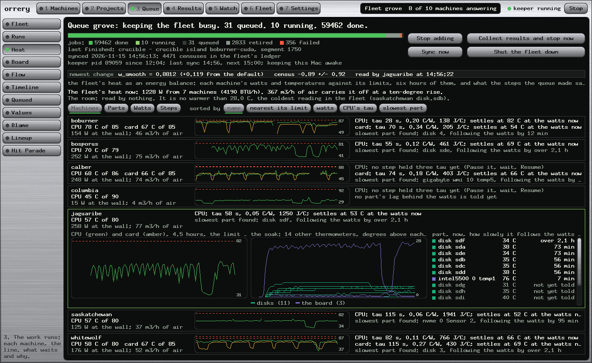
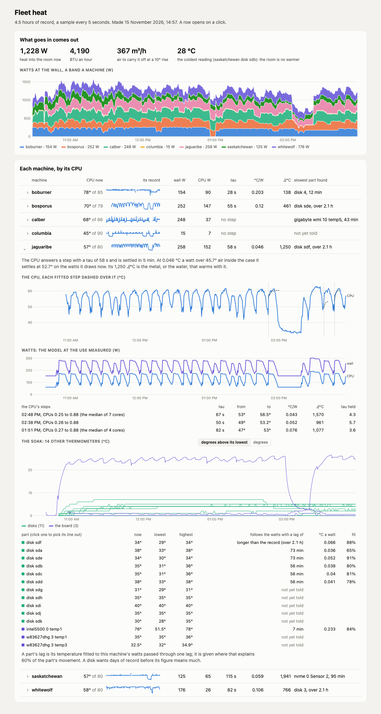
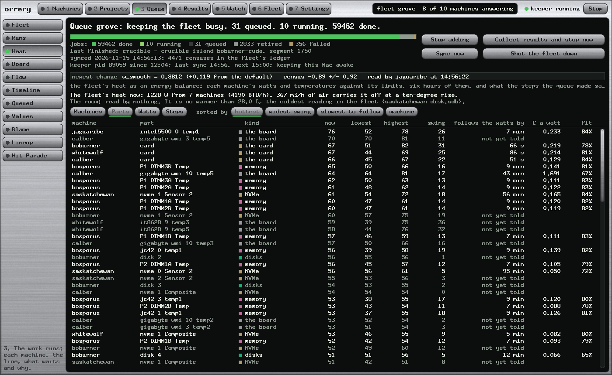
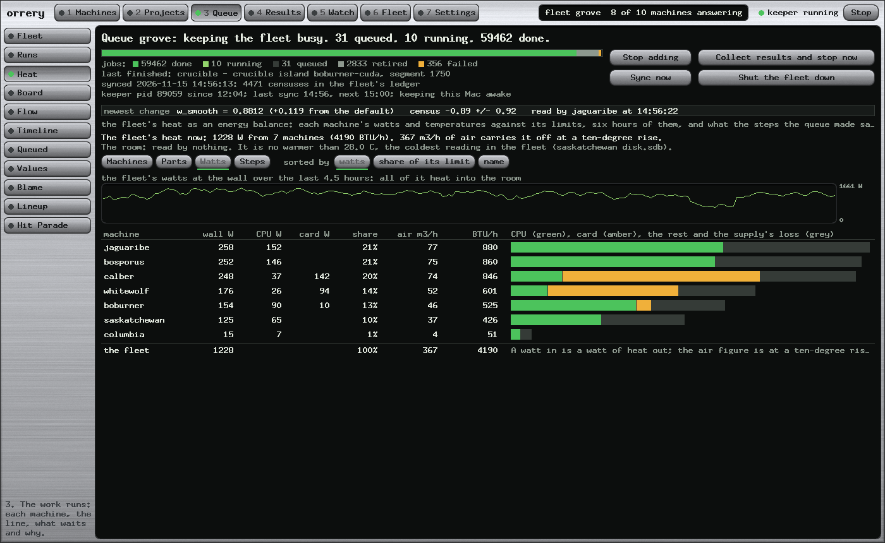
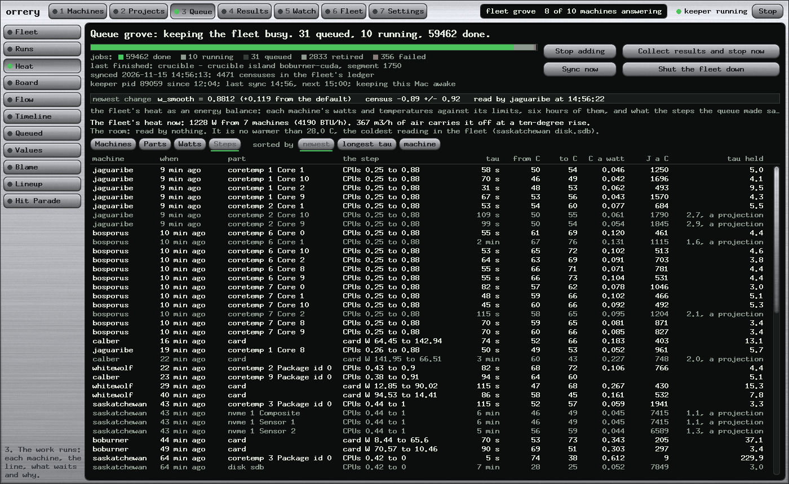

# The Fleet as the Hearth: Reading the House's Air, What the Mesh Radios Can Tell, and What to Buy

*Paul Richeson · Lab Report — IEEE Format · 15 November 2026*

Copyright (c) 2026 Paul Richeson. MIT licensed, as orrery.

Companions: `tools/heat_page.py` (the page and each part's lag behind the watts); `tools/thermal.py`, `tools/telemetry.py`, `tools/telemetry_chart.py`, `tools/fleet-telemetry.sh`, `tools/fleet-sensors.sh` (the record this stands on, `docs/thermal-telemetry.md`); `src/heat.rs` (Orrery's Heat, four panels); the queue `treadcore/build/queue/grove` (`plan/thermal.json`, `plan/telemetry.html`, `telemetry/MACHINE/`); the pictures in `docs/hearth/`. Three radios were asked what they are over USB. Nothing was written to any of them.

## Abstract

Paul, 15 November 2026: "the assumption is the entire fleet is the heat that heats the living quarters using a dynamic where expensive per computation is reduced as the area ambient air ... we want to get detailed temp humidity sensors from lily go, although i flashed them meshcore ... with a small budget we can get multiple temp probes along the fleet. We could then have zone heating, because currently we do have two different rooms separated by a fan active mixing the air of the rooms."

The fleet put 1,228 W into the house at 14:58, all of it heat. A watt the house needed anyway is a watt of computing that cost nothing more than the heating it replaced. To use that, the house must be read as the machines now are: its air's temperature in each room and outside, and how fast it loses heat. **NOTHING IN THE HOUSE READS ITS AIR TODAY, AND THE THREE MESH RADIOS ON THIS MAC DO NOT CHANGE THAT AS THEY ARE.** The first T-Echo runs MeshCore 1.17.1 as a room server and lists one sensor, its GPS: no thermometer. The second T-Echo answers nothing on its serial port. The T-Deck runs an interface firmware that knows none of MeshCore's commands. The sensors repository Paul found is for another board and names no temperature or humidity chip.

What was built today is the machines' side of the same balance, and it is working: each CPU's time constant from a step test the queue made, each disk's and board's lag behind its machine's watts, one browser page and four panels in Orrery. The house's side is a model written down (Section VIII) and a list of what to buy (Section VII). No controller is built, and none can be before a thermometer stands in each room.

## I. The question

Three questions, in Paul's order.

1. Can the temperature and humidity probe of a LilyGo radio flashed with MeshCore be read from the computer it is plugged into?
2. If not, what is the cheapest way to several probes "along the fleet", enough for two rooms and the outside?
3. With those, what is measured, and what does the fleet do with it: the house's time constant, its cooling rate against the weather, zone heating by which machines work?

This report answers the first by asking the radios, the second from what is sold and what the fleet's collector already accepts, and the third as a model with the measurement that would find each of its numbers. It also records what today's machine-side measurements found, because the house model uses the same arithmetic.

## II. What the reader needs

**A machine is a heater.** Every watt a computer draws leaves it as heat into the room. Nothing is stored and nothing leaves by wire that matters at this scale. So the fleet's wall watts are the heater's output, and they are already measured or modelled every five seconds.

**A time constant.** A thing heated at P watts that loses heat in proportion to how far it is above its surroundings settles at T_surround + P x R and gets there as 1 - exp(-t / tau), where tau = R x C. R, in degrees a watt, is how badly it sheds heat. C, in joules a degree, is how much stuff warms with it. After one tau it has made 63% of the move, after five 99%. A CPU's tau is a minute; a disk's is an hour; a house's is many hours.

**The collector.** `fleet-telemetry.sh` on each Linux machine writes one line of `key=value` every five seconds and includes anything found in `/run/fleet-sensors/*.kv`. A new probe on a Linux machine needs only a reader that writes its reading there. This Mac and the Mac mini have no collector.

**MeshCore.** Firmware for LoRa radios that pass messages from node to node. A node is a companion (it pairs with a phone), a repeater, a room server, or a sensor. The repeater and room server answer a text command line on their USB serial port.

## III. What goes in comes out, and what a computation then costs

The house's air, to first order:

    C_house x dT_in/dt = P_fleet + P_other + P_sun - (T_in - T_out) / R_house

P_fleet is known. Everything else is not measured yet. When the house wants heat, each watt of P_fleet is a watt its heating does not have to make. The cost of a computation is then its electricity less the heating it replaced:

    cost = E x price x (1 - f / COP)

E is the job's energy. f is the part of its heat the house wanted at that hour: 1 on a cold night, 0 on a day the windows are open. COP is what the house's other heating gets from a watt: 1 for a resistance heater, about 3 for a heat pump. Against resistance heat on a cold night the computation is free. Against a heat pump it costs two thirds of its electricity. On a warm day it costs all of it, and more if anything cools the house.

That is the "dynamic" Paul names. The queue would run the fleet hard when f is 1 and thin it when f is 0. Two numbers are not in this repository and are Paul's to give: what heats the house besides the fleet, and the price of a kilowatt-hour.

## IV. The machines' side, measured today

The queue's own buttons made the steps. For each machine in turn its CPU lanes were paused, the job in hand ended, the CPUs sat idle twenty minutes, then took work again. A card's lane kept working throughout.

| Machine | CPU's tau | degrees a watt | joules a degree | settles at, on the watts at 14:58 |
|---|---|---|---|---|
| boburner | 28 s | 0.203 | 138 | 82 |
| bosporus | 55 s | 0.120 | 461 | 69 |
| jaguaribe | 58 s | 0.046 | 1,250 | 53 |
| whitewolf | 82 s | 0.106 | 766 | 66 |
| saskatchewan | 115 s | 0.059 | 1,941 | 52 |
| calber | no step fitted yet | | | |
| columbia | no model: its CPU moved inside one sample | | | |

**These are one step each, and they move.** Bosporus read 104 s at 13:53 and 55 s at 14:58; whitewolf 162 s and then 82 s. The two Xeon servers are read core by core and the table takes one core. A figure here is a first reading, good to a factor of two. Calber's step was in its idle hold when this was written; whitewolf's waits for its restart.

Boburner's CPU has the least metal behind it and the worst path to air of the five: it is the machine nearest its limit all day (78 of 85).

**The soak.** A disk never gets a clean step, so each part that is not a CPU is fitted to its machine's wall watts passed through one lag. The lag that fits best is how slowly the part follows the machine's heat. It is given only where the fit explains 60% of the part's movement.

| Machine | Part | Follows the watts by |
|---|---|---|
| bosporus | memory (18 sensors) | 9 to 12 min |
| bosporus | the board's own thermometer | 15 min |
| bosporus | disks (11) | 33 min to over 2 h |
| jaguaribe | chipset | 7 min |
| jaguaribe | disks | 56 min to over 2 h |
| boburner | disks | 12 to 15 min |
| whitewolf | board | 7 to 12 min |
| whitewolf | disks | over 2 h, the longest lag tried |
| saskatchewan | NVMe | 95 min |

"Over 2 h" means the best lag was the longest the 4.5-hour record allows: the true figure is longer. Paul: "that will be longer, days of data." The page recomputes this at every pull, so the disks' figures will settle as the record grows.

## V. The screens

**The browser page**, `QUEUE/plan/telemetry.html`, made at every five-minute pull by `tools/heat_page.py`. The fleet's wall watts with a band a machine; then a row a machine, CPU first; a click opens the CPU with each fitted step dashed over it, the watts on the same clock, and the soak overlay with its table. A click on a part picks its line out. Pointing at a plot gives the clock and that plot's leading values on one line and nothing else.

**Orrery, Heat**, under Queue (page 20) and under Machines. Four panels, each sorted by its own buttons; nothing is said on hover.

- **Machines:** by name, nearest its limit, watts, the CPU's tau, or slowest part. A click opens a row.
- **Parts:** every thermometer in the fleet that is not a CPU, by hottest, widest swing, slowest to follow, or machine. A click goes to its machine with the part picked out.
- **Watts:** the conservation. The fleet's watts over the record, then a bar a machine: CPU, card, and the rest with the supply's loss.
- **Steps:** every fit, by newest, longest tau, or machine. A hold under three tau is marked a projection.

The pictures were taken with the program's own frame renderer. The panels were not clicked through in the running program.

## VI. What the three radios answered

Each was opened at 115,200 baud and sent read-only text. An nRF52 board opened at 1,200 baud drops into its update mode, so that speed was never set.

| Port | What it is | What it said |
|---|---|---|
| `/dev/cu.usbmodem2301` | LilyGo T-Echo (nRF52840), MeshCore v1.17.1-d929643, built 14 August 2026, role `room_server`, name Caiques | `sensor list`: "1 vars, gps=0". `stats-core`: battery 4,804 mV, uptime, no errors. `stats-radio`: noise floor -104, last RSSI -100. Its clock read 19 September 2026 |
| `/dev/cu.usbmodem241201` | a second nRF52 board (the same USB identity as the T-Echo) | nothing, to text or to one companion-protocol frame |
| `/dev/cu.usbmodem241401` | T-Deck (ESP32-S3) | boot lines of an interface firmware (`[WS] listening port=8765`, `[STALL] ui:lvgl ...`); "Error: unknown command" to every MeshCore command and to `help` |

**The first T-Echo has no thermometer its firmware can see.** The T-Echo is sold with and without a BME280 (temperature, humidity, pressure); the sensor is an option sold separately from the base model [1], [2]. MeshCore finds environment sensors on the I2C bus at start, for the chips its build includes [3], [4]. This unit's list holds the GPS alone. Either the board has no BME280 or this build left it out. The board's label or its listing settles which; nothing sent over the wire can.

**The second T-Echo is unread.** It may run the companion firmware, whose serial protocol is binary. One frame of that protocol was sent from memory and drew no answer, which proves nothing: the frame may have been wrong. `meshcore-cli` is the tool that speaks it [5]. It is not installed here.

**The T-Deck does not run MeshCore's command line.** What it runs was not identified.

**The repository Paul found**, `LILYGO-UI/sensors`, is a diagnostic program for a Linux board, the T-DisplayCM0: motion, microphone, keyboard, CPU and battery. It names neither the T-Echo nor the T-Deck, and no temperature or humidity chip [6]. Paul's guess that it "might be for the other package" is right.

**What was not established:** whether MeshCore prints a sensor's reading on the serial line at all. One third-party reference lists `sensor get <name>` [7]; on this unit `sensor get gps` answered "0". MeshCore's telemetry is otherwise sent over the mesh, packed as Cayenne LPP, to a node that asks [4]. With no thermometer on any unit here it could not be tried.

## VII. How to get more sensors

In order of how soon each gives a reading. Prices were not checked today except where a source is cited.

1. **Ask what is already here.** Saskatchewan's two Geiger counters (GMC-320) have a temperature command, `GETTEMP`, that radbeeper does not send. It costs nothing to try; the service holds the port, so it means a change to radbeeper or a pause of it. A counter's thermometer sits inside its case, so it will read a little warm.
2. **A T-Echo with the BME280, or a breakout on the one here.** A BME280 or SHT4x board is a few dollars and four wires to the T-Echo's I2C pins. Then either MeshCore finds it, or the radio is reflashed with a sketch of thirty lines that prints temperature, humidity and pressure every few seconds. Paul offered to reflash. A radio used this way is a USB thermometer and no longer a mesh node.
3. **The mesh, as a mesh.** A MeshCore node in the sensor role reports over the air [4]. One radio stays on a computer as the companion and asks the others. This is the only option that puts a probe where there is no computer and no cable: outside, or the far room. It needs the sensor chips on the remote units, `meshcore-cli` on the host, and it was not tried.
4. **USB probes.** A TEMPerHUM stick reads temperature and humidity over the kernel's raw HID interface; reports of it on Linux are mixed, with models that change identity and reject the protocol [8], [9]. One UK listing has it at 29 pounds [10]. For temperature alone, DS18B20 probes on a one-wire USB adapter put many probes on one cable, each with its own address; that is the cheap way to a line of probes along the racks. That last is from general knowledge, not checked today.

**What to place where**, for two rooms mixed by a fan:

| Probe | Why |
|---|---|
| each room, at sitting height, away from the machines | T_in for each zone: what the controller holds |
| outside, shaded | T_out: what the loss is driven by |
| the fleet's intake and its exhaust | the air's rise across the machines, which with the watts gives the airflow |
| at the fan between the rooms | what the fan carries from one zone to the other |

Humidity matters at two of these: one room and outside. Six probes cover it.

Whatever is bought, the plumbing exists on the Linux side: a reader that writes `room.NAME.c` and `room.NAME.rh` into `/run/fleet-sensors/` is picked up by the collector, drawn on the page and shown in Orrery with no other change. A probe on this Mac needs a small reader of its own, since the Macs run no collector.

## VIII. The house, as the next thing to measure

Two rooms and a fan:

    C1 x dT1/dt = P1 - (T1 - T_out) / R1 - (T1 - T2) / R12
    C2 x dT2/dt = P2 - (T2 - T_out) / R2 - (T2 - T1) / R12

P1 and P2 are the watts of the machines in each room. R12 is the fan: small when it runs, large when it does not.

**The fleet is its own step generator.** The queue can drop a kilowatt in a minute and put it back. On a still night with the heating off, `shutdown` or a Pause of every lane is a step of about 1.2 kW into the house; the rooms' fall over the next hours is the house's tau, and the level they fall toward gives R. C follows. The same test with the fan off, then on, gives R12. This is the CPU step test again with a house for the part.

**The weather's terms.** Sun through the windows is a second heater. Wind and damp change R. Paul names light, visibility and ambient temperature. An outside probe gives temperature and humidity; light and wind would come from a weather feed, which nothing here asks today.

**Humidity.** It does not enter the two equations: warming air does not change the water in it. It matters to comfort, and to the cost of any cooling.

**Zone heating.** With R1, R2 and R12 known, which machines work is a choice of where the heat goes. The queue already has the dials: Pause a machine, set a lane's CPUs. A controller holds each room at its mark by choosing them, and the house's hours of tau are the "maintainable thermal mass" Paul names: the fleet can run hard for an hour and coast the next without the room moving a degree.

**Two things today's record already says about that.** The fleet's heat moved between about 800 and 1,300 W across the afternoon without anyone asking it to. And the coldest reading in the fleet, a disk in saskatchewan at 28, is the nearest thing to a room thermometer there is: the room is no warmer than that, and how much cooler is not known.

## IX. What Paul decides

1. Which sensor road: a breakout on a T-Echo, T-Echos with the BME280, USB probes, or the mesh. They are not exclusive; the first reading soonest is road 2 or 4.
2. Whether a T-Echo is reflashed as a plain thermometer, which takes it off the mesh.
3. Whether radbeeper is changed to ask the counters their temperature.
4. What heats the house besides the fleet, and the price of a kilowatt-hour: Section III's two missing numbers.
5. Whether the house's step test is run: a night with the fleet off for some hours.

## X. What this report did not do

- No room temperature was read. Every statement about the house is a model.
- No radio was reflashed, configured or written to. One stray binary frame reached the first T-Echo's command line, which echoed it and did nothing.
- The second T-Echo's firmware and the T-Deck's were not identified.
- No probe was bought and no price confirmed beyond the one cited.
- The CPU figures are one step each; calber's and whitewolf's steps were not finished.
- The Heat panels were checked as pictures, not used.
- No controller, dial or throttle is built.

## Addendum, 16 November 2026: the Geiger counters read the room

The report above says nothing on USB reads the room's air. That was wrong by one day. The two GQ GMC-320 Geiger counters each carry a thermometer, and it can be read.

- **What misled.** On 15 November each counter was asked its temperature once and answered 85.0 °C. That is the answer the counter gives before its thermometer has a reading; the next answer is real.
- **What was measured.** On 16 November the GMC-320Re 4.26, plugged into the Mac, answered 85.0 °C once after being plugged in and then 26.1 °C for ten readings over five minutes, with its own screen showing 26.1 °C. Asked in the middle of its count stream, it answered nine times in forty seconds, each within 55 ms, and every second of counts still arrived.
- **What was built.** radbeeper's service now asks each GMC-320 once a log interval, between two seconds of counts, and writes `temp-SERIAL-YYYY-MM.tsv` beside the count log. `radbeeper now` gives another program the counts a minute and the temperature from the running service. The fleet's collector (`tools/fleet-telemetry.sh`) reports the newest reading as `room.radXXXX.c`. radbeeper's own report is `docs/the-thermometer.md` in its repository.
- **What it is and is not.** It is one thermometer per counter, inside the counter's case, wherever the counter sits. It has not been compared with a thermometer in the air. It gives no humidity. A second room and the outside still need probes of their own.
- **Not yet in use.** The services on saskatchewan and the VM still run the radbeeper from before this; until they are updated and restarted no machine writes the temperature file, and the collector has nothing to report. The other counter, a GMC-320+V4Re 4.83, has been asked once and has not yet been seen to give a real reading.

## References

[1] Meshtastic, "LILYGO TTGO T-Echo devices." https://meshtastic.org/docs/hardware/devices/lilygo/techo/

[2] OpenELAB, "LILYGO T-Echo Plus With BME280." https://openelab.io/products/lilygo-t-echo-plus-bme280

[3] IoTThinks, EasySkyMesh release "PowerSaving14" (I2C addresses tried for BME280, BME680, BMP280; the `sensor` command). https://newreleases.io/project/github/IoTThinks/EasySkyMesh/release/PowerSaving14

[4] DeepWiki, "MeshCore: sensor integration" (the sensor manager, the chips, Cayenne LPP; a secondary source). https://deepwiki.com/ripplebiz/MeshCore/8-sensor-integration

[5] meshcore-dev, "meshcore-cli" wiki. https://github.com/meshcore-dev/meshcore-cli/wiki

[6] LILYGO-UI, "sensors." https://github.com/LILYGO-UI/sensors

[7] "MeshCore repeater: serial commands." https://git.supported.systems/rf/meshcore-repeater/src/branch/main/docs/serial-commands.md

[8] The Pi Hut, "Testing PCsensor's TEMPerHUM, Part 4: Linux." https://thepihut.com/blogs/raspberry-pi-tutorials/testing-pcsensors-temperhum-part-4-linux-software-logging

[9] "temper-py." https://pypi.org/project/temper-py

[10] The Pi Hut, "TEMPerHUM USB Temperature & Humidity Sensor." https://thepihut.com/products/temperhum-usb-temperature-and-humidity-sensor

[11] MeshCore, "CLI commands." https://docs.meshcore.io/cli_commands
