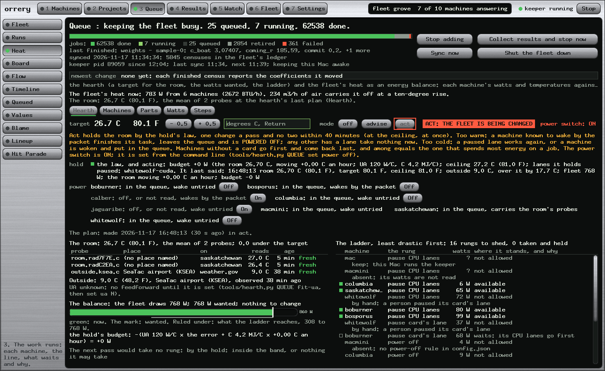

# Switching a machine on and off for the room's heat

*17 November 2026. The procedure, what was proved on bosporus, and how it is built into Orrery. Companions: `tools/hearth.py` (the controller and the two power orders), `tools/hearth_regulator.py` (the hold, its second law), `tools/hearth-energy.py` (each machine's joules and what it did for them), `tools/fleet-wol.sh` (the root recipe that arms a card), `src/heat.rs` (the Hearth panel's power row), `docs/hearth-controller.md` (the controller's guide).*

Paul, 17 November: "wake on lan. supermicro ... prepare to issue wake on lans on command with the script. also trigger shutdown. We will focus on supermicro first." Then, after the first machine came up from a packet: "It worked! ... Document upgrade to on off procedure. Explain how we adapt this back into orrery. Seems to work. It does a long ram test, so maybe a multi minute delay to boot. Add the buttons to turn on and off, and have the heat manager schedule these."

## 1. What was proved

| | bosporus (Supermicro X8DT3, BIOS 2.1) | jaguaribe (Supermicro X8DTL, BIOS 2.1b) |
|---|---|---|
| Card on the default route | `eth0`, Intel 82576 (igb), `00:25:90:84:e3:da` | `eth0`, Intel (e1000e), `00:25:90:ca:c4:8a` |
| BIOS setting for wake-on-LAN | none found, none needed | none found |
| `tools/fleet-wol.sh on` run on it | yes, 11:18 | not confirmed |
| Linux's wake switch for the card | enabled | enabled when last read |
| Powered off | 11:21:01, accepted | 11:32:36 |
| Wake packet | 11:21:30 | **not yet sent** |
| Came up | yes: its kernel started 1 min 52 s after the packet | |
| Verdict | **wakes by the packet** | untried |

calber (a desktop board, Intel e1000e card) passed the same test at 12:12 to 12:14, through `hearth.py power-off` and `power-on`: it answered 32 seconds after the packet, and its card was still armed after the boot with no recipe run.

The bridge above bosporus's card says wake is disabled, in Linux and in the BIOS's own table. It woke all the same. The packet on bosporus was sent 29 seconds after the power-off was ordered; Paul watched it shut down and start. One trial, on one machine.

## 2. The three conditions

A packet starts a machine that was shut down only if all three hold:

1. **The board lets the card wake it, and keeps standby power.** On these Supermicro X8 boards the onboard ports do this with no BIOS item. The power supply's switch stays on.
2. **Linux leaves the card armed when it powers off.** `ethtool -s DEV wol g`, said again at every boot. `tools/fleet-wol.sh on` does both, as root, on the machine. It arms the card that carries the default route, so the cable stays in that port.
3. **The packet reaches the card.** Sent from the Mac to the network's broadcast address, to ports 9 and 7.

## 3. The procedure for a new machine

With the machine on and answering:

| Step | Where | What |
|---|---|---|
| 1 | a terminal | `python3 tools/hearth.py QUEUE learn-macs`: it reads each answering machine's card address |
| 2 | a terminal | `scp ~/code/orrery/tools/fleet-wol.sh user@NAME: && ssh -t user@NAME 'doas sh fleet-wol.sh on'` (your password) |
| 3 | the panel, or a terminal | Off (`hearth.py QUEUE power-off NAME`): it finishes its jobs, leaves the queue, powers off |
| 4 | the panel, or a terminal | On (`hearth.py QUEUE power-on NAME`), once it is down. Allow minutes: a server board tests its memory before it boots. Coming up from it marks the machine as waking by the packet |
| 5 | a terminal | only if it did NOT come up by itself: `hearth.py QUEUE machine NAME wol off` |

Being marked as waking is what lets the controller switch the machine off by itself. A machine not known to wake is never powered off unasked, because only a person could bring it back.

## 4. Who switches a machine

| | Who decides | How |
|---|---|---|
| **The controller in act, its law the hold** (`tools/hearth.py`, `tools/hearth_regulator.py`) | Orrery | Every five minutes, after the telemetry is pulled, one pass. Too warm: a machine known to wake finishes its task, leaves the queue and is powered off; any other has a lane take nothing new. Too cold: a paused lane resumes, or a machine is woken and put in the queue when it answers. Needs `set power on`. |
| **The Hearth panel's power row** (Queue, Heat, Hearth) | a person | A cell a machine: its name, what it is doing, whether it wakes by the packet, and one button. **On** sends the packet and, when the machine answers, puts it in the queue. **Off** asks to be pressed twice; the machine then takes nothing new, leaves the queue when its jobs end, and is powered off. The line under the row says where an order has got to. |
| **The command line** | a person | `hearth.py QUEUE power-on NAME`, `power-off NAME`, the same two orders. |

The panel's buttons run `hearth power-on NAME` and `hearth power-off NAME` through the queue, which logs who asked. Each returns at once; a process of its own sees the order through and writes its progress to `QUEUE/hearth/power.json`. A machine that comes up from an On is marked as waking by the packet, since that is the proof.

Never switched off by any of the three: the machine that carries the room's probes (saskatchewan), and this Mac.

## 5. Orrery holds the room

Paul, 17 November, in order: "we have a hold script. can that also be part of orrery. they should compliment"; "i want this hosted as part of orrery"; "they should do this automatically if in auto mode. when they boot they will start computing ... then if its too hot on its next task, it should shutdown, if its the right power budget for the heat we want"; and "update the implementation of orrery. stop using the script. switch to orrery controlling. Prefer GPU computers, Prefer Energy Calculations. Prefer keeping temp around 80, under 81F."

The morning's hold was a script in a terminal (`tools/hearth-hold.py`), then the same script in the background. It is gone. What it learned is the controller's second law, `hold` (`hearth.py QUEUE set law hold`), in `tools/hearth_regulator.py`, and the keeper's own pass runs it. Since 16:44 on 17 November the live controller is in act with that law and the power switch on.

What the law does at each pass:

| | |
|---|---|
| **Target and ceiling** | The target is the panel's: 26.7 °C (80 °F). The ceiling is 27.2 °C (81 °F, `set ceiling`). Inside 0.25 °C of the target nothing is changed. Within 0.15 °C of the ceiling and not falling, heat is shed at once, without waiting out the pace. |
| **The budget** | An energy calculation: watts to move = −(UA × (room − target) + C × the room's slope). C is 4.2 MJ/°C, measured by the step of the 17th. UA is 120 W/°C, the middle of what that record allows and not a measurement (`set ua`). The slope is a line through the last hour. Held within 600 W either way. |
| **On means computing** | A spare machine that answers and is not in the queue is put in it; if the room wants watts taken away, it is switched off instead. |
| **GPU machines are kept** | Heat is shed from a machine without a card before one with, and from a CPU lane before a card's lane. Heat is added the other way about. |
| **Work for the joule** | Among equals, the machine that spends most energy on a job goes first and comes back last. `tools/hearth-energy.py` works that out from the record: watt-hours of the CPU side for each job finished. |
| **The step** | The first in that order whose watts are no more than twice the budget, or no more than 250 W. A machine known to wake is shed whole; any other by a lane. |
| **The pace** | Forty minutes between changes: the room answers about an hour late. |
| **One probe's spike** | A probe that moves 0.4 °C in a quarter of an hour while the other does not, and stands away from its usual place, is left out until it comes back, an hour at most. Probe C2EA did this five times in two days, and once had a machine switched off for it. |
| **Steady stretches** | Two hours inside the band with nothing changed is written to `steady.tsv`: the fleet's watts against the room's height over the outside. That is the house's loss being measured while the room is held. |

The energy each machine spent, 16 November 15:00 to 17 November 16:31, the CPU side for each job:

| Machine | Wh a job | Card | Known to wake |
|---|---|---|---|
| columbia | 3.3 | no | no (card not armed) |
| saskatchewan | 8.7 | no | carries the probes: never off |
| boburner | 11.3 | yes | no |
| calber | 18.7 | yes | yes |
| whitewolf | 22.3 | yes | no |
| jaguaribe | 37.6 | no | untried |
| bosporus | 46.4 | no | yes |

So when the room is too warm bosporus goes first, and when it is cold whitewolf's card lane comes back first, then calber, and bosporus last. The two Supermicros' watts are a model and not a meter's, and both stood idle part of their hours, which that figure includes.

The ladder, the controller's first law (a slow PI over lanes, then power), is still worked out at every pass and shown on the panel for comparison. It acts only when the law is set back to `ladder`, and its proof (`tools/hearth-check.sh`) is unchanged.

## 6. Not done

- jaguaribe has not been woken by a packet.
- The panel's On and Off buttons were drawn and tested as code; neither has been pressed in the app. The orders behind them have run from the command line: `power-off` and `power-on` on calber (down at 12:12, back 32 seconds after the packet at 12:14).
- **The hold as a law has no proof of its own.** It was tried on a copy of the live queue at four targets (too warm: bosporus off first; too cold: whitewolf's card lane first) and has run live since 16:44 with the room on target and nothing to do. The script it came from made eight changes on the 17th. `tools/hearth-check.sh` proves the ladder, not this.
- The budget's UA is a guess.
- The watts the efficiency order rests on are a model for the two Supermicros.
- No other machine of the fleet has its card armed except calber. boburner's and whitewolf's default route is a 10 GbE card, which may not wake its machine at all.
- A power cut: what a machine does when power returns is its BIOS's "Restore on AC Power Loss", not looked at.
