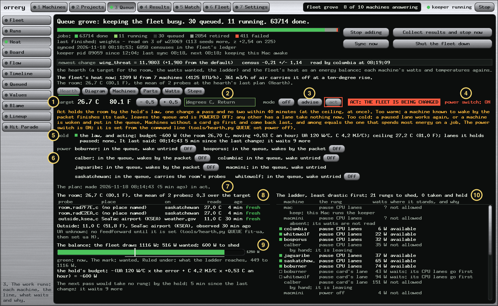
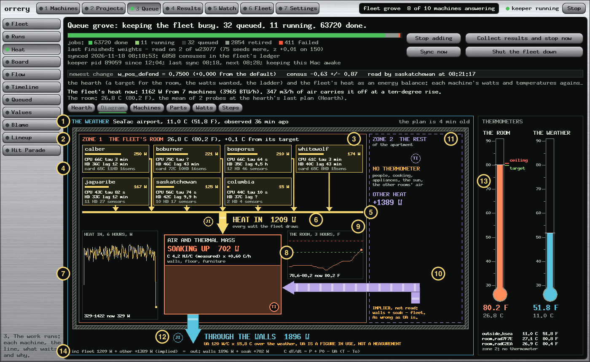
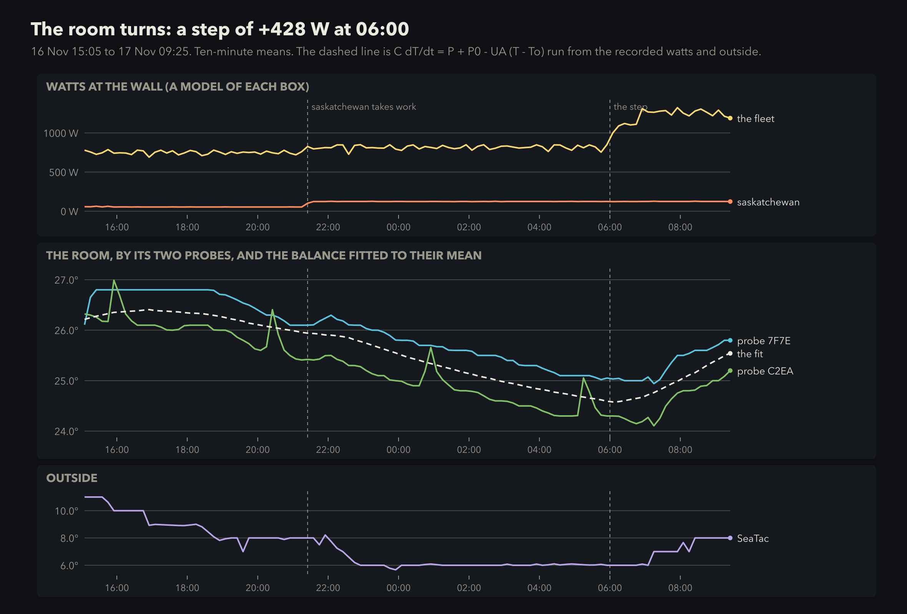

# Keeping the Room: How to Use, Read and Look After Orrery's Thermal Regulation

*Paul Richeson · Lab Report — IEEE Format · 18 November 2026*

Copyright (c) 2026 Paul Richeson. MIT licensed, as orrery.

Companions: `tools/hearth.py` (the controller: instruments, switches, orders); `tools/hearth_regulator.py` (the hold, the law that acts); `tools/hearth-energy.py`, `tools/hearth-house.py`, `tools/hearth-response.py` (the three read-only measurements); `tools/fleet-wol.sh` (arming a card to wake its machine); `src/heat.rs` (the Hearth and Diagram panels); `tools/report/hearth-annotate.py` (the numbered marks on this report's pictures); `docs/hearth-power.md`, `docs/hearth-controller.md` (the guides); `docs/hearth-response-lab-report.md` and `docs/hearth-auto-lab-report.md` (the two reports before this one).

The film of this report: [Keeping the Room, on film](hearth-regulation-film.html).

## Abstract

Paul, 18 November 2026: "do a lab report about the maintenance, the visualization techniques. Do a lab report on the thermal regulation features of orrery fleet management. Start with a how to use guide. Show pictures, annotate them and give descriptions ... Starting as a HOW TO guide, with scientific and formulas showing and some sample calculations."

A fleet of eight computers heats an apartment whose own heating is switched off. Since 16:44 on 17 November Orrery holds the room that the fleet stands in at 80 °F by itself: every five minutes it reads two thermometers in the room and the weather at the airport, works out how many watts the room wants moved, and takes one step, a lane of work paused or resumed, or a whole machine finished, powered off and later woken by a network packet.

Part One of this report is how to use it: where the panels are, what each control does, and the orders a person can give. Part Two is the science: the one heat balance everything is worked from, with seven calculations done on the fleet's own numbers. Part Three is what the first fifteen hours showed. The room was held between 78.1 and 81.3 °F, with one excursion to about 81.6 °F at 18:44 that a person had to end; eight faults in the law were found and seven were corrected the same day. Part Four is how the heat is drawn, and why. Part Five is its upkeep.

The house's loss per degree is still not measured. The figure in use, 120 W/°C, is a working value, and everything that rests on it says so.

## I. The questions

1. How does a person use it: set a temperature, see what it is doing, take a machine in hand?
2. What is it calculating, and can each number be checked by hand?
3. Did it hold the room, and where did it fail?
4. How is the heat shown, and what does each mark on the screen mean?
5. What does it need from a person, daily and weekly?

---

# Part One: how to use it

## II. The five-minute guide

**Where.** In Orrery: **Queue**, then **Heat** in the left column. The Heat page has six panels in a row of chips; the first two are the ones for this.

| Panel | What it is for |
|---|---|
| **Hearth** | The controls: the target, the mode, the power buttons, and the controller's own account of what it is doing |
| **Diagram** | The picture: where the heat comes from, where it goes, and the thermometers |

**To set the temperature.** On the Hearth panel press **− 0.5** or **+ 0.5**, or type a number in the field and press Return. The field takes `26.7`, `26.7 C` or `80 F`.

**To switch regulation on or off.** Three mode buttons:

| Mode | What happens |
|---|---|
| **off** | Nothing is read and nothing is done |
| **advise** | Every five minutes it works everything out and says what it would do. It changes no machine |
| **act** | It does it. The button is framed in red and must be pressed twice |

**To take a machine in hand.** The **power** row has a cell for each machine and one button: **On** (send the wake packet; when the machine answers it is put to work) or **Off** (press twice; the machine finishes its job, leaves the queue and is powered off). The machine that carries the room's thermometers has no Off.

**To see why it did something.** The **hold** line says the budget in watts and the last thing it said. The whole record is one file, a line a look: `QUEUE/hearth/hold.log`.

**If the room is too warm right now.** Lower the target by a degree. That sheds heat at the next pass. If the room is at the ceiling, the controller sheds without waiting. A door opened is faster than either.

**To stop it and take over.** Press **advise**. Lanes it paused stay paused until you resume them or set **act** again.

## III. The Hearth panel, mark by mark

| Mark | What it is | How to read it |
|---|---|---|
| 1 | **The target**, in both scales | The temperature being held. Here 26.7 °C, 80.1 °F |
| 2 | **Changing it** | Half a degree down, half a degree up, or a number typed and Return |
| 3 | **The mode** | The one in force is underlined. *act* is red-framed and asks twice |
| 4 | **The power switch** | Whether act may power machines off and wake them. It has no button: `tools/hearth.py QUEUE set power on` or `off` |
| 5 | **The hold** | The law in force, its budget in watts, the room and its slope, the ceiling, the lanes it holds paused, and its last words |
| 6 | **The power row** | A cell a machine: what it is doing, whether it is known to wake by the packet, and its On or Off button |
| 7 | **The plan's age** | When the controller last looked. Over fifteen minutes old, something has stopped |
| 8 | **The room and its probes** | Each thermometer, where it is, what it reads, how old the reading is, and whether it is believed |
| 9 | **The balance** | Green: the watts the fleet draws now. The mark: the watts wanted. Under it, the budget's own arithmetic |
| 10 | **The ladder** | The older law's list of steps, shown for comparison. It does not act while the law is *hold* |

The red paragraph under the mode buttons says, in words, exactly what act will do with the power switch as it stands. Read it before pressing act.

## IV. The Diagram panel, mark by mark

| Mark | What it is | How to read it |
|---|---|---|
| 1 | **The weather** | The outer frame is the outside air. The reading is the airport's, with its age |
| 2 | **The walls** | The hatched band round the apartment. The heat that leaves crosses it |
| 3 | **Zone 1, the fleet's room** | The room the thermometers are in, its temperature, and how far it is from the target |
| 4 | **The machines** | A tile each: watts now as a bar and a number; the CPU's temperature and time constant (tau); the drives' temperature and lag; how many drives and sensors report. A dim tile is a machine that is off |
| 5 | **The collector** | Every machine's heat runs to this bar. A pipe's thickness is its watts |
| 6 | **HEAT IN** | The fleet's total watts: the heat going into the room. `JI` is a power reading |
| 7 | **Heat in, six hours** | The same number as a trend |
| 8 | **The air and the thermal mass** | A tank. It says SOAKING UP when the room is warming (heat going into walls, floor and furniture), GIVING BACK when it is cooling, HOLDING when it is still. The level is the room's temperature between 60 and 90 °F |
| 9 | **The room, three hours** | The room's trend, with the target (green dots) and the ceiling (red dots) |
| 10 | **Other heat** | Everything that warms the room and is not the fleet. It is **implied**, not read |
| 11 | **Zone 2, the rest of the apartment** | Drawn in dashes with an empty `TI` bubble: there is no thermometer there |
| 12 | **THROUGH THE WALLS** | The watts leaving to the weather. The line under it says which figure it rests on |
| 13 | **The thermometers** | The room, with its target and ceiling marked, and the weather, on one scale; every probe listed under them |
| 14 | **The balance** | In equals out, in one line, with the equation |

The numbers are the controller's plan, so they change at each pass, about every five minutes. The bright marks in the pipes move continuously, in the direction the heat flows.

## V. The command line

`QUEUE` is the queue's directory. Everything a button does, and the few things no button does:

| Command | What it does |
|---|---|
| `python3 tools/hearth.py QUEUE status` | One screen: the room, the plan, what it would do. Changes nothing |
| `python3 tools/hearth.py QUEUE target 26.7` | The target, in °C |
| `python3 tools/hearth.py QUEUE mode off` / `advise` / `act` | The mode |
| `python3 tools/hearth.py QUEUE set ceiling 27.2` | The temperature the room must not stand above, °C |
| `python3 tools/hearth.py QUEUE set power on` / `off` | Whether act may power machines off and wake them |
| `python3 tools/hearth.py QUEUE set law hold` / `ladder` | Which law acts |
| `python3 tools/hearth.py QUEUE set ua 120` | The house's loss per degree, when it is measured |
| `python3 tools/hearth.py QUEUE power-off NAME` / `power-on NAME` | One machine, by hand |
| `python3 tools/hearth.py QUEUE machine NAME wol on` / `off` | Whether a machine is known to wake by the packet |
| `python3 tools/hearth.py QUEUE probes` | Every thermometer and what it reads |
| `python3 tools/hearth-energy.py QUEUE` | Each machine's joules and what it did for them |
| `python3 tools/hearth-house.py QUEUE --table` | The house's fit so far; also saves the week's weather |
| `tail -f QUEUE/hearth/hold.log` | What the controller is saying, as it says it |

## VI. Making a machine switchable

A machine is powered off by the controller only if it is known to come back. To prove one:

1. With it on, arm its network card (root, your password): `scp tools/fleet-wol.sh user@NAME: && ssh -t user@NAME 'doas sh fleet-wol.sh on'`
2. Press **Off** twice on its cell. Wait until it is down.
3. Press **On**. A server board tests its memory first; allow some minutes.
4. If it answers, it is marked as waking by the packet and the controller may switch it from then on.

| Machine | Wakes by the packet | Seconds to answer |
|---|---|---|
| calber | yes, with no recipe needed | 32, 52 |
| bosporus | yes, after the recipe | 112 to 286 (one of 602) |
| jaguaribe | yes | about 120 |
| boburner, whitewolf | untried: their only cable is in a 10 GbE card | |
| columbia | untried: card not armed | |
| saskatchewan | never switched off: it carries the thermometers | |

---

# Part Two: the science

## VII. One balance

The room is treated as one lump of heat:

    C dT/dt = P + P0 − UA (T − To)                                   (1)

| Symbol | Meaning | Unit | Where it comes from |
|---|---|---|---|
| T | the room | °C | two thermometers, read every five seconds |
| To | the weather | °C | the airport's observation |
| P | the fleet's watts at the wall | W | each machine's energy counter and card; a model where there is none |
| dT/dt | the room's slope | °C/h | a line through the last hour's looks |
| C | the joules that warm the room one degree | J/°C | **measured**: 4.2 MJ/°C, by the step of 17 November |
| UA | watts lost for each degree over the weather | W/°C | **not measured**: 120 is in use |
| P0 | every watt that is not the fleet's | W | **not measured**: what is left over |

Three things follow from (1), and the screen draws all three.

**Where the room settles.** With dT/dt = 0:

    T_ss = To + (P + P0) / UA                                        (2)

**How fast it gets there.**

    τ = C / UA                                                       (3)

**The three flows on the Diagram.**

    through the walls = UA (T − To)                                  (4)
    soak              = C dT/dt                                      (5)
    other heat        = walls + soak − P                             (6)

## VIII. The budget

The controller does not use gains. It asks how many watts would have to be added or taken away for the room to stop where it is wanted:

    budget = −( UA (T − target)  +  C dT/dt )                        (7)

The first term is what the walls will lose more or less of once the room is at the target. The second is what the room is storing or giving up as it moves now; stopping the movement means taking that away. The budget is held within 600 W either way, because a thermometer that reads in tenths cannot justify more.

Then one step: the first, in the order of preference, whose watts are no more than twice the budget.

| Preference | Rule |
|---|---|
| 1. Graphics machines are kept | Heat is shed from a machine without a card before one with, and from a CPU lane before a card's lane. Heat is added the other way about |
| 2. Work for the joule | Among equals, the machine that spends most energy on a job goes first and comes back last |
| At the ceiling | The preference gives way: the largest step that is no more than twice the budget |

And the pace: forty minutes between changes, because the room answers about an hour late; fifteen when the budget is 400 W or more; ten at the ceiling.

## IX. Seven calculations, on the fleet's own numbers

Each can be checked against `hold.log` or the picture it came from.

**1. A budget, on a quiet morning.** 06:37, 18 November: room 26.00 °C, target 26.7, slope −0.07 °C/h.

    UA term:   120 × (26.00 − 26.7)          = −84 W
    C term:    4.2×10⁶ × (−0.07) / 3600      = −82 W
    budget:    −(−84 − 82)                   = +166 W        (the log says +164)

The room wants 166 W more. Every machine was already on, so nothing was done.

**2. A budget at its limit.** 18:37, 17 November: room 27.10 °C, slope +0.69 °C/h.

    UA term:   120 × (27.10 − 26.7)          = +48 W
    C term:    4.2×10⁶ × 0.69 / 3600         = +805 W
    budget:    −(48 + 805) = −853 W, held at −600 W

Nearly all of it is the second term: the room was not far over its target, it was rising fast. This is why a law that looked only at the error would have done almost nothing.

**3. The three flows on the Diagram.** 08:21, 18 November (the picture in section IV): fleet 1,209 W, room 26.8 °C, weather 11.0 °C, slope +0.60 °C/h.

    through the walls:  120 × (26.8 − 11.0)       = 1,896 W
    soak:               4.2×10⁶ × 0.60 / 3600     =   700 W        (drawn: 702)
    other heat:         1,896 + 700 − 1,209       = 1,387 W        (drawn: 1,389)

**4. The room's time constant.** By (3):

    τ = 4.2×10⁶ / 120 = 35,000 s = 9.7 hours

So a change in the fleet's watts is two-thirds felt after ten hours, if UA is 120. The first hour of it is all the controller can wait for.

**5. What a night with every machine on says.** 02:00 to 07:00, 18 November: the room stood at 26.00 °C (25.75 to 26.10), the weather averaged 5.7 °C, the fleet 1,280 W, and nothing was changed. By (2):

    (P + P0) / UA = 26.00 − 5.7 = 20.3 °C

    if P0 were nothing:   UA = 1,280 / 20.3          =    63 W/°C     (a floor)
    if UA is 120:         P0 = 120 × 20.3 − 1,280    = 1,156 W

One steady night gives one equation in two unknowns. A second night at a different weather gives the second.

**6. How cold it can be before the fleet cannot hold 80 °F.** The fleet's most is about 1,300 W. From the same night, each watt of (P + P0) is worth 20.3 / (1,280 + P0) degrees, so the coldest weather at which 26.7 °C can be held is

    To = 26.7 − 20.3 × (1,300 + P0) / (1,280 + P0)   ≈   6.1 to 6.2 °C  (43 °F)

and this hardly depends on P0. Below about 6 °C outside, the room falls short however the fleet is run. That night it went to 3 °C, and the room stood 0.7 °C under its target with every machine working.

**7. Energy, and what it bought.** 16:44 on the 17th to 08:17 on the 18th, 15.6 hours:

    energy into the room:   860 W mean × 15.6 h × 3600 = 48.2 MJ = 13.4 kWh       (about $2.28 at 17 ¢/kWh)
    kept by the room:       4.2 MJ/°C × (26.90 − 26.55) = +1.5 MJ
    so through the walls:   46.7 MJ, a mean of 834 W, less whatever the other heat added

And the order of preference rests on this, from 25.5 hours on the 16th and 17th, the CPU side's energy for each job finished:

| Machine | Wh a job | Card |
|---|---|---|
| columbia | 3.3 | no |
| saskatchewan | 8.7 | no |
| boburner | 11.3 | yes |
| calber | 18.7 | yes |
| whitewolf | 22.3 | yes |
| jaguaribe | 37.6 | no |
| bosporus | 46.4 | no |

The two Supermicros spend four to five times saskatchewan's energy on a job. Their watts are a model and not a counter's reading.

---

# Part Three: what the first fifteen hours showed

## X. The record

Orrery took over at 16:44 on 17 November with the room at 80.1 °F. The stretch before it was a script in a terminal, then the same script in the background; its rules are the law described here.

| Stretch | Room, °C | Weather, °C | What happened |
|---|---|---|---|
| 16:44 to 18:20 | 26.5 to 26.9 | 9 to 10 | Held on target. Connections to the machines were dropping, and lanes stood idle |
| 18:20 to 19:10 | 26.7 to **27.4** | 9 to 7 | The room rose 0.6 °C an hour. The law shed 143 W, then 73 W. A person shed the rest at 18:39. Peak about 27.55 °C (81.6 °F) by the plain mean at 18:44 |
| 19:10 to 21:25 | 27.2 to 26.4 | 7 to 8 | Fell back under the ceiling by 19:36; nothing added until the room reached the band's foot |
| 21:25 to 02:00 | 26.4 to **25.6** | 7 to 4 | Heat added a step at a time; the weather fell faster than the steps. A person woke the last machine at 01:39 |
| 02:00 to 07:00 | 25.75 to 26.10 | 3 to 9 | Every machine on, nothing left to add. The room stood still, 0.7 °C under its target |
| 07:00 to 08:20 | 26.0 to 26.8 | 9 to 11 | The morning warmed; rising 0.5 °C an hour; calber shed at 08:08 |

Over the whole of it: the room between 25.60 and 27.40 °C by the controller's own reading (78.1 to 81.3 °F), a mean of 26.28 °C; the weather between 3 and 11 °C; the fleet between 240 and 1,420 W. The controller made 13 changes; a person made 6, and power-cycled calber once more to watch it wake.

## XI. Eight faults, and what was done about each

Every one was found by watching it run.

| # | Fault | What it did | State |
|---|---|---|---|
| 1 | One probe jumps a degree by itself for ten minutes | At 14:03 the mean rose half a degree and a machine was switched off for it | **Corrected.** A probe that moves alone and stands away from its usual place is left out, an hour at most. The log has it left out seven times |
| 2 | An order to switch a machine off did not count as a change until the machine was down | Two steps a minute apart | **Corrected** |
| 3 | Only named spares could be woken | calber, switched off by the law, was stranded; bosporus was woken in its place | **Corrected.** A machine the law switched off is the law's to wake |
| 4 | Steps were chosen by preference alone, and the pace was forty minutes whatever the budget | Asked for 600 W, it shed 143 W, then 73 W, and the room went through 81 °F | **Corrected.** At the ceiling, the largest step; fifteen minutes when the budget is 400 W or more |
| 5 | At the ceiling, a probe left out as a spike was not believed | A real rise read as 80.8 °F when it was over 81 °F | **Corrected.** For the ceiling the hotter reading is believed |
| 6 | The machine that carries the thermometers was paused | Its corner cooled, the thermometers read low, and heat was added in another part of the apartment; Paul: "it got hot" | **Corrected.** That machine is left working |
| 7 | A large budget reached past small steps for a large one | It woke bosporus, the least efficient machine, over four paused card lanes | **Corrected.** The order of preference is kept whatever the size |
| 8 | Heat is added only when the room reaches the foot of the band | The room dipped to 78.1 °F overnight though the fall was visible an hour earlier | **Open.** It should act on where the room is heading |

A ninth is the queue's, not the controller's: pausing a machine's first lane pauses all its lanes. The law now pauses one lane and puts the others back.

## XII. What limits it

- **The thermometers are in one corner.** Both are on one machine. What is held at 80 °F is that corner. Zone 2 is not read at all.
- **UA is not measured.** Calculation 5 gives one equation; the walls flow and the other heat on the Diagram move together with whatever UA is set to.
- **The fleet is too small for a cold night.** Calculation 6: below about 6 °C outside it cannot hold 80 °F.
- **Something else heats the apartment in the evening.** On the 17th the room rose 0.6 °C an hour at 850 W; the morning before, that rate took 1,260 W.
- **The law has no proof of its own.** The ladder, the older law, has sixty checked claims. The hold has two days of running.

---

# Part Four: how the heat is shown

## XIII. The techniques, and the reason for each

The Diagram is a process diagram of the kind a plant's control room uses, drawn in the palette of a mathematics film: a dark ground, one colour for each kind of thing.

| Technique | What it is here | Why |
|---|---|---|
| **Nesting** | The weather encloses the walls, the walls the apartment, the apartment its two zones | The geometry is the physics: heat can only go outward through each frame |
| **One colour, one meaning** | Yellow is the fleet's heat, orange the room, blue the weather, violet the heat that is not the fleet's, green the target, red the ceiling | A colour is never reused for a second thing, so a glance at a pipe says what is in it |
| **Width is watts** | A pipe is a pixel thick for each 70 W | The three flows of the balance can be compared without reading a number |
| **Movement is direction** | Bright marks walk along each pipe | Which way the heat goes is seen, not read |
| **A tank for what is stored** | The room's air and thermal mass, with a level and a word | Storage is the term people forget; SOAKING UP and GIVING BACK make the sign of dT/dt a thing that is happening |
| **Hatching for the walls** | The band the heat crosses on its way out | The loss is located where it occurs |
| **Dashes for what is not measured** | Zone 2's frame, and its empty instrument | A reader must be able to tell a reading from a guess at a glance |
| **Instrument bubbles** | `JI` on a power, `TI` on a temperature | The convention of process diagrams: a ring is a thing that is read |
| **Said in words, in the warning colour** | "UA IS A FIGURE IN USE, NOT A MEASUREMENT"; "IMPLIED, not read" | The two numbers that rest on a guess say so beside themselves |
| **Thermometers as thermometers** | Glass, mercury, a scale, the target and the ceiling as marks | The one reading everyone can already read; the two tubes share a scale so the gap between room and weather is a height |
| **Trends beside the numbers** | Heat in over six hours, the room over three | A number says where it is; a trend says where it is going |
| **Lettering that grows** | Twice the size on a wide screen | The fonts are bitmaps of one size; at that size on a large display the picture was a stamp in a field |
| **Clocks on every machine** | tau for the CPU, lag for the drives | Three time scales, a minute, an hour and a day, are why the controller waits |

The Hearth panel uses plainer means for a different job: it is where things are changed, so it is words, buttons and one bar. The dangerous button is framed in red and asks twice; the consequence of pressing it is written out above it before it is pressed.

The charts of the report before this one use the same rules on paper: small panels on one time axis, never two scales on one chart, every line named at its end.

---

# Part Five: upkeep

## XIV. What it needs from a person

| When | What | How |
|---|---|---|
| **Daily** | Look at the hold line | Its plan should be under fifteen minutes old and its last words should make sense |
| **Daily** | Read the day's changes | `grep -E 'takes|switched|woken' QUEUE/hearth/hold.log \| tail` |
| **Weekly** | Save the weather and read the house's fit | `python3 tools/hearth-house.py QUEUE --table`. The weather service keeps seven days; a week missed is a week lost |
| **Weekly** | Read the energy | `python3 tools/hearth-energy.py QUEUE`. The controller refreshes its own copy every twelve hours |
| **After a power cut** | Nothing to set | The mode, the target and the list of what is paused are files and survive. A machine that was off stays off until the room wants it |
| **After a machine is power-cycled** | Accept it | Settings, After a cut: a machine that "came back different" waits for Accept |
| **When a machine is added** | Prove it wakes | Section VI |
| **When a probe is moved** | Say so | Its usual place is learned again within the hour, and the first readings may be left out as a spike |

## XV. When something is wrong

| What you see | What it means | What to do |
|---|---|---|
| "the plan is 20 min old" | The passes have stopped: the keeper is down, or the telemetry pull is failing | Queue page: is the keeper running? Then `python3 tools/hearth.py QUEUE step` |
| "NO ROOM PROBE IS FRESH" / "nothing is changed: no room probe is fresh" | radbeeper is not running on the probes' machine | On saskatchewan: `doas rc-service radbeeper restart`. The controller changes nothing while it is blind |
| The room over 81 °F and rising | The fleet's heat plus something else | Lower the target; open a door; press Off on a Supermicro |
| "SWITCH ON NAME" in the hold's words | It is cold, and the only machine left is one it may not wake | Press that machine's On, or its power button |
| "too cold, and nothing is left ... The fleet has no more to give" | Every machine is on | Nothing. See calculation 6 |
| A tile says "tau ?" or "no drive read" | The heat page's model did not finish that pass | It fills in at the next |
| Jobs "sent back: host unreachable" every few minutes | The queue's shared connections are being closed. On three occasions this began when the Orrery app was opened and it stopped when the app was closed | Close the app when not looking. The cause is not found |

## XVI. The files

All under `QUEUE/hearth/`:

| File | What it holds |
|---|---|
| `state.json` | The target, the mode, the settings |
| `plan.json` | The last pass: what both panels draw |
| `hold.json` | What the law holds paused, what it switched off, each probe's usual place |
| `hold.log` | Its words, a line a look |
| `hold.tsv` | The room, the weather, the fleet's watts, a line a look |
| `steady.tsv` | Each two hours the room did not move: the house's loss being measured |
| `machines.json` | Each machine's card address, whether it wakes, how long it took |
| `power.json` | The last On or Off order for each machine |
| `energy.json` | Watt-hours a job, for the order of preference |

## XVII. Method

Every figure is from the controller's own files or from the three read-only tools, run on 18 November between 08:00 and 08:30. The two annotated pictures are frames of the program drawn from the live plan at 08:19 and 08:21, with numbered marks added by `tools/report/hearth-annotate.py`. The calculations were done by hand from the logged values and compared with the logged or drawn result; where they differ in the last digit it is rounding of the slope. Nothing was changed on the fleet for this report.

## XVIII. What is not done

- UA is not measured, and so neither is the other heat.
- Zone 2 has no thermometer, and zone 1 has them in one corner.
- The eighth fault, acting on where the room is heading, is open.
- The hold has no proof script.
- Steady stretches were counted only inside the target's band until the morning of the 18th, so the five still hours of that night were not written down by the controller; calculation 5 takes them from the log instead.
- The On and Off buttons have been pressed by a person on the command line and not in the app.
- Why opening the app closes the queue's connections is not found.

## XIX. Added later the same morning: four of the open items closed

Paul, 18 November: "analyze conclusions and action items. Implement the best of your ideas." The sections above stand as they were written at 08:30, and the film was made from them. Between 08:40 and 09:15 four things changed.

| Item above | What was done |
|---|---|
| **Why opening the app closes the queue's connections** (sections XV, XVIII) | **Found, and corrected.** An ssh server allows ten sessions on one connection and refuses the eleventh: "no more sessions" in its log, exit 255 at the Mac, which the queue reads as the host being unreachable. The queue's jobs and every housekeeping tool shared one connection a machine; with the app open and asking, the count went past ten. whitewolf's log has "no more sessions" in the hours of 14 November's incident, in the hours the app was open on the 17th and 18th, and in no others. The housekeeping tools (machines, storage, growth, boots, power and six more) now share a second connection of their own, so a job is never the one refused |
| **Fault 8: acting on where the room is heading** (section XI) | **Corrected.** If the room is moving 0.15 °C an hour or more and will be out of the band within three quarters of an hour, the step is taken now |
| **The hold has no proof** (sections XII, XVIII) | **It has one.** `python3 tools/hearth-hold-check.py` drives the law through 30 claims on a made-up fleet and ends PASSED. Writing it found two more faults, both corrected: "at the ceiling" began 0.15 °C under it, which left a tenth of a degree in which the order of preference applied at all (so the first machine shed on the morning of the 18th was calber, a card machine); and a size limit of 250 W kept calber, at 313 W, from being the first machine woken |
| **UA is not measured** | **Begun.** Standing still is now the room not moving, wherever it stands, and each stretch is set against the weather the room has *felt* (its mean over the hours before, the newest counting most), not the weather of that minute. The night's two stretches, taken at the minute, said 58 and 68 W a degree; set against the weather felt, 68 and 67. `python3 tools/hearth.py QUEUE steady` lists them; with four stretches standing 3 °C apart the line through them gives UA and the other heat, and the hold takes that UA for its budget by itself |

Still open: zone 2 has no thermometer; the thermometers of zone 1 are in one corner; the two Supermicros' watts are a model; the fleet cannot hold 80 °F below about 6 °C outside.

## References

[1] P. Richeson, "The Room Turns," Orrery lab report, 17 November 2026. `docs/hearth-response-lab-report.md`

[2] P. Richeson, "Holding the Room," Orrery lab report, 16 November 2026. `docs/hearth-auto-lab-report.md`

[3] P. Richeson, "Switching a machine on and off for the room's heat," 17 November 2026. `docs/hearth-power.md`

[4] US National Weather Service, "API Web Service: station observations." https://api.weather.gov/stations/KSEA/observations

[5] ISA-5.1, "Instrumentation Symbols and Identification," International Society of Automation: the ring-and-letters convention for an instrument on a process diagram.
