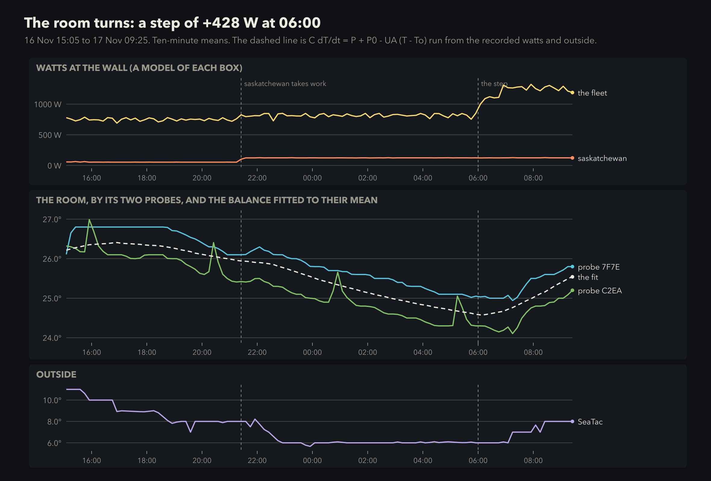
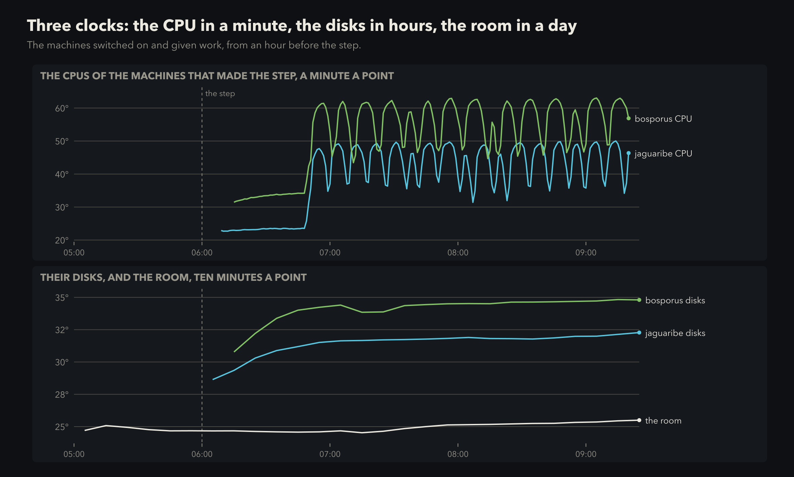
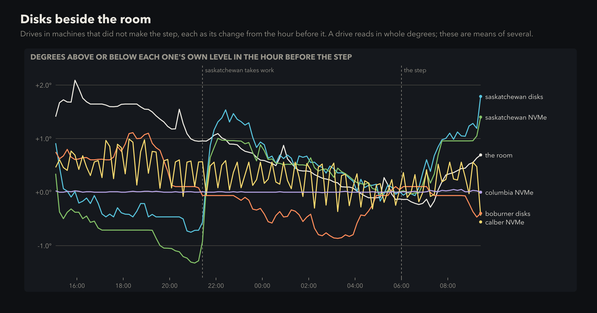

# The Room Turns: A Step of 428 W, the Room's Answer, and Every Disk and CPU Beside It

*Paul Richeson · Lab Report — IEEE Format · 17 November 2026*

Copyright (c) 2026 Paul Richeson. MIT licensed, as orrery.

Companions: `tools/hearth-response.py` (every number and picture here; it reads and commands nothing); `tools/hearth-house.py` (the record it stands on); `docs/hearth-auto-lab-report.md` section XI (the heat balance) and `docs/hearth-measure-plan.md` (the plan this is the first result of); `docs/hearth-response/response.json` (the figures as data).

## Abstract

Paul, 17 November 2026: "has there been a turn around to the heat in the room. can we more accurately look at the step response. do a lab report about the temperature response. correspond it to hd temperatures and cpu temps."

Yes. The house's own heating was switched off on the evening of 16 November and the room fell all night, 26.4 °C to 24.5 °C, with the fleet level at about 816 W. At 06:00 on the 17th two machines were switched on and at 06:52 they were given work: the fleet went to 1,244 W, a step of +428 W. The room reached its lowest, 24.52 °C, at 07:15, and has risen since at 0.34 °C an hour. It stood clear of its lowest 85 minutes after the step began.

The step gives the first number of the house that can be believed: its heat capacity, 3.4 to 4.9 MJ/°C by two methods. It does not yet give the loss per degree. The record is fitted about as well by a loss of 100 W/°C as by 150, because what the fit cannot see, the watts the house gets from everything that is not the fleet, trades against it. One night's reading of the utility meter, or two more days of the room settling, will decide it.

Beside the room, 83 other thermometers were recording, on disks and CPUs. The CPUs of the two machines answered the step in under a minute. Their disks answered in half an hour. The room is answering over hours. Of the drives in machines that did not make the step, only saskatchewan's own, which share its air with the two room probes, follow the room: correlation 0.9. The drives in boburner, calber, columbia and whitewolf do not, and that is a finding about where the probes are, not about the drives.

## I. The question

1. Did the room turn around when the fleet's watts went up, and when?
2. What does that answer say about the house: its heat capacity, its loss, its time constant?
3. Do the disks and CPUs of the fleet say the same thing as the room's two probes?

## II. What the reader needs

**The balance.** One room, one lump of heat (section XI of the report before this one):

    C dT/dt = P + P0 − UA (T − To)                                   (1)

T is the room and To the outside, P the fleet's watts, P0 every other watt the house gets, UA the watts lost for each degree the room stands over the outside, C the joules that warm the room a degree. The room settles at To + (P + P0)/UA, with a time constant τ = C/UA.

**A step** is a sudden, lasting change in P. Just after one, before the room has moved, the only thing in (1) that has changed is P, so the change in the room's slope gives C directly:

    C = ΔP / Δ(dT/dt)                                                (2)

**The probes.** Two thermometers, each inside a Geiger counter's case, both on saskatchewan. They read in tenths of a degree. "The room" in this report is their mean.

**A drive's thermometer** reads in whole degrees. A machine's disks are averaged, always the same disks, so the mean moves in fractions.

## III. The step

| | |
|---|---|
| The fleet before | 816 W, the mean of the two hours before 06:00 |
| The fleet after | 1,244 W |
| The step | +428 W |
| Made by | jaguaribe +232 W, bosporus +205 W |
| How | switched on at about 06:00 and idle (+260 W); given work at 06:52 (the rest) |

It is a step in two stages, 52 minutes apart. Every other machine's watts held within 17 W through it. saskatchewan had taken work the evening before, at 21:30, going from 55 W to 125 W; that smaller step is marked on the pictures and matters in section VI.

The fleet's watts are a model of each box and not a meter's reading (`tools/plans/power.json`). bosporus and jaguaribe have no energy counter the collector may read, so theirs are an idle figure plus a share for how busy they are. If the true step was larger or smaller, every figure in section V scales with it.

## IV. The turn

| | |
|---|---|
| The room's slope, the four hours before the step | −0.11 °C an hour |
| Its lowest | 24.52 °C, at 07:15 |
| Its slope, 07:25 to 09:25 | +0.34 °C an hour |
| Clear of its lowest by 0.1 °C, and staying so | from 07:25 |
| From the step's beginning to that | 85 minutes |
| From the machines being given work to that | 33 minutes |

The room turned. The delay is not all the room's: the probes are inside cases, on one machine, some distance from the two that were switched on, and for the first 52 minutes those two were idle. The fitted line in the picture, which has no delay in it, begins to rise at 06:00 and the probes follow about an hour behind. One lump has no dead time; this room has about an hour of it at these probes.

Both probes show the turn, 0.8 °C apart as they have been throughout. Probe C2EA also shows four spikes of about a degree, each one or two ten-minute lines long, at about 16:00, 20:30, 01:00 and 05:15. They are in one probe only and are not explained. They are in the mean the fit is made on.

## V. What the step says of the house

### A. The heat capacity, from the slopes

By (2), with the slope going from −0.11 to +0.34 °C an hour for +428 W:

    C = 428 W / (0.46 °C / 3600 s) = 3.4 MJ/°C

This assumes nothing else moved. One thing did: the outside rose 1.6 °C between the two stretches, which lowers the loss by 1.6 × UA and so adds to the apparent step. If UA is 120 W/°C that is another 190 W, and C would be 4.9 MJ/°C. So: **3.4 to 4.9 MJ/°C.**

For scale, the air of a room of 50 m³ holds 0.06 MJ/°C. The room that answers the fleet is sixty to eighty times that: the air, and the walls, floor and furniture that the air warms within the hour.

### B. The fit

The second method does not difference the probes. It runs (1) forward from the recorded watts and outside air, lays the simulated room over the probes, and moves UA, τ, P0 until they agree (`hearth-response.py`, an output-error fit, 111 lines of ten minutes).

| | Best fit |
|---|---|
| UA | 121 W/°C |
| τ | 9.7 hours |
| C = τ × UA | 4.2 MJ/°C |
| P0 | 1,289 W |
| The probes missed by | 0.13 °C (root mean square) |

That UA is not to be adopted. The same fit with UA held at each of a row of values:

| UA held at, W/°C | τ, hours | C, MJ/°C | P0, W | Miss, °C |
|---|---|---|---|---|
| 40 | 33.7 | 4.8 | −192 | 0.250 |
| 60 | 18.5 | 4.0 | 190 | 0.204 |
| 80 | 13.2 | 3.8 | 558 | 0.163 |
| 100 | 10.9 | 3.9 | 920 | 0.139 |
| 125 | 9.6 | 4.3 | 1,367 | 0.132 |
| 150 | 9.0 | 4.9 | 1,811 | 0.141 |
| 200 | 8.9 | 6.4 | 2,688 | 0.169 |
| 300 | 9.9 | 10.7 | 4,412 | 0.209 |

Three things are in that table.

- **C holds still.** From UA 60 to UA 150 it stays between 3.8 and 4.9 MJ/°C, and agrees with the slopes. The step decided it.
- **UA does not.** 100 to 150 W/°C fit within 15% of the best. Each higher UA is paid for by a higher P0: about 180 W of unseen heat for every 10 W/°C. The record so far cannot tell a leaky house with a large hidden heater from a tight house with a small one.
- **UA under 60 is ruled out,** since it wants the house's other heat to be less than nothing. That raises the floor of 42 W/°C found the evening before.

A P0 of 1.3 kW is too much for people, a refrigerator and lights. Some of it is surely the house itself: it was heated until the evening of the 16th, and its walls and the rooms beyond the door are still giving that back. That heat fades over days, and as it does the fitted UA will fall. This is why the plan reads the fit from the second day.

### C. A check that failed, usefully

The fit was made again on the hours before the step alone, then run through the step:

| | |
|---|---|
| Fitted before the step | UA 51 W/°C, τ 5.5 h, C 1.0 MJ/°C |
| Its miss on the hours it was fitted to | 0.11 °C |
| Its miss on the hours after | 1.93 °C |

It fitted the night better than the whole fit does and then predicted a room two degrees too warm. A night of slow cooling with level watts cannot give C, UA or P0; the plan said so, and this is the measurement of it. The step is what holds the numbers.

### D. Where the room is going

By the best fit, with the fleet at 1,244 W and the outside at 8 °C the room settles at 8 + (1,244 + 1,289)/121 = 29.0 °C. By the fit with UA held at 60, it settles at 8 + (1,244 + 190)/60 = 31.9 °C. Both say warmer than now, and both say the same for the next twelve hours:

| Hours after 07:15 | UA 121, τ 9.7 h | UA 60, τ 18.5 h |
|---|---|---|
| 12 | 27.7 °C | 28.0 °C |
| 36 | 28.9 °C | 30.9 °C |

These hold the outside at 8 °C, which it will not be. The two part by two degrees only after a day and a half. So the step must be held that long, or P0 must be measured another way.

## VI. The disks and the CPUs

### A. The machines that made the step

| | bosporus | jaguaribe |
|---|---|---|
| CPU idle, then working | 37 °C, 56 °C | 26 °C, 44 °C |
| 63% of that rise | within a minute | within a minute |
| Disks, from switching on | 30.8 °C to 34.8 °C | 28.6 °C to 32.3 °C |
| The disks' lag | about 0.2 hours | about 0.5 hours |
| Disks counted | 10 | 11 |

The CPU figures are a mean of twelve cores, a minute a point, so "within a minute" is the finest this record gives; the report of 15 November put these two CPUs at 55 and 58 seconds. Once working, both CPUs swing by about fifteen degrees every nine minutes as jobs end and begin. The disks reached nearly their new level within an hour and have crept up since at about the room's own rate.

So three clocks are running: the die in a minute, the drive in half an hour, the room in ten to twenty hours. They are far enough apart that each can be read without the others.

### B. The drives that did not make the step

A drive in a machine whose watts held still moves only when the air it is given moves. That makes it a thermometer for the room, if a coarse one. The night is 21:55 to 05:30; the step is 05:30 to 09:25.

| Part | Count | Night, °C | Correlation with the room | Step, °C | Correlation | Its machine's watts, night and step |
|---|---|---|---|---|---|---|
| **The room (two probes)** | 2 | −0.99 | | +0.68 | | |
| saskatchewan disks | 4 | −1.31 | +0.92 | +1.27 | +0.90 | 0, +1 |
| saskatchewan NVMe | 3 | −0.91 | +0.91 | +1.04 | +0.94 | 0, +1 |
| saskatchewan CPU | 1 | −1.19 | +0.49 | −1.23 | −0.43 | 0, +1 |
| boburner disks | 6 | −0.08 | +0.48 | −0.35 | −0.85 | +2, −9 |
| boburner CPU | 2 | −0.15 | +0.14 | −1.92 | −0.61 | +2, −9 |
| calber disks | 6 | 0.00 | | 0.00 | | 0, −17 |
| calber NVMe | 2 | −0.36 | +0.41 | +0.19 | +0.29 | 0, −17 |
| calber CPU | 1 | −0.38 | +0.24 | +1.27 | +0.49 | 0, −17 |
| columbia NVMe | 1 | 0.00 | +0.12 | +0.02 | +0.44 | 0, 0 |
| columbia CPU | 1 | +0.10 | +0.11 | +1.83 | +0.53 | 0, 0 |
| whitewolf disks | 6 | +0.49 | −0.14 | −2.39 | −0.66 | +6, −3 |
| whitewolf CPU | 1 | +0.67 | −0.06 | −2.84 | −0.46 | +6, −3 |

**saskatchewan's drives follow the room, and closely.** Seven drives, correlation 0.90 to 0.94 in both stretches, moving the same way at the same time. They fell with the room all night and turned with it after the step, with saskatchewan's own watts unchanged. They are a third and fourth witness to the turn, and they owe nothing to the Geiger counters.

**They moved further than the probes after the step:** +1.0 to +1.3 °C against +0.68 °C. A drive in a fan's stream reads the air it is given; a probe inside a counter's closed case lags it. The air at saskatchewan had warmed by about a degree by 09:25, and the probes were still catching up. If so, the probes' own lag is part of the hour's delay in section IV.

**saskatchewan's own step shows the difference between the two.** When it took work at 21:30 its drives rose a degree and more within half an hour, from its own heat. The probes rose about 0.15 °C. The fit agrees: the term for saskatchewan's own heat on the probes came out at nothing. The probes are on saskatchewan and are not reading its exhaust.

**No other machine's drives follow the room.** boburner's six disks moved 0.08 °C in a night in which the room fell a degree. calber's six did not move at all, which for six integer thermometers over eighteen hours more likely means they are not being refreshed than that they held. columbia's one drive is flat. whitewolf's went the other way, and fell 2.4 °C in the last half hour with its watts unchanged, cause not found.

There are two readings of that, and this record cannot choose between them. Either those machines stand in air the probes do not share, another room or the far side of this one, and the "room" of this report is the air around saskatchewan. Or their cases hold their drives at a temperature of their own, by fans that speed up as the intake warms. boburner and whitewolf report fan speeds; they were not examined for this report.

**The CPUs of the steady machines are no use as room thermometers at ten minutes.** Their correlations with the room are between −0.6 and +0.5. A CPU's temperature is its watts first and the room's air a distant second, and its watts move with every job.

## VII. Method

Everything is from records already kept: each machine's five-second telemetry on the Mac, radbeeper's reading of the two counters within it, and the airport's observations. `tools/hearth-response.py` averages them into ten-minute lines, finds the step as the boundary with the largest lasting change in watts, takes slopes by least squares, and fits (1) by simulating the room and minimising the squared miss with a simplex search from nine starting points. A machine's drives are averaged over the same drives throughout; a drive missing from more than one line in ten is left out. It was run once for this report, at 09:25 on 17 November, 3 hours 25 minutes after the step began. No machine was commanded by it. The step itself was Paul's: he switched the two machines on and added them to the queue.

## VIII. What is not done

- **UA is not decided.** 100 to 150 W/°C fit equally; under 60 is ruled out. P0 is the unknown that trades against it.
- **The step is three and a half hours old.** A time constant of ten to twenty hours cannot be read from that. Every figure here should be made again at a day and at two.
- **The house's stored heat is in P0** and will fade. No allowance is made for it.
- **The fleet's watts are a model.** The two machines that made the step have no energy counter in the record.
- **Whether the probes read the room or saskatchewan's corner of it** is not settled. The other machines' drives do not confirm them, for one of two reasons.
- **The probes' own lag is not measured.** It would take a bare thermometer beside them.
- **The spikes in probe C2EA are unexplained** and are not removed.
- **One lump has no dead time and the room has about an hour.** A second lump, or a delay, would fit the first hour after the step better. Neither is added.
- **Fan speeds were not read,** which would decide between the two readings in section VI.
- No film of this report is made yet.

## IX. What to do next

1. Leave the fleet as it is until the morning of 19 November, and run `hearth-response.py` each morning and evening. By then the two UAs of section V.D stand two degrees apart.
2. Read the utility meter at 22:00 and 06:00 one night. The house's whole electrical draw, less the fleet, is most of P0, and it turns the table of section V.B into one row.
3. Stand a bare thermometer beside the counters for an hour. It gives the probes' offset and their lag at once.
4. Say which room each machine is in. It decides what section VI means.

## References

[1] P. Richeson, "Holding the Room," Orrery lab report, 16 November 2026, section XI. `docs/hearth-auto-lab-report.md`

[2] P. Richeson, "Measuring the house: a plan for UA, the time constant and the steady temperature," 16 November 2026. `docs/hearth-measure-plan.md`

[3] P. Richeson, "The Fleet as the Hearth," Orrery lab report, 15 November 2026. `docs/hearth-lab-report.md`

[4] US National Weather Service, "API Web Service: station observations." https://api.weather.gov/stations/KSEA/observations

[5] J. A. Nelder and R. Mead, "A simplex method for function minimization," *The Computer Journal*, vol. 7, no. 4, pp. 308–313, 1965.
