# Three Generations, Filmed: The Line from Question to Commit, a Crowd of Duels That Are Really Different, and Every Wire in Its Node's Colour

*Paul Richeson · Lab Report — IEEE Format · 5 November 2026*

Paul Richeson, treadcore.org; Claude Code (Claude Opus 5.5) as the pair. Copyright (c) 2026 Paul Richeson. MIT licensed, as orrery and treadcore.

Companions: orrery `tools/montage.py` (`line_story`, `line_act`, `chain_frames`, `node_hue`, `moments`), `src/pipeline.rs` (the Flow's walked road), `src/montage.rs` (the Mind player's wires), `tools/plans/treadcore.py` (the run's words, "on the line at"); crucible `src/crucible.cu` (`--trace-spread`); orrery commit 91cd3ba, crucible commit 8d15995. The film: `docs/line-film/montage-0004.mp4`, also `output/treadcore-montage-0004.mp4`. Reports of 4 and 5 November: *Seeing the Brain Grow* [1] and *The Duty Cycle* [2].

## Abstract

On the evening of 5 November the line committed its third generation of the day, r0201 (trial w11352), and Paul asked four things: what each generation's move was and how it succeeded; whether it was committed, pushed, and submitted by the auto mode or corrected by hand; that the montage show it, the chain and the arrows of the flowchart, with more investigation and more of the battles; and that the film have more ghosts and wires of different colours, so a node's connections can be followed. **All three generations are committed and none is pushed.** r0196, r0199 and r0201 stand on the local line, the branch `orrery/accepted` that every machine of the fleet builds and plays; main is still r0186's. Main takes the line only when the hourly proof reads it past main at z 3; the proof read the line at r0199's head +0.33 ± 0.18 over 2,400 seeds (z 1.87), and at r0201's head, its first read, +0.08 ± 0.31 over 800 (z 0.25). Every one of the five promotion tries of the day was asked by the auto mode. One generation needed correcting, w10839: its first try failed at the writer (a default written as a constant's name) and its second at the commit (a machine with no git identity), neither its numbers' fault; both were mended in code and the third try landed. The film, **montage 4** (Fig. 1), now opens on the line: each generation's chain revealed a job at a time with an arrow from every job to the one it followed, the dials it moved in the weights table's words, the investigation of w10839's tries with the commits that mended them, orrery's own screens with the chain lit (the Flow now numbers the stages a trial walked), and where the commits stand. Then the twelve crucible chapters, with **more ghosts**: a finding first, that the 64 duels the old films called a crowd were only eight to twelve different games, stacked, because the nets are deterministic and eleven opponents from one start can play only eleven ways. A new crucible flag moves each duel's start by up to three tiles; each chapter is now 120 to 128 different duels. The champions of the five chapters before stand in the followed duel as lavender ghosts. **More battles**: each chapter replays its kill shot at half speed and closer, and shows its hardest win and a loss. **The wires** take their source node's colour, drawn over the layers from a dot to a ring, dotted when they inhibit. The film is 275 s long, 12.8 MB, and took 353 s to make.

*Index Terms*: neuroevolution, visualization of neural networks, provenance, continuous delivery, statistical acceptance testing, small multiples, deterministic simulation.

## I. The question

Paul, at 19:31: "i see we just found r0201 w11352. so describe the success story of each generation move. Is this commited. Pushed. Was it auto submitted corrected. Add this to the montage. Show the chain, show the arrows in the flowchart. In fact. show more investigation. show more demonstration of the battles. Also can you show more ghosts in the movie. Also, try for a way so that the wires are different colors so we can see the node conenctions." And at 20:45, having watched it: "so good. commit push. show movie in new lab report."

Three questions to answer from the record (sections III to V) and four things to build (sections VI to IX). Everything here is read from the queue's own records and from git, and every picture is a frame of the film or of orrery drawn from them.

## II. The film

!html(line-film/film.html)

The film is in two acts. **The line** (0:19 to 1:55) is the game's brain, the rules with their three hundred dials, moved by the fleet's census a generation at a time. **The chapters** (1:55 to 4:14) are crucible's GPU islands, small neural networks evolving under the game's rules [9], each milestone a chapter, each chapter the same 128 duels, so the chapters read as small multiples [8]: one picture, the generation the only thing changed. The two are told apart because they are apart: a generation of the line is a commit to treadcore, and a milestone is a net that plays in the game only as the Gladiator style.

## III. Committed, and not yet pushed

A promotion that passes its tests is committed at once, but not to main. It goes on **the line**, a branch on the coordinator, `orrery/accepted`, which every machine then builds (all nine confirmed r0201's values by 19:59) and against which every new trial is read. Main, what a player who installs the game gets, takes the line by a **proof**: each hour main's values are read as a trial against the line's, 800 seeds, the reads of one line against one main pooled by inverse variance [3] until either moves. When the line reads past main at z 3, with no map given up beyond the trade rule, the line goes to main and is pushed.

| | commit | on main? | its proof |
|---|---|---|---|
| r0186 · w10040 | 562b3d4 | yes, 11:37 | +1.28 ± 0.31 over 800 seeds |
| r0196 · w10839 | 7c64198 | no, on the line | pooled with r0199's head |
| r0199 · w11139 | ea41f83 | no, on the line | +0.33 ± 0.18 over 2,400 seeds, z 1.87 |
| r0201 · w11352 | a96baf9 | no, on the line | +0.08 ± 0.31 over 800 seeds, z 0.25 (20:29) |

*Table I. Where the day's commits stand at 21:00. Main is 0dd8b5a, whose last generation is r0186 (`ping_style 0 -> 2`). A new generation on the line starts its proof's pool again, so r0201's first proof is one read.*

**The proof has not passed, and that is the rule working.** Three generations each passed their own held-out read; read together against main they are, so far, inside the noise. The proof's bar is high on purpose: a generation's held-out read passes at z 1.65 today, and a line carrying three of them can contain one that passed by luck. The proof keeps reading every hour.

One fault was in the words, and it was found answering this question. The run's record said "on main at a96baf9" for a commit on the line: the planner wrote "on main" for every confirmed promotion, a phrase from before the line existed. It now writes "on the line at" while a promotion's status is `self-modified`, the line's, and the records of r0196 and r0199 were corrected to match.

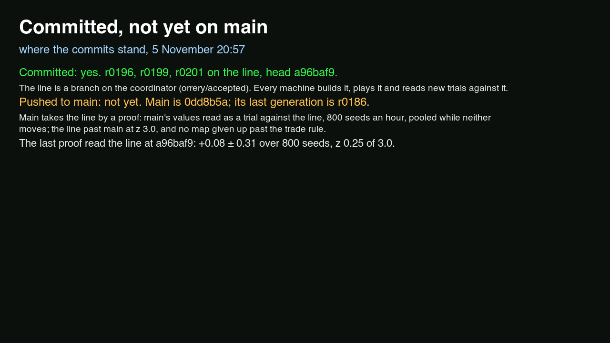

*Fig. 2. The film's last card of the line (1:47), drawn again at 20:57 for this report: committed, yes; pushed to main, not yet; the proof's rule and its newest read. In the film, drawn at 20:00, the newest read was ea41f83's, z 1.87, and the card said the next proof would read a96baf9 at about 20:12; it did, at 20:29.*

## IV. Three generations, each from its question to its commit

Each generation begins as a **trial**: a few dials drawn by `suggest.py` from the uncertainty of a fit to every census so far. It is read on 55 seeds against today's defaults (the **first read**), read on in steps while it stays above a bar (the **read-ons**, to about 190 seeds), then read on 400 seeds no search has seen (the **held-out read**, since this morning four pieces of 100 pooled [2]). A trial past the held-out bar goes to its **families** (nine scenario families, each with a floor), its **gauntlet** (22 single-decision tests, each with a floor) and the **tests**, 168 unit tests on a branch, and is committed. Fig. 3 is how the film tells it: every job a box in its stage's column, on the machine that ran it, with an arrow from the job it followed, the newest of the chain to have ended when it began.

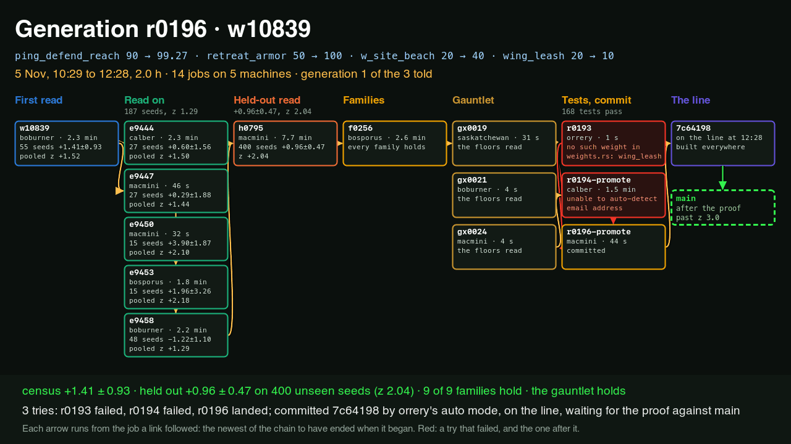

*Fig. 3. r0196 (w10839), 10:29 to 12:28. First read on boburner; five read-ons on calber, macmini, bosporus and boburner; a held-out read of 400 seeds on macmini (+0.96 ± 0.47, z 2.04); families on bosporus; the gauntlet read three times; three promotion tries, two red. The dashed box is main, after the proof.*

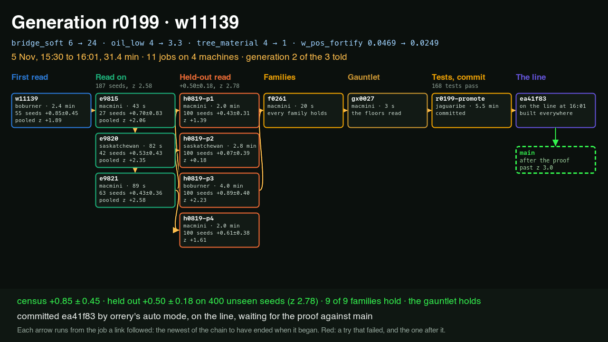

*Fig. 4. r0199 (w11139), 15:30 to 16:01, thirty-one minutes from question to commit. The held-out read in four pieces on macmini, saskatchewan and boburner (+0.43, +0.07, +0.89, +0.61; pooled +0.50 ± 0.18, z 2.78, the strongest of the three); tests on jaguaribe.*

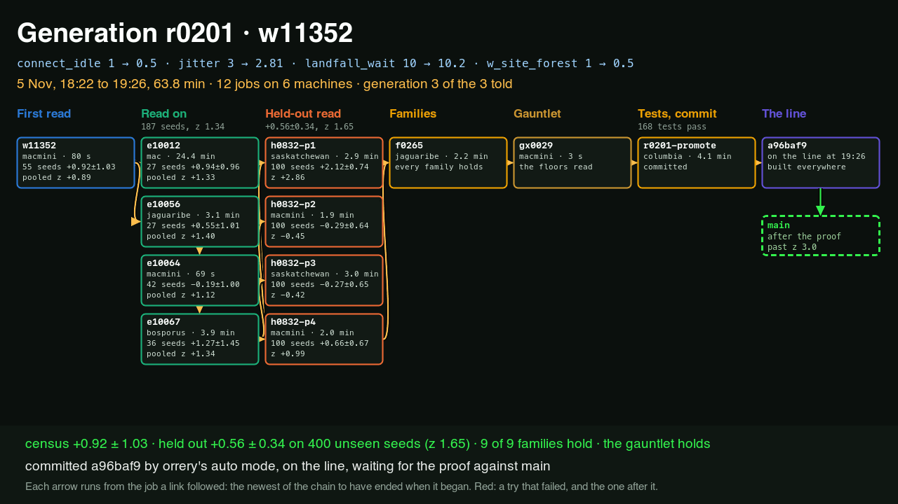

*Fig. 5. r0201 (w11352), 18:22 to 19:26. The first read +0.92 ± 1.03; four read-ons, one of them 24 minutes on the Mac, which since this afternoon runs fleet work on 2 of its 8 cores at background priority; four pieces (+2.12, −0.29, −0.27, +0.66) pooled +0.56 ± 0.34, z 1.65; families on jaguaribe, tests on columbia.*

What each moved, in the weights table's own words [4]:

- **r0196 · w10839.** `ping_defend_reach` 90 → 99.27 (a call to defend is answered this near, tiles); `retreat_armor` 50 → 100 (armour at or under this goes home, blended from the constant by `w_smooth`, so at the defaults it barely acts); `w_site_beach` 20 → 40 (tiles of a boat's run a beach's island is worth per point of its site score, on a naval start); `wing_leash` 20 → 10 (a wingman is taken no further than this from its leader). Read as a whole: answer defence calls from further, value good islands more at sea, and keep the wingman close. Census +1.41 ± 0.93; held out +0.96 ± 0.47.
- **r0199 · w11139.** `bridge_soft` 6 → 24 (a bridge this long or shorter costs no extra when a crossing is planned); `oil_low` 4 → 3.30 (a crew fetches oil when the refinery holds less than this); `tree_material` 4 → 1 (the material a tree gives, as the crossing planner counts it); `w_pos_fortify` 0.047 → 0.025 (the worth of Fortify's score). Plan crossings by bridges more freely, count trees as the thin resource they are, and fortify less. Census +0.85 ± 0.45; held out +0.50 ± 0.18.
- **r0201 · w11352.** `connect_idle` 1 → 0.5 (how much of Connect's score stands when the tank has no pillbox to bring in); `jitter` 3 → 2.81 (a moving goal's shift under this is smoothed); `landfall_wait` 10 → 10.20 (seconds a boat stands off a covered beach before it lands anyway); `w_site_forest` 1 → 0.5 (a base site's worth of trees enough). Halve the pull of a posture that has no work to do, and weigh forest less in choosing a base. Census +0.92 ± 1.03; held out +0.56 ± 0.34.

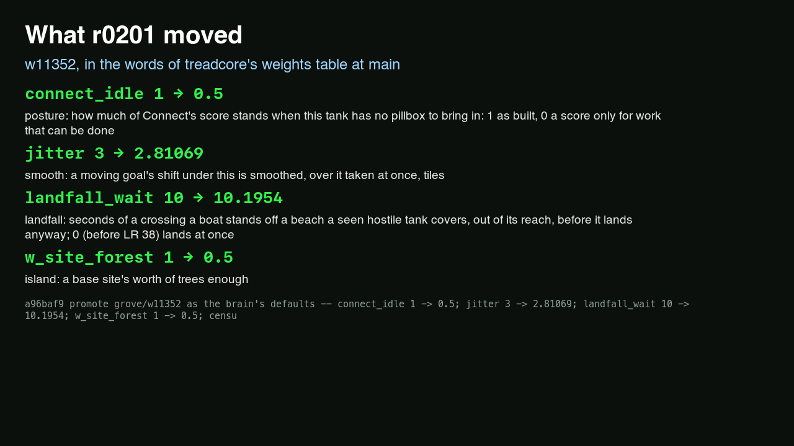

*Fig. 6. The film's card of r0201's dials (1:29), the words read from treadcore's weights table at main, not written for the film.*

**The success story is the same three times and different in its margins.** All three passed every family and the gauntlet and all 168 tests; all three were asked and committed by the auto mode. r0199 was the cleanest, a held-out z of 2.78 and thirty-one minutes end to end. r0201 was the thinnest: z 1.65, exactly the bar, with two of its four pieces a little below zero. That is not a fault: a bar is passed at the bar. It is why the proof exists.

## V. The investigation: w10839's three tries

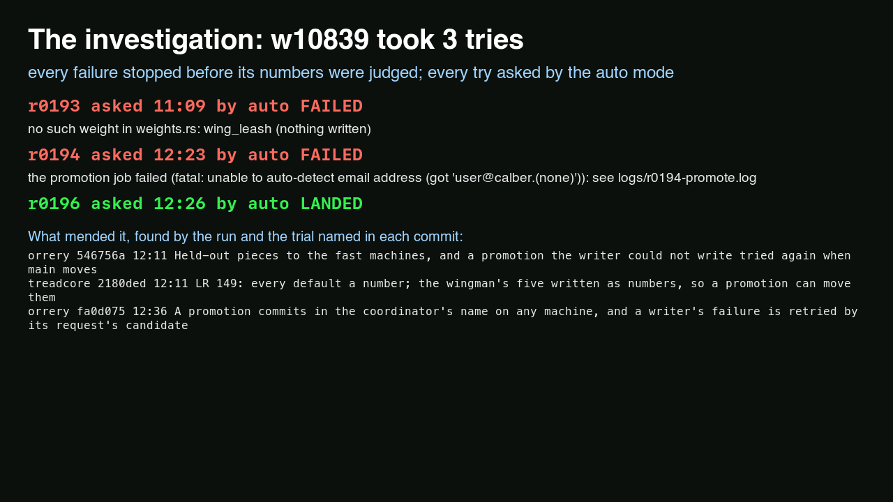

*Fig. 7. The film's investigation (0:48). The tries and their faults are the run records' own words; the commits under them are found by the film itself, every commit in orrery and treadcore that names a failed try or the trial between the first failure and an hour after the landing.*

**r0193, 11:09, failed at the writer.** Before a promotion job is asked, the planner writes the trial's values into the weights table with `set-defaults.py`, and it could not write `wing_leash`: its default in the table was the name of a constant in `commander.rs`, which the writer read as no default at all ("no such weight in weights.rs: wing_leash (nothing written)"). Treadcore LR 149 (2180ded, 12:11) wrote all five of the wingman's defaults as numbers, their values unchanged, and a test now holds every default in the table to be a number. Orrery 546756a (12:11) let a promotion the writer could not write be tried again when main moves, which LR 149 did.

**r0194, 12:23, failed at the commit.** It passed the 168 tests, every family and the gauntlet on calber; then calber's git refused the commit, "Author identity unknown". Since 3 November a promotion may run on any CPU machine, and only some have a git identity. The planner already tried again at once, and once, a promotion that failed before its numbers were judged, and asked r0196 three minutes later; orrery fa0d075 (12:36) then made the promotion job commit in the coordinator's name on any machine, so the fault cannot come back.

**r0196, 12:26, landed** on macmini in 44 seconds of work.

**Neither failure was the candidate's.** The planner tells them apart: a failure at the tests, a family or the gauntlet is the candidate's numbers judged, and is tried again only when main moves; a failure before them is the machine's or the line's, and is tried again at once, once. Any two failures in a row pause the auto mode. The film's card reads the same words and says "every failure stopped before its numbers were judged".

## VI. The chain on orrery's own screens

The film shows the chain as orrery shows it, and one screen learned something for it. **The Flow** (Queue, Pipeline, Flow) draws the line's stages as boxes and, under them, one trial's reads. It now also lights the road that trial walked: each stage it reached is framed in the Timeline's amber and numbered in order, an arrow runs from each to the next over the road everyone shares, and the stage it waits at is framed and marked *next*, without an arrow into it, since an arrow into the proof before the proof has read would claim a step the line has not taken. A failed promotion's box is framed red. `ORRERY_FRAME_TRACE=w11352` chooses the trial for a frame, as a click does in the window.

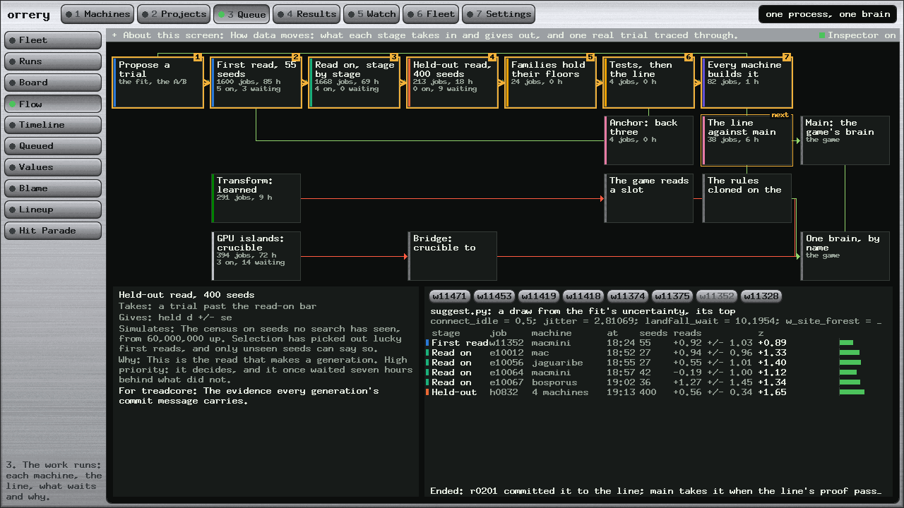

*Fig. 8. The Flow with w11352's road lit: propose, first read, read on, held out, families, tests, every machine builds it, numbered 1 to 7; the line against main framed as next. Under it, the trial's reads, and "r0201 committed it to the line; main takes it when the line's proof passes."*

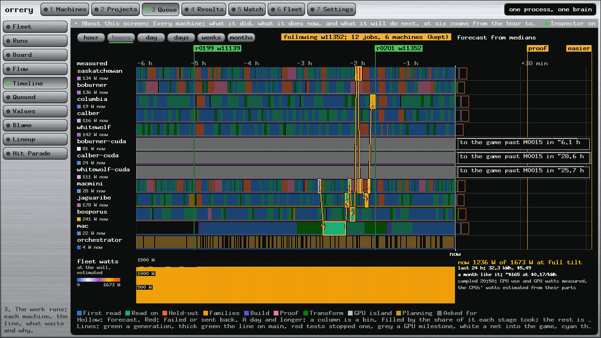

*Fig. 9. The Timeline following w11352 (the film shows one for each generation still inside the six hours): its twelve jobs on six machines, the rest of the hours stepped back, an arrow from each job to the one it followed.*

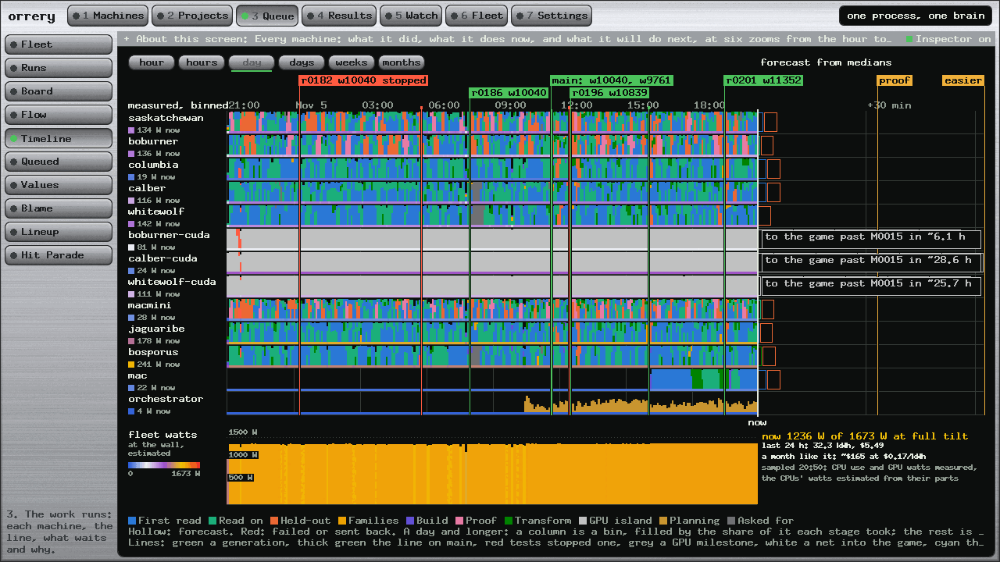

*Fig. 10. The day: the bins coloured by stage; a green line for each generation, labelled where there is room (r0199's label is crowded out by r0201's); the red one where r0182, w10040's first try, stopped; and "main: w10040, w9761" where the line went to main at 11:37.*

## VII. More ghosts: a dozen games in 128 duels, and the spread

The montage's crowd is every other duel of the chapter at the same moment, drawn faded with the camera's movement. Paul asked for more of them, and the first answer, more duels, was wrong, which a count showed before a film was made. The trace plays every duel from **one start**, the pillars, the pillboxes and both tanks' places drawn once, so that duel *d* is the same contest in every chapter. Each duel's opponent is drawn by its index: a milestone (six of them) or a scripted sparring partner of five styles. The nets are deterministic. So two duels with the same opponent from the same place are the same game, step for step, and their ghosts stand exactly on one another.

| chapter | distinct duels, one start | distinct duels, spread 3 tiles |
|---|---|---|
| 1 (M0001) | 8 of 128 | 122 of 128 |
| 7 (M0009) | 11 of 128 | 128 of 128 |
| 12 (the newest) | 12 of 128 | 120 of 128 |

*Table II. Distinct duels among 128, counted by their length and fitness, in two traces of the same twelve champions on boburner. At the first clip of chapter 12 there were 16 learners within a tile of the followed one, all on the same path.*

**The answer is permutations, not copies.** `crucible --trace-spread S` moves each duel's two tanks up to S tiles from the start and turns them up to a fifth of a turn, by dice that are the duel's index, drawn from a stream apart from the opponent's: duel *d* keeps its opponent and its start in every chapter, the arena is one world, and a moved tank stays off the pillars and inside its starting band, as `place()` keeps it. The montage asks for 3 tiles and 128 duels a chapter (the trace's limit is 256). Paul's first words for the film were "the multitudes of permutations in the same world"; with one start there were a dozen.

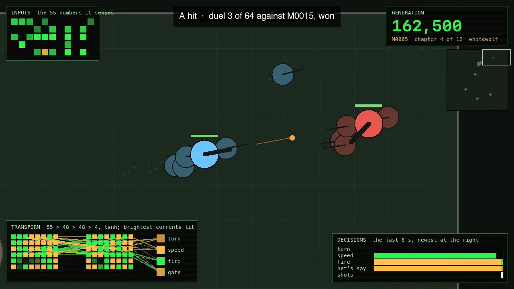 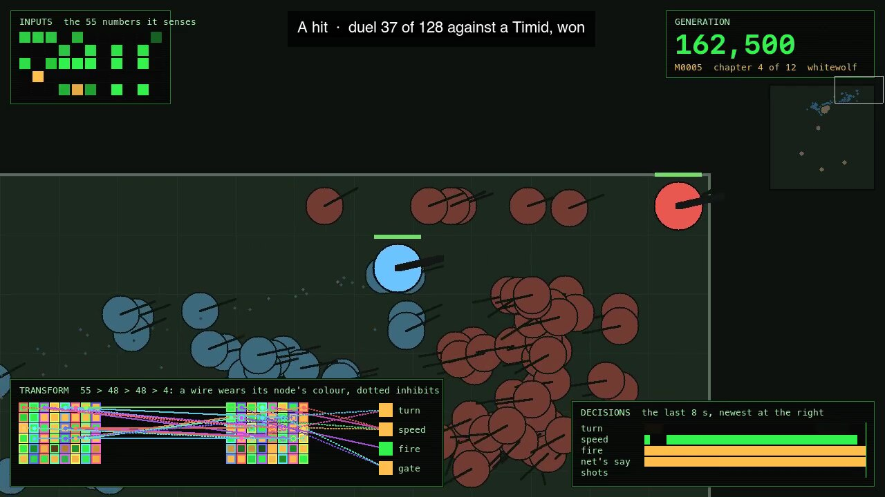

*Fig. 11. The same champion, generation 162,500 (M0005), in film 3 (above: 64 duels from one start, a handful of ghosts in view, most of the rest under them) and film 4 (below: 128 duels spread, the crowd of learners in teal and foes in red).*

Two more kinds of ghost were added. **The generations before**: the champions of the five chapters before this one played the followed duel too (same start, same opponent), and each is drawn where it stood at this step, lavender, the older the fainter, with its track behind it. Only the learner: the foe in their duels answered a different tank. **The standing**: a tank still standing when its duel ended, a winner or both sides of a draw, stays in the crowd at half strength where it stood, so the crowd thins by the dead and not by the clock.

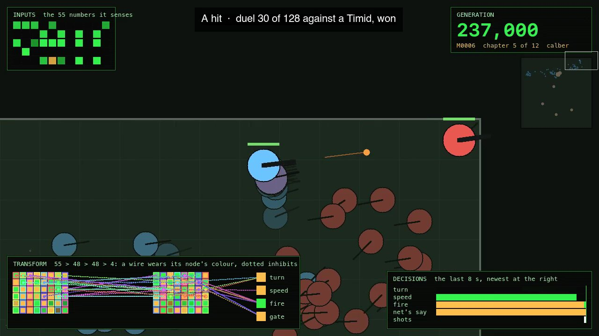

*Fig. 12. Generation 237,000 (M0006), a hit in duel 30 against a Timid tank: the lavender tank under the champion is the champion of the chapter before, in the same duel at the same moment.*

## VIII. More battles

Each chapter now shows up to three pillbox fights where there were two, then three things it did not show before:

- **The kill shot again, at half speed and closer.** The second before it and the moment after, six frames a step instead of three, 20 tiles across instead of 30, the camera halfway to the foe instead of a third, and no corners: the shell's flight and the turn that aimed it can be watched. Once a chapter, at its first kill.
- **The hardest win.** The kill shot of the duel won against the strongest opponent: the highest milestone on the ladder it beat.
- **A loss,** its last second and a half, where the champion died. A film of wins alone says nothing of what a generation still cannot do.

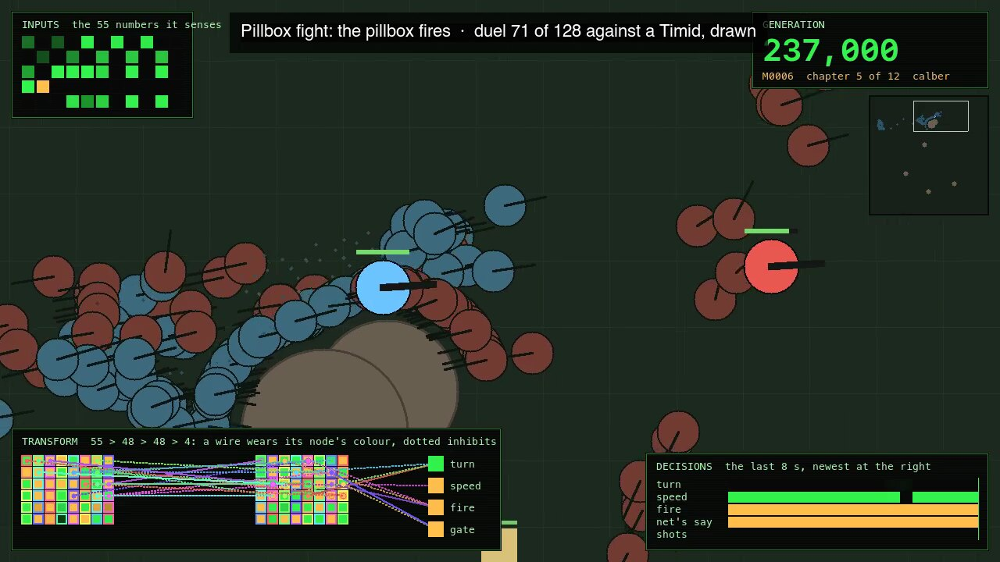

*Fig. 13. A pillbox fight, generation 237,000, duel 71 against a Timid tank (drawn): the pillbox's shells on the champion by the pillars, and the crowd of the other duels round the same pillars.*

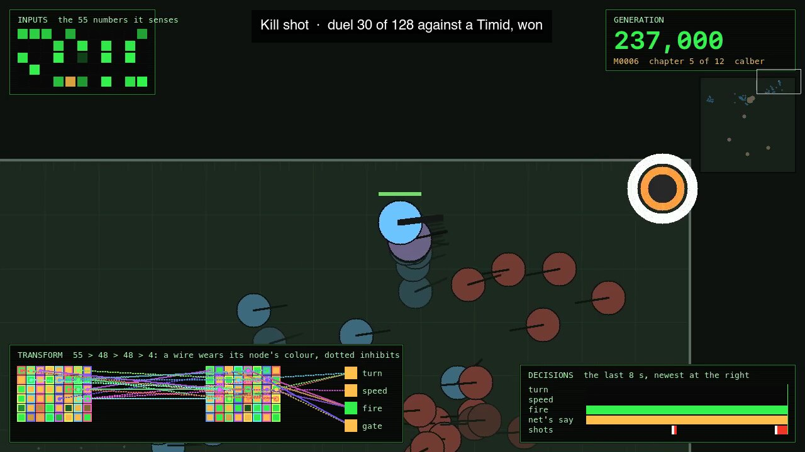 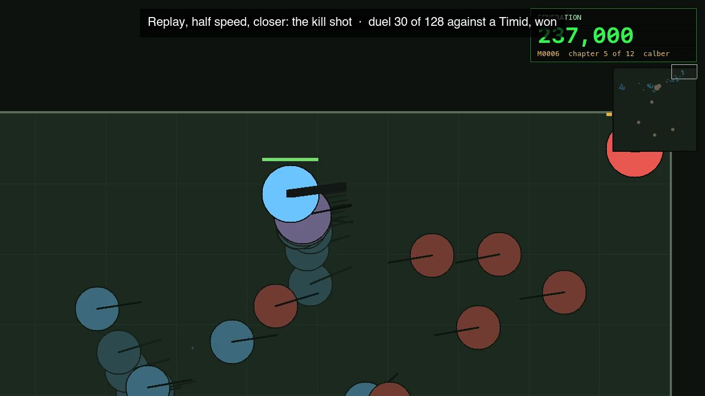

*Fig. 14. The kill shot of duel 30 (above) and the same moment in the replay (below), half speed, 20 tiles across, the corners off. In film 4 the replay's long caption runs under the generation's panel; shortened for the next film.*

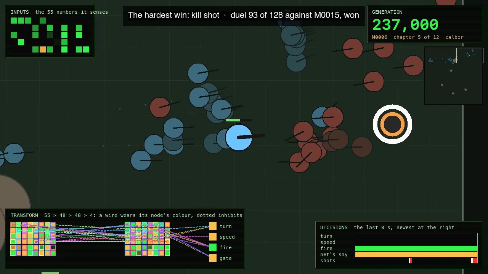 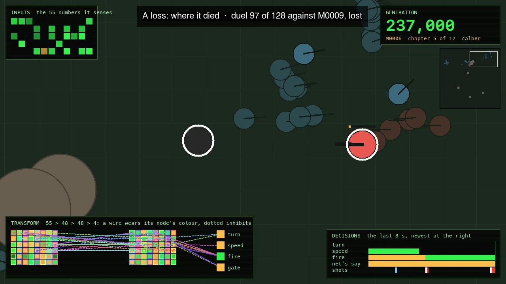

*Fig. 15. Generation 237,000's hardest win, duel 93 against M0015, the newest milestone it was given (above), and a loss, duel 97 against M0009, the champion's wreck ringed (below).*

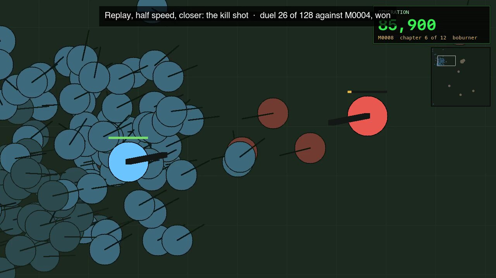

*Fig. 16. Generation 85,900 (M0008), the replay of its kill shot in duel 26 against M0004: the learners of 128 duels round it.*

| chapter | generation | won · lost · drawn | clips |
|---|---|---|---|
| M0001 | 200 | 64 · 4 · 60 | hit, kill, pillbox, hardest win, loss |
| M0002 | 235,800 | 27 · 77 · 24 | kill, pillbox, loss |
| M0004 | 236,600 | 52 · 63 · 13 | hit, kill, pillbox, hardest win, loss |
| M0005 | 162,500 | 62 · 5 · 61 | hit, kill, pillbox, hardest win, loss |
| M0006 | 237,000 | 61 · 7 · 60 | hit, kill, pillbox, hardest win, loss |
| M0008 | 85,900 | 48 · 2 · 78 | hit, kill, loss |
| M0009 | 238,100 | 62 · 7 · 59 | hit, kill, pillbox, hardest win, loss |
| M0011 | 238,700 | 54 · 1 · 73 | hit, kill, pillbox, hardest win |
| M0012 | 239,000 | 53 · 0 · 75 | hit, kill |
| M0013 | 239,200 | 50 · 0 · 78 | hit, kill |
| M0015 | 241,300 | 55 · 0 · 73 | hit, kill |
| the newest | 267,100 | 63 · 3 · 62 | hit, kill, loss |

*Table III. Every chapter's 128 duels and the clips the film took from them; each also replays its kill shot. The last four milestones fought no pillbox in their best duel and won no kill against a milestone, and three of them lost nothing: their chapters are the shortest.*

## IX. Every wire in its node's colour

The bottom-left corner draws the champion's net between its two hidden layers of 48 and its four outputs, lit by the strongest currents, a weight times the signal it carries. Before today every wire was green or amber by its sign, and forty-two of them read as one fan with no ends. Now **a wire wears its source node's colour**: each node has its own hue, the golden angle round the colour wheel [5] by its index, so neighbours in the grid never share one and forty-eight stay apart; each node is framed in its hue; a wire is drawn over the grids from a dot on the node it leaves to a ring on the node it feeds, brighter the larger its current, and dotted when it inhibits. The strongest 18 between the layers and 9 into the decisions are drawn: more and the wires are a mat. The panel is wider, 624 pixels, so the wires between the layers have room to be told apart. Orrery's Mind player, which plays a film's corners in the window, uses the same rule, and a test pins its colours to the film's.

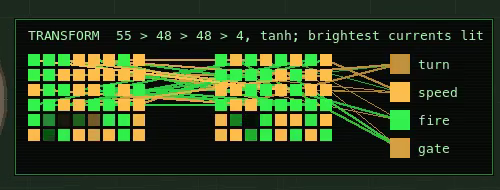 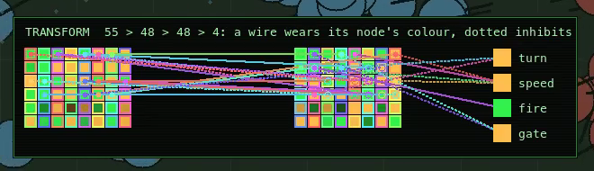

*Fig. 17. The same champion's transform in film 3 (above) and film 4 (below). The two hidden layers' nodes are framed in their own colours; each wire begins at a dot on its node.*

## X. What is not shown, and what is open

- **The line is not on main.** Section III. The proof reads hourly; if the three generations together never read past main at z 3, the line stays the fleet's working line and main stays r0186's. This report claims each generation's held-out read, not the line's.
- **The lavender ghosts are the learner only**, and only the five chapters before. Chapters of different islands are interleaved by milestone, so "the chapter before" can be another island's champion.
- **The spread changes the film's duels, not crucible's training.** `--trace-spread` acts only in `--trace`; training's arenas are untouched. Films 1 to 3 were traced from one start and are not comparable duel for duel with film 4.
- **The newest milestones' chapters are thin** (Table III): a hit and a kill, because their best duels fought no pillbox.
- **Captions.** Film 4's longest captions (the replay's, the hardest win's) run under the generation's panel; the replay's caption is now "Replay at half speed: the kill shot", the captions are a point smaller, and they are centred in the gap between the inputs' panel and the generation's instead of on the frame.
- **The Flow traces the last eight trials** that reached a held-out read; r0196's and r0199's trials had left it by evening, so the film's Flow shows r0201's road, and its Timeline shows only the generations still inside six hours.
- **Not yet in the running window.** The Flow's road and the Mind player's colours are in orrery 91cd3ba; the installed Orrery.app shows them after `make install` and a restart.

## XI. How to make it again

`fleet-queue.py QUEUE montage make` (or Results, Montage, *Make montage*) makes the next film from the milestones since the last; `python3 -I tools/montage.py QUEUE make --since start` makes one of the whole ladder, as montage 4 was. `python3 -I tools/montage.py QUEUE line OUT.mp4` renders the line's act alone, about 96 s of film in 22 s. A film is traced on whichever GPU island answers (boburner, 156 s, 597 MB for 12 chapters of 128 duels), rendered in plain Python at about 0.04 s a frame, joined with FFmpeg [6] and lettered with ImageMagick [7], and written to `archive/montages/NNNN/` and `output/`; the trace and the frames are deleted.

## References

[1] orrery, *Seeing the Brain Grow: The Montage, the Mind in the Corners, and Every Screen of Orrery and Treadcore*, lab report, 4 November 2026.

[2] orrery, *Ninety-Eight Percent Busy: Where the Fleet's Waiting Goes, a Round Table to See It, and a Background Job That Asks for Nothing*, lab report, 5 November 2026, sections XIV to XVI.

[3] W. G. Cochran, "The combination of estimates from different experiments", *Biometrics*, vol. 10, no. 1, pp. 101–129, 1954.

[4] treadcore, `source/treadcore-brain/src/weights.rs`, the weights table at main 0dd8b5a; *LR 149: every default a number*, commit 2180ded, 5 November 2026.

[5] H. Vogel, "A better way to construct the sunflower head", *Mathematical Biosciences*, vol. 44, no. 3–4, pp. 179–189, 1979.

[6] FFmpeg developers, *FFmpeg*, https://ffmpeg.org.

[7] ImageMagick Studio LLC, *ImageMagick*, https://imagemagick.org.

[8] E. R. Tufte, *The Visual Display of Quantitative Information*. Cheshire, CT: Graphics Press, 1983.

[9] K. O. Stanley and R. Miikkulainen, "Evolving neural networks through augmenting topologies", *Evolutionary Computation*, vol. 10, no. 2, pp. 99–127, 2002.
