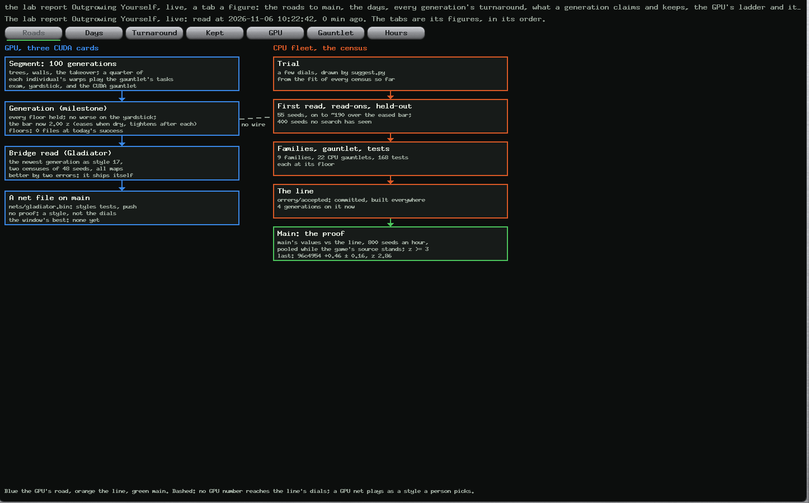
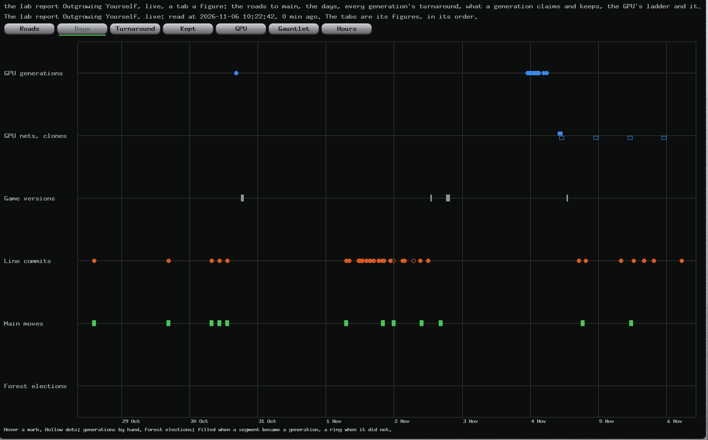
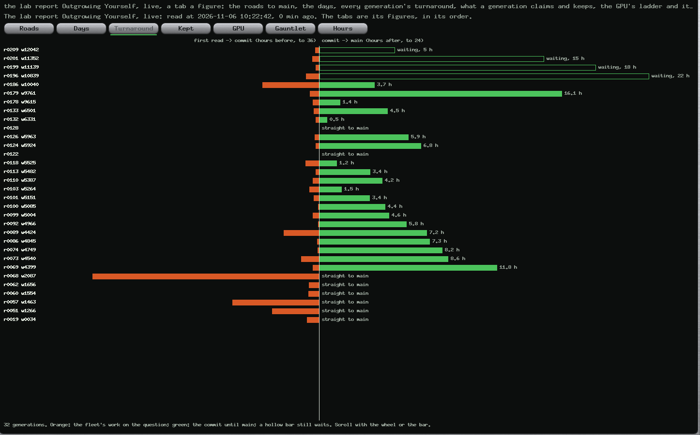
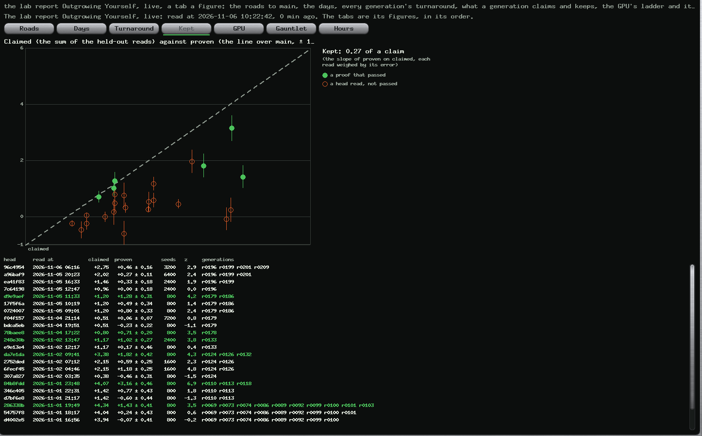
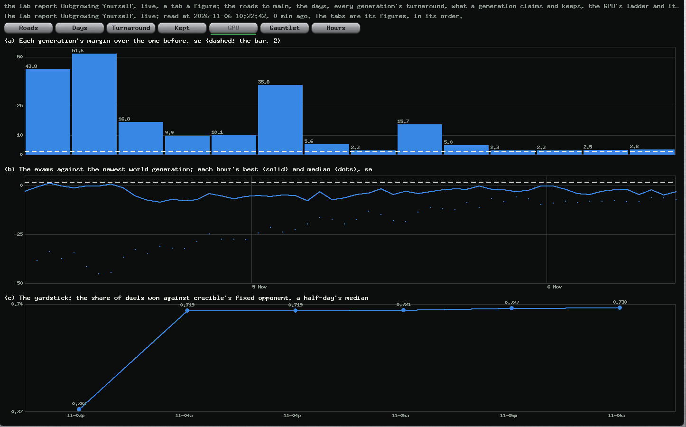
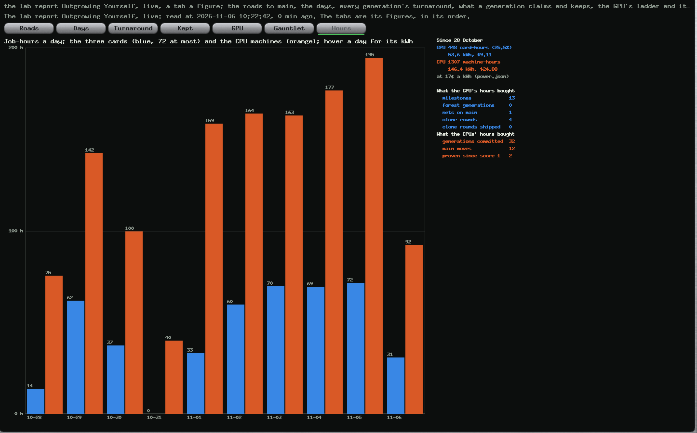

# One Rule, Two Machines: Trees, Mazes and Takeovers on the Card, a Gauntlet Both Can Read, and Generations the GPU Can Earn

*Paul Richeson · Lab Report — IEEE Format · 6 November 2026*

Paul Richeson, treadcore.org; Claude Code (Claude Opus 5.5) as the pair. Copyright (c) 2026 Paul Richeson. MIT licensed, as orrery and treadcore.

Companions: crucible `src/crucible.cu` and `gauntlet/*.toml` (commit da47f15, local), orrery `tools/plans/treadcore.py` (the forest home, `gpu_step`, `gpu_bar`, `gpu_elected`, `gpu_force`, `src_tree`), `tools/montage.py` (trace version 3), `tools/report/outgrowing.py --view`, `tools/plans/treadcore-view.py` (`generations`), `src/generations.rs` (Results, Generations); treadcore `source/treadcore-brain/src/scenario.rs` and `scenarios/gauntlet/g23` to `g28` (worktree `cpu-mazes`, not committed). The report before it: *Outgrowing Yourself* [1].

## Abstract

*Outgrowing Yourself* [1] found that the GPU had handed the game nothing in 149 card-hours: its ladder had stalled behind a milestone that draws 99.6% of its duels, its exam could see no step forward, and no number it made reached the line. Paul asked for the fix the same morning: generations from the GPU that are automatic, frequent and incremental; trees and more training on the card; CUDA gauntlets in the style of the CPU's, with mazes shaped S, 5 and @ and takeover tasks (a pillbox, a base, a base built); rewards on both machines that score the same game; a better fitness that follows the line's difficulty projection; the pooling the report recommended; the report's figures live in orrery's tabs; and a generation forced once the training works. **All of it is built, and this report says what each word means and what changed.** The card's arena now has the game's forest (it slows a tank, stops a flat shot, hides a tank deep in it), walls (the rays see them; nothing crosses them), and pillboxes taken from rubble, and its fitness adds the game's own score: a kill 1, a capture 0.25, a held pillbox 0.02 every ten seconds, the weights read from treadcore's rules.rs. **The CUDA gauntlet** plays treadcore's gauntlet files on the card, fifteen of them (six of treadcore's G-files, three for the trees, three mazes, three takeovers), each file a block and each run a thread, so two nets meet the same runs and their difference is paired. Its first reads showed the step the old exam could not: calber's newest champion over M0015 by **+0.072 ± 0.003** (paired, 7,680 runs), and ten forest generations with tasks moved a champion **+0.059 ± 0.0045**. **The same mazes and takeovers run on the CPU gauntlet** from the same words; the rules pass the S and the @ 100% and the 5 66.5%, take a pillbox 99.5%, build a base 88% and take a base 3.5%. **A GPU generation** is now elected on the gauntlet weighed by difficulty and the yardstick, against a bar that follows the line's projection (2.0 z at the start, a quarter harder after each generation, a quarter easier for every hour dry, between 1 and 3), above floors that are today's success; after three hours without one, the window's best is elected. **The proof's pool** now belongs to the game's source, not to a commit. **Orrery's Results** has a Generations page, seven tabs in the report's order, live. **The first forest generation came 21 minutes after the switch**: M0016-calber-cuda-g277100, elected by the rule untouched, +16.3 z on the weighed gauntlet (it turns and shoots an enemy behind it 256 times of 256; M0015, never). The bridge read it in the game at once, its first read ever: −1.35 ± 1.79 a seat against the shipped M0015, not shipped, and now read on 192 seeds. **An hour later a GPU net passed a takeover task for the first time**: boburner's champion built a base 56 times in 256 where no net had, and lost 31 runs of getting out of a pillbox's ring, so the floors kept it from being a generation. Two faults of the first election were found and mended (a paired variance that went to zero, floors of 1.00). The words are explained in Table I; six recommendations close it.

*Index Terms*: neuroevolution, competitive coevolution, curriculum learning, task-based fitness, paired comparison, McNemar's test, sequential testing, behaviour cloning, CUDA, scenario testing.

## I. The question

Paul, in the morning: "Fix the promotion to generations via the GPU. We have a method, but explain the frequency of this happening. We want incremental improvement. I'm not observing increments. The hand-picked generations need to be automatic and frequent. The CUDA needs to have trees and more training aspects. More CUDA gauntlets that match the style of the CPU gauntlet."

Later: "Place each of the graphs about the held-out read of the generations … use the sequence of the Outgrowing Yourself lab report, and include their visualizations in the tabs of Orrery … scrollable generational inspections, a growth observers dashboard … All the graphs live with data. The compute hours and what they bought, calculated. Can the scalars adjust when they detect diminishing returns, and have a good method of still electing the best? Explain the terminology in a new lab report, which describes code changes to incorporate the GPU and CPU acting within the same rules, and using their advantages in the compute cycle. Durations and sizes can be adjusted. More tests can be added. Specifically the goal is to navigate a simple maze, like a maze of S-shaped and 5-shaped and @-shaped mazes on test gauntlet maps of player versus environment, where we add takeover tasks like pillbox capture, base capture, building a base capture. A series of rewards need to be placed into the GPU and CPU such that they can simulate the same score, or at least correlate their fitness … You can restart the fleet. We need to force a generation after training this successfully … We want to make the GPU compute more useful in the overall learning, and to mark credit for it, to be worth it. Suggest things to train, or aspects to improve best-practice standards."

And then: "I really liked the suggestions in the last lab report. The pooling technique was a good idea. Make a better-designed fitness, and make it match the difficulty projection."

## II. The words

The two machines grow different things and use some of the same words for them. Each term below is used in one sense in this report and in the code.

| Term | Meaning here |
|---|---|
| **The line** | The game's scripted brain, its ~300 dials, moved a **line generation** at a time: a commit to the branch `orrery/accepted` that every machine builds. Its trials are read in CPU **censuses**. |
| **Census** | Whole games of treadcore on the CPUs, a trial's dials against today's defaults on the same seeds; the measure is the difference in a seat's score. |
| **Held-out read** | A census of 400 seeds no search has seen; what a line generation **claims**. |
| **Main** | The branch a player installs. It takes the line by **the proof**: main's values read as a trial against the line, 800 seeds an hour, **pooled** while the question stands, passed at z 3. |
| **Crucible, island, segment** | The GPU trainer; a population on one card; 100 of its generations, nine to thirteen minutes, after which a **champion** (the best net) is exported and examined. |
| **Home** | The arena an island trains in and its ladder. `crucible-world-hybrid` is treadcore's physics; `crucible-world-hybrid-forest`, new today, adds the trees, walls and the takeover. A new home begins from its parent's population and **carries** its milestones. |
| **Milestone, GPU generation** | A champion kept on the ladder as better than the one before (a hall of fame's rungs [3]); the ladder is the GPU's line. Until today the bar was the **exam** head to head; in a forest home it is the election below. |
| **Yardstick** | Crucible's fixed scripted opponent; a net's share of duels won against it does not cycle as head-to-head does [7]. |
| **Gauntlet (CPU)** | treadcore's `scenarios/gauntlet/*.toml`: one decision each, little else on the map, a share of runs passed, each file with a **floor**. |
| **CUDA gauntlet** | The same files' words played on the card (`crucible --gauntlet`), fifteen files: C (treadcore's G-files), F (the trees), M (the mazes), T (the takeovers). |
| **Floor, today's success** | The share a file must not fall under: the newest generation's own share less two errors, raised by each generation, so a generation only goes forward. |
| **Paired difference** | Two nets on the same runs; the runs only one passed (McNemar's discordant pairs [8]) give the difference and its error. |
| **Weighed step** | The paired difference over the gauntlet, each file weighed by its difficulty, 1 for a file the newest generation never passes, 0.25 for one it always does; as a z. |
| **The bar, the difficulty projection** | The z a step must reach. It moves as the line's does (`ease()`, [2]): a notch harder after each generation, a notch easier for each hour dry. |
| **Election, forced election, the window's best** | A segment's champion becoming a GPU generation; after GPU_FORCE_H hours without one, or when asked, the best candidate since the last generation (the largest weighed step among those that held every floor and the yardstick) becoming one. |
| **Task** | A run of a gauntlet file inside training, on training's own dice, paid by the **task fitness**. |
| **Score** | The game's: SCORE_KILL 100, SCORE_CAPTURE 25, SCORE_HOLD 2 every ten seconds a structure stands; on the card in kills: 1, 0.25, 0.02. |
| **Takeover** | A pillbox shot to rubble and driven onto rises as the taker's, and fires only at the other side. |
| **Bridge, Gladiator; clone, Scholar** | The two roads by which a GPU net reaches main as a file: a milestone as bot style 17, an imitation of the rules as style 6 [1]. |

*Table I. The words. "Generation" alone is ambiguous between the two machines, and this report always says which.*

## III. One rule for both machines

**What the two machines now share.** Before today the card's arena shared sixteen of the game's physical constants with treadcore and nothing else [1]: a GPU net that thrived there met forest, walls and pillboxes it had never seen once it played in the game. Now:

| | treadcore (CPU) | crucible (GPU), forest home |
|---|---|---|
| Physics | rules.rs | the same sixteen constants, read at the fleet's commit, and CONCEAL_RANGE |
| Forest | move cost 1.8; blocks a flat shot; a tank in a 2 × 2 block hidden past 3 tiles | six groves: 1/1.8 of the speed; a shell stops in a grove's core; a tank 1 tile deep hidden past CONCEAL_RANGE |
| Walls | impassable, block fire; the Gladiator's rays stop at them | three bars in training (up to twelve in a gauntlet's maze); the rays see them; nothing crosses; shells stop |
| Pillboxes | neutral or a side's; taken | neutral or a side's (`owner`); shot to rubble and driven onto, the taker's |
| Score | SCORE_KILL, SCORE_CAPTURE, SCORE_HOLD | the same, as weights in kills, read from rules.rs into the build |
| Single-decision tests | scenarios/gauntlet, 28 files | gauntlet/, 15 files, the same words; the mazes and takeovers in both |
| Not shared | the economy, drones, maps, the mortar | — |

*Table II. One rule. The forest home's arena is the game's in every respect a duel can show; what is not shared is said.*

**The net's senses did not change, on purpose.** treadcore's Gladiator computes crucible's 55 inputs from the game (`styles.rs`, `world_senses`): its rays stop at impassable terrain, so forest is invisible to them and walls are not. The forest arena does exactly that: the rays see walls, pass through trees, and a tank hidden in the trees is simply not on them. A forest champion is still the 20,944-byte file the bridge reads as the Gladiator, so the road from the card to the game stays open.

**The same mazes, in the same words.** treadcore's scenario loader learned one word, `kind = "wall"` (a one-line change in `scenario.rs`), and the S, the 5 and the @ are written once for each machine from the same coordinates: two staggered bars for the S; a top bar, a middle bar and the bowl's stroke for the 5; two square rings with gaps on opposite sides for the @, the pillbox at the centre. Crucible's reader takes treadcore's words as they are, headings in degrees, `toward`, `owner`, `pillbox_owned_by` and forest rectangles (as a grove of the same area), so a file of either gauntlet reads in the other where both machines can play it.

## IV. What changed in the code

**crucible (da47f15)**, `make WORLD=1 FOREST=1`:

- the trees, walls and takeover above (`in_forest`, `hidden_from`, `ray_box`, `takeover`, `held_by`), every one inside `#ifdef FOREST`, so the world, hybrid and plain builds compile and play as before (all four built and run on boburner);
- a sixth sparring style, **the Lurker**: hidden in the trees until an enemy comes within the gun's reach, then out to the edge to fire, since a flat shot cannot leave the trees from inside them;
- the game's score in the fitness;
- `--gauntlet DIR` with `--champions` (alone) or after training with `--gauntlet-ref` (the newest milestone on the same runs); its tsv is treadcore's `gauntlet.tsv` column for column, with each file's floor, and PAIRED and PAIRED-ITEM rows;
- `--tasks DIR --task-p P`: training's tasks (section V);
- the exam also reads the newest milestone's yardstick on the same seeds (`yardstick@NAME`), so the yardstick step is a difference of two reads of the same duels;
- `--trace` version 3 records the groves and walls, and the film draws them.

**orrery, the planner** (`tools/plans/treadcore.py`): `crucible.forest` in plan.json makes the home `crucible-world-hybrid-forest`, begun from the world island's population and carrying its fifteen milestones; each segment sends the fifteen gauntlet files and asks the tasks and the gauntlet; the exam reader takes the gauntlet and the reference's yardstick; the election (`gpu_step`, `gpu_bar`, `gpu_elected`, `gpu_force`); `elect.tsv`, a row a segment, which the dashboard draws; the score weights and CONCEAL_RANGE read from rules.rs into the build's flags; and the proof's pool keyed on the game's source (section VII). **`montage.py`** reads trace version 3 and draws the trees and walls; a sparring opponent can be a Lurker. **`outgrowing.py --view`** writes the report's numbers for the app, and **`treadcore-view.py`** hands them over and refreshes them in the background every ten minutes. **`src/generations.rs`** is the page.

**treadcore** (worktree `cpu-mazes`, not committed: treadcore commits when Paul asks): `scenario.rs` reads `kind = "wall"`; six gauntlet files, G23 to G28.

## V. A better fitness, and the difficulty projection

**The fitness a champion is chosen by** now has three parts. A duel pays what it paid before: hits given less taken, ±2 for a win or a loss, −1 for a draw, a little for aim. To that a forest arena adds **the game's score**, so a net that takes and holds a pillbox is preferred to one that only trades shots. And a quarter of every individual's training is **tasks**: the first quarter of its warps play the generation's task, a gauntlet file on training's own dice, never the gauntlet's seed. **The task fitness** pays 3 for passing, more than a duel's win, because passing is the decision the gauntlet will ask. Short of a pass it pays the share of the way to the goal the run closed, so a maze, which a pass rewards too seldom to learn from, has a signal from the first generation. It also pays hits given less taken, and the score. Every individual of a generation meets the same tasks, so their fitnesses compare like with like, and the tasks rotate with the generations. A run whose ask is met ends there, and with whole warps on tasks the forest arena trains at the speed of the old one: 6.2 s a generation on calber, 66 million tank-steps a second.

**The election follows the line's difficulty projection.** The line's bar has been a ratchet since 1 November: harder with each generation, easier after hours dry, within a floor and a ceiling [2]. The GPU's bar now moves the same way: 2.0 z to begin, +0.25 after each generation up to 3.0, −0.25 for every hour without one down to 1.0. A champion is elected when it holds every floor, is not worse on the yardstick by two errors, and its weighed gauntlet step or its yardstick step reaches the bar. The old head-to-head rule still elects too, where it can. A gate on a new generation is old practice: AlphaGo Zero took a new network only when it won 55% of 400 games against the best [11]. What is new here is what the gate reads, many single decisions paired, rather than one contest against a past self that may have stopped losing [4]. **The weighing is the difficulty projection made per file**: a step on a file the newest generation never passes counts four times a step on one it always does, so the bar asks for growth where growth is hard and does not pay for polishing what is done.

**When the returns diminish**, two things happen. The bar comes down an hour at a time, and after GPU_FORCE_H (3) hours without a generation **the window's best is elected**: the champion since the last generation with the largest weighed step that held every floor and the yardstick. That is the method Paul asked for, a way of still electing the best. It never elects a step backwards, because a candidate must have held every floor and stepped forward at all (a weighed z above 0). A person can ask for the election at once: `fleet-queue.py QUEUE crucible elect`, which writes `plan/crucible-elect`.

## VI. The gauntlets, read

**The CUDA gauntlet's first reads** (Table III) are the measurement the old exam could not make. Head to head, calber's newest world champion was six standard errors *worse* than M0015, because M0015 draws 99.6% of its duels and the newer net loses a few [1]. On the same 7,680 gauntlet runs it is better, **+0.072 ± 0.003 paired**: it turns and shoots an enemy behind it every time, where M0015 never does. The step was there; the exam could not see it.

| File | M0015 | calber's newest (world) | M0016 (first forest generation) |
|---|---|---|---|
| C1 fire at an enemy in reach (G1) | 0.959 | 1.000 | 1.000 |
| C2 an enemy behind (G2) | 0.000 | 1.000 | 1.000 |
| C7 a pillbox from outside its ring (G7) | 0.000 | 0.000 | 0.000 |
| C8 out of a pillbox's ring (G8) | 0.842 | 0.879 | 0.867 |
| C19 two pillboxes, one at a time (G19) | 0.000 | 0.000 | 0.000 |
| C21 alone: kite the one that comes (G21) | 0.000 | 0.000 | 0.000 |
| F1 into the trees | 0.000 | 0.000 | 0.000 |
| F2 round the trees | 0.000 | 0.000 | 0.000 |
| F3 the lurker in the trees | 0.045 | 0.045 | 0.035 |
| M1 the S maze | 0.000 | 0.000 | 0.000 |
| M2 the 5 maze | 0.000 | 0.000 | 0.000 |
| M3 the @ maze | 0.000 | 0.000 | 0.000 |
| T1 take a pillbox | 0.000 | 0.000 | 0.000 |
| T2 take the base | 0.000 | 0.000 | 0.000 |
| T3 build a base | 0.000 | 0.000 | 0.000 |
| Mean share | 0.123 | 0.195 | 0.194 |

*Table III. The CUDA gauntlet, a share passed of 512 runs a file for the first two columns and 256 for M0016 (its segment's own read, with M0015 on the same runs at 0.122). Most files are new to every net: the trees, the mazes and the takeovers had never been in any arena these nets trained in.*

**The CPU's twins** read the rules on the same mazes and takeovers (Table IV). The rules' route-finding passes the S and the @ nearly always, and the 5's sharp bowl two times in three. They take a pillbox in the open almost always and build a base 88% of the time, but take a defended base only 3.5% of the time. These are now the targets the GPU's nets learn toward, and the floors that guard the line.

| File | The rules, 200 runs | Floor (today's success) |
|---|---|---|
| G23 the S maze | 0.995 | 0.95 |
| G24 the 5 maze | 0.665 | 0.55 |
| G25 the @ maze | 1.000 | 0.95 (one run in twenty may fail) |
| G26 take a pillbox | 0.995 | 0.95 |
| G27 take the base | 0.035 | 0.00 |
| G28 build a base | 0.880 | 0.80 |

*Table IV. treadcore's gauntlet with the six new files, the rules alone (GAUNTLET_BRAINS=scripted), 1.8 s for every file at 20 runs on this Mac.*

## VII. The pooling

*Outgrowing Yourself* found that a push to main replays the line and gives it a new head, and that the proof's pool belonged to a head: 6 of the 26 heads the proof read had the same generations as the head before, and each threw its predecessor's reads away [1]. The reads are pooled by inverse variance [9]. The proof's question is main's game against the line's, so its pool now belongs to the source trees of both (`git rev-parse COMMIT:source`, `src_tree`). A report, a doc or a film pushed to main changes neither tree, and the pool goes on; a change to the game's code changes one, and the pool starts again, as it must. A proof asked before the change keeps the old rule. At 10:20 the pool held four reads of the line 96c4954 against main, **+0.46 ± 0.16 over 3,200 seeds, z 2.86**. Under the old rule, a report pushed to main would have thrown those seeds away; under the new one, they wait for a change to the game. A small fault was found writing it: a pool from before the key, met by a proof asked with one, would not have matched. A pool without a key is now matched the old way, by head and main, once.

## VIII. The first forest generations

**The switch.** At 10:08 plan.json turned on the forest home, and the fifteen segments queued for the old home were stopped (`stop-job`, a person's stop, not a fault). The three running ones finished where they were. Each island's first forest segment resumed its world population (calber at generation 277,000, boburner at 111,100, whitewolf at 191,600), so nothing it had learned was lost. It compiled the forest arena (three minutes on the Pascal cards at nice 10, six on whitewolf) and trained at the old arena's speed: calber 6.2 s a generation, 66 million tank-steps a second.

**The first GPU generation in 50 hours came 21 minutes later.** At 10:29 calber's first forest segment became **M0016-calber-cuda-g277100**, by the election, untouched by hand: every floor held, the yardstick no worse (−0.41 z), the weighed gauntlet step over the bar of 2.0. Head to head it was still six errors worse than M0015, and that no longer stops it. It turns and shoots an enemy behind it in 256 runs of 256, where M0015 does in none. It fires at an enemy in reach every time (M0015: 96.5%), and gets out of a pillbox's ring 86.7% of the time (82.4%).

**Two faults showed in that first election, and both are mended.** The z it printed was **+166.47**. When every discordant run of a file goes one way (C2: 256 runs only the champion passed, none only M0015), the plug-in variance of a paired difference is zero and its z infinite. The planner now uses McNemar's variance, the discordant runs under no difference [8], and the same election reads **+16.34 z**: still an election, now a number to believe. Its floors were 1.00 on C1 and C2, because a share of 256 out of 256 has no binomial error, and one unlucky run would then have blocked every later election. A floor is now the share less 1/√n (two of the largest errors a share of n runs can have; 0.0625 at 256 runs), the same for every file and never 1. The CPU's G25 had the same fault, and its floor is 0.95.

**The bridge read M0016 in the game at once**, its first read ever: as the Gladiator, two censuses of 48 seeds on saskatchewan, 85 s each. M0016 read **−3.37 ± 1.36** a seat against the shipped M0015's −2.02 ± 1.17, a difference of **−1.35 ± 1.79**: not better, so not shipped. The step on the card did not show in the game at that resolution. That is the first point of the correlation Paul asked about, and the error is as large as any step a generation makes, so the bridge now reads 192 seeds a side (about six minutes of one machine), which halves it.

**One latency the design did not foresee.** An island keeps segments queued ahead, and the keeper sends the ladder when a segment starts. The segments that started while M0016 was being made carried M0015 as their newest rung, so their champions met M0015 and were kept as training, not judged. After each election, each island's segment in flight is lost to the vote.

**The first segments judged against M0016** (10:57), from the paired counts each file wrote:

| Segment | Weighed step | Yardstick | Gains and losses against M0016, runs of 256 | Verdict |
|---|---|---|---|---|
| boburner 1439, gen 111,300 | +5.84 z | −0.54 z | **T3 build a base +56**, 0 lost; C8 −31 | kept: under C8's floor |
| calber 3277, gen 277,300 | 0.00 z | −0.32 z | C8 +1 −1 | kept: no step |
| whitewolf 2290, gen 191,800 | −7.45 z | −0.35 z | C1 −19; C8 +1 −41 | kept: under C1's and C8's floors |

*Table V. The step and its parts. Every file not listed was passed and failed on the same runs by both nets.*

**A GPU net passed a takeover task for the first time.** boburner's champion took the ground and held it for twenty seconds while a Raider came, in 56 runs of 256, where M0016 and M0015 never had. It had trained on that task, among the others, for two segments. It paid on C8, getting out of a pillbox's ring, in 31 runs, and C8's floor (0.80) refused the trade. That is the floors' meaning: a generation may not buy a new skill with an old one. If Paul wants trades like this one elected, the floor is the dial: a floor at today's success less a margin per file, or a rule that lets the weighed step pay for a small shortfall. Neither is built, and the choice is Paul's. The forced election cannot take boburner's champion either, because it also requires every floor; none of the three held them with a step forward, so the window has no candidate yet.

## IX. The dashboard

**Results, Generations** (page 18) is the report *Outgrowing Yourself* [1] live, a tab a figure and in its order. The numbers are the report's own: `outgrowing.py --view` computes them from the queue and git into `plan/generations.json` (4.6 s), and the view refreshes them in the background every ten minutes. Every mark gives its numbers to the pointer. The long lists (every generation's turnaround, every line head the proof read, every GPU election, the hours and what they bought) scroll with the wheel or with the bar on their right. The pictures below were drawn by orrery's own `--frame` at 10:25 from the live queue.

*Fig. 1. Roads: the gates from a computation to main, with what stands on each now: the bar, the floors, the window's best, the line's generations, the pooled proof (here 96c4954, +0.46 ± 0.16, z 2.86 over 3,200 seeds).*

*Fig. 2. Days: GPU generations, nets on main and clone rounds, the game's versions, line commits, main's moves, and a lane for the forest elections.*

*Fig. 3. Turnaround: every generation, newest first; the line's four now wait 4 to 23 hours.*

*Fig. 4. Kept: claimed against proven, the slope live (0.27 of a claim), and every head the proof read, scrolling.*

*Fig. 5. GPU: the world ladder's margins, the exams against M0015, and the yardstick.*

*Fig. 6. Hours: job-hours a day for the cards and the CPUs, the energy and its cost, and what the hours bought, counted from the records.*

## X. The compute, and what it buys now

**The cards' hours now buy something the line's process can count.** By the dashboard's own tally at 10:41, the cards have run 448.6 card-hours since 28 October: 53.7 kWh, $9.13 at the planner's 17¢ a kWh, about $1.41 a day. They bought:

- 13 world milestones, all in the first night;
- one net on main, by hand;
- four clone rounds, none shipped;
- since 10:08 today, the first forest generation and its read in the game.

The CPUs' 1,310 machine-hours bought 32 line generations, 12 moves of main, and +2.0 a seat proved since score 1.

The change is in what each card-hour now produces. Every segment, about fourteen minutes of a card, ends with a measured step on fifteen decisions, paired against the newest generation and weighed by difficulty, which either elects a generation or says by how much it fell short. Every generation is read in the game within minutes, on the CPUs, at about six minutes of one machine. Before today a card-hour produced an exam that could not move (811 in 50 hours, none past the bar). Now it produces a number on the dashboard's Gauntlet tab, and through the bridge a number in the game.

**Using each machine for what it does best.** The card plays duels and gauntlet runs in their thousands at once, 66 million tank-steps a second on one Pascal card: a whole CUDA gauntlet of 15 files and 3,840 runs takes under a second. That makes it the place for search, many nets and many small decisions. The CPUs play the game whole: the economy, the maps, the drones, the score in full, about 85 s for 48 games on one machine. They are the place for judgement. The design follows that division. The GPU searches and proposes, on the card's gauntlet. The CPU confirms, in the bridge's census for the Gladiator and in the CPU gauntlet for the rules. Only the CPU's verdict ships anything to main. Section XI's first item would let the GPU's results inform the line as opponents too.

**Can the hours be justified now?** In money they always could [1]. In what they hand the game, the answer is no longer "nothing", but it is not yet "yes": M0016 is a real step on the card and an unconfirmed one in the game (−1.35 ± 1.79). The bridge at 192 seeds will say within a few generations whether steps on the card become steps in the game. If, after a dozen forest generations, they do not, the card's arena or its gauntlet is measuring the wrong thing, and that is section XI's second item.

## XI. What to train next, and the standards to keep

**To make the GPU's hours count toward the game, and to credit them**, in the order they would pay:

1. **Put the GPU's nets into the line's censuses.** Read a share of every trial's seeds with the newest forest generation seated as the enemy (`bot_mix` with the Gladiator). The line's dials would then be tuned against learned opponents as well as against themselves. This is the one road by which GPU compute would enter the line's numbers. *Credit:* every line generation read against a GPU net carries that net's name in its evidence.
2. **Keep a credit ledger of the GPU's generations.** For each forest generation, record its weighed step on the card and the bridge's read of it in the game as the Gladiator. After a dozen pairs, the rank correlation between the card's step and the game's score says whether the shared score correlates the two machines' fitness. Paul asked for exactly that, and it is not yet measured.
3. **Choose tasks by the zone just beyond today's skill.** Training draws each generation's task evenly. Drawing it in proportion to how near the newest generation is to passing (often for a file at 30% to 70%, seldom for one at 0% or 100%) is curriculum learning's oldest result [5]. The mazes may need easier versions first: a single bar, then the S.
4. **Shape with potentials.** The task fitness pays the share of the way closed to the goal. That is a potential-based term, which does not change which behaviour is best, only how fast it is found [6]. Any new shaping term should be written the same way.
5. **Make the clone a GPU task.** Imitating the line's head on the card takes one to five minutes. Run it with each line generation rather than each twelve hours, judged by the CPU gauntlet as now.

**The standards worth keeping**, each already true of the CPU's gauntlet and now of the card's:

- a new test enters with its floor at today's success: 200 runs, less two errors;
- training never sees a test's seeds (the tasks draw on training's dice, the gauntlet on its own);
- two nets are compared on the same runs, and the difference is paired;
- a claim is shown beside its proof, and shrunk toward what proofs have kept before [10];
- an arena and the game agree on the senses: crucible's 55 inputs and styles.rs's are read from the same rays, so a new feature of the world is added to both or to neither;
- the islands' source is never edited in place: the working copy of `~/code/crucible` is sent with every segment. It is changed on a branch, built on a card in a scratch folder, and merged (section XII).

## XII. What is not shown, and what is open

- **The floors can stop an election that a person would take.** The ten-generation test champion beat M0015 on C2 by 100% to 0%, but fell on C8 from 0.824 to 0.676; at today's success that champion is not elected. That is the rule's intent (no step back for a step forward), but if training trades skills often, the forced election finds no candidate. The planner flags it ("waits for one") rather than lowering a floor.
- **Most files are 0% for every net yet.** The mazes, the takeovers, the trees, C7, C19 and C21: the weighed step counts them at full weight once anything passes, and until then they add nothing. They are the curriculum's work (section XI).
- **The takeover is simpler on the card than in the game.** In treadcore a pillbox is taken by a squad and can be carried; here a tank drives onto the rubble.
- **The score's correlation is not yet measured.** Both machines now count kills, captures and held ground with the same weights. Whether a champion's score on the card predicts its census in the game needs the bridge's reads of several forest generations (section XI, item 2).
- **The CPU's twins are not committed.** treadcore's `scenario.rs` change and G23 to G28 are in the worktree `cpu-mazes`, read by the rules at 200 runs, and wait for Paul. Once committed, the CPU gauntlet that guards every promotion grows by six files and by about 90 seconds of game a run on the slowest.
- **Editing the islands' source in place reached two segments.** During this work, crucible's working copy held untested edits for about eight minutes, and boburner and calber built one segment each from it. Both compiled and trained normally: the edits were inside `#ifdef FOREST`, and their checks in the world build were always false. Development then moved to a worktree.
- **The bridge's error is still unpaired** [1]; with frequent generations it reads each newest one, stricter than written.

## XIII. Paul's decisions, and what they changed

Asked at 11:00 to restate the problem and ask, Paul decided four things. Each is built.

| Question | Paul's answer | What changed |
|---|---|---|
| What GPU nets should change in the game | **Replace the brain over time** | The bridge's census of each GPU generation is read against the rules as well as against the shipped Gladiator (`vs_rules`); the day one reads past the rules at the proof's z 3, a flag says so, and moving the default brain stays Paul's. M0016 stands at −3.37 ± 1.36 a seat against the rules (z −2.5). |
| When a GPU generation counts | **The card elects, the game credits** | The card's election stays as built, frequent. The bridge now reads every forest generation in order, not only the newest, and a generation is **credited** only when the game confirms it; the dashboard marks each credited, unconfirmed or unread. |
| Small trades under the floors | **Allow small trades** | A file may fall up to 1/√n (two more of its largest errors) under its floor when the weighed step is over the bar by 2; after an election every floor is the new generation's own success, so a traded skill is not held against its heirs. boburner's base-builder (C8 0.746 under 0.805, a step of +5.84 z over a bar of 2.25) would have been elected under it. |
| The day's work | **Commit and push both** | treadcore f5dee8e (LR 150, CI-099, journal 0127, CHANGELOG, ROADMAP 92: walls in a scenario, G23 to G28, the brain's 168 tests passing); orrery pushed with this report. |

**The pooling proved itself the same hour.** At 11:17 the proof read the line 96c4954 past main at **+0.54 ± 0.15 over 4,000 seeds, z 3.73**, five reads pooled, four of them from before the key changed, which the transition rule kept; main took the line's four generations (r0196, r0199, r0201, r0209) after 20 hours on the line. Under the old rule a push of a report to main during those hours would have started the pool again.

## XIV. How to run it

`make WORLD=1 HYBRID=1 H=48 FOREST=1` builds the forest arena (the planner adds the rules); `crucible --gauntlet gauntlet --champions A.bin,B.bin --gauntlet-runs 512` reads nets through the CUDA gauntlet, the first against each other paired; a segment does it by itself. `GAUNTLET=1 GAUNTLET_BRAINS=scripted GAUNTLET_RUNS=200 cargo test -p treadcore-brain --release --lib -- --ignored learn::harness::train` reads the CPU gauntlet, G23 to G28 among it. `fleet-queue.py QUEUE crucible elect` asks the forest home to elect its window's best at the next pass. `tools/report/outgrowing.py QUEUE --view plan/generations.json` refreshes the dashboard by hand; `ORRERY_FRAME_PAGE=18 ORRERY_FRAME_GTAB=n orrery --frame` draws tab n. Reverting: `crucible.forest` false in plan.json, and the world home goes on where it stopped.

## References

[1] orrery, *Outgrowing Yourself: What the GPU Hands the Game, What a Generation Keeps, and Whether the Card-Hours Pay*, lab report, 6 November 2026.

[2] orrery, *The Whole Line: One Table, Read by the Planner, orrery and This Report*, lab report, 1 November 2026.

[3] C. D. Rosin and R. K. Belew, "New methods for competitive coevolution," *Evolutionary Computation*, vol. 5, no. 1, pp. 1–29, 1997.

[4] S. G. Ficici and J. B. Pollack, "Challenges in coevolutionary learning: Arms-race dynamics, open-endedness, and mediocre stable states," in *Artificial Life VI: Proc. 6th Int. Conf. Artificial Life*, C. Adami, R. K. Belew, H. Kitano, and C. E. Taylor, Eds. Cambridge, MA: MIT Press, 1998, pp. 238–247.

[5] Y. Bengio, J. Louradour, R. Collobert, and J. Weston, "Curriculum learning," in *Proc. 26th Int. Conf. Machine Learning (ICML)*, Montreal, 2009, pp. 41–48.

[6] A. Y. Ng, D. Harada, and S. Russell, "Policy invariance under reward transformations: Theory and application to reward shaping," in *Proc. 16th Int. Conf. Machine Learning (ICML)*, Bled, 1999, pp. 278–287.

[7] D. Cliff and G. F. Miller, "Tracking the Red Queen: Measurements of adaptive progress in co-evolutionary simulations," in *Advances in Artificial Life: Proc. 3rd European Conf. Artificial Life (ECAL '95)*, Lecture Notes in Computer Science, vol. 929. Berlin: Springer, 1995, pp. 200–218.

[8] Q. McNemar, "Note on the sampling error of the difference between correlated proportions or percentages," *Psychometrika*, vol. 12, no. 2, pp. 153–157, 1947.

[9] W. G. Cochran, "The combination of estimates from different experiments," *Biometrics*, vol. 10, no. 1, pp. 101–129, 1954.

[10] B. Efron, "Tweedie's formula and selection bias," *Journal of the American Statistical Association*, vol. 106, no. 496, pp. 1602–1614, 2011.

[11] D. Silver *et al.*, "Mastering the game of Go without human knowledge," *Nature*, vol. 550, no. 7676, pp. 354–359, 2017.
