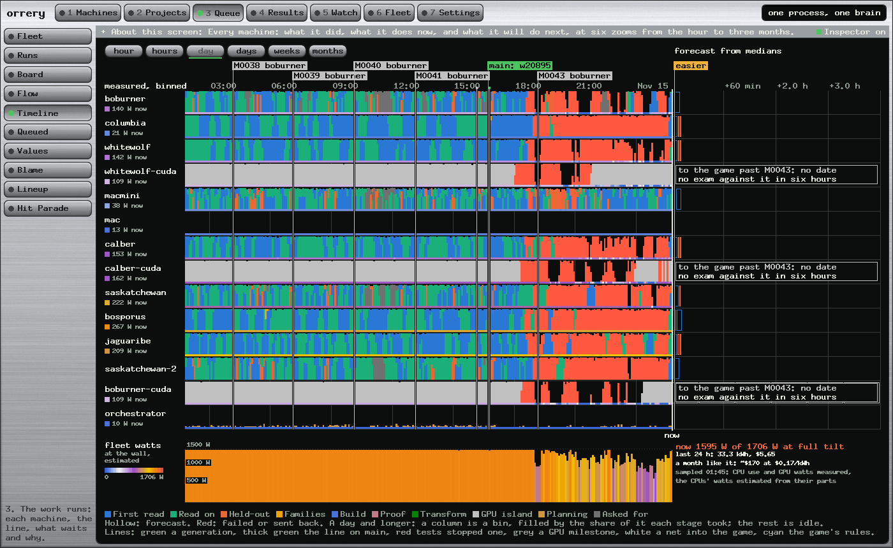
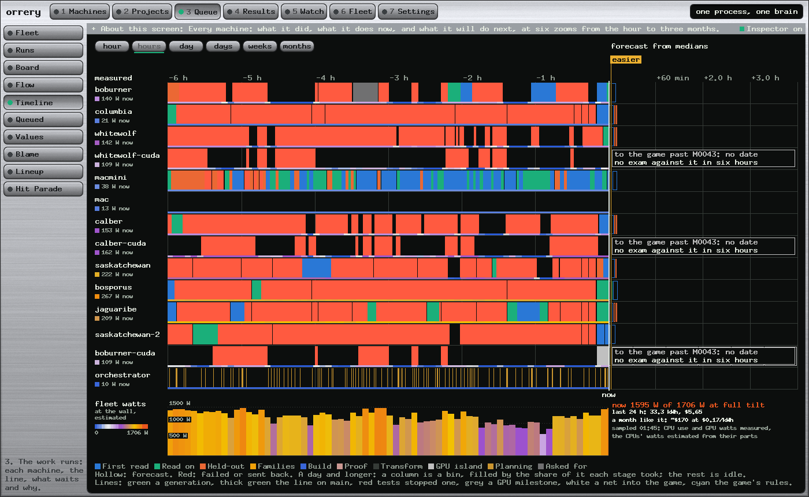
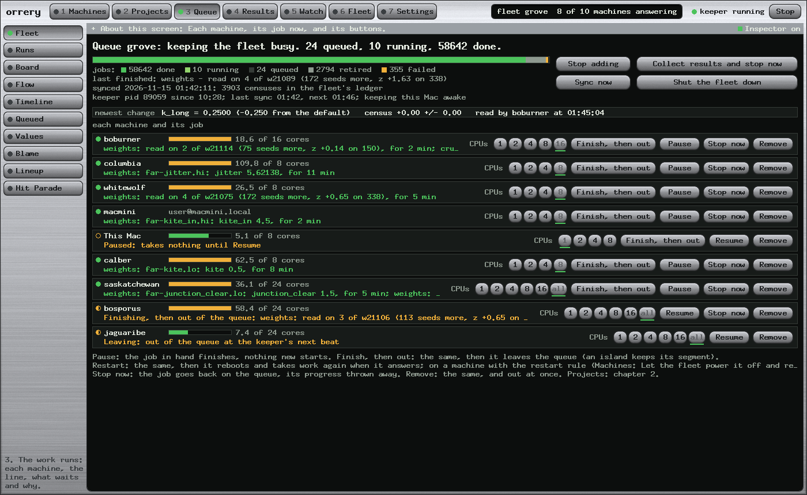
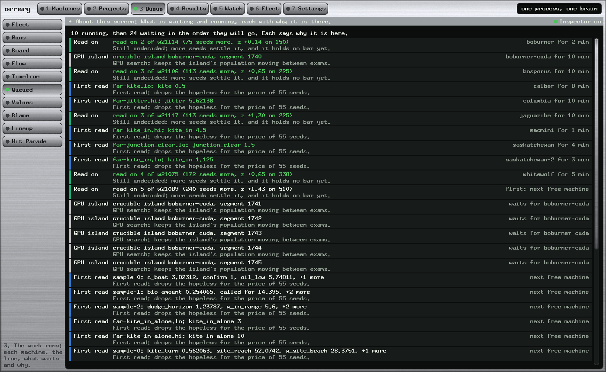
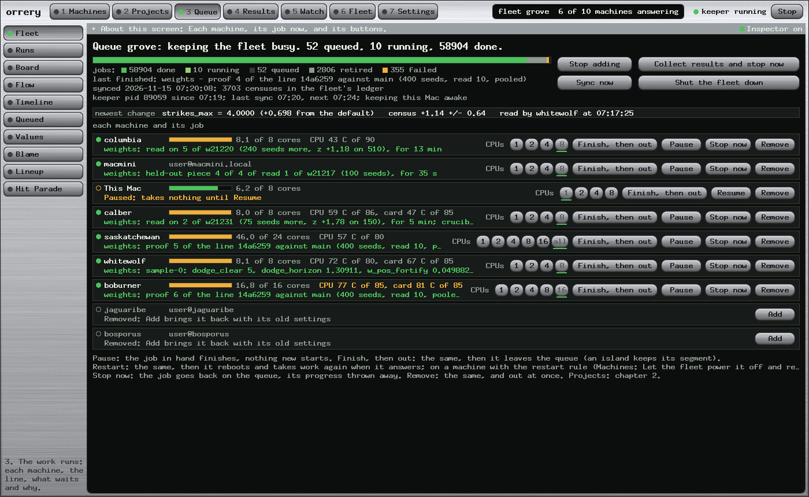

# The Orange Queue: Seven Hours of Dropped Connections, Jobs Left Running Behind, and Three Cards Busy with Nothing

*Paul Richeson · Lab Report — IEEE Format · 15 November 2026*

Copyright (c) 2026 Paul Richeson. MIT licensed, as orrery.

Companions: `tools/fleet-queue.py` (the keeper: `remote`, `run_job`, `work`, `reachable`); `tools/plans/treadcore.py` (`chores`); `tools/power.py`, `tools/growth.py` (the housekeeping that logs in to every machine); `~/.ssh/config` on the Mac (the shared connection of 4 November); the queue `treadcore/build/queue/grove` (`events.jsonl`, `logs/`, `failed/`); the pictures in `docs/orange-queue/`. Nothing was changed to write this: every command was a read.

## Abstract

From 18:42 on 14 November to 01:36 on 15 November the Mac closed its shared SSH connection to each fleet machine every four to six minutes, 123 times in all. Each close ended every job riding that connection with ssh's own failure, 255. The keeper put each such job back on the queue, 276 times, and started it again; IT DID NOT STOP THE COPY ALREADY RUNNING ON THE MACHINE. The copies piled up. At 01:55 columbia ran fifteen census jobs on eight cores (load 112), calber seven, and boburner's one card ran six crucible segments at once. The fleet finished 24 jobs an hour where it had finished 79. No GPU segment has finished since 18:21: a segment needs 31 to 45 minutes on one connection and no connection lasted seven. The cards read 100% busy the whole time, on work the keeper had already written off.

The drops stopped at 01:36 and none has happened in the twenty minutes since. Nothing repaired it: no code ran that fixes anything, the cause of the closes is not established, and the leftover jobs are still running. What is established is where the closes come from (the Mac, not the machines and not the network), what they are timed to (the five-minute housekeeping), and the fault that turned a nuisance into seven lost hours (a requeue that leaves the first copy running).

## I. The question

Paul, 01:39 on 15 November:

> look at queue. why is it so orange. everything ok? did it just self repair. give an lab report writeup with pictures and investigation from the timeline and other views. what type of work occurs. and why is the cuda not computing. what was it waiting on.

And, while this was being measured, of bosporus and jaguaribe: "i'm unqueueing some machines. i did that." The two "Finish, then out" presses at 01:45 are his and are not part of the fault.

Short answers, each argued below:

| Asked | Answer |
|---|---|
| Why so orange | Three different things are orange. The load bars are amber on any machine past 90% of its cores, which a healthy busy fleet always is; what is wrong is the number beside them (109.8 of 8 cores). The Timeline's orange-red wall from 18:40 is jobs that failed or went back. The amber text on bosporus, jaguaribe and This Mac is machines a person set aside. |
| Everything ok | No. The keeper is healthy and the queue moves, but at a third of its rate, and the machines carry leftover jobs nobody is waiting for. |
| Did it self repair | The drops stopped at 01:36, by themselves, cause unknown. The damage did not repair: 33 leftover jobs were still running at 01:55. |
| What work occurs | Section III. |
| Why the CUDA is not computing | It is computing, at 100%, the wrong thing: segments the keeper gave up on. Section VI. |
| What it was waiting on | Each card's lane waited about 31 minutes at a time for the planner to ask a fresh chain of segments after the last chain failed, then lost the new one to the next drop. |

## II. What the reader needs: the keeper, a lane, the shared connection

The **keeper** (`tools/fleet-queue.py`, one process on the Mac) owns the queue. Each machine has one or two **lanes**; a lane is a thread in the keeper that takes a job from `queue/`, runs it on its machine, and files it under `done/` or `failed/`. A job runs as one `ssh` command from the Mac that stays open until the job ends: the job's exit code comes back as ssh's.

Since 4 November every ssh to a fleet machine rides ONE connection per machine (`ControlMaster auto`, `ControlPersist 10m` in `~/.ssh/config`). The first command opens it; a small background process on the Mac, the **master**, holds it; every later command to that machine is a channel inside it. That was done because three machines turned away bursts of separate connections. Its cost is the subject of this report: WHEN A MASTER CLOSES, EVERY JOB ON THAT MACHINE ENDS AT ONCE, each with exit code 255.

The keeper reads 255 as "ssh failed, not the job's fault" and puts the job back on the queue, three times at most; the fourth time it files the job as failed (`work`, `fleet-queue.py:996`). A GPU segment waits on the segment before it, so one failed segment fails the five or six queued behind it ("a job it waited for failed").

> **Side note — the job on the machine does not know.** The job's processes were started under `set -m` in their own process group, with their pid in `~/.fleet-queue/ID.pid`, exactly so that `stop_remote` can stop the whole group. A closed connection does not stop them. `stop_remote` is called on a timeout, on Stop and on Remove. It is not called on 255.

## III. What type of work occurs

*Table I. The queue's jobs by kind, all time, from `fleet-queue.py status` at 01:42.*

| Kind | Done | Failed | What it is |
|---|---|---|---|
| weights | 44,580 | 176 | A trial of the brain's numbers played as a census. A **first read** is 55 seeds and drops the hopeless; a **read on** adds seeds in stages (110, 220, 440) while the trial stays undecided; a **held-out** read is 400 fresh seeds in four pieces of 100. The `far-NAME.lo/.hi` trials move one dial far; the `sample-N` trials draw several from the fit. |
| crucible | 7,832 | 152 | A **GPU island segment**: 100 generations of 2,048 nets, 256 episodes each, on one card, 31 to 45 minutes. Each segment loads the island's saved state, imports the other two islands' champions, and writes the state back. |
| census | 4,546 | 0 | The older whole-census reads, and the bridge's reads of a GPU net inside the game. |
| prepare | 969 | 1 | A machine's build of the fleet's current commit. |
| families, gauntlet | 449 | 0 | A candidate's tests before it goes on the line. |
| record, train, net, school | 217 | 0 | Recordings for cloning, the trainer, a net into the game. |
| promote | 46 | 22 | A candidate committed to the line. |

Beside the jobs: the **planner** passes (6 to 20 s each, about one a minute), and the **housekeeping** the keeper begins each minute when a document is stale: analysis each ten minutes; nets, growth and the power sample each five. The power sample and growth each open an ssh to every machine.

At 01:47 the Queued page (Fig. 4) held 10 running and 24 waiting: first reads and reads on for the CPU lanes, five segments for boburner's card, none for the other two.

## IV. What happened

*Table II. 14 to 15 November. Keeper's events unless a source is named.*

| Time | What |
|---|---|
| 00:00–18:00 | An ordinary day. 66 to 95 jobs done an hour, three failed, no host unreachable once. |
| 18:19, 18:21 | The last GPU segments to finish: calber-cuda 3645, boburner-cuda 1711. (whitewolf-cuda's last was 18:02.) |
| 18:40:11 | Orrery.app opened (its process's start time). Paul's last input a few seconds after; the display's five-minute hold timed out at 18:43 (`pmset -g log`). |
| 18:42:11 | The first drop: calber, calber-cuda, jaguaribe, macmini and bosporus lose their jobs in the same ten seconds. |
| 18:49, 18:54, 18:57, 19:01 … | It repeats, 123 times to 01:36, 1.5 to 12 minutes apart, median about four. |
| 19:01:32 | First "cannot be reached" flags (whitewolf, boburner). They answer again within the minute; 113 unreachable/back pairs follow. |
| 19:40:57 | calber-cuda's segment 3646 fails on its fourth 255. Segments 3647–3651 fail behind it within a minute. The pattern of section VI begins. |
| 21:57–01:34 | Five lane errors: a file sent to a card's machine did not finish in ten minutes. |
| 01:35:51 | The last drop that took several machines (bosporus, jaguaribe, saskatchewan, columbia). |
| 01:37:46 | Paul's first input since 18:40. |
| 01:45 | Paul: Finish, then out, on bosporus and jaguaribe. jaguaribe left at 01:47. |
| 01:46–01:56 | Watched for this report: the seven masters of 01:35–01:41 all still alive, three test connections alive, no drop. |

*Table III. Each hour, from `events.jsonl`.*

| Hour | Started | Done | Put back (255) | Failed | Unreachable |
|---|---|---|---|---|---|
| 14 Nov 15:00 | 86 | 86 | 0 | 0 | 0 |
| 16:00 | 94 | 95 | 0 | 0 | 0 |
| 17:00 | 86 | 85 | 0 | 0 | 0 |
| 18:00 | 77 | 62 | 14 | 1 | 0 |
| 19:00 | 71 | 34 | 33 | 18 | 11 |
| 20:00 | 82 | 18 | 52 | 21 | 10 |
| 21:00 | 73 | 20 | 40 | 25 | 19 |
| 22:00 | 66 | 23 | 34 | 28 | 18 |
| 23:00 | 81 | 24 | 43 | 17 | 31 |
| 15 Nov 00:00 | 56 | 24 | 25 | 25 | 16 |
| 01:00 | 67 | 17 | 35 | 21 | 8 |

In the eight hours before 18:42 the fleet finished 635 jobs, 79 an hour. From 18:42 to 01:36 it finished 163, 24 an hour. Of the 158 failures, 85 are jobs that waited on a failed one; of the 72 jobs filed in `failed/` with their own exit code since 18:30, 55 ended on ssh's 255 at the fourth try (46 weights, 9 crucible) and 17 on an exit code of 1.

*Fig. 1. The Timeline, day zoom, rendered 01:47. Blue and green are first reads and reads on; grey is a GPU island at work; the orange-red is "failed or sent back". The wall begins at 18:40 on every row at once. The fleet's watts (bottom) fall at the same minute. The grey that returns on the GPU rows near midnight is the Timeline drawing segments that started; none of them finished.*

*Fig. 2. The last six hours. The CPU rows are nearly solid orange-red; the three `-cuda` rows are mostly black, with a failed attempt about every half hour.*

## V. Why it is orange

*Fig. 3. Queue → Fleet at 01:47.*

The bar beside each machine is its load average against its cores, drawn amber past 90% (`training.rs:1038`). A fleet that is 98% busy is amber on every row on a good day: THE COLOUR IS NOT THE ALARM. The figures are. columbia reads 109.8 of 8 cores, calber 62.5 of 8, whitewolf 26.5 of 8, bosporus 58.4 of 24. A census job asks `nproc` and starts that many games; a machine carrying fifteen of them runs fifteen times its cores.

*Table IV. Each machine at 01:55, by `ps` on the machine against the keeper's `running/`.*

| Machine | Cores | Load | Census jobs running | The keeper's | Left behind | Oldest left behind |
|---|---|---|---|---|---|---|
| columbia | 8 | 112 | 15 | 1 | 14 | 23:11 |
| calber | 8 | 60 | 7 | 1 | 6 | 00:58 |
| whitewolf | 8 | 24 | 3 | 1 | 2 | 01:13 |
| boburner | 16 | 18 | 1 | 1 | 0 | |
| saskatchewan | 24 | 22 | 2 | 2 | 0 | |
| bosporus | 24 | 9 | 1 | 1 | 0 | |

No machine was short of memory (27 to 62 GB free, no swap in use). A leftover census job finishes by itself and its output is overwritten or ignored; on a machine at fifteen times its cores that takes hours, and each drop added one more.

The other orange on Fig. 3 is not the fault: "Paused" on This Mac since 13 November, and "Finishing, then out" and "Leaving" on bosporus and jaguaribe from Paul's presses at 01:45.

## VI. Why the CUDA is not computing, and what it waited on

*Table V. One card's evening, calber-cuda, from the events. The other two read the same.*

| Segment | What became of it |
|---|---|
| 3645 | started 17:48:39, done 18:19:39 (1,860 s). The last to finish. |
| 3646 | started 18:19; put back 18:42, 18:51, 18:55; failed 19:40:57 on the fourth 255, after 45 minutes in which the card was shared with its own three earlier copies. |
| 3647–3651 | failed 19:41, each "a job it waited for failed". |
| (lane idle 32 min) | The planner asks a new chain. |
| 3652 | started 20:13; put back 20:23, 20:37, 20:46; failed 20:57. |
| 3653–3657 | failed behind it. |
| 3658, 3664, 3671, 3678 | the same, at 21:29, 22:19, 23:32 and 00:57: three or four tries, then failed, then five or six failed behind. |

Eight rounds on calber-cuda, seven on whitewolf-cuda, six on boburner-cuda, and not one segment done in seven and a half hours on three cards.

The cards were not idle. At 01:43 `nvidia-smi` on each read 100%:

| Card | crucible processes | Started | For segment |
|---|---|---|---|
| boburner | 5 (6 by 01:55) | 21:56, 22:30, 22:52, 23:13, 23:35, 01:44 | 1719, 1727 (four copies), 1740 |
| whitewolf | 3 | 00:58, 01:03, 01:40 | 2609 (two copies), 2616 |
| calber | 3, and three `nvcc` compiles | 00:41, 00:50, 01:40 | 3671 (two copies), 3678 |

Only boburner's 1740 is a segment the keeper is waiting for: the keeper had nothing running on the other two cards. Every other process is a copy of a segment already put back or filed as failed. Five on one card each run at a fifth of the speed, so a 31-minute segment needs two and a half hours, and the one live segment has no chance of finishing inside its connection's life even on a quiet night.

**What the lanes waited on.** After a chain failed, a card's lane had nothing it could start, and the keeper asked the planner for it each minute ("planning for idle lanes", 44 times). The planner asked a fresh chain about 31 minutes after each failure (19:41 → 20:13, 20:57 → 21:29, 21:47 → 22:19 on calber-cuda). So of each round, half an hour was the lane standing idle for the planner and the rest was a segment that the next drop took. At 01:42 health said exactly that: `LOOK lanes idle with nothing they can start: calber-cuda`, `BAD machines cannot be reached, its lane waiting: whitewolf-cuda`.

**The harm that is not only lost time.** Every copy loads `island.state` when it starts and writes it when it ends. boburner's file was written at 01:42 and five processes that began from older states are still to write over it. An island's population can go backwards by hours when the oldest copy finishes last. This was not measured; the files' generations should be read before the islands are trusted (section IX).

*Fig. 4. Queue → Queued at 01:47. Segments 1741–1745 wait for boburner-cuda; calber-cuda and whitewolf-cuda have none, their last chains having just failed (01:38 and 01:42).*

## VII. Where the drops come from

What was measured, in the order it narrowed.

1. **It is the connection, not the job.** All 276 put-backs carry "ssh failed (255)". The job logs hold the command and then that line, nothing between.
2. **It is every job on a machine at once.** calber and calber-cuda, saskatchewan and saskatchewan-2 go in the same second, every time. That is the master closing.
3. **The Mac closes it.** saskatchewan's own log has the keeper's connection accepted at 01:10:56, 01:17:35, 01:23:58 and 01:29:30 and each time ended 331 to 399 seconds later with `Connection closed by 192.168.8.143`, the Mac's address. bosporus, jaguaribe and columbia log the same close in the same second (01:17:35, 01:23:57, 01:29:29, 01:35:51).
4. **It is not the network, the lease, or sleep.** Thirty pings to each machine and the router lost none (jaguaribe lost half of one run and none of the next forty, as it was leaving). The DHCP lease is twelve hours. The Mac has not slept (`pmset`: caffeinate holds it, as it has for 162 hours). No crash report for ssh. `sshd`'s `MaxStartups` is the default on every machine and is not what closes an open connection.
5. **It is not new code.** The keeper has run the same file since 13 November 10:28 and `~/.ssh/config` is unchanged since 4 November. The day before 18:42 has not one unreachable.
6. **It is timed to the housekeeping.** `power.py sample` is begun each five minutes and stamps its start. Of the 276 put-backs, 83 fall 110 to 125 seconds after a stamp, 77 of them at 119 or 120 exactly, and 40 more within 35 seconds after one. Spread evenly, 14 would fall in the first window.
7. **Killing a timed-out client does not close a master.** `growth.py` gives each machine's `du` two minutes and `power.py` gives its probe thirty seconds; both end an overdue ssh by killing it. Tested on a private connection to saskatchewan with a job riding it: a second client killed by its timeout, and then the client that had opened the master killed by its timeout. The master and the job lived both times.

So the closes come from the Mac, in step with the five-minute housekeeping, two minutes after it begins; and the obvious mechanism for that, tested, is not it. THE CAUSE IS NOT ESTABLISHED. Two things about it are worth saying without claiming them. The first drop is two minutes after Orrery was opened and the desk went quiet, and the last is two minutes before the next touch of the mouse; nothing was found that ties a master's life to a person being there. And once the machines were loaded with leftover jobs, anything on them that answers slowly (a `du` of `~/fleet`, a probe) answered slower still, so whatever the first cause was, the fault fed itself.

## VIII. Did it repair itself

The drops stopped. From 01:36 to 01:56 no master closed, the longest quiet since 18:42 (the longest before was twelve minutes), and jobs began finishing in their ordinary five to ten minutes on the machines without leftovers.

Nothing else did. The keeper took no step that repairs anything: it has no check that sees a job running on a machine that it is not waiting for. At 01:55 there were 22 leftover census jobs (Table IV) and 11 leftover crucible processes (section VI: five on boburner, three each on whitewolf and calber). columbia and calber will stay at many times their cores until those end, and boburner's card will run its live segment at a sixth of its speed. And with the cause unknown, it can start again tonight.

## IX. Recommendations

In the order of what they are worth. None is built.

1. **A job put back is stopped where it ran, first.** In `work`, on 255, call `stop_remote(host, jid)` before the rename to `queue/`, and do not start the job again on that machine until it has answered. This one change turns the night into a slow fleet and not a stalled one: a drop would cost the minutes a job had run, not a machine's whole evening. If the machine truly cannot be reached, the pid file is still there for the next lane that reaches it to act on.
2. **A segment refuses to share its island.** The crucible job takes a lock on the island's home (`flock` on `island.state`) and, finding another segment of the same island running, stops it or stands down. Two copies writing one population is wrong whatever caused the second.
3. **The job's end kept on the machine.** This is change B of *Fifty-Four Idle Minutes* (section VII there), designed on 4 November and not built: the job writes its exit code beside its pid file, and a lane whose connection closed asks the machine whether the job is still running or how it ended, and takes it up again. With it a closed connection costs nothing at all. It is the real fix; 1 is the cheap one.
4. **Health sees leftovers.** One check a machine: the job ids under `~/.fleet-queue/*.pid` and the crucible processes, against `running/`. Anything the keeper is not waiting for is `BAD leftovers`, with a button that stops them. Tonight health said `LOOK lanes` and `BAD machines` for two lanes and nothing of 33 leftover jobs.
5. **The housekeeping off the jobs' connection.** `power.py`, `growth.py`, `boots.py` and `machines.py` get their own `ControlPath`, as `fleet-select.py` and `treadcore-view.py` already have. Whatever in them is closing the masters, it then closes its own.
6. **Catch the next one.** A master started by hand with `ssh -vv -E file` logs why it ends. Leave one a machine running beside the keeper's for a night; the first close names its cause in a line.
7. **Now, by a person's say-so:** stop the leftovers (the eleven crucible processes that are not a segment the keeper is running, and the 22 census jobs of Table IV), then read each island's generation against its last milestone before the next election.

## X. What Paul decides

- Whether the leftovers are stopped now (recommendation 7). It is a kill on six machines, so it was not done unasked.
- 1 and 2 are small and safe to build first; 3 is a day's work with a check script of its own. Which, and in what order.
- Whether bosporus and jaguaribe come back once the machines are clean, or stay out.

## XI. What this report did not do

It did not find the cause of the closes. It did not read the islands' states for damage. It did not check macmini, whose master of 21:03 lived through everything and which lost jobs only twelve times. It measured one night; the eight days of events before it were searched only as far as the day before, which was clean.

## XII. Addendum, 02:08 to 02:17 the same night: the leftovers stopped, 1 and 2 built

Paul, 02:05: "fix please. 1, and 2. 2 is imporant."

**The leftovers.** A job on a machine is two process groups: the wrapper the ssh started and, its child, the job's own group, whose number is in `~/.fleet-queue/ID.pid`. Live is the group named by the pid file of a job in the keeper's `running/` for that machine's lanes, and its parent; every other `q-grove` group leader older than 90 seconds is a leftover. Listed first and read, then stopped at 02:08: 66 groups (10 on boburner, 6 on whitewolf, 22 on calber, 28 on columbia), TERM then KILL. Twenty seconds later every machine ran only the keeper's jobs: boburner's card one process, whitewolf's and calber's none, columbia's load falling from 111 (7 by 02:17).

**1, built (`tools/fleet-queue.py`).** Three places.

- `work`, on 255: `stop_remote` is called before the job goes back, and the log says which: "its copy on calber is stopped", or that it could not be yet.
- When the machine could not be told, the job is written down as `leftover/LANE--ID`; the lane, each time round and before it takes anything, stops what is written there once the machine answers (`stop_leftovers`, event "leftover stopped").
- The job's wrapper on the machine: a pid file already there for this job is an earlier copy, and its group is stopped before this one starts. This holds even if the keeper never knew.

**2, built (`tools/plans/treadcore.py`).** A segment's command opens `segment.lock` in the island's home and holds it for its whole life, its group's number in `segment.pgid`. A segment that finds the lock held is the one the keeper is waiting for: it stops the holder's whole group, takes the lock, and stands down with exit 75 if it cannot within two minutes. The segments queued before 02:16 (boburner 1741–1745, calber 3685–3689) were written before the change and carry no lock; every segment planned after does.

**Proved.**

| Check | Result |
|---|---|
| `tools/leftover-check.sh KEEPER MACHINE` (new): a real job on jaguaribe writing a line a second, the shared connection closed under it | The keeper as it was: put back, started again, **2 writers** (the fault, reproduced). The changed keeper: put back, "its copy on jaguaribe is stopped", started again, **1 writer**. |
| The island lock on calber, with `sleep` standing for crucible | Segment A holds the island; B finds it held, stops A's group, runs and ends 0; A and its children gone; C on a free island ends 0. |
| `fleet-queue-check.sh`, `restart-check.sh`, `breaker-check.sh`, `idle-check.sh`, on the changed keeper in a copy | PASS, all four. |
| The live keeper | Took the code by handover at 02:16:09: seven jobs adopted, none put back. Health at 02:17: no BAD line. calber-cuda runs segment 3684 alone, boburner-cuda 1740 alone. |

**Not proved.** No segment had yet finished when this was written (the first is due about 02:45), and no segment carrying the lock has yet run on a real island. The cause of the closes is as open as it was: these two changes make a close cost the minutes a job had run, they do not stop the closes. Recommendations 3 to 6 are not built. The islands' states were not read for damage.

## XIII. Addendum, 07:25 the same morning: the temperature is read, and a drop is followed by a rest

Paul, 07:09, with two machines back in the queue and two left off: "two systems back on. two systems off (they got hot). Can we create a temperature monitor every so often, and if the ssh client drops off, maybe we should have some sort of cool off period (or reduction of new tasks for a moment while measuring the temperature."

Nothing read a temperature before this. A night of fifteen censuses on eight cores and six processes on one card was a night of heat nobody saw.

**The monitor (`tools/fleet-queue.py`, `take_heat`).** Each two minutes (`temp_s`, 120) the keeper reads every machine: each hwmon sensor under `/sys/class/hwmon` with the limit the sensor gives itself, and the card's temperature from `nvidia-smi`. None of it needs root. The reading goes over a connection of its own (`ControlMaster=no`, `ControlPath=none`), never the shared one the jobs ride: it is wanted most just after that one dropped, and it is not one more thing on it (recommendation 5, for this tool). The last reading of each machine is `QUEUE/temps.json`; a week of them is `QUEUE/plan/temps.jsonl`; `fleet-queue.py QUEUE temps` prints them, and `health` has a `heat` line. The two Macs tell nothing without root and read as "no sensor".

| Machine | CPU at 07:21 | Its limit | Card | Its limit |
|---|---|---|---|---|
| boburner | 78 | 85 (the default: its sensor names none) | 81 | 85 |
| calber | 61 | 86 (the sensor's) | 50 | 85 |
| columbia | 43 | 90 (the sensor says 105; never above 90) | | |
| saskatchewan | 57 | 80 (the sensor's) | | |
| whitewolf | 71 | 80 (the sensor's) | 66 | 85 |

**Hot.** A machine with its CPU or its card at the limit finishes the job in hand and takes nothing new, on every lane of it; the lane says "cooling", a flag is raised once an hour of it, and the Fleet page's word for the machine is Cooling. It takes work again when every part reads 8 degrees under its limit (`cool_by_c`): the gap keeps a machine at its limit from taking a job one reading and dropping out the next. A hot spell with no reading in ten minutes lapses, so a sensor that stops answering does not hold a lane. A machine's limit is its own `hot_c` and `gpu_hot_c` in `config.json` where the defaults are wrong for it.

**After a drop.** When a job's connection ends 255 and the job goes back on the queue, every lane of that machine now rests 60 seconds (`cool_off_s`) and the machine is read at once (the event `cool-off` carries the reading). Found hot, it is held until it reads cool; found cool, it takes work again after the minute. Last night's 123 closes would have cost about 123 machine-minutes of rest across the fleet in seven hours, against 276 jobs put back.

**On the screen.** The Fleet page shows each machine's temperatures beside its load, amber within 5 degrees of a limit.

**Proof.** `tools/heat-check.sh` runs a real keeper and real jobs on this Mac with a file for a sensor (`heat_probe`): a hot reading lets the job in hand finish and holds both lanes of the machine; 6 under the limit still holds; 16 under releases it; a job that ends 255 goes back, both lanes rest, and it then runs. It passes, as do `fleet-queue-check.sh`, `restart-check.sh`, `breaker-check.sh` and `idle-check.sh` on the changed keeper. The keeper took the code by handover at 07:19:54 with ten jobs adopted and none run again.

**Not proved.** No real machine has reached a limit since, so the hold has run only against the stand-in sensor. Boburner's card is the nearest, 4 degrees under at one segment alone: if 85 is the wrong limit for that card it will be seen there first. Jaguaribe and bosporus were off and were not read; what "hot" was on them is not known here.

## References

[1] P. Richeson, "Fifty-Four Idle Minutes: the Line Replayed Twice, Three Guards, and Restarting Orrery Without Losing Work," orrery `docs/idle-fleet-lab-report.md`, 4 November 2026. Section VII, change B.

[2] P. Richeson, "The Duty Cycle," orrery `docs/duty-cycle-lab-report.md`, 5 November 2026. The Timeline and the fleet's ordinary 98%.

[3] OpenSSH, `ssh_config(5)`: `ControlMaster`, `ControlPath`, `ControlPersist`, `ServerAliveInterval`.
