# The Orrery Q Process: A Fleet, Two Learners and a Warm Room, Traced From the Outside In

*Paul Richeson · Lab Report — IEEE Format · 19 November 2026*

Copyright (c) 2026 Paul Richeson. MIT licensed, as orrery.

Companions: `tools/report/orreryq_figs.py` (every drawn figure and close-up of this report); `tools/report/orreryq-shots.list` (the 60 pictures of Orrery, by the program's own `--frame` renderer); `docs/orreryq/trace-cpu.md` and `trace-cpu.json` (the CPU generation, job by job); `docs/orreryq/trace-gpu.md` and `net.json` (the GPU generation and its net, weight by weight); `docs/orreryq/pipeline-w21532.json` (the Pipeline's state at 22:50 on 15 November, to draw that generation again); `tools/report/orreryq_film.py` and `docs/orreryq/storyboard.json` (the film).

The film of this report: [The Orrery Q Process, on film](orreryq-film.html).

## Abstract

Paul, 19 November 2026: "please take pictures and do an analysis of the timeline, the wattage, the hearth, talk about the successes of the lineup ... a lab report of all the aspects of the orrery program, leading to a single investigation and the temps, and the hearths, and the watts, and the calculations the tau, and generational increase and testing. It would be nice to see a CPU generation and a GPU generation ... where can we step in and continue constant improvement ... zoom in and clearly track a good example, telling the paths not taken, in the timeline / lineup format. talk about the time spent waiting. talk about the transferring of seeds and which variables got modified, which are tested, show us the neural net, show us the result of the net, and show a diagram around the tank correlating the inputs to the input sensor matrix to transform matrix, to output matrix, to output signals ... every thing in the Orrery on all pages, should be interpreted and talked about the general purpose it represents, in the context to a user training a dataset ... a hybrid of user manual and explanation like a post-mortem doing a feature trace of all capabilities."

Orrery is one Mac directing ten computers to improve a game's artificial players. It is drawn here from the outside in: first the whole as any learning system would be drawn, a centre that asks and planets that answer; then the application's parts; then every page of its window, 39 pages and 51 views with the Heat page's panels and the Generations page's tabs, each with what it is for in the general case of someone training a model on a dataset and what it means for *treadcore*, the game this fleet trains; then one investigation, two generations followed from the first question to the last verdict.

**The CPU generation**, trial w21532 on 15 November, changed one dial, the order in which a tank's ladder of jobs is taken (`ladder` 0 → 3). It was read on 682 seeds, then on 1,128 seeds no trial had played, passed at z 3.13, became promotion r0337 and, with the promotion before it, went to main at 22:47 after its line proved +0.59 ± 0.14 a seat over 7,200 seeds. It took 3 hours 6 minutes from its first question: 43 minutes running, 37 waiting for a lane, 81 proving. 119 other trials asked on the same defaults went nowhere, and the report shows each kind of dead end. **The GPU generation**, milestone M0049 on the same evening, was 100 generations of 2,048 nets on boburner's card in 49.5 minutes after 4 hours in the queue. It held every floor of the 24-file gauntlet but read only z +1.99 against a bar of 3.00, was elected because three hours had passed without one, and was refused by the game 49 minutes later at −8.84 ± 1.22 a seat. **Its net** is 64 senses, two layers of 48 and six outputs; 96% of its hidden values sit at ±1, so it works as a set of switches, and its gate lets its corrections through on 6.8% of the duel steps recorded.

What went well is large: 65,601 jobs done, 98% of today's back done, the CPU defaults 8.22 ± 0.27 points a seat over main of 28 October on the same 2,000 seeds, the GPU gauntlet's share from 0.64 to 0.81, and the room held near 80 °F by the fleet's own heat. What stands still is as clear: no CPU generation has reached main for 90 hours, and no GPU generation has held for four days, because **the election raised the floors to a milestone the game then refused and nothing lowered them**: 316 segments and 206 GPU-hours since have met none. That is the first place to step in; the report lists eleven.

Two faults were found and fixed while this was written: the room controller sent a dead machine a wake packet every 40 minutes and never gave back lanes it had paused itself, and the telemetry pull fetched every older day again every five minutes, 14.9 GB of which 0.14 GB is real. The second fix stops the growth, and the copies were removed the same evening.

## I. The questions

1. What is Orrery, said so that someone training any model on any dataset would recognise it?
2. What does each page of the window show, and what is it for?
3. How does one generation go, on the CPUs and on the cards: what changes, what is tested, which seeds, how long, and what else was tried?
4. What is the net, and what does it attend to?
5. Is the fleet getting better, and how is that tested?
6. Where does the time go, and the watts, and what does the room do with them?
7. What went well, and where should a person step in next?

---

# Part One: the whole

## II. An orrery

An orrery is a clockwork model of the solar system: one sun, and every planet on its own arm, moved by one crank. Orrery is named for it because it is built the same way (Fig. 1). **One Mac is the centre.** It holds the queue, plans what to ask next, starts every job and reads every result. **Every other machine is a planet on an arm**: it is reached only by ssh from the Mac, it runs what it is sent, and it knows nothing of the others. The housekeeping moves on the inner orbit every two to five minutes (temperatures, telemetry, the room, power samples, the sync of results); the CPU lanes on the middle orbit, a job of minutes; the CUDA islands on the outer, a segment of half an hour to fifty minutes. Outside the orbits stand the two things the whole serves: **main**, the game's code on GitHub, which a generation changes, and **the room**, which every watt the fleet draws ends up heating.

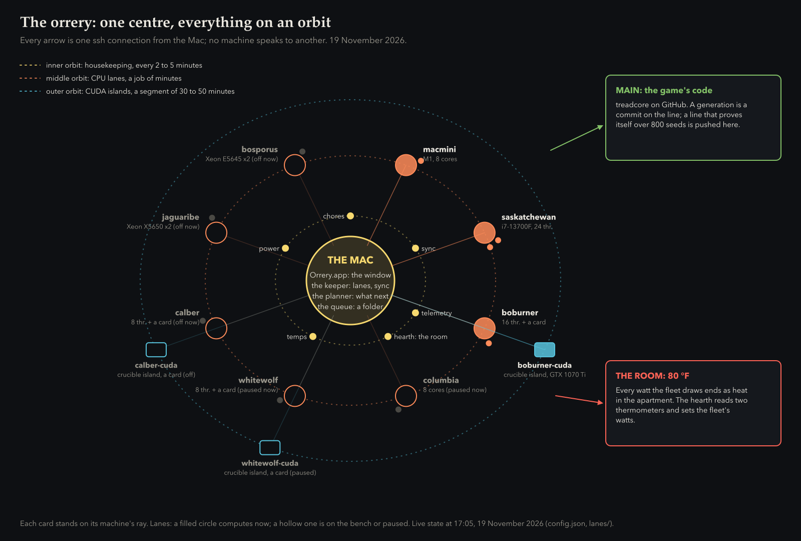

*Fig. 1. One centre and everything on an orbit, as it stood at 17:05 on 19 November. A filled planet computes; a hollow one is paused or on the bench. Each card stands on its machine's own ray. Drawn by `orreryq_figs.py` from `config.json` and `lanes/`.*

This shape is a choice with a cost and a gain. The gain: one place holds the truth, nothing is lost when a machine dies but the job in hand, and a machine joins by being given an ssh key. The cost: every connection is the Mac's, so when the Mac refuses to connect (18 November: macOS's local-network policy [1]) or its ssh server limits them (14 November: ten sessions a connection [2]), the whole fleet reads as unreachable at once.

**The "Q process"** is what the orrery turns. Paul's name for it, *Orrery Q*, is the queue-centred way of computing: a question becomes a file in the queue, a lane takes the file, a machine answers, the answer becomes the next question. Fig. 2 draws it as two learning loops and a bridge.

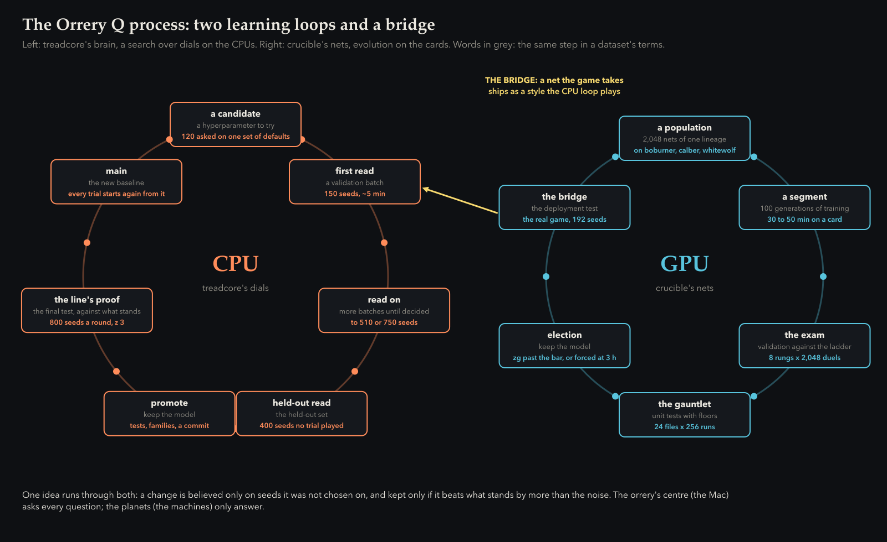

*Fig. 2. The CPU loop (treadcore's dials) and the GPU loop (crucible's nets). In grey, each step in the terms of someone training a model on a dataset.*

## III. The same thing, in a dataset's terms

Treadcore is a game of tanks; its artificial players are a hand-written *brain* with about 940 numbers in it (dials, switches, choices) and a small *net* that may correct the brain's turn, speed and fire. The fleet improves both. Strip the tanks away and what remains is the problem of anyone who trains a model:

| Orrery's word | In a dataset's terms | In treadcore |
|---|---|---|
| a **trial** | one hyperparameter setting to evaluate | one dial moved, e.g. `ladder` 0 → 3 |
| a **seed** | one example: a game whose dice are fixed by a number | one game on one of 13 maps; seed n plays map n mod 13 |
| a **census** (a read) | evaluating the setting on a batch | the trial's brain against today's brain, the same seeds, the gain a seat ± its error |
| the **first read, read-ons** | sequential testing: stop early when clearly bad, read more when unsure | 150 seeds, then 225, 338, 510, 750, each with its own bar |
| the **held-out read** | the validation set, seeds the setting was never chosen on | 400 seeds from a block no trial draws from |
| **families**, the **gauntlet** | regression tests: behaviours that must not break | named situations with floors (e.g. "a tank under a ready gun" holds 80%) |
| a **promotion** | accepting the model | a commit to the brain's defaults |
| the **line** | a candidate release, not yet deployed | commits promoted on the Mac, not yet on main |
| the **proof** | the final A/B test against production | the line against main, 400 seeds a job, until z 3 or refused |
| **main** | the deployed model | treadcore's main branch on GitHub |
| the **ratchet** / the **bar** | the significance threshold, and how it adapts | z 2.5 for a held-out read now; it eases after a dry spell |
| an **island** | one training run of a population | 2,048 nets on one card, a segment of 100 generations at a time |
| a **milestone** | a checkpoint kept | M0049: the best net of a segment, elected |
| the **ladder**, the **exam** | a benchmark of past checkpoints | 8 earlier milestones, 2,048 duels each |
| the **bridge** | the deployment test of a learned model | the net plays in the real game as the Gladiator, 192 seeds |
| the **keeper** | the job scheduler | `tools/fleet-queue.py`: a lane a thread, ssh, sync, health |
| the **planner** | the experiment designer | `tools/plans/treadcore.py`: what to ask next and what an answer means |
| the **hearth** | the cooling plan, run backwards | the fleet's watts set to keep a room at 80 °F |

So a reader who trains image classifiers can read the rest of this report with the left column, and a reader who plays treadcore with the right.

## IV. The application

Fig. 3 is the application drawn as UML components [3]. Read it from the left. A person presses a button in the window; the button is a command a script runs; the command writes a file in the queue folder. The keeper and the planner read that folder and act on the machines through ssh. Nothing on a machine knows the others exist, and nothing in the window acts on a machine by itself.

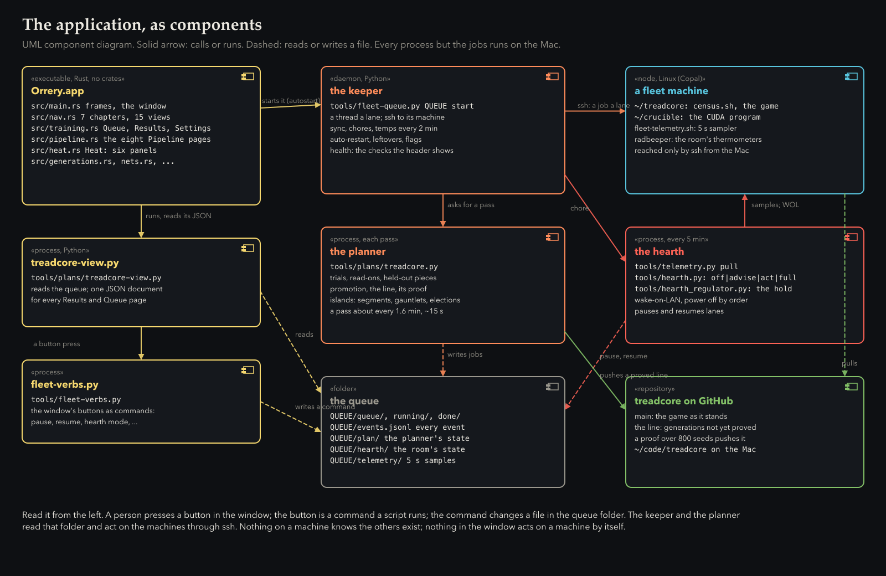

*Fig. 3. The application. Orrery.app is 46,660 lines of Rust with no crates [4]; the keeper, the planner, the hearth and the report tools are 41,389 lines of Python. The window reads one JSON document a page from `treadcore-view.py`; a button is a verb of `fleet-verbs.py`.*

Fig. 4 follows one job through it as a UML sequence. The times are the fleet's medians over the six hours before this was written: a trial's step waits 1.2 minutes for the planner's pass and 1.4 in the queue, and works 4.6.

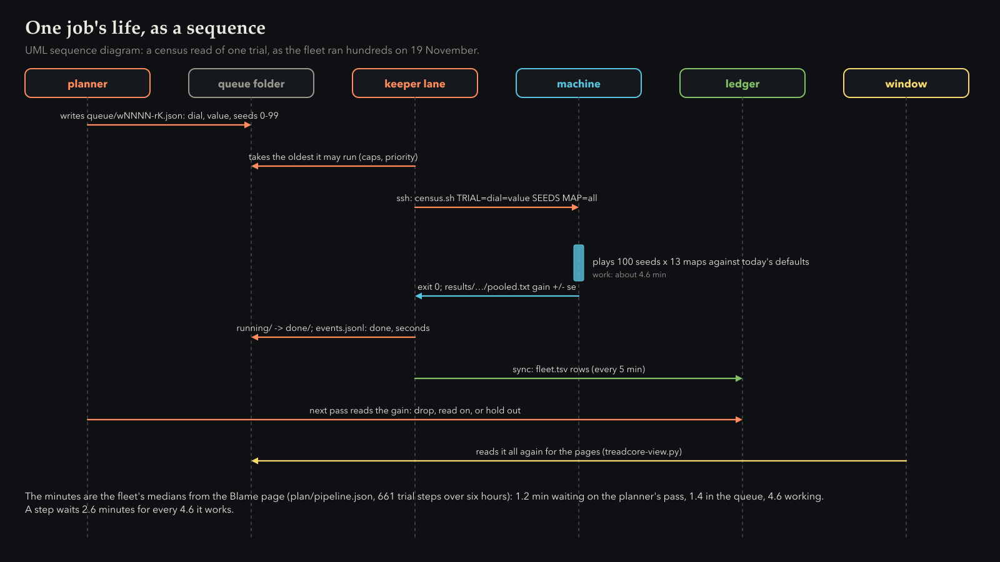

*Fig. 4. One census read, from the planner's question to the page that shows its answer.*

Three properties follow from the drawing, and the rest of the report leans on them:

1. **Every step leaves a file.** `events.jsonl` has every job's start and end (160,000 lines); `done/` every job's command; `results/` every read; `hearth/` every look at the room. Each number in this report was read back from those files, not remembered.
2. **The window only reads.** A page cannot change the fleet; a button runs a verb, and the verb writes the change where the keeper will see it. So a picture of a page (`--frame`) is exactly what the window would show, and this report's 60 pictures were taken that way, with no screen.
3. **The planner is the only judge.** It decides what a result means. When the planner is wrong (the floors in §XIV, the duplicate read in §XI), every machine does the wrong thing faithfully.

---

# Part Two: the window, page by page

The window has seven chapters along its top, each with its pages down the left: 39 pages, 51 views counting the Heat page's six panels and the Generations page's eight tabs. Every picture here is the program's own drawing of the live queue at about 17:00 on 19 November 2026, 1600 × 1000 pixels [5]. For each page: what it is **for**, in a dataset's terms; what it **means** for treadcore; and what to **look for**. Close-ups are cut from the same pictures and enlarged; their numbers are explained beside them.

## V. Every page: the header, the rail, the inspector, About

| | |
|---|---|
| [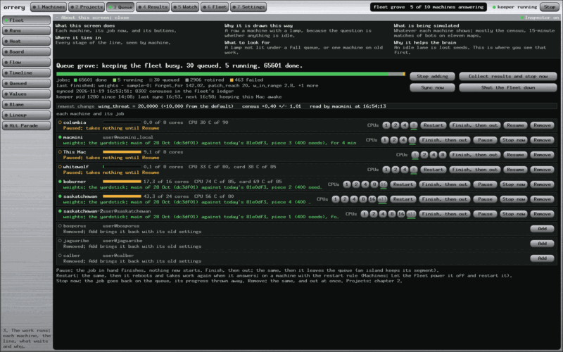](orreryq/live/0-about.png) | [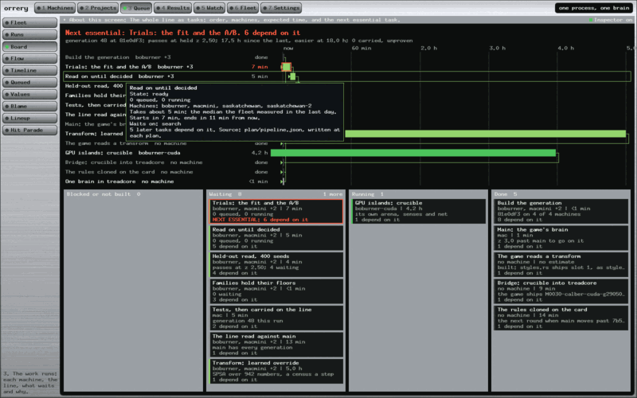](orreryq/live/0-inspector.png) |
| **About this screen**, open on the Queue's Fleet page. Six short answers on every page: what it does, where it ties in, why it is drawn so, what to look for, what is simulated, and why it helps the brain. They come from `tools/plans/line.json`, so the window and the guides say the same. | **The inspector**: point at almost anything and a panel says what it is, where its number came from and which file holds it. Here, a task on the Pipeline's Board. |

**For:** a model trainer's dashboard is only as good as the trust in its numbers; every number here can be traced to its file with the pointer. **Look for:** the header's right side, "5 of 10 machines answering" and the keeper's lamp. A lamp on a page in the rail is green when it has news and red when it wants a person.

## VI. Chapter 1, Machines: the planets

| Page | For (a dataset's terms) | For treadcore | Look for |
|---|---|---|---|
| **Machines** | adding a worker to the cluster | probe a computer (CPU, GPU, driver, CUDA, Rust, tools), apply its recipe, join it to the queue | a machine stuck on a step |
| **Media** | the data each worker can see | the shares and disks the copal fleet knows | a share that is missing |
| **Storage** | where datasets and checkpoints live | the queue's results, archives, builds and their sizes | anything near a limit |
| **Bench** | measuring the hardware | calber's SSD layouts: thirteen tried, md10-ext4 best | a run not finished |
| **Firmware** | keeping workers current | BIOS, microcode, what is behind | a machine marked behind |
| **Heat** (six panels) | the cluster's thermal and energy budget | Machines, Parts, Watts, Steps, the Hearth, the Diagram | a part near its limit; the room off target |

| | |
|---|---|
| [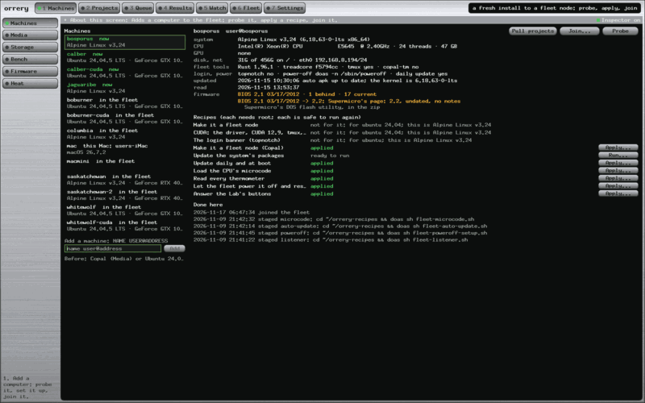](orreryq/live/1-machines.png) | [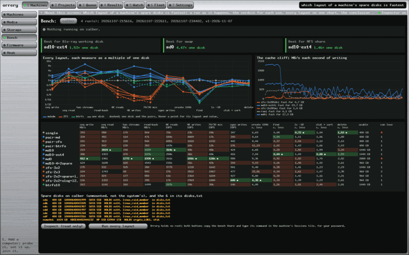](orreryq/live/1-bench.png) |
| [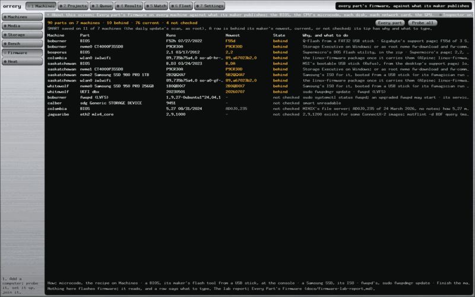](orreryq/live/1-firmware.png) | [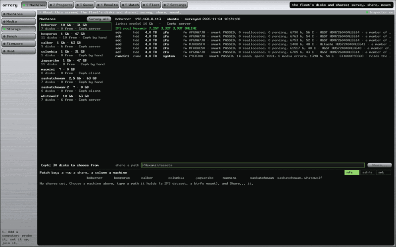](orreryq/live/1-storage.png) |

The **Heat** page is a chapter of its own and is read in §XVIII with the watts and the room; its six panels are pictured there.

## VII. Chapter 2, Projects: what the fleet works on

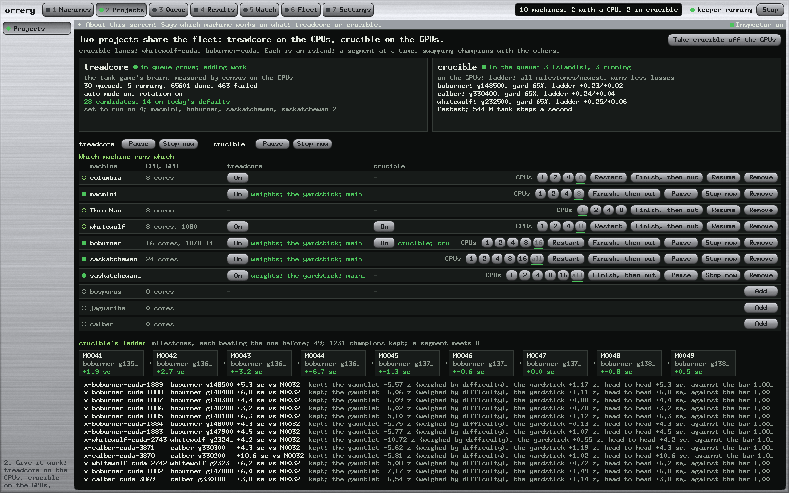

**For:** choosing which experiments the cluster runs and on which hardware. **For treadcore:** treadcore's brain on the CPUs, crucible's nets on the cards, and which machines take which; a project switched off on a lane is why a lane may sit idle with a full queue. **Look for:** a lane whose project is off by mistake.

## VIII. Chapter 3, the Queue: the work running

The Queue chapter is the fleet now (Fleet, Runs), then the Pipeline's eight pages, which are the same work drawn eight ways: as tasks, as a flow, in time, waiting, as numbers, as blame, as chains, and as a scoreboard.

### Fleet

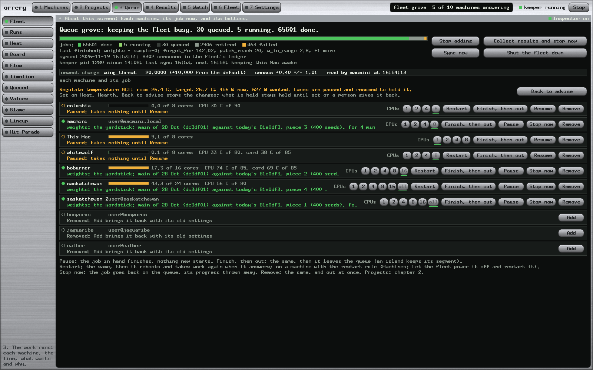

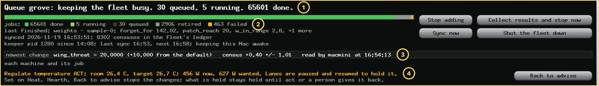

*Close-up 1. The head of the Fleet page, enlarged.*

| Mark | What it says | What it means |
|---|---|---|
| 1 | "30 queued, 5 running, 65601 done" | The whole history of the queue in three numbers. 65,601 jobs since 28 October is about 2,900 a day. Only 5 running is low for this fleet: the hold law paused columbia and whitewolf's two lanes and switched calber off at noon to keep the room under its ceiling (§XX); bosporus and jaguaribe are on the bench. (The health line calls a paused lane "set aside by a person": the keeper cannot tell the hold's pause from Paul's.) |
| 2 | "2906 retired" | Jobs taken off the queue unrun because their question was answered another way (a trial dropped, defaults moved). Retiring is the queue's way of not doing useless work. |
| 3 | "463 failed" | 0.7% of everything. A failure is retried up to three times before it counts. |
| 4 | "newest change: wing_threat = 20 (+10 from the default), census +0.40 ± 1.01" | The latest read's headline: a trial is a guess; this one is inside its error, which is what most reads are. |
| 5 | "Regulate temperature ACT: room 26.4 C, target 26.7 C; 456 W now, 627 W wanted" | The hearth's line (§XVIII): the room is under target and the controller wants 171 W more than the fleet gives. |

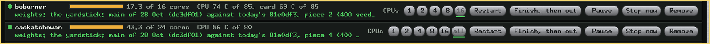

*Close-up 2. Two machines' rows. boburner: "17.3 of 16 cores" (the load average, which counts threads waiting as well as running), "CPU 74 C of 85, card 69 C of 85" (each against the limit at which its lanes cool off), the job now (a piece of the yardstick read, §XVI), and its buttons: the CPU limit 1, 2, 4, 8, 16, then Restart, Finish then out, Pause, Stop now, Remove.*

**For:** the scheduler's live view. **Look for:** a machine with no job and no reason, a temperature near its limit.

### Runs, Board, Flow

| | |
|---|---|
| [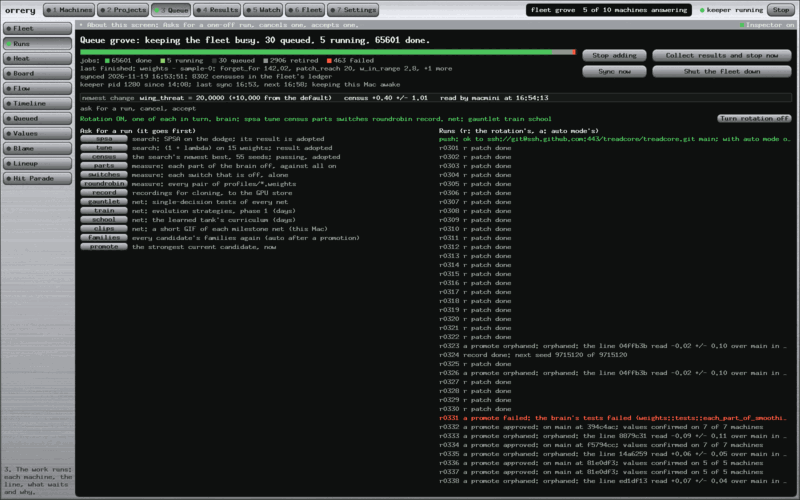](orreryq/live/3-runs.png) | [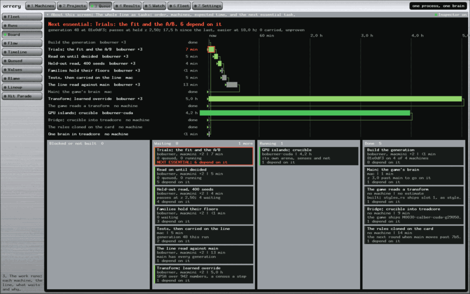](orreryq/live/3-board.png) |
| **Runs**: ask for a run, cancel one, accept one. *For:* a person's own experiments, beside the automatic ones. | **Board**: the whole line as tasks: order, machines, expected time, and the next essential task ("Trials: the fit and the A/B. 6 depend on it"). *For:* the critical path of the experiment pipeline. |

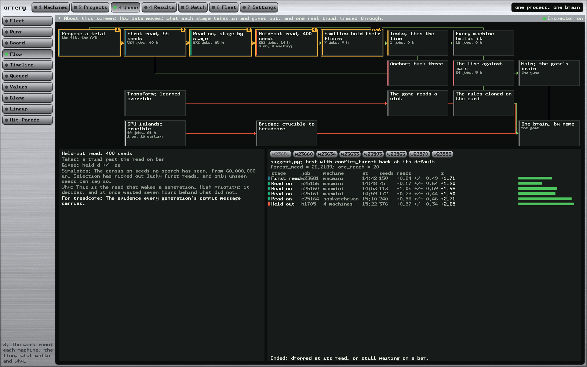

**Flow** draws the line as a graph of stages: what feeds what. *For:* the pipeline's shape, so a person can see that a held-out read cannot start before a sequential pass, and that a proof waits on a build.

### Timeline

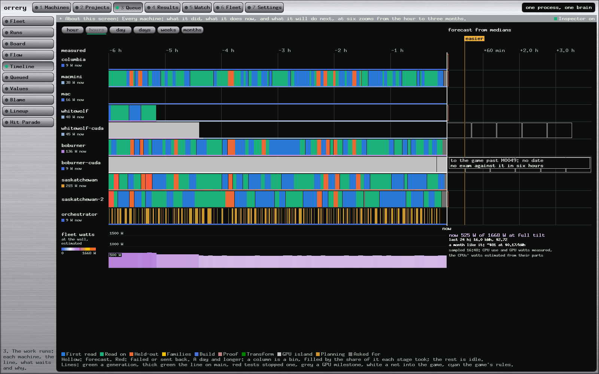

| | |
|---|---|
| [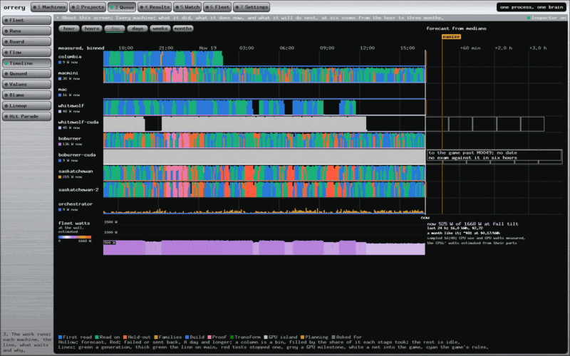](orreryq/live/3-timeline-day.png) | [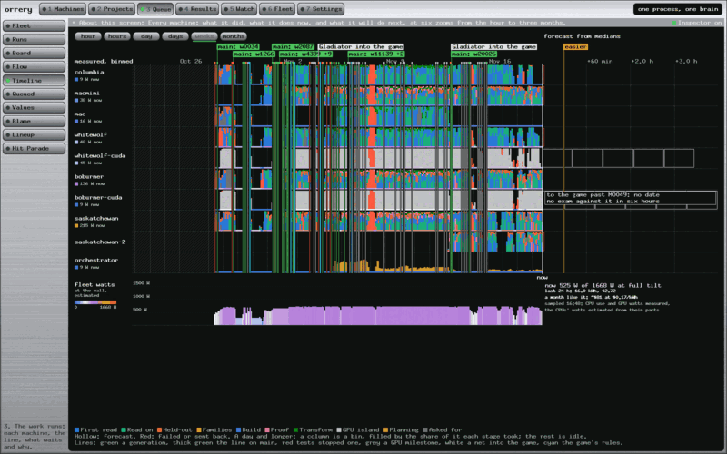](orreryq/live/3-timeline-weeks.png) |

**For:** a Gantt chart of the cluster: every lane a row, every job a block coloured by its stage, at six zooms from the hour to three months. **For treadcore:** the blue of first reads, green of read-ons, coral of held-out reads, pink of proofs, grey of GPU islands; the strip at the bottom is the orchestrator, the Mac's own planning. **Look for:** a hollow block (forecast), a red one (failed or sent back), a gap in a row (a lane idle). The Timeline can **follow a chain**: point at a job and every other job of its trial lights in amber, joined by arrows. §XI uses this.

### Queued, Values, Blame

| | |
|---|---|
| [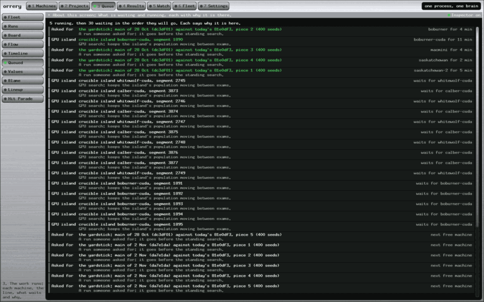](orreryq/live/3-queued.png) | [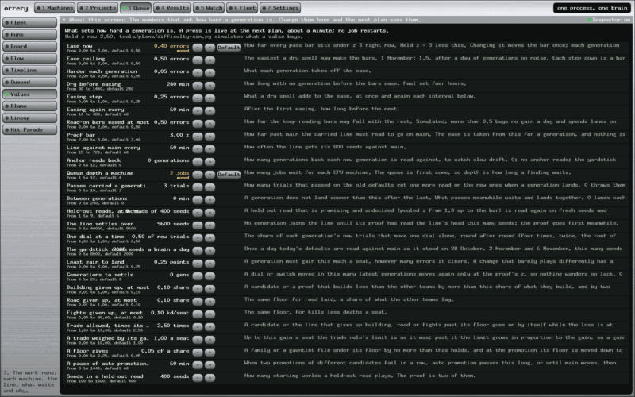](orreryq/live/3-values.png) |
| **Queued**: what waits, in the order it will run. *For:* the queue itself. 15 GPU segments always wait here: each island keeps six ahead, by design (§XVII). | **Values**: the planner's settings as a table (bars, ease, carry, generation pace), moved with `tools/fleet-tune.py` without a restart. *For:* the experiment's hyperparameters of its own. |

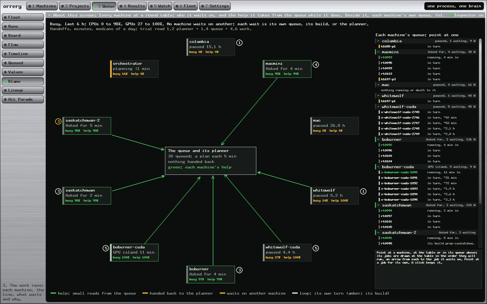

*Close-up 3. "Busy, last 6 h: CPUs 0 to 98%, GPUs 27 to 100%. No machine waits on another: each wait is its own queue, its build, or the planner. Handoffs, minutes, medians of a day: trial read 1.2 planner + 1.4 queue + 4.6 work."*

**Blame** answers the question every cluster operator asks: *why is this waiting?* Every machine sits at a round table around "the queue and its planner"; green lines are its help, amber a wait on another machine. On 19 November nothing waited on anything but its own turn. **For:** finding the bottleneck. **Look for:** amber, and a machine "busy 0%".

### Lineup

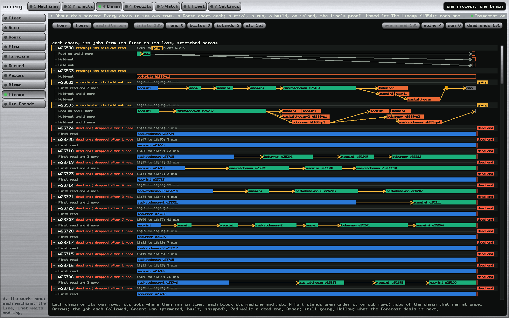

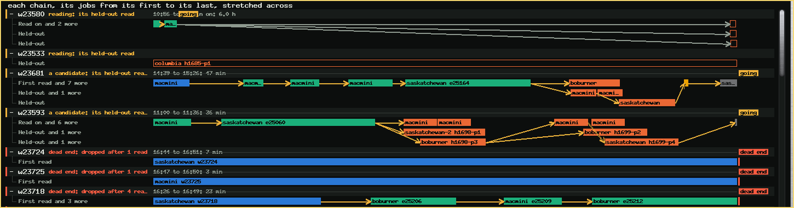

*Close-up 4. The top of the Lineup at 17:00 on 19 November: w23580 "reading: its held-out read"; w23681 and w23593 "a candidate: its held-out read" (amber, going); then a column of red walls, "dead end: dropped after 1 read", "after 4 reads", each with how long it lived.*

**For:** every experiment as its own Gantt row, fanned out where its jobs ran at once, named for the 1954 police lineup [6]: each chain stands in a row and is judged. **For treadcore:** a trial, a run, a build, an island, a line's proof. The buttons filter by kind (trials 135, runs 0, builds 0, islands 2) and by ending (going, won, dead ends 131). **Look for:** the green "won" among the red; it is rare by design (§XI).

### Hit Parade

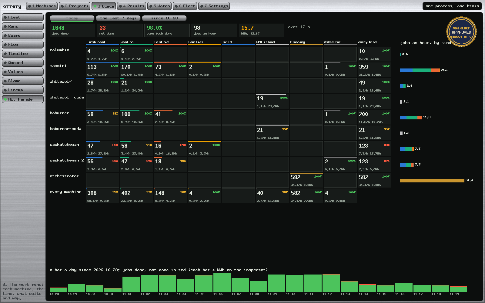

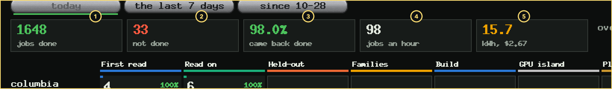

*Close-up 5. Today: (1) 1,648 jobs done; (2) 33 not done; (3) 98.0% came back done; (4) 98 jobs an hour; (5) 15.7 kWh, $2.67, over 17 hours.*

**For:** the scoreboard: jobs done by machine and by kind, a bar a day since 28 October, and the seal when the day is good. **For treadcore:** macmini, an M1 Mac mini, did 359 of today's 1,648, the most of any machine; the planner's own passes (582) have a column of their own. **Look for:** a red stripe on a day's bar (jobs not done), a machine whose column is empty.

## IX. Chapter 4, Results: what the fleet found

Results is the chapter of findings, thirteen pages. They divide into the CPU side's findings (Candidates, Found, Algorhythm, Personas, Gauntlet, Flags), the GPU side's (Net, Nets, Growth, Recordings, Montage, Videos) and the two together (Generations).

| Page | For (a dataset's terms) | For treadcore | Look for |
|---|---|---|---|
| **Candidates** | settings past validation, waiting for the release gate | trials past both held-out reads: progress, nothing to answer | one that waits too long |
| **Found** | the improvements log | every improvement by dial and machine; 1,173 to date | a dial that keeps coming back |
| **Net** | inspecting one model's weights | the learned tank's weights as matrices | a block of zeros: a sense never learned |
| **Nets** | the model registry | every learned .bin: where it has been, what read it, notes; capture, promote, expire | a milestone not in the register (M0049 is not, §XIII) |
| **Growth** | training curves and checkpoint sizes | crucible's generations, the champion's matrices, the sizes on disk | red: over 20 GB |
| **Generations** | the experiment's history, eight tabs | the lab report *Outgrowing Yourself*, live (§XVI) | a flat tab |
| **Recordings** | the training data kept | the behaviour-cloning recordings: size, recipe, who reads them | a recording nothing reads |
| **Montage**, **Videos** | qualitative evaluation: watch the model play | the newest generations' duels as a film, and the films made | a film older than the last milestone |
| **Algorhythm** | the model as a program | the brain as a patch: dials, switches, transforms; tabs for terrain and matrices | a switch that never fires |
| **Personas** | named configurations | styles (Raider, Castle, Expander ...) and their last census | a persona worse than the defaults |
| **Gauntlet** | the unit-test matrix | a row a gauntlet, a column a brain, the share passed; red under its floor | red |
| **Flags** | the alert queue | what needs a person; 93 open now | a stale one |

| | |
|---|---|
| [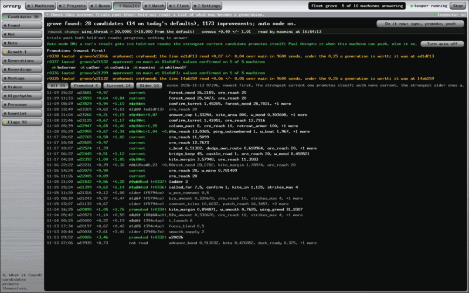](orreryq/live/4-candidates.png) | [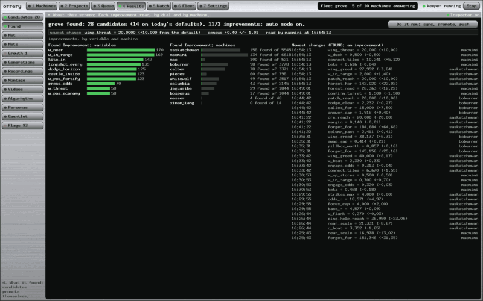](orreryq/live/4-found.png) |
| [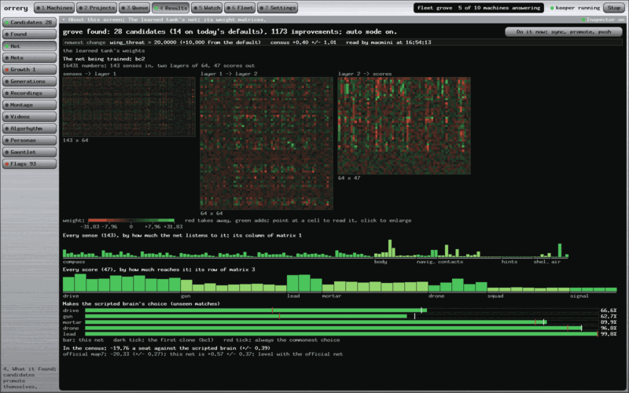](orreryq/live/4-net.png) | [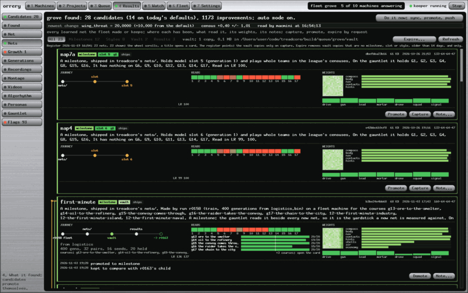](orreryq/live/4-nets.png) |
| [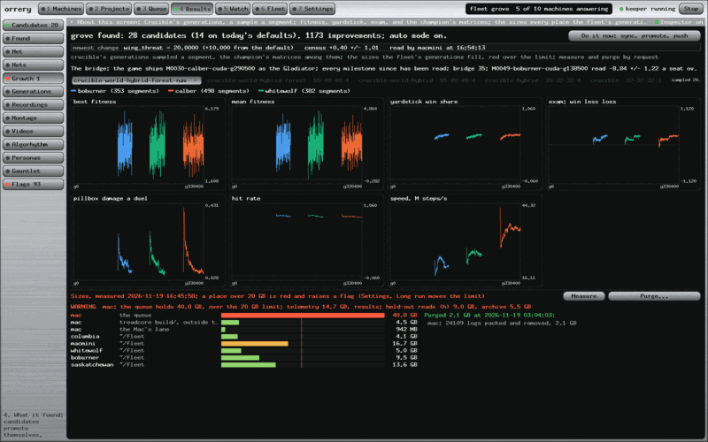](orreryq/live/4-growth.png) | [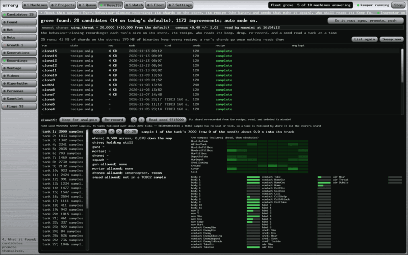](orreryq/live/4-recordings.png) |
| [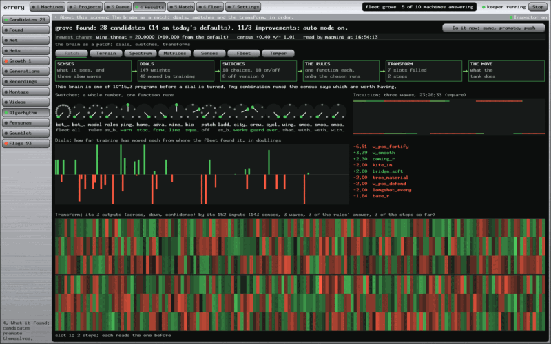](orreryq/live/4-algorhythm.png) | [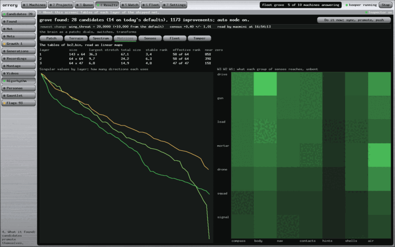](orreryq/live/4-matrices.png) |
| [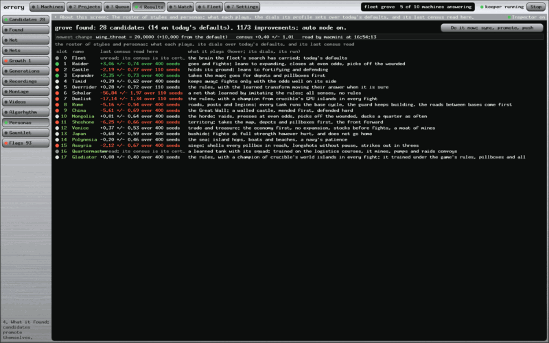](orreryq/live/4-personas.png) | [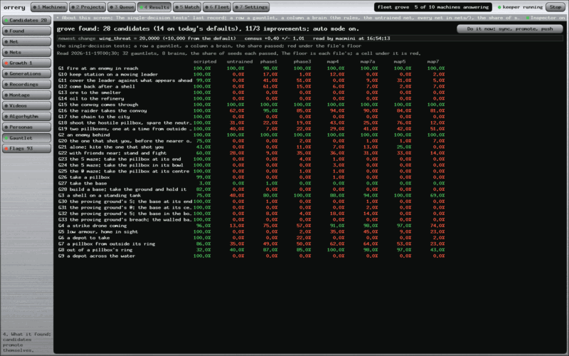](orreryq/live/4-gauntlet.png) |
| [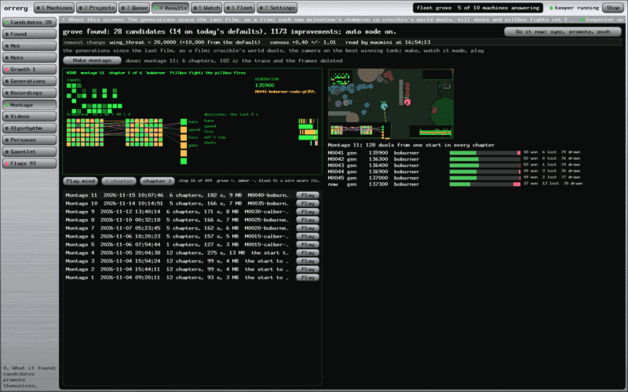](orreryq/live/4-montage.png) | [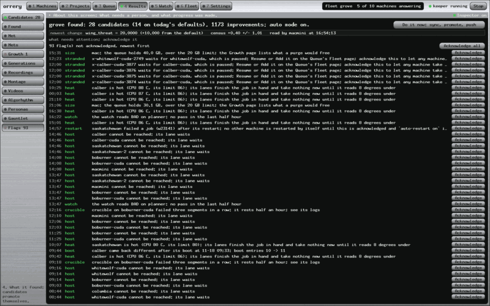](orreryq/live/4-flags.png) |

**Generations**, its eight tabs: Roads (how a computation reaches main), Days (nine days in lanes), Turnaround (each generation's time), Kept (what a generation claims and what main keeps), GPU (the ladder's margins, exams and yardstick), Gauntlet (the forest home's elections), Hours (the hours and what they bought), Yardstick (today against fixed mains).

| | | | |
|---|---|---|---|
| [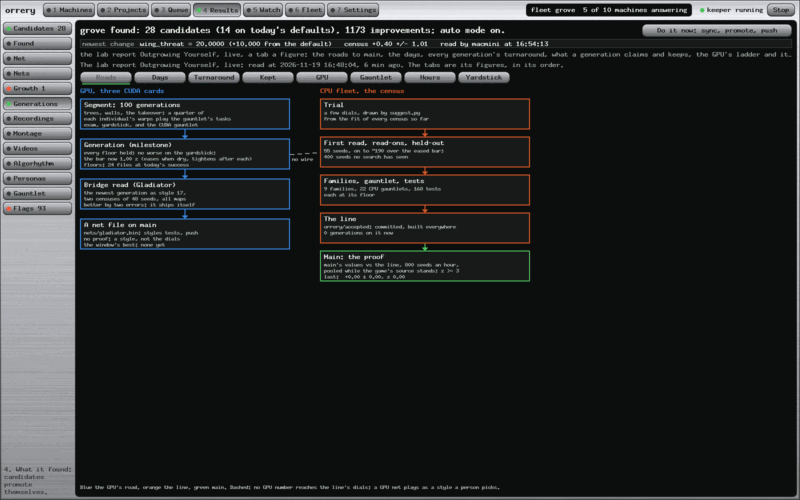](orreryq/live/4-generations-0.png) | [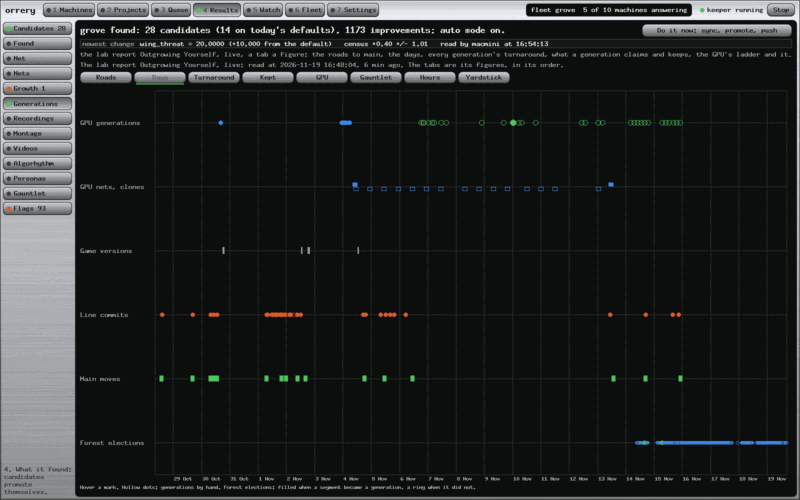](orreryq/live/4-generations-1.png) | [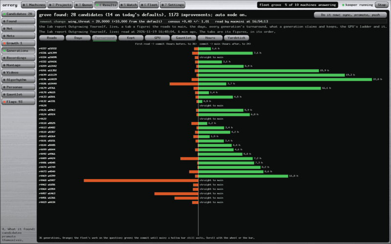](orreryq/live/4-generations-2.png) | [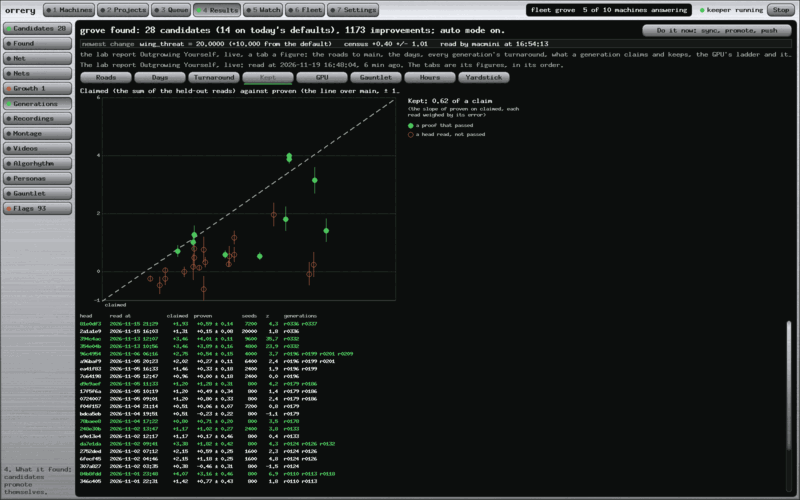](orreryq/live/4-generations-3.png) |
| [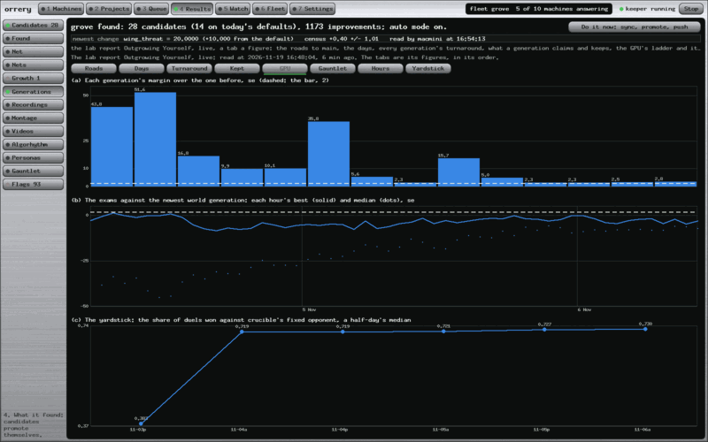](orreryq/live/4-generations-4.png) | [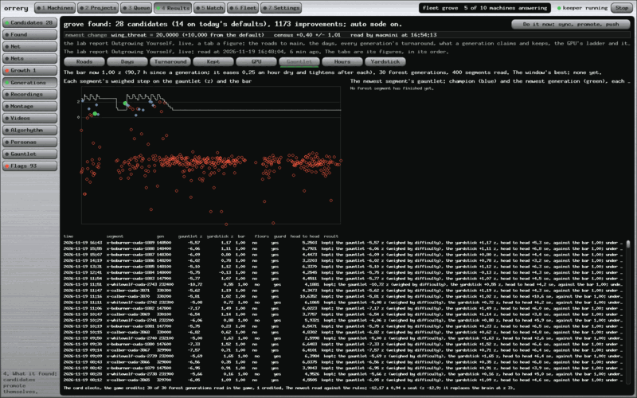](orreryq/live/4-generations-5.png) | [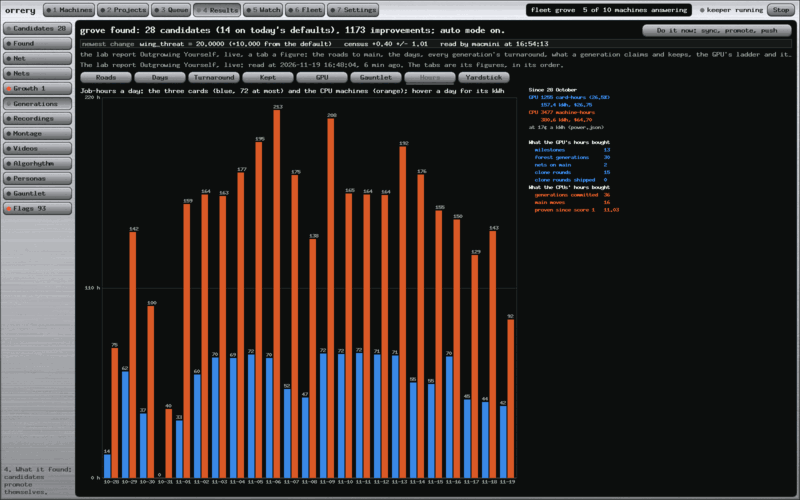](orreryq/live/4-generations-6.png) | [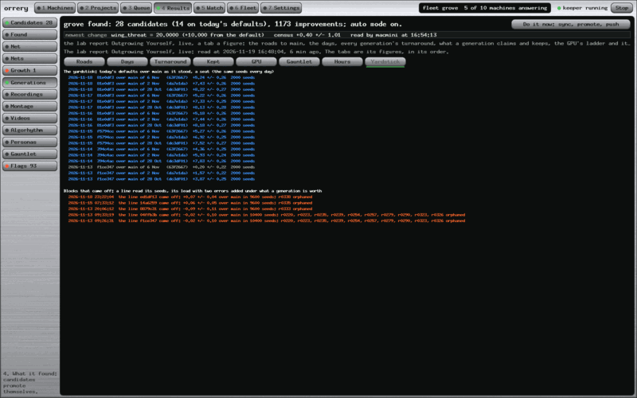](orreryq/live/4-generations-7.png) |

## X. Chapters 5 to 7: Watch, Fleet, Settings

| | |
|---|---|
| [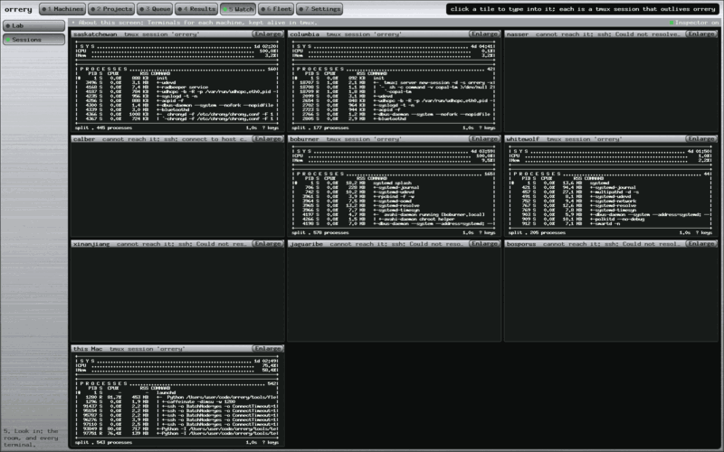](orreryq/live/5-sessions.png) | [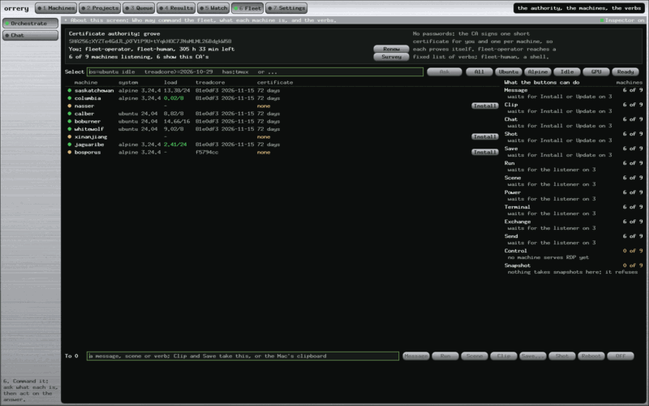](orreryq/live/6-orchestrate.png) |
| **Watch, Sessions**: a terminal for each machine, kept alive in tmux. *For:* reading what no report caught, a stack trace or a build error. (Watch, Lab, the room of live tiles, needs the copal fleet's command, which is not on this Mac; its picture is in the feature guide [5].) | **Fleet, Orchestrate**: ask what each machine is, then act on the answer. *For:* fleet-wide commands with a record of who asked what. |
| [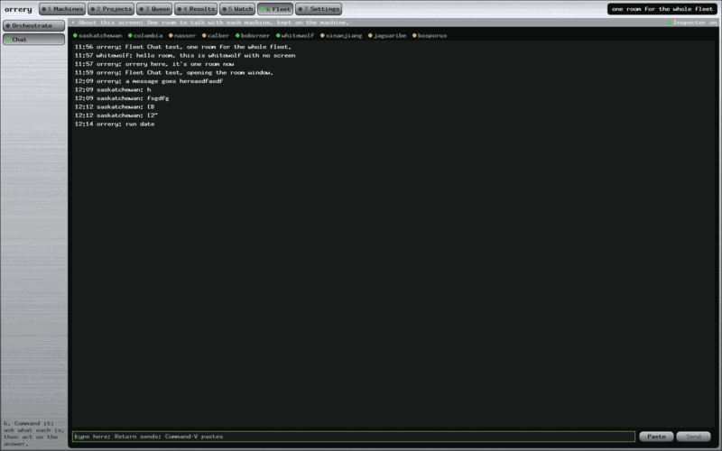](orreryq/live/6-chat.png) |  |
| **Fleet, Chat**: the machines' commanders talking. | **Settings, Keeper**: is it running as it should? The keeper's checks, its code, its planning, its buttons (Plan now, Sync now, Restart the keeper). |
|  |  |
| **Settings, After a cut**: when the fleet went quiet and came back, each machine's boot against the one before. *For:* recovery after a power cut. | **Settings, Long run**: what repeats over many generations (width watch, power price) and what it last found. |
|  |  |
| **Settings, Ranges**: every number's limits in the brain and the reason beside each; only Paul decrees. *For:* the search space, written down. | **Settings, Commits**: the line the fleet builds, newest first, with the defaults each changed. *For:* the model's version history. |

*Close-up 6. The Keeper page's last check, amber: "difficulty: the bar: a generation passes at held-out z 2.50; 17 h 30 m since it last moved, 48 step(s) this run; it stands there: a dry spell widens the search and does not lower it: at its easiest and nothing found: the brain itself needs a change." The program's own diagnosis of the CPU side, read in §XXI.*

---

# Part Three: one investigation

## XI. One CPU generation, followed: w21532

**The choice of example.** The question was a good generation, recent, followed to the end. In the last three days only one CPU generation reached the line, r0338 on 18 November, and its proof read it +0.07 ± 0.04 over main in 9,600 seeds, under the 0.25 a generation must be worth, so it came off the line at 23:22 that night. The newest generation that went all the way to main is **r0337, trial w21532, on 15 November**. It is also one of the quickest: 2.9 hours from its first job, against a median of 9.0 for the nine before it [7].

**What changed (the variable modified).** One dial, `ladder`, a *choice* in treadcore's `weights.rs`: the order in which a tank takes its ladder of jobs, "defend base first in each". It moved from 0, *as built*, to 3, *expand first*. Nothing else.

**Where the idea came from.** Not a person, not the fit. On every new set of defaults the planner asks each switch and each choice version that is not the default, once, alone: the A/B set. `ladder = 3` had been asked 38 times before, since 29 October. Twice it passed its held-out reads and was stopped by the same regression family, *a tank under a ready gun*, at 78.9% (1 November) and 79.7% (5 November) against a floor of 80.0%. On 13 November treadcore gained a rule, "a small drop passes and moves its floor; a collapse does not" (commit 6a706cd). On 15 November the family read 79.6% and the rule let it through. **So this generation was an old idea meeting a new rule**, and the A/B set's habit of asking again is what found it.

**The defaults it ran on**: `2a1a1e9`, which was main `f5794cc` plus the promotion before it, r0336 (four dials: `called_for` 15 → 7.5, `confirm` 2 → 1, `kite_in` 2.25 → 1.125, `strikes_max` 3.30 → 4).

### The seeds: how examples are kept apart

Every read is a census of the trial's brain against the defaults on all 13 maps, seed n on map n mod 13. **Each kind of read draws its seeds from its own block**, so no read reuses another's games and a held-out read has seeds nothing was chosen on:

| Read | Seed block (the planner's rule) | w21532's seeds |
|---|---|---|
| first read | 20,000,000 + 10,000 × the trial's number | 235,320,000 to 235,320,141, and 8 probes: 150 |
| read-ons | 300,000,000 + 1,000 × the read-on's number | 322,790,000 (75), 322,794,000 (113), 322,799,000 (172), 322,801,000 (172) |
| held-out reads | 60,000,000 + 200,000 × the read's number, four pieces of 100 | 360,600,000; 360,800,000; 361,000,000 |
| the line's proof | 700,000,000 + 200,000 × the proof's number | 799,800,000 to 803,200,000, 400 a job |
| probes | (1,000,000,000 + j) × 13 + map | the same eight in every census, on naval, constanine, island, industry, generated |

This is the "transfer of seeds" in Orrery: not seeds handed from one machine to another, but **one numbering shared by every machine**, so that a job is fully named by its block and any machine can play it and get the same games. The probes are the one thing every read shares, and they let a person see the same eight games change across generations.

### The chain, step by step

| Step | When (15 Nov) | Where | What it read | Decision |
|---|---|---|---|---|
| asked | 19:41:26 | queue | | waits 11.1 min behind six high-priority read-ons of other trials |
| first read | 19:52 to 19:57 | boburner | +0.44 ± 0.37 on 150 seeds, z 1.19 | over the keep bar z 0.25: read on |
| read-on 1 | 19:59 to 20:06 | whitewolf | pooled +0.58 ± 0.31, z 1.86 on 225 | read on |
| read-on 2 | 20:09 to 20:13 | boburner | pooled +0.56 ± 0.26, z 2.20 on 338 | read on |
| read-on 3 | 20:16 to 20:20:27 | macmini | **pooled +0.63 ± 0.22, z 2.92 on 510** | **passed** (bar z 2.1, no map two errors under) |
| read-on 3, again | 20:21 to 20:32 | calber | +0.49 ± 0.38 on 172 more | **asked twice by a race** (below) |
| held-out read 1 | 20:32 to 20:42 | four pieces | +0.56 ± 0.26 on 376 | z 2.15: undecided, read again |
| held-out read 2 | 20:42 to 20:52 | four pieces | +0.28 ± 0.25; pooled z 2.30 | read again |
| held-out read 3 | 20:52 to 21:00:41 | four pieces | +0.62 ± 0.28; **pooled +0.47 ± 0.15 on 1,128, z 3.13** | **passed** (bar z 2.5) |
| families | 21:01 | calber, 48 s | *a tank under a ready gun* 79.6%: a small drop | holds; the floor moves to 0.78 |
| gauntlet floors | 21:03 | macmini, 4 s | | holds |
| promote r0337 | 21:06 to 21:07:42 | macmini | 178 of the brain's tests pass | **commit 81e0df3** on the line |
| builds | 21:10 to 21:17 | six machines | 81e0df3 built where it will run | |
| proof round 1 | 21:20 to 21:44 | four fast lanes | line +0.64 ± 0.24 on 2,400, z 2.62 | under z 3.0: on |
| proof round 2 | 21:45 to 22:14 | four fast lanes | +0.64 ± 0.17 on 4,800, z 3.77 | constanine two errors on main's side: on |
| proof round 3 | 22:16 to 22:45 | four fast lanes | **+0.59 ± 0.14 on 7,200, z 4.27**, no map under | **proved: main moves to 81e0df3 at 22:47:05** |

Orrery draws this chain itself. With the Pipeline's state of 22:50 rebuilt from `events.jsonl` (`docs/orreryq/pipeline-w21532.json`), the Timeline follows it:

*Close-up 7. The Timeline, "following w21532: 20 jobs, 6 machines (kept)". Every lane is a row; the trial's own jobs are framed in amber and joined by arrows in the order each followed the last; the green rules mark "main: w21532" and "r0337 w21532"; the grey one, M0049, the GPU milestone elected the same hour (§XIII).*

And the Lineup sets it among the trials that ran beside it:

*Close-up 8. The Lineup at 22:50, trials only. Six still going (amber), w21532 "promoted as r0337, and on main" (green, its fork of four held-out pieces fanned under it), and below, the red walls: "dead end: dropped after 1 read", "after 4 reads", "after 5 reads".*

Fig. 5 is the same chain drawn on one time axis, every job a bar: thin while it waited for a lane, thick while it ran.

*Fig. 5. w21532 from its first ask to main: 44 jobs, 3 hours 6 minutes. The bar beneath is where the time went.*

### The time spent waiting

**From the first ask to the promotion: 86.3 minutes.** On the critical path (each link's slowest job): **43.0 running (50%), 37.0 waiting for a lane (43%), 5.8 between a job's return and the next ask (7%)**. **From promotion to main: 99.4 minutes**, of which 81.2 were the three proof rounds. **First ask to main: 185.7 minutes**, about 116 running and 70 waiting. The waits, largest first:

1. **The proof needs 7,200 seeds on four lanes** (81 minutes): three rounds, because round 1 was under z 3.0 and round 2 was held by one map. Inside a round the slowest lane runs its jobs back to back (macmini 7.3 minutes a job, boburner 12.9, saskatchewan 18.5).
2. **The first read's queue turn** (11.1 minutes): a normal-priority trial behind high-priority read-ons.
3. **Fast lanes shared with r0336's proof**: held-out reads 2 and 3 ran their four pieces on two lanes while saskatchewan's two were proving the line before (waits of 3.8, 5.4 and 6.3 minutes).
4. **A read asked twice** (about 11.6 minutes). A planner pass that ran from about 20:20:24 to 20:20:34 asked "read on 4 of w21532" again as e22801, the same question as e22799, which had returned at 20:20:27, inside that pass. The planner reads the finished jobs first and the running jobs second; e22799 was not yet in `done/` when the first was read and no longer in `running/` when the second was. The duplicate ran on calber, the slowest CPU lane, for 10.3 minutes and 24.3 Wh. The cause is read from the code and the timestamps, not from a log line.
5. **The build** of the new line on six machines (11.7 minutes before the proof could be asked).
6. **The planner's passes** themselves: 0.1 to 1.4 minutes a link. Small, because the chain's steps carry `replan` and the keeper asks for a pass 15 seconds after such a job returns [8].

**Energy**, by the planner's model (not a meter): the trial's chain 115 Wh, the duplicate 24.3 of it, the builds 4.8, the proof 330.5: **450 Wh from the first ask to main, about $0.08**. The whole generation's 120 trials cost about 3,035 Wh. saskatchewan-2 is booked at 0 W in the model (its box's watts go to its first lane), so its 59.9 lane-minutes count nothing.

## XII. The paths not taken

On the defaults `2a1a1e9`, from 15:38 to 21:08, the planner asked **120 trials**: 62 A/B versions, 40 far trials (one dial at 1.41 times or 1/1.41 of today's value), 12 draws from the fit's uncertainty (`suggest.py`), 3 carried passes and 3 old candidates read again. They took 258 jobs, 29.4 lane-hours and 30,038 seeds. Fig. 6, left, is the funnel.

*Fig. 6. Left: the CPU generation of w21532. Right: the GPU window that made M0049, and the four days since.*

Ten of the 119 others, each a different way to fail:

| Trial | Source | Change | Reads | Why it stopped |
|---|---|---|---|---|
| w21529 | A/B | `ladder` 0 → 1 (expand before hunt) | +0.01 ± 0.31 on 225 | under the 225-seed keep bar 0.55 |
| w21531 | A/B | `ladder` 0 → 2 (hunt first) | +0.00 ± 0.00 | played the very games of the defaults: the change is never reached |
| w21541 | far, ÷1.41 | `castle_road` 2.0 → 1.418 | passed on 510 (z 2.27); held out +0.00 ± 0.07 | held-out z 0: a sequential pass that did not repeat |
| w21511 | A/B | `bio` square → sine | +0.39 ± 0.22 on 1,140, z 1.77 | europe −0.84 ± 0.37: a map two errors under blocks it |
| w21456 | carried pass | `bio_amount`, `ore_reach`, `strikes_max`, `w_pos_expand` | +2.48 ± 0.75 on 150; held out −0.28 ± 0.46 | a lucky first read; held out under 1.0 |
| w21508 | old candidate | `w_smooth` 0.525 | +1.47 ± 0.93; held out −0.69 ± 0.45 | naval and proving under |
| w21473 | fit draw | four dials (`alpha`, `odds_r`, two pings) | +0.36 ± 0.40 on 750, z 0.89 | under the 750-seed keep bar 1.45 |
| w21464 | far, ×1.41 | `alpha` 0.348 | +2.28 ± 1.03 on 150; +0.38 ± 0.70 on 338 | regression to the mean |
| w21474 | A/B | caps − dodge | −8.11 ± 0.99 on 150 | dropped at the first read |
| w21506 | A/B | `advance_plan` forward → as built | −3.20 ± 0.68 on 150 | dropped at the first read |

The kinds of failure are the lesson. **21 of 120 were never really tested**: the game never reaches the changed number on these maps, so the trial plays the defaults' own games. **Lucky first reads regress** (w21456 +2.48 on 150 seeds, −0.28 held out; w21464 +2.28, then +0.38): that is what the sequential bars and the held-out block are for. **A map can veto** (w21511). And a sequential pass can fail to repeat on fresh seeds (w21541). One in 120 passing is not waste: it is the price of believing only what repeats.

## XIII. One GPU generation, followed: M0049

**The choice of example.** No home has elected a milestone in the last three days. The newest is **M0049-boburner-cuda-g138500**, in the maze home (`crucible-world-hybrid-forest-nav`), at 22:06 on 15 November: the same evening as w21532, so the two can be read side by side.

**What made it.** One segment, `x-boburner-cuda-1756`, on boburner's GTX 1070 Ti (sm_61, 19 SMs). It resumed the island's saved state at generation 138,400, ran 100 generations in 2,587 seconds (25.4 s each, about 20.8 million tank-steps a second) and saved generation 138,500. Fig. 7 is its evening.

*Fig. 7. Queued at 15:00:58, four hours in the GPU queue, 49.5 minutes on the card, 2 h 14 min as the window's best, forced in at 22:06, refused by the game at 22:55.*

**What it trained against, and what was modified.** On a card nothing is a dial: **every weight is the variable**. Each generation the 16 best nets are kept as they are and the other 2,032 are children of the top quarter, every weight nudged by a Gaussian of σ 0.03. Each net plays 256 duels a generation; its opponent is a scripted sparring partner of random skill (half the time), one of the 8 ladder milestones (a fifth), or one from the 4,096-net hall of fame. Half the threads instead play one of the gauntlet's 24 files as a task (`task_p 0.5`). A win scores +2, a loss −2, a draw −1, plus damage. The rules are treadcore's own, from commit 81e0df3, passed to the compiler as constants.

**How seeds and champions move on the GPU side**, which is what "transfer" means there:

1. **Segment to segment, on one island**: the whole population and the hall of fame live in `island.state` on the card's machine; each segment loads it, runs 100 generations and saves it. The Mac never holds the population, only each segment's champion.
2. **Island to island**: at each dispatch the keeper sends the other islands' newest champions, each as an opponent in the hall of fame and as a migrant into the population. M0049's segment imported calber's and whitewolf's champions and `game.bin`, M0030, the net the game ships. **boburner's champions are sent to nobody**: an island whose last three milestones the game refused is not imported.
3. **The dice**: the island's fixed seed (boburner's is 32,137: 1,000 + 97 × the sum of its name's letters mod 1,000), mixed with the generation's number, so each generation differs and each can be played again.
4. **Home to home**: a new home starts from its parent's milestones and population, widened with zero weights for the new senses (M0001 to M0019 came from the forest home on 6 November).

**What is tested** at the end of every segment: the **exam**, 2,048 duels against each of the 8 ladder rungs and the scripted yardstick (M0049 won 65.5% against the yardstick, and against the top rung M0032 won 6.8%, drew 86.8%, lost 6.4%); the **gauntlet**, 24 files × 256 runs, the champion and the standing top on the same runs, weighed by how hard each file is, with a floor on each. At an election, **footage** (12 files × 8 runs, filmed: M0049 passed 96 of 96) and **the bridge**, 192 seeds in the real game as the Gladiator against the shipped net.

**The election.** Against M0032 the champion held every floor and read **zg +1.99** on the weighed gauntlet. Almost all of it was one file, T3 (*build a base: take and hold*), 251 of 256 runs against M0032's 201. The bar was 3.00, so the rule kept it as the window's best. At 22:06, three hours after M0048 with no generation, the planner **forced** the window's best in.

**The game's verdict.** At 22:55 the bridge read the team with M0049 as its Gladiator at −12.17 ± 0.94 a seat against the defaults, and the shipped M0030's team at −3.33 ± 0.78: **M0049 was 8.84 ± 1.22 a seat worse, and refused.** The top rung went back to M0032.

**Its paths not taken** (Fig. 6, right): 14 segments were examined in the window from M0048 to M0049. Four could not be elected at all: they were dispatched against M0048, which the game refused an hour after it was made, and a segment's rung is fixed when it is dispatched. Of the other ten, calber's and whitewolf's read zg −5 to −12 and missed the floors of C7 (*a pillbox from outside its ring*) and T3; boburner's three held, and the largest step, 1756's, was taken.

**Its time spent waiting.** Each island keeps **six segments queued** (crucible's `ahead`), each after the one before, so a segment waits for about five of its island's segments: 1756 waited **241 minutes**. Since M0049 the median waits are boburner 240, calber 153 and whitewolf 210 minutes. Because the ladder and the champions to import are read at dispatch, **a segment trains against the ladder as it stood four hours before it ends**.

## XIV. The lock: why no GPU generation since

The election did one more thing. **It set every floor to M0049's own share less 1/√256 = 0.0625**: C7 to 0.18 and T3 to 0.918. When the game refused M0049, the top rung went back to M0032, **but the floors were not put back**. M0032 itself scores T3 0.785. So the standing top could not be elected under the floors its refused successor left, and neither can anything like it.

Since 22:06 on 15 November, **316 segments were examined, 310 against M0032, and none held every floor**. Only three, all boburner's, had zg above 0 (+2.03, +0.79, +1.91), and each missed T2 by a hair. calber's 126 and whitewolf's 92 missed C7 and T3 every time; the islands now score C7 at 0.00 to 0.02. **About 206 GPU-hours** went into these segments: boburner 74.5, calber 65.5, whitewolf 65.7. Nothing in the program will unlock it: with no candidate, `crucible elect` only waits.

Two more facts make this the first place to step in (§XXI):

- **Every milestone after M0032 is boburner's, and the game refused all 17.** Forced elections every three hours favour boburner's lineage, which wins T3, C7 and F3 on the gauntlet but plays 5 to 11 points a seat worse in the game. calber's nets are the ones the game rates, and they cannot reach the floors boburner's elections set.
- **The gauntlet's mean share stopped moving** at 0.80 to 0.81 on 7 November, and boburner's yardstick win rate at about 0.65 (0.654 at generation 138,500, 0.653 at 148,500). The generation count rises; the measured skill does not.

---

## XV. The net, around the tank

M0049's net is 5,766 numbers, 23 KB, read as 64 → 48 → 48 → 6 with tanh on every layer (crucible's `think()`). The reading was checked against a recording: montage 11 kept the inputs and every layer's values of M0041 to M0045 at two decimals, and those nets' own files, read the same way, give back h1 within 0.05 for 98.7 to 99.5% of values and the gate's opening on exactly the same steps. Fig. 8 draws M0049 outside in, left to right, as Paul asked: the tank, the input sensor matrix, the two transform matrices, the output matrix, the output signals.

*Fig. 8. The tank's twelve rays and three channels become the sensor matrix (a cell as bright as holding it at its mean moves the outputs); seven small blocks of other senses below. Two columns of 48 hidden units: hollow ones never change sign, bright ones are live switches. Six outputs. The lines are the strongest connections by |w| × mean |activation|: the 40 strongest from the senses, 20 between the hidden layers, 20 into the outputs; blue a positive weight, coral a negative, width the significance; in yellow the strongest of all, h2[3] into the gate, +48.8.*

**The input sensor matrix** (64 numbers a step). Twelve rays leave the tank at its heading + 30° × r. Each is read three ways, as 1 − distance/40: the **nearest thing** (wall, pillar, a forest's walls or the enemy), the **enemy tank** (only within 10 tiles and not hidden in trees), and a **pillbox** not its own. Then seven blocks: its **body** (own speed, own armour, gun ready, enemy armour, the enemy's bearing as sine and cosine, an incoming shell's nearness, and a constant 1); **the rules' own answer** this step (turn, speed, fire: what the hand-written brain would do); the nearest **pillbox** (bearing, nearness, reload, health, "it has you"); the **gun** (shells, reload); the **route** to the next waypoint (bearing, length, walled); three **arcs** (how far it could drive turning left, straight, right in 1.5 s); and two **memory** cells, its own outputs of the step before.

**The transform** is two layers of 48. **The output matrix** is six numbers: corrections to turn, speed and fire, a **gate**, and two memory cells written back. **The output signals** are decided by the gate: when y3 > 0 the tank does the rules' answer plus the corrections, clipped to ±1; when it is shut the tank does the rules' answer exactly. Turn is a heading error of value × π, speed is value × 4 tiles a second, and it fires when the fire value is over 0, it is loaded and it has a shell.

**What the numbers say.**

1. **It is a net of switches.** 95.6% of h1's values and 96.9% of h2's sit beyond ±0.99; the median input to an h2 unit is 47 before tanh. Over 723 recorded steps there were only 294 distinct sign patterns in h1 and 32 in the outputs. Six h1 units and two h2 units never change sign: they act as biases. So |w| × activation is nearly |w|, and **the line widths in Fig. 8 show strength, not use**. Use is measured by ablation, below.
2. **A weight's size tells its age.** Mutation adds σ 0.03 to every weight each generation, so a weight left to drift reaches an RMS of 0.03 × √G after G generations. The blocks match the time since each was added: the first 32 hidden units and the rays, body and rules senses date from about generation 0 (drift 11.2, measured 10.5 to 12.2); the world's senses from about 85,000 (drift 6.9, measured 7.0); the maze's route, arcs and memory from 112,600 (drift 4.8, measured 4.9 to 5.3). **The maze senses' weights are exactly the size mutation alone would give them.**
3. **The result of the net: it mostly lets the rules drive.** h2[3] is the gate neuron (its sign matches the gate on 98.5% of steps). On the 723 duel steps the gate is open on **6.8%**, and the fire decision differs from the rules' on **1.1%**. The island's own count, "the net overrode the rules on 84 to 85% of steps", is over its whole population's training, half of it gauntlet tasks, not these fights.
4. **What it listens to**, by ablation: hold a group of senses at its mean over the 723 steps and measure how much outputs 0 to 3 move (Fig. 9). The rules' own answer, the near rays and its body matter most; the single inputs that matter most are the rules' fire (0.355, flipping the gate on 12.7% of steps), gun ready (0.350), the enemy dead ahead (0.298) and the rules' speed (0.267). **The route, the sense added for the mazes, matters least: 0.076.**

*Fig. 9. Group ablation over 723 recorded steps. The steps are duels (montages 10 and 11, boburner's M0036 to M0045), not mazes; M0049's own play was not recorded, because the footage tool deletes its traces after filming.*

5. **It is another lineage from the net the game ships.** M0049's weights correlate 0.02 with M0030's and M0032's: separate lineages since October, never mixed. Their outputs agree in sign on 81% of steps for turn but only 55% for fire.

So the net is a gate on a rule-follower, trained hard to pass the gauntlet's maze and base files, and in the real game it is worse than the net it would replace. Points 2 and 4 together say why the maze senses may not be earning their place yet: they are no bigger than drift and the net barely uses them in a fight.

## XVI. Is it getting better? The yardsticks, and how it is tested

A fleet that runs all day can look busy and learn nothing. Orrery keeps **two fixed yardsticks** for that reason (Fig. 10).

*Fig. 10. Left: today's CPU defaults against main as it stood on 28 October, on the same 2,000 seeds every day. Right: the GPU gauntlet's mean share by milestone in the maze home; M0030, in yellow, is the last net the game took.*

*Close-up 9. Results, Generations, Yardstick: each day's defaults over three fixed mains. On 13 November f1ce347 was +3.87 ± 0.25 over 28 October's main; on 14 November 394c4ac +7.83; from 16 November 81e0df3, the defaults w21532 made, +8.18, +8.13, +8.22. Over 6 November's main the same defaults read +5.19 to +5.24; against 2 November's, +7.33 to +7.44. The day-to-day repeat is within 0.11, so the steps are real. Below, in red, the blocks that came off: lines whose proof read under what a generation is worth.*

**The CPU brain** gained 4.35 points a seat over 28 October's main in five days, 13 to 18 November, and has not moved since. w21532's own generation moved the yardstick by **+0.66** against 28 October, **+0.52** against 2 November and **−0.09** against 6 November: two of three agree with its proof's +0.59.

*Close-up 10. Results, Generations, GPU, its chart (a): each generation's margin over the one before, in standard errors, against the dashed bar of 2. 43.8, 51.6, 16.8 ... then 2.3, 2.3, 2.5, 2.8: each step smaller than the last, until the steps are the bar.*

**The GPU nets** rose from a gauntlet share of 0.64 to 0.80 in two days (6 to 8 November) and have stayed within 0.01 since. The game has credited nothing since M0030 on 10 November (+2.28 ± 0.98 a seat).

**How it is tested.** The program and its process are tested at five levels:

| Level | What | How much |
|---|---|---|
| the window's code | Rust unit tests: drawing, parsing, every page's layout rules | 435 pass on this Mac (`cargo test`; 465 in the source, the rest for Linux) |
| the keeper, planner and controller | proofs on scratch queues and simulated rooms: `fleet-queue-check.sh`, `plan-check.sh`, `board-check.py`, `hearth-check.sh` (60 claims), `hearth-hold-check.py` (47), `heat-check.sh`, `leftover-check.sh`, `telemetry-pull-check.py`, and 13 more | 21 check scripts |
| a CPU trial | sequential reads with rising bars, a held-out block, families with floors, the brain's 178 tests, the gauntlet's floors | Section XI |
| a CPU line | the proof against main, 400 seeds a job, z 3, no map under, orphaned under 0.25 | Section XI |
| a GPU champion | the exam (8 rungs), the gauntlet (24 files with floors), footage (12 files filmed), the bridge (192 seeds in the game) | Section XIII |

The CPU side's tests have one property the GPU's lack: **a CPU generation is judged by the thing it changes, the game, on seeds it was not chosen on**. A GPU champion is elected by the gauntlet and judged by the game only afterwards, and the two disagree (§XIV).

---

## XVII. The time spent waiting, fleet-wide

Sections XI and XIII followed waiting through one chain each. Over the whole fleet, in the six hours to 17:04 on 19 November (`plan/pipeline.json`):

| Lane | Busy | Of it |
|---|---|---|
| saskatchewan-2 | 98.1% | first reads 168 min, read-ons 144, held 24 |
| saskatchewan | 97.7% | read-ons 163, first 148, held 29 |
| boburner | 97.2% | read-ons 151, first 144, held 40 |
| macmini | 95.2% | read-ons 169, first 132, held 29 |
| boburner-cuda | 99.6% | islands 359 min |
| whitewolf-cuda, calber-cuda | 23.9%, 20.2% | paused by the hold, removed with calber |
| whitewolf, calber, jaguaribe | 11.0%, 16.2%, 7.1% | paused or switched off part of the six hours |
| the orchestrator (the Mac's planning) | 15.2% | 582 passes today, 15.2 s each, none failed; 2.87 of the Mac's cores, about 10 W |

**A lane that is allowed to work works 95 to 99.6% of the time.** The fleet's idle hours today are not waiting: they are machines a person or the hold took out (§XVIII, §XX). The waiting that is left is in three places, each measured:

1. **Between the steps of a chain** (Blame's medians, Fig. 4): 1.2 minutes for the planner's pass and 1.4 in the queue for every 4.6 working. A trial's step spends 36% of its life waiting; the work itself is short, so the hand-offs show. On 5 November this was 3.2 + 2.6 minutes; making a chain's return ask for a pass at once cut it to these [8].
2. **The proof's rounds** (81 of w21532's 186 minutes): four lanes, six reads at a time, three rounds.
3. **The GPU queue's six segments** (four hours a segment): not a waste of the card, which is busy, but a staleness: the segment trains against a ladder four hours old, and four of the 14 segments in M0049's window could not be elected because their rung had been refused in the meantime.

## XVIII. The watts, the room and tau

**For:** every computation is also heat. In a data centre that is a cost to remove; here, with the apartment's own heating switched off since 16 November, it is the heating [9]. The Heat page (Machines, chapter 1) has six panels:

| | | |
|---|---|---|
|  |  |  |
| **Machines**: each machine's watts and temperatures against its limits, and what its steps say of each part. | **Parts**: every sensor, ranked by how close it runs to its limit. | **Watts**: the fleet's watts over six hours, and each machine's share. |
|  |  |  |
| **Steps**: every step the queue made in a part's watts, and the time constant fitted to it. | **Hearth**: the room's target, the mode, the power buttons, the law's own account. | **Diagram**: the heat as one process picture: tiles, pipes, the tank of the room's air, the walls. |

Fig. 11 is the three days the room has been held: the room on its own scale, the weather outside, and the fleet's watts.

*Fig. 11. The room (two Geiger counters' thermometers on saskatchewan), the airport's air, and the fleet's watts, 16 November 17:37 to 19 November 17:05. Full tilt in yellow. The leap just before it is the thermometers warming up after saskatchewan's automatic restart at 14:34, not the room.*

**Read off it:** the room stayed within half a degree of 26.7 °C (80 °F) for most of two days on 400 to 1,300 W, with the outside at 4 to 11 °C. **Full tilt** (18 November, 16:32 to 19:17) shed nothing by design and took the room to about 27.9 °C (82 °F), over the ceiling, until a person ended it. Since noon on 19 November the fleet has given about 450 W and the room has slid to 26.35 °C: the hold switched calber off at 12:18 and could not wake it again (§XX).

*Close-up 11. The Hearth panel at 16:55 on 19 November: the target 26.7 °C (80.1 °F), mode act, the full tilt button, power switch on; the hold's line ("budget +171 W, the room 26.35 °C, moving −0.11 °C an hour; UA 120 W/°C, C 4.2 MJ/°C"), the power row with each machine's On and Off, "calber, asked 24 min ago: the wake packet was sent; waiting for it to answer", and the ladder of rungs it may shed.*

### The balance, and four calculations

Everything the controller does is worked from one balance for the room, treated as one lump of heat [9]:

> C · dT/dt = P + P₀ − UA · (T − Tₒ)

C is the room's heat capacity (4.2 MJ/°C, measured by a step on 17 November [10]), P the fleet's watts (read or modelled), P₀ the heat nothing reads (people, the kitchen, the rest of the flat), UA the loss through the walls for each degree over the outside (120 W/°C is a figure in use, not a measurement), T the room and Tₒ the outside.

**1. The energy.** From 16 November 15:00 to 19 November 16:56 (73.9 hours) the fleet put **217.0 MJ** into the room (Fig. 12). 217.0 MJ ÷ 3.6 MJ/kWh = **60.3 kWh**; ÷ 266,040 s = a mean of **815 W**; at $0.17 a kWh, **$10.25**. The room ended 0.1 °C warmer than it began: C × ΔT = 4.2 × 0.1 = 0.4 MJ kept. **216.5 MJ went through the walls.**

*Fig. 12. Energy into the room, and the CPU side's energy for each job finished. columbia does a job for 4.4 Wh, bosporus for 47.6: eleven times as much heat for the same work, which is why the hold sheds the Supermicros first.*

**2. A part's time constant.** A part heats like a small room of its own: τ = R × C, where R is how many degrees it settles above its idle for each watt (°C/W) and C its heat capacity (J/°C). The Heat page fits both from every step in a part's watts (Close-up 12). boburner's card: R = 0.35 °C/W, C = 213 J/°C, so **τ = 0.35 × 213 = 74.6 s**; the page says 74 s. saskatchewan's CPU: 0.55 × 38 = **21 s**. whitewolf's card: 0.48 × 738 = 354 s, **6 minutes**. calber's CPU: 0.054 × 2,040 = **110 s**.

*Close-up 12. Heat, Steps: each step a part took ("card W 8.15 to 65.79"), its time constant, where it began and settled, °C a watt, joules a degree. boburner's card answers in 74 to 104 s; whitewolf's in 6 minutes.*

**3. The room's time constant.** The same form for the room: **τ = C / UA = 4.2 × 10⁶ / 120 = 35,000 s = 9.7 hours.** A CPU answers in a minute, a disk in half an hour, the room in ten hours. That is why the hold waits forty minutes between changes, and why it acts on where the room is heading rather than where it is.

**4. The budget at 16:31 on 19 November**, the step that woke calber for the last time. The room read 26.35 °C against a target of 26.7, falling 0.12 °C an hour. The watts the room wants added:

> budget = −(UA · (T − T*) + C · dT/dt) = −(120 × (26.35 − 26.70) + 4.2 × 10⁶ × (−0.12) / 3,600) = −(−42 − 140) = **+182 W**

The log says +186 W (its slope unrounded). Note which term is larger: **140 of the 182 watts are the room's fall, not its distance from the target**. A controller that looked only at the distance would ask for a quarter of this.

**5. What the balance says about the house.** At 16:50 the fleet gave 456 W, the outside was 8.0 °C, the room 26.35 °C and falling 0.11 °C an hour, so C · dT/dt = −128 W and UA · (T − Tₒ) − P₀ = 456 + 128 = 584 W. If UA were 120, the walls would lose 120 × 18.35 = 2,202 W and **1,618 W would have to come from what nothing reads**. If UA is the 67 W/°C the two steady stretches of 18 November give, the walls lose 1,229 W and the unread heat is 645 W. Either way a third or more of the room's heat is not the fleet's, and the controller's one weak number is UA.

---

# Part Four: what to keep, and where to step in

## XIX. The successes of the lineup

1. **Volume, with very little lost.** 65,601 jobs done since 28 October, 463 failed (0.7%), 2,906 retired unrun because their question had been answered. Today 1,648 done, 98.0% came back done, 98 an hour, for 15.7 kWh and $2.67 over 17 hours.
2. **The CPU brain improved, measured on fixed seeds.** +8.22 ± 0.27 points a seat over main of 28 October on the same 2,000 seeds; +4.35 of it in the five days from 13 November. Main moved three times in those days, each time by a line that proved itself over at least 7,200 seeds.
3. **The proof refuses what does not repeat.** r0338 on 18 November passed its held-out reads and then read +0.07 ± 0.04 against main over 9,600 seeds; it came off the line the same night. A system that only ever said yes would have shipped it.
4. **The GPU learned fast, then hit a wall it measures.** The gauntlet share rose from 0.64 to 0.80 in two days; M0030 was credited by the game at +2.28 ± 0.98 and ships as the Gladiator; footage of M0049 passed 96 of 96 tests. The wall since is seen in Orrery's own pages (Close-up 10, §XIV), not discovered by surprise.
5. **The lanes that are allowed to work, work.** 95 to 99.6% busy over six hours, no machine waiting on another, 582 planner passes today at 15 seconds each and none failed.
6. **Everything is traceable.** w21532 was followed through 44 jobs, every seed block and every decision, from files the fleet wrote as it went (`events.jsonl`, `done/`, `results/`); the Timeline and the Lineup drew it again four days later from those files alone.
7. **The fleet heats the home.** Since 17 November 16:44 Orrery has held the room near 80 °F from its own heat, woken machines by packet (bosporus, calber, jaguaribe) and switched them off when the room was warm, with no person in the loop.
8. **The Lineup itself.** It makes the cost of learning visible: 131 dead ends to one win on 19 November's page, each with how long it lived and why it died. That is what an honest search looks like.

## XX. Found while this report was written, and fixed

**1. The hold sent a dead machine a packet every forty minutes and never gave back what it had paused.** On 19 November, with the room heading over its band, the hold paused columbia's lane (01:44), asked calber to finish and switch off (11:06; off at 12:18), and paused whitewolf and its card (11:44, 11:47). From 14:42 the room was cold and the hold wanted heat; calber, first in its order of preference (a card machine, 20 Wh a job), was sent a wake packet and did not answer in 20 minutes, four times (14:42, 15:22, 16:10, 16:51). Each pass it chose calber again, so the three lanes it had paused itself waited behind a machine that would not come, and the room slid from 26.7 to 26.25 °C. **Fixed** in `tools/hearth_regulator.py`: a machine that did not answer its last packet is not sent another for three hours (`WAKE_FAILED_S`), and the log says so. Four new claims in `tools/hearth-hold-check.py` (47 in all, PASSED); the first fails on the code before the fix. **Live at 17:12**: "not woken again yet: calber did not answer the last packet ... whitewolf-cuda takes work again (about 147 W)". calber itself wants a look: it answered its packet in 43 s that morning and not since it was switched off at 12:18.

**2. The telemetry pull fetched every older day again every five minutes.** The pull tells each machine which files the Mac has and how much of each, and the machine sends only what is new; but it named only the newest three files, and a machine sends a file it is not told of from its first byte. From a machine's fourth day on, every pull re-sent each older day whole and appended it again: saskatchewan's 16 November is 1.8 GB on the Mac, 262 copies of its 6.9 MB; the telemetry folder 14.9 GB, of which 0.14 GB is real, growing about a gigabyte an hour; a pull took over ten minutes, so pulls overlapped. Every reader of the telemetry was misled: the energy account above said 204 MJ and put saskatchewan first at 74 MJ until it was run on a copy without the repeats. **Fixed** in `tools/telemetry.py`: every file is named with its size. `tools/telemetry-pull-check.py` proves it on a fake machine's folder with the machine's own half of the script, and shows the old code sending the older days again. The next pull, at 17:10, appended nothing to the old days. **Then** the copies already on disk were removed. A de-duplication that keeps each line once in the order first written gives back each machine's file byte for byte (saskatchewan's 16 November: 6,940,069 bytes, the machine's own size) and was measured without writing; Paul ran it at 18:15 the same evening (`python3 tools/telemetry-dedupe.py QUEUE --do`): the folder went from 14.9 GB to 194 MB, saskatchewan's day files are now the machine's own sizes to the byte, and `hearth/energy.json`, the hold's order of preference, was written again from the clean record (219.4 MJ over 75.3 hours; the order unchanged).

## XXI. Where to step in: eleven suggestions, the largest first

| # | Where | What is wrong | What to do | What it would buy |
|---|---|---|---|---|
| 1 | GPU election (`gpu_elected`, the bridge's refusal) | floors raised by M0049 stayed after the game refused it; nothing can meet them | when the game refuses a milestone, put the floors back to the standing top's | the 206 GPU-hours since 15 Nov would have been read against M0032's floors |
| 2 | GPU election | forced elections every 3 h favour boburner's lineage, which the game refused 17 times | let the bridge's verdict weigh in the election, or stop forcing an island the game has refused three times running | elections that agree with the game |
| 3 | GPU gauntlet | T3, C7 and F3 decide elections; they are not what the game rewards | weigh gauntlet files by how well they predict the bridge's read (32 bridge reads exist) | a gauntlet that is a better proxy |
| 4 | CPU search | dry for 72 h at the easiest bar; the Keeper says "the brain itself needs a change" | new dials and switches from what the game does wrong (the Algorhythm and Terrain tabs), not more trials of the same 940 numbers | a search with somewhere to go |
| 5 | CPU planner (`sequential`) | a read-on asked twice when a job returns during a pass (11.6 min and 24 Wh in w21532's chain) | read `running/` before `done/`, or take one snapshot of both | about a tenth of a chain's wall time where it happens |
| 6 | CPU proof | 81 of 186 minutes; the slowest lane runs its jobs back to back | size a proof job by its lane's speed, as held-out pieces could be | the proof in about half the time |
| 7 | GPU queue | six segments ahead is four hours; a segment trains against a ladder four hours old, and four of 14 could not be elected | size `ahead` in minutes (about one hour) | fresher rungs, fewer wasted segments |
| 8 | telemetry | 14.9 GB of copies on disk (§XX) | done 19 Nov 18:15: `telemetry-dedupe.py --do` | 14.7 GB back; true energy figures |
| 9 | the hearth | UA is a guess; both thermometers are in one corner, inside two counters' cases; full tilt overshoots to 82 °F | a step of about 300 W held a day to measure UA; a thermometer in the second zone; a ceiling that holds in full tilt | a controller on measured numbers |
| 10 | energy model | saskatchewan-2 counts 0 W; the Supermicros are a model | book a box's watts across its lanes; a plug-in meter for an hour on each Supermicro | every Wh a job on a meter |
| 11 | footage | traces are deleted after filming, so M0049's own activations were never recorded | keep one trace of every milestone (a few MB) | §XV's ablations on the net's own play, in mazes as well as duels |

The first three are one problem seen three ways: **the GPU loop elects on a proxy the game does not share, and nothing undoes a bad election.** The CPU loop does not have this problem because its last test is the game itself. Bringing the bridge's verdict into the GPU election is the change most likely to move the second yardstick again.

## XXII. Method

The pictures of Orrery are `--frame` renders of the live queue, 1600 × 1000, by `tools/report/double-shots.sh` with `SHOTS=tools/report/orreryq-shots.list OUT=docs/orreryq/live SIZE=1600x1000`, from a saved document of `treadcore-view.py` (`JDOC`). The Timeline and Lineup of w21532 are the same renderer on `docs/orreryq/pipeline-w21532.json`, the Pipeline's state rebuilt for 22:50 on 15 November from `events.jsonl` (the live file keeps six hours). The figures and close-ups are `tools/report/orreryq_figs.py`; every number in them is in the queue's files or in the two traces. The two traces were made by two read-only passes over the queue and the crucible source, written up as `docs/orreryq/trace-cpu.md` and `trace-gpu.md`; their numbers were checked against the pages where a page shows them (the Yardstick tab, the Lineup, the Blame line). The net's file format was checked against a recording (§XV). The energy account was run twice, on the live files and on a copy without the repeated telemetry, and the second is the one used. Nothing in the queue was changed to write this report except the two fixes of §XX.

## XXIII. What is not done

- **calber** has not answered four packets since it was switched off at 12:18 on 19 November; it may want its button or a look at its wake setting.
- **None of the eleven suggestions is built.** The first changes how the GPU elects and is Paul's to order.
- **The net's activations are a neighbour's**: M0049's own play was never recorded; the 723 steps are boburner's M0036 to M0045 in duels.
- **Watch, Lab** is not pictured: it needs the copal fleet's command, which this Mac does not have.
- **Energy** is a model for the two Supermicros and for saskatchewan-2's lane.
- **UA** is a figure in use; calculation 5 shows how much rests on it.
- **The film** (12:54, 32 scenes, `docs/orreryq/film.mp4`, 720p, 12.1 MB) was rendered in full; every scene was checked as a still before the render and six frames were cut from the encoded file and looked at. Nobody has watched it play. It has no sound. The 1080p master and the YouTube kit are in `output/youtube/orreryq/`, outside the repository.

## References

[1] P. Richeson, "The Same Application Tomorrow," Orrery lab report, 18 November 2026. `docs/local-signing-lab-report.md`

[2] P. Richeson, "The Orange Queue," Orrery lab report, 15 November 2026. `docs/orange-queue-lab-report.md`

[3] Object Management Group, *Unified Modeling Language (UML), Version 2.5.1*, OMG document formal/17-12-05, Dec. 2017.

[4] P. Richeson, "From Cargo to AppKit," Orrery lab report, 2026. `docs/appkit-gui-lab-report.md`

[5] Orreryq feature guide, 6 November 2026. `docs/FEATURE_GUIDE.md`

[6] "The Lineup," CBS, 1954 to 1960; the page is named for it in `src/pipeline.rs`.

[7] P. Richeson, "Outgrowing Yourself," Orrery lab report, 6 November 2026. `docs/outgrowing-lab-report.md`

[8] P. Richeson, "The Duty Cycle," Orrery lab report, 5 November 2026. `docs/duty-cycle-lab-report.md`

[9] P. Richeson, "Keeping the Room," Orrery lab report, 18 November 2026. `docs/hearth-regulation-lab-report.md`

[10] P. Richeson, "The Room Turns," Orrery lab report, 17 November 2026. `docs/hearth-response-lab-report.md`

[11] P. Richeson, "Round the Corner," Orrery lab report, 6 November 2026. `docs/round-corner-lab-report.md`

[12] A. Wald, "Sequential tests of statistical hypotheses," *Ann. Math. Statist.*, vol. 16, no. 2, pp. 117–186, 1945.

[13] T. Salimans, J. Ho, X. Chen, S. Sidor and I. Sutskever, "Evolution strategies as a scalable alternative to reinforcement learning," arXiv:1703.03864, 2017.

[14] G. Sanderson, *3Blue1Brown*, the style of the drawn figures and the film. https://www.3blue1brown.com
