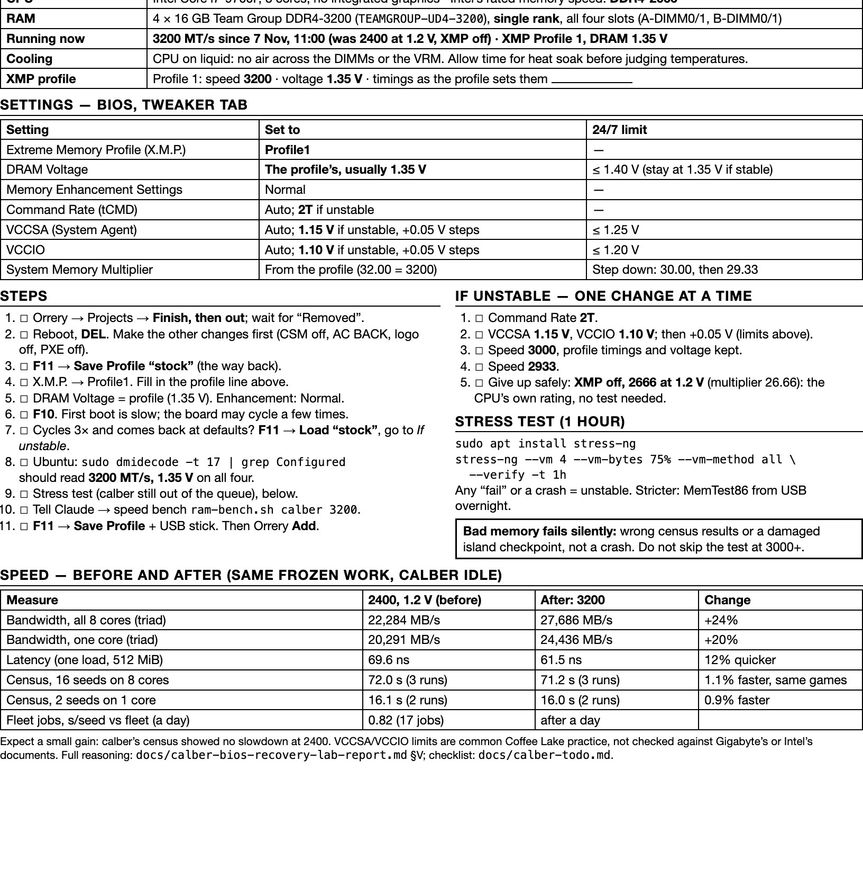

# Memory at Its Rated Speed: calber from 2400 to 3200 MT/s, the Procedure for Any Fleet Machine, and the Quick Guide

*Paul Richeson · Lab Report — IEEE Format · 7 November 2026*

Copyright (c) 2026 Paul Richeson. MIT licensed, as orrery.

Companions: `docs/calber-bios-recovery-lab-report.md` §V (the choices for calber, argued before the change); `docs/calber-todo.md` (what is still open); `docs/calber-ram/` (every result file, and the one-page sheet as printed); `tools/ram-bench.sh`, `tools/job-speed.py` and `tools/thermal-log.sh` (the three tools this report built); `docs/calber-update-f15-lab-report.md` (the BIOS flash that followed, and the firmware left to update: none).

---

## Abstract

calber's four 16 GB DDR4-3200 sticks had been running at 2400 MT/s and 1.2 V, their standard profile, since the BIOS was reset after the power cut of 7 November. XMP Profile 1 brought them to their rated 3200 MT/s at 1.35 V by itself. No hand-set timings or voltages were needed.

The change was measured with a new bench that runs the same frozen work before and after, on a machine out of the queue:

| Measure | Change |
| --- | --- |
| Bandwidth | +24% on all cores, +20% on one |
| Latency | 12% quicker |
| The fleet's own census work | 1.1% faster |

**The memory got a quarter faster, and calber's work about one percent faster.** The census runs within each speed agree to within half a second, and every run produced the same pooled result, so the gain is real. It is small because the census lives in the processor's caches, as the jobs run before the change had already suggested.

This report records how it was done, as a procedure for any machine in the fleet, and the one-page quick guide Paul printed. It also records what firmware calber can still take:
- a newer BIOS exists on Gigabyte's own page: F15 of November 2021, a security release that cannot be rolled back (not F15b, whose only change is Resizable BAR);
- the UEFI revocation list (dbx) is behind;
- one Ubuntu package is waiting.

The microcode, the kernel and every drive are current. One check is still owed before 3200 is trusted for unattended work: an hour of memory verification, of which two minutes have run.

## I. Introduction

The power cut's BIOS reset turned XMP off. Paul read the memory with `dmidecode` and asked for the steps, then: "i'm going to change ram config. can you profile speeds. start the collection of needed data." And after: "it went 1.35 the profile 1 set everything perfect. write a lab report about maxing ram speed. and our general procdure and the quick guide."

Faster memory is only worth its risk if the work notices it. So the question this report answers is a pair:
- how fast does the memory get?
- how much faster does calber's own work get?

The second is the one the fleet pays for. A memory overclock that is unstable does not crash: it flips a bit in a census result or an island's checkpoint, and nothing says so.

### The machine

| | |
| --- | --- |
| Board | Gigabyte Z370 AORUS Gaming WIFI, BIOS F15a (11/28/2019) |
| Processor | Intel Core i7-9700F, 8 cores; Intel rates it for DDR4-2666 |
| Memory | 4 × 16 GB Team Group DDR4-3200 (`TEAMGROUP-UD4-3200`), single rank, every slot |
| Cooling | the CPU on liquid; no air across the DIMMs or the voltage regulators |
| Its work | census and weights jobs on the CPU lane; a crucible island on the GTX 1080 Ti |

## II. The Procedure, for Any Machine in the Fleet

1. **Read what the memory is, and the processor's rated memory speed.** Run `sudo dmidecode -t 17` and note, for each stick:
   - `Speed`, the stick's own standard (JEDEC) speed while XMP is off, and its rated speed once XMP is on;
   - `Configured Memory Speed`, what it runs at now;
   - `Part Number`, which carries the rated speed;
   - `Rank`;
   - **not** `Configured Voltage`, which is not the live voltage: calber reported 1.2 V at 3200 MT/s with XMP setting 1.35 V. Read the voltage on the BIOS screen.
2. **Measure the jobs first.** `python3 tools/job-speed.py QDIR HOST …` gives the machine's seconds a seed on the queue's own work against the rest of the fleet, over two windows. If the machine's work has not slowed when its memory was slower, expect little from faster memory.
3. **Take it out of the queue without losing work:** Projects → **Finish, then out**. It takes nothing new, the job in hand ends (an island saves its segment), and then it leaves. Remove or Stop now would cut the job.
4. **Bench it before:** `sh tools/ram-bench.sh HOST LABEL 3`. This runs bandwidth (a STREAM-style copy, scale, add and triad over 3 GiB, on all cores and on one), latency (a random walk through 512 MiB) and a census on frozen inputs (Section III.A). Each result carries the clock, power limit and temperatures it was taken at.
5. **In the BIOS, save the way back first:** F11 → Save Profile "stock". A memory speed that will not train sends the board back to factory defaults, and this restores everything else in one step.
6. **XMP Profile 1, nothing else.** Leave Memory Enhancement Settings at Normal and the voltages on Auto. On calber the profile set 3200 MT/s and 1.35 V and trained on the first try.
7. **Confirm it in Linux:** `sudo dmidecode -t 17 | grep Configured`.
8. **Verify the memory, with the machine still out:** `stress-ng --vm 4 --vm-bytes 75% --vm-method all --verify -t 1h`, or MemTest86 from a USB stick overnight. Any failure means the next rung of the ladder (Section V), not a retry.
9. **Bench it after**, with the same command and a new label. Equal pooled hashes prove the census played the same games.
10. **Save the result as a BIOS profile** (F11) and on the USB stick: a future CMOS clear takes XMP away again.
11. **Back into the queue** (Add). After a day, run `job-speed.py` again over the new window.
12. **Optionally, the heat soak.** `sh tools/thermal-log.sh HOST install` logs temperatures and clocks once a minute across reboots. A liquid loop takes a while to reach its working temperature, and a bench of a few minutes runs it cold (Section IV.C).

## III. Results

### A. The bench, and why its inputs are frozen

`tools/ram-bench.sh` copies itself to the machine and builds two small C programs there:
- `stream`: copy, scale, add and triad over three 1 GiB arrays, best of ten, OpenMP;
- `latency`: Sattolo's random cycle through 512 MiB, huge pages asked for, 100 million dependent loads.

For the census it copies, **once**, the census binary and its worktree (`c/fd7b36d`, 57 MB), the models and the patches into `~/fleet/bench-ram/inputs`. It replays the trial of `w13740`, a weights job calber ran at 07:22 on 7 November, on two workloads:
- 16 seeds of 900-second games on all 8 cores;
- 2 seeds on one core.

A later prune or promotion cannot change this work, and the pooled result's hash shows it did not.

### B. 2400 against 3200

Both runs were made with calber out of the queue, idle (load 0.05 and 0.00 before), a few minutes from cold, and with the CPU at 4.5 GHz under load. The files are `docs/calber-ram/2400-jedec-20261107-184051.txt` and `3200-20261107-191431.txt`.

| Measure | 2400 MT/s, 1.2 V | 3200 MT/s, 1.35 V | Change |
| --- | --- | --- | --- |
| Copy, all cores | 19,497 MB/s | 24,321 MB/s | +24.7% |
| Triad, all cores | 22,284 MB/s | 27,686 MB/s | **+24.2%** |
| Triad, one core | 20,291 MB/s | 24,436 MB/s | +20.4% |
| Latency, one load | 69.6 ns | 61.5 ns | **11.6% quicker** |
| Census, 16 seeds on 8 cores | 72.2, 71.8, 72.1 s | 71.2, 71.4, 71.1 s | **1.1% faster** |
| Census, 2 seeds on one core | 16.1, 16.2 s | 16.0, 16.0 s | 0.9% faster |
| Pooled hashes | e087db31, 11b83ba9 | e087db31, 11b83ba9 | the same games |

The bandwidth rose by less than the clock (33%). That is usual: part of each transfer is latency, not clock. The census's 0.8 s is three times the spread of its own runs, so it is real, but small.

### C. The jobs, before the change

`tools/job-speed.py` over calber's work in the 24 hours before the power cut, against 08:36 to 09:31 after it, at 2400 MT/s:

| | Before | After | After ÷ before |
| --- | --- | --- | --- |
| calber, seconds a seed | 4.24 (422 jobs) | 3.65 (17 jobs) | 0.862 |
| the fleet's median change | | | 1.047 |
| calber against the fleet | | | **0.823** |

At 2400, calber did the queue's work no slower than before the cut. Its memory speed then is not known. That was the first sign, before any bench, that the census does not wait on memory. The figure after 3200 needs a day back in the queue, and it is not yet taken.

### D. Stability

stress-ng `--verify` passed twice at 3200, once for 42 s (stopped) and once for 1 min. Every census in Table III.B also produced the same pooled result as at 2400, which a corrupting memory would be unlikely to do five times. **Neither is the hour the procedure asks for.** 3200 MT/s is above the 2666 Intel rates the i7-9700F's memory controller for, so the hour is owed before calber goes back to unattended work.

## IV. Discussion

### A. Why the memory moved a quarter and the work one percent

A census plays games in a tank simulation whose working set (positions, a map, small nets) most likely fits in the processor's 12 MB of L3 cache. The working set was not measured; the small gain is the evidence. The CPU waits on main memory rarely, so a quarter more bandwidth and an eighth less latency buy little.

The one-core census gained no more than the eight-core one (0.9% against 1.1%). So it is not bandwidth shared between cores that holds the work back either. Work that streams large arrays would gain most of the 24%. On this fleet that is mainly the crucible's host side, and the island's host side is small next to its GPU.

### B. When to stop

The ladder in Section V exists because four sticks load a memory controller more than two, and XMP above the processor's rating is an overclock of that controller. calber's sticks are single rank, two ranks a channel, a lighter load, and the profile trained as it was. For this fleet's work the gain is about one percent, so the right place to stop is the first speed that passes the hour. **2666 MT/s at 1.2 V (XMP off, multiplier 26.66) is the processor's own rating and needs no test: it is where to go back to, not something to fight for.**

### C. Liquid cooling and heat soak

Paul: "its a liquid cooled system, it takes a while for heat soak." The two benches ran a few minutes from cold, with the package at 28 to 44 °C. They compare the memory at the same temperature, which is what they are for. They say nothing about the loop's working temperature, or about the board sensor that read 85 to 91 °C after hours of full load. With the CPU on liquid, no fan blows across the voltage regulators, a common reason for that sensor to run hot. The minute-by-minute log (`tools/thermal-log.sh`) records the soak.

Its installation is a cron entry on calber, which this session's permission check refused to make on its own authority. Paul can run `sh tools/thermal-log.sh calber install`.

### D. A trap in the readings

`dmidecode`'s `Configured Voltage` reported 1.2 V before and after, while the BIOS ran the sticks at 1.35 V. SMBIOS reports the stick's standard rating, and its `Speed` field changed from 2400 to 3200 when XMP went on. So: speed from `dmidecode`, voltage from the BIOS screen.

## V. The Quick Guide

*Fig. 1. The quick guide as printed for calber on 7 November, filled in after the change (`docs/calber-ram/calber-ram-sheet.pdf`).*

The same guide, for any machine in the fleet:

1. **Out of the queue:** Projects → Finish, then out.
2. **Bench before:** `sh tools/ram-bench.sh HOST before 3`.
3. **BIOS:** F11 → Save Profile "stock". Then Tweaker → Extreme Memory Profile (X.M.P.) → **Profile1**. DRAM voltage: the profile's (1.35 V for DDR4-3200), never above 1.40 V for round-the-clock work. Memory Enhancement: Normal. F10.
4. **If it will not boot**, the board cycles and returns at defaults: F11 → Load "stock". Then climb down one rung at a time:
   1. Command Rate (tCMD) 2T.
   2. VCCSA 1.15 V and VCCIO 1.10 V, then +0.05 V steps, no more than 1.25 V and 1.20 V. These are common practice for this generation, not checked against Gigabyte's or Intel's documents.
   3. 3000 MT/s with the profile's timings and voltage.
   4. 2933 MT/s.
   5. XMP off at the processor's rated speed.
5. **Confirm:** `sudo dmidecode -t 17 | grep Configured`.
6. **Verify, an hour:** `stress-ng --vm 4 --vm-bytes 75% --vm-method all --verify -t 1h`, or MemTest86 overnight.
7. **Bench after:** `sh tools/ram-bench.sh HOST after 3`.
8. **Save:** F11 → Save Profile, and export it to a USB stick.
9. **Back in:** Add. After a day, run `python3 tools/job-speed.py QDIR HOST …`.

## VI. Firmware and Updates, Read the Same Day

| What | calber now | Newer | Basis |
| --- | --- | --- | --- |
| BIOS | F15a (Nov 28, 2019): "Workaround beta BIOS to improve Kingston DDR4-2666 stability … Add NTFS format support for Q-Flash" | **F15b** (Mar 23, 2021): Resizable BAR, which the 1080 Ti cannot use. **F15** (Nov 29, 2021), the newest: "Major vulnerabilities updates" (credited to Assaf Carlsbad and Itai Liba of SentinelOne), capsule BIOS support from this version, and "Customers will NOT be able to reverse to previous BIOS version". Checksum 1683 | Gigabyte's own page for the board, rev. 1.0, as Paul read it [3]. An automated read was refused (HTTP 403); Station-Drivers' copy [1] agrees on F15 |
| Intel ME firmware | 11.8.70.3626 before the flash | **11.8.81.3807 after it: the F15 image carried a newer ME, so no separate ME update is needed.** The ME 12.1.5.1099 on the third-party list is, as far as I know, for Z390-class chips, not this Z370 | calber's `/sys/class/mei` and dmidecode type 221, before and after |
| CPU microcode | 0x104, loaded early by `intel-microcode` 3.20260210 | none: the package is current | `apt-cache policy` |
| Kernel | 7.0.0-42 (HWE) | none | `apt-cache policy` |
| Ubuntu packages | | `libsqlite3-0` 3.45.1-1ubuntu2.8 → 2.9, applied by Paul the same day; nothing waits now | `apt list --upgradable`, apt's history |
| UEFI dbx (Secure Boot revocation list) | 20230501 before the flash; **none after it**: F15 left Secure Boot in Setup Mode with no keys | 20260707 was offered before the flash; nothing after | `fwupdmgr`, `mokutil --sb-state` |
| NVMe and SATA drives | HP EX900 R0802E0, EX950 42A0S63C, six SSDs SBFM61.2 | none offered | `fwupdmgr` |
| NVIDIA driver | 580.178.04 | held at 580 on purpose, "held for a Pascal card" (calber's login banner) | |

What to do with each:
- **`libsqlite3-0`:** `sudo apt update && sudo apt upgrade`, any time.
- **The dbx:** `sudo fwupdmgr update`, then a reboot. Secure Boot is off on calber, so the list has no say in how it boots today. It matters only if Secure Boot is turned on. Low risk, low urgency.
- **Gigabyte's naming is a trap.** A letter after the number (F15a, F15b) marks a beta or interim build, and the plain number (F15) is the finished release. F15 looks like it comes before F15a, and it came two years after. Go by the dates.
- **The BIOS: F15 was flashed the same day,** with Q-Flash from a FAT32 USB stick. The kernel reads `BIOS F15 11/13/2021`, the BIOS's own microcode moved from 0xCA to 0xEA, and the Intel ME firmware from 11.8.70.3626 to 11.8.81.3807. With XMP Profile 1 set again, the memory measured 27,714 MB/s triad and 58.7 ns, so 3200 holds under F15. F15 is one-way: there is no going back to F15a or F15b.

## VII. Limitations

- One machine. The other machines' memory has not been read: `dmidecode` needs root on each.
- The census replay is one trial on one build. Another build or another kind of job may lean on memory more. The day of jobs will say.
- The benches ran cold. The soaked machine is unmeasured until the log runs.
- The BIOS list is Gigabyte's, as Paul read it from its page. The ME reading is from memory of Intel's chipset generations, not from Gigabyte.

## VIII. Future Work

- The hour of `stress-ng --verify` at 3200, then Add, then `job-speed.py` after a day.
- Read every fleet machine's `dmidecode -t 17` and bench those whose memory runs below its rating. The procedure and tools are general.
- The thermal log on calber, once Paul installs it.
- The BIOS: flash F15 (confirmed on Gigabyte's page) on a UPS, then set XMP and the rest again.

## References

[1] Station-Drivers, "Z370 AORUS GAMING WIFI" (a copy of Gigabyte's BIOS, ME and driver list; last updated December 2024). [Online]. Available: https://www.station-drivers.com/index.php/en/bios-news/13-gigabyte-bios-drivers/234-intel-z370-serie-300/1975-z370-aorus-gaming-wifi

[2] Softpedia Drivers, "Z370 AORUS Gaming WIFI (rev. 1.0)" BIOS listing, including F15a. [Online]. Available: https://drivers.softpedia.com/downloadTag/Z370%20AORUS%20Gaming%20WIFI%20%28rev.%201.0%29,2

[3] Gigabyte, "Z370 AORUS GAMING WIFI (Rev. 1.0), Support, BIOS" (F1 to F15). [Online]. Available: https://www.gigabyte.com/Motherboard/Z370-AORUS-GAMING-WIFI-rev-10/support#Support-Bios
