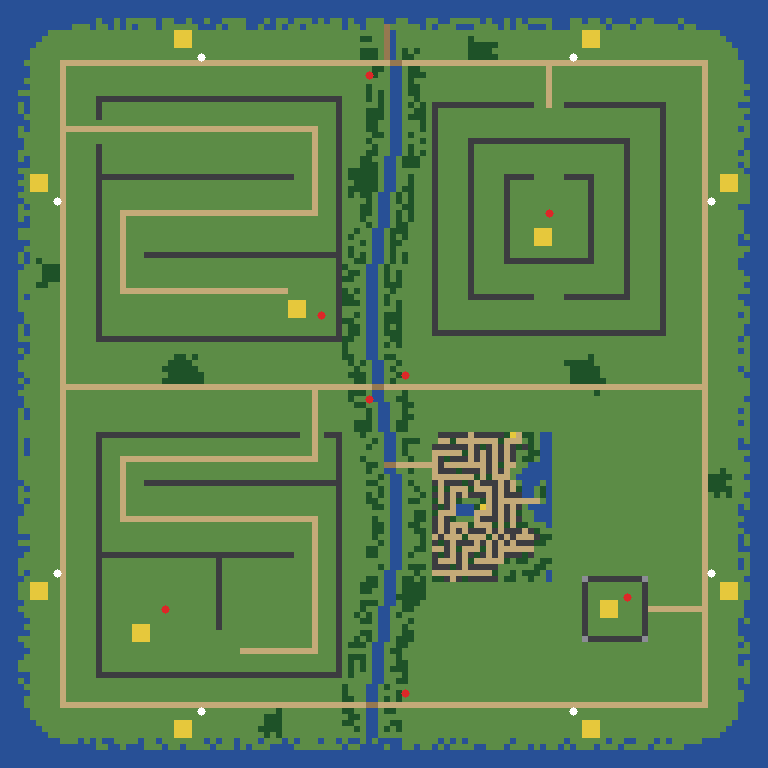

# Round the Corner: What a Net Needs to Pass a Maze, the Senses That Were Not Enough, the Errand That Was, a Proving Ground, and the Breach

*Paul Richeson · Lab Report — IEEE Format · 6 November 2026*

Paul Richeson, treadcore.org; Claude Code (Claude Opus 5.5) as the pair. Copyright (c) 2026 Paul Richeson. MIT licensed, as orrery and treadcore.

Companions: crucible `src/crucible.cu` (`NAV`: `grid_build`, `nav_field`, `nav_need`, `route_from`, `arc_free`, the memory cells, `scen_nav`, the geodesic progress, `errand`, breakable walls, `ends_near`, the `ray_box` fix, `--trace-scen`) and `gauntlet/m0-one-bar.toml`, `b1-breach-the-walled-base.toml`, `n0` to `n3`; orrery `tools/plans/treadcore.py` (the maze home, `gpu_trade_ok`), `tools/montage.py`, `tools/report/maze_film.py`; treadcore `scripts/provingmap.py`, `maps/proving.map`, `maps/prior-art/flame-war-modified.map`, `scenarios/gauntlet/g30` to `g33`. The reports before it: *One Rule, Two Machines* [1], *Three Generations, Filmed* [2].

## Abstract

Paul asked what it takes for a net to make the two-part move round a corner: what sensor, what memory, what cheap projection of its own movement, whether the matrices must grow. He also asked for a test of breaking into a walled base and a total score that lets a vastly better net trade a little. The robotics literature names the corner as a local minimum [3], [4], and neuroevolution names it deception [5]. Both answer with a planner, a little memory, a short look ahead and a curriculum, not a wider net.

**Built.** Crucible's `NAV` build gives the net:

- a route sense: a breadth-first wave over a 32 × 32 grid, made only when the straight line is shut;
- its own future along three arcs;
- two memory cells;
- progress paid along the route.

It also has breakable walls, a breach file (B1), a one-bar file (M0), treadcore's `ends_near` ask, and four route-only mazes (N0 to N3). The net grows from 55-48-48-4 to 64-48-48-6 at +10% of its weights. A generation costs 1.8× the forest build's, measured: the cost is register spills, not the wave.

**The senses were not enough.** Four arms of 30 generations, in two controlled pairs, passed no maze. The senses tripled the paired step (+0.0108 ± 0.0023 against +0.0034 ± 0.0021), but on other files, and their weights never grew past mutation's drift: a norm of 1 against an old input's 55.

**The errand was.** The card's hybrid had steered its rules at the enemy tank. The game's rules route by `map.route`. Given the same errand, M0016 untrained passes every route file in all 256 runs, M0 238 and taking a pillbox 229 (from 0). Thirty generations on it take the S maze 256 of 256, the 5 249, the walled base 255 and the base 253: the first maze captures by a GPU net, and +0.1594 ± 0.0068 over M0016. The @ maze is still 0.

**The breach** worked once a bug the film exposed was fixed: a fallen wall had become the whole plane to every ray.

**The total score.** The planner's own election refuses this generation. It lost building a base entirely, and two files fell past the three-margin cap. Whether that trade should be allowed is Paul's to decide.

**The proving ground.** Built from Birdman's tile sheet with A Flame War Modified's walled city. Its four gauntlet files pass for the game's rules at 100, 100, 100 and 95.5%.

Nothing here is on the fleet yet.

*Index Terms*: maze navigation, local minima, potential fields, bug algorithms, dynamic window, recurrent neuroevolution, curriculum, reward shaping, path planning, CUDA.

## I. The question

Paul, in the afternoon: "Can we look into IEEE research about AI neural nets, and what it takes to make a two-part move around a corner. How would we give a sensor to the AI net, and brains, such that it has enough information to pass the maze? In fact, write a lab report, like the montage, but specific to training the maze navigation in specific. What functions would improve the maze navigation? Do we need to expand the matrix transforms to get more occlusion and multiple-curve path finding? Like a way to project your own future movements that don't take too much computation. We need a very straightforward exploratory model which can be trained by our custom brain modification to increase the sensors to be able to route into a maze. Also a test for destroying a wall in between a base which was walled off. We need to amend the brains' coding to consider intrusion given its weights (and maybe temperament of bio). What addition to the transform will give it more of a perceived memory, or be capable of doing delayed actions that it progresses towards? … And yes, spending time on one type of goal will reduce its metrics in other things. We need a total score consideration: if things are vastly better, then we can allow a differing of goal priorities as long as we have improvement."

And while it was being built: "Build a map, with the test setup gauntlet of the series of tests. A series of spiral mazes, S-shaped bases, and roads … look at the map tiles, for ways to stitch together components like blocks to make rivers and roads styled with consistent tiles … Also the map A Flame War Modified has a good walled section. Add bases around the island if they are missing, but I think it's all good."

## II. What the corner is, and what the research says

**The two-part move round a corner is a local minimum, and it is the oldest problem in the field.** A controller that steers toward its goal is drawn into the dead end in front of a wall whenever the way round first leads away from the goal. Khatib's potential fields [3] move a robot down the sum of an attraction to the goal and a repulsion from obstacles; Koren and Borenstein showed, at the 1991 IEEE conference on robotics, that such a field traps a robot in front of a U-shaped obstacle, oscillates it between close obstacles and in narrow passages, and cannot be tuned out of either [4]. Neuroevolution meets the same trap as *deception*: Lehman and Stanley's "hard maze" rewards closeness to the goal, its best early nets drive straight into the wall nearest it, and objective-based search stalls there [5]. **Our own record says the same.** Every crucible net, M0015 to M0016 and every champion since, passes none of the mazes M1 to M3; the task fitness of [1] paid the closing of the *straight-line* distance to the goal, which in the S maze is the wrong way.

**What the literature uses instead, cheapest first:**

| Method | What it gives a tank | Cost a step | Kind |
|---|---|---|---|
| A grid planner: A* [6] or a breadth-first wave from the goal | the direction of the next cell on the shortest route, and its length; no local minimum survives it | a search of a coarse grid, once a second or less | classical, deterministic |
| Bug algorithms (Lumelsky and Stepanov, IEEE Trans. Automatic Control, 1986) [7] | head for the goal; on meeting an obstacle, follow its wall until the line to the goal is clear again | a little state: one bit, "following the wall" | classical, needs memory |
| The dynamic window (Fox, Burgard and Thrun, IEEE Robotics & Automation Magazine, 1997) [8] and the curvature-velocity method (Simmons, ICRA 1996) [9] | the tank's own future along a few arcs it could drive, scored by how far each stays clear | a few forward steps of its own motion | classical, local |
| Recurrent memory: Elman's context units [10], LSTM [11]; co-evolved recurrent neurons for deep-memory tasks [12] | a decision held across steps: "I am going round" | feedback of a few outputs as inputs | learned |
| Learned planning: value iteration inside the net [13]; recurrent navigators with auxiliary losses [14] | a planner learned end to end | a convolution per planning step per cell; LSTMs and gradient training | learned, costly |
| Curriculum [15], [16] and shaping by a potential [17] | an easier task first; a reward that is dense and does not change what is best | none at play time | training |
| Novelty search [5] | a population that explores past the deceptive dead end | a behaviour archive | training |

**The answer to "do we need to expand the matrix transforms?" is no.** A wider hidden layer costs in proportion to its square (the net's 5,766 multiply-adds a step would grow by a third for 8 more units of H), and it adds neither a fact the net cannot sense nor a memory it does not have: the route is not in the inputs, and the net forgets everything between steps. Occlusion the net already has (its twelve rays stop at walls, as the game's do); multiple-curve path finding is the planner's job, done once a second for the cost of a few thousand integer steps, and handed to the net as a bearing. A learned planner [13], [14] is the right tool when the map is not known; here it is, exactly, and the game's own rules route by it.

## III. Four cheap senses and an errand (`NAV=1`)

The `NAV` build (crucible, on top of the forest arena [1]) gives a net nine more inputs and two more outputs. Its 55-48-48-4 champions load as 64-48-48-6 with every new weight zero, and they answer exactly as before (crucible printed "widened from 55-48-48-4 to 64-48-48-6", as it did for the world's senses). Each addition answers one of Paul's questions.

**1. A sensor of the route** (answering "how would we give a sensor … such that it has enough information to pass the maze", and "a very straightforward exploratory model … to route into a maze"). The arena becomes a grid of 32 × 32 cells, two tiles each; a cell is shut where a wall or a pillar covers it. A breadth-first wave from the goal's cell gives every open cell its number of steps to the goal. From the tank's cell, the next waypoint is its neighbour with the smaller number, or the goal itself when the straight line to it is clear. The net reads the bearing to that waypoint (a sine and a cosine), the route's length, and a flag: **walled**, when the goal has no route at all, which is the cue to breach. This is the classical planner the game's rules already use [6]. It is the "straightforward exploratory model": deterministic, with nothing to train, and handed to a net that only has to learn to follow it and when to leave it. In a duel the goal is the other tank, in a task it is the file's goal (its pillbox, or its enemy).

**2. Its own future, projected** (answering "a way to project your own future movements that don't take too much computation"). Three arcs, turning left, holding straight and turning right at half the turn rate, are stepped forward six times over 1.5 s at the tank's speed. The net reads the share of each it could drive before meeting a wall, a pillar or the arena's edge. This is the dynamic window [8] and the curvature-velocity method [9] at their cheapest: 18 points a refresh. A corner is seen 1.5 s before the hull meets it, so a turn can start in time.

**3. Two memory cells** (answering "what addition to the transform will give it more of a perceived memory, or capable of doing delayed actions that it progresses towards"). The net writes two more outputs, and reads them back as inputs the next step. That is Elman's context [10] at its smallest, and the bit a bug algorithm keeps for "I am following this wall" [7]. Evolution decides what the cells mean. Co-evolved recurrent neurons solve deep-memory tasks this way [12], and the cells cost 2 × 48 weights in and 2 × 48 out.

**4. Progress along the route, not the crow's line** (answering how to guide training). A task's fitness paid the share of the straight-line distance closed [1]; in the S maze that pays pressing against the first wall. It now pays the share of the route's steps closed: a potential, which shapes without changing what is best [17], and it is the deception of the hard maze [5] removed. With it come the curriculum's first step [15], [16]: **M0, one bar**, a single wall between the tank and the pillbox, one corner. The mazes M1 to M3 follow it among the tasks.

**5. The rules' errand** (found by the experiment, section VII). The card's net is a hybrid: the rules decide, and the net adds a correction when its gate opens. In the game the rules are the Commander's, and they go where they are going along `map.route`; the Gladiator's net speaks only in a duel. On the card the rules were a script that steered at the enemy tank and nothing else, so a maze asked the net to do the Commander's work as well as its own. Under `NAV` the hybrid's rules now follow the route sense to their goal:

- **An enemy tank**, round the wall that shuts it off (the gun stays the script's).
- **An enemy pillbox**, until it is within the gun's reach and outside its ring. Then they face it and shell it, through a wall that shuts it in, which falls.
- **Rubble or a point**, onto it.

The net corrects them, as it corrects the Commander in the game (`errand`; `ERRAND=0` builds the old script). A widened net's own answers are unchanged by the widening, but the rules under it now route, so M0016 in this build plays differently from M0016 in the forest build. Section VII measures both.

**Two pieces of plumbing.** The route's field is **lazy**. The sense first checks the straight line to the goal, which is all a duel in the open needs; the wave runs only when that line is shut and the field is missing or stale. A task's goal stands still, so its field is made once a run. And the card gains treadcore's own words for the route alone, **`ends_near`**: passed when the tank ends within *r* tiles of a point (the run stops when it gets there). Four new files use it, **N0 to N3**, the mazes of M0 to M3 with the pillbox gone and the point where it stood. Every M file asks for the pillbox to be taken, and no net took even T1's in the open. So M0 to M3 measured the capture as much as the way; N0 to N3 measure the way.

**What it does not add.** No hidden unit, no planning layer, no LSTM. The matrices stay 48 wide.

## IV. The breach, and intrusion

**On the card, a walled base can be broken into.** A gauntlet file's walls may be `breakable = true`, and a breakable wall falls to two direct hits (WALL_HP 90). **B1** puts the enemy's pillbox inside a ring of four such walls with no gap. The route sense reads *walled*, so the way in is through a wall. This differs from the game, where a direct shot does not bring a wall down: a mortar's splash turns it to rubble (treadcore-sim, the indirect shell's impact). Crucible's tanks have no mortar, so the direct shot stands in for it in B1 only. The training arena's walls do not fall, as the game's do not to the gun. **On the card the breach now works:** under the errand the rules shell a wall that shuts the goal in, and the trained net takes B1 in 255 of 256 runs (Table IV), after a fix to how a fallen wall is removed (section VII).

**In the game, the rules already intrude.** On the proving ground (section VI), G33 puts the enemy's pillbox inside a compound of wall and concrete with no gate. The rules take it in 95.5% of 200 runs, by aiming the mortar at the pillbox inside, whose splash brings down the wall in between. The brain's code already breaches as a by-product of attacking. What it does not have is intrusion as a choice: going through a wall when there is a way round, or breaching to reach a base without a pillbox. **Designed, not built:** a dial `w_breach` in the weights table. When a target's route is longer than its straight line by more than `w_breach` times, the commander aims the mortar at the wall tile where the straight line meets the wall. Its default would be the census's to find, and temperament would scale it as the twelve temper_ dials scale aggression today. It changes treadcore's brain, so it waits for Paul's word and gets its own LR.

## V. The total score

Paul: "spending time on one type of goal will reduce its metrics in other things. We need a total score consideration: if things are vastly better, then we can allow a differing of goal priorities as long as we have improvement." The GPU's election [1] already allowed a small trade: a file up to one margin (1/√n) under its floor when the weighed step was 2 z over the bar. The trade now **grows with the step**. A step 2 over the bar may pay for a file one margin under its floor, a step 4 over for two margins, a step 6 or more over for three. In every case **the total must still rise**: the runs gained, less the runs lost, over every file unweighed. A net that becomes vastly better at the maze may lose a little of an easy file, never more than three margins (0.19 at 256 runs), and never at the cost of the whole (`gpu_trade_ok`).

**The first test of the rule refused the first maze generation.** The planner's own election (`gpu_step`, `gpu_trade_ok`), run on Table IV's gauntlet with M0016 as the reference, gives:

- a weighed step of z 26.8 and a total of +857 runs;
- C8 0.62 margins under its floor and N2 1.94, both within the trade;
- **N3 3.88 margins under and T3 3.69, past the cap of three.**

So it would not elect. This is the rule doing what it was written to do: a generation that takes the S, the 5 and the walled base, and loses building a base entirely, is the trade the cap was put there to stop. Whether "vastly better" should buy a whole lost skill is Paul's to decide. There are three ways:

1. **Keep the cap.** Train on until T3 and N3 come back within three margins. Their tasks are in the training mix (`--tasks`), so the floors pull them back.
2. **Let the cap grow with the step** (here 26.8 − 2 = 24.8 z over the bar, 12 margins), with one rule kept: no file a net passed at least a fifth of the time may fall to nothing. That rule would still refuse this generation, for T3 (0.29 to 0).
3. **Weigh the floors by what the game asks of the net.** In the game the Gladiator's net has its say only in a duel. Building a base and the mazes are the Commander's: its rules pass them 88% (G28) and 100% (the proving ground, G30 to G32). A file the game never asks of the net could weigh less in the election, and the duel files more.

**Paul's decision (6 November, evening): keep the cap and train on.** The rule stands as written. The maze generation is elected when T3 and N3 come back within three margins.

## VI. The proving ground

**The tile sheet.** Birdman's map tiles is a prior-art sheet of 5 × 5 blocks, each a way terrain meets terrain: roads a tile wide that leave every block at the offset they entered, rivers two wide, bridges as wide as the river, forest and rubble edges ragged a tile deep, walls with a road through a gate. Blocks whose edges agree tile without seams. `scripts/provingmap.py` lays the proving ground with one function per kind of block, so its joins agree.

*Fig. 1. The proving ground, 128 × 128. North-west, the S: a road down the S to a base (yellow) and its pillbox (red) at the end. North-east, the @: three rings, gaps north, south and north, the base at the centre. South-west, the 5, its base in the bowl. South-east, A Flame War Modified's walled city as it is (its lanes, blocks and pond) and a compound of wall with concrete corners and no gate. A river two tiles wide runs between them, crossed by the ring road and the cross road on bridges. Eight bases ring the coast, a start (white) beside each, and there are pillboxes at the bridges.*

**A Flame War Modified** joins treadcore's prior-art maps. It has twelve starts, eleven bases on the island (enough, as Paul thought) and five more on a pad of road at sea, sixteen pillboxes and 397 wall tiles.

**The series**, G30 to G33. A tank stands at a place's door with the enemy's pillbox at its end, and the map's own pillboxes and bases are cleared so the decision is one. The rules, 200 runs each: **the S 100%, the @ 100%, the 5 100%, the breach 95.5%**, with floors 0.95, 0.95, 0.95 and 0.90. The loader checks the whole map on every run. Crucible's card cannot load a map file; its twins of these places are M0 to M3 and B1.

## VII. Three experiments: the senses, the route alone, the errand

Every arm starts from the same population (the forest home's state of the morning, `forest.state`) with the same seed (4242). Each trains 30 generations of 2,048 nets, half of its warps on tasks (`--task-p 0.5`), and is then read on the CUDA gauntlet, 256 runs a file, paired against M0016, the forest home's elected generation. Only the build and the tasks differ. The runs were made on boburner's GTX 1070 Ti, beside its island's own segment.

**Experiment 1: the senses, with every gauntlet file as a task.**

| Arm | Mean share | Paired step over M0016 | M0 to M3 | B1 | T3 build a base |
|---|---|---|---|---|---|
| Forest, no senses | 0.176 | +0.0034 ± 0.0021 (50 runs gained, 35 lost) | 0 of 1,024 | 0 | 50 of 256 |
| `NAV`, senses and memory | 0.183 | **+0.0108 ± 0.0023** (75 gained, 28 lost) | 0 of 1,024 | 0 | 75 of 256 |

*Table I. M0016 reads 0.172. A step is the share of runs gained less the share lost, over all the files' 4,352 runs.*

The senses made the step three times as large, and it is clear of zero by 4.7 standard errors. But it came from T3 and C8, not from a maze: **neither arm passed a maze.**

**Experiment 2: the route alone.** Every M file asks for the pillbox to be taken, and no net passes even T1's in the open. So the four N files were added (section III), and both arms trained on them alone:

| Arm | Mean share (21 files) | Paired step over M0016 | N0 to N3 |
|---|---|---|---|
| Forest, no senses | 0.139 | −0.0004 ± 0.0017 | 0 of 1,024 |
| `NAV`, senses and memory | 0.146 | +0.0069 ± 0.0018 (66 gained, 29 lost) | 0 of 1,024 |

*Table II. M0016 reads 0.140 on the 21 files.*

The forest arm has no sense of where the end of a maze is, and learned nothing; that is as it should be. The senses arm learned no route either: none of its 1,024 runs reached an end. Its step came from T3, build a base (66 runs gained), paid for by C8 (29 lost). Paid for closing the route's steps, it learned to drive somewhere and stay, which is T3's ground. It did not learn to follow the bearing round a corner.

**What the trace showed.** Fig. 2 follows M0016 in the S maze. The rules under it drove straight at the enemy tank, and the net could steer away from them only by a correction it had never needed. A sense with zero weights, and 30 generations of selection, did not grow one. **The way to the maze was not a bigger net, but the right rules under it.**

**Experiment 3: the errand.** With the hybrid's rules following the route (section III, 5), M0016 itself, *untrained*, read:

| File | Old script | The errand |
|---|---|---|
| N0 to N3, the route alone | 0, 0, 0, 0 | **256, 256, 256, 256** |
| M0 one bar, take the pillbox | 0 | **238** |
| T1 take a pillbox | 0 | **229** |
| C7 a pillbox from outside its ring | 0 | 51 |
| F2 round the trees | 0 | 184 |
| F3 the lurker | 10 | 81 |
| T2 take the base | 0 | 20 |
| T3 build a base | 0 | 75 |
| M1, M2, M3 (the capture at the maze's end) | 0 | 0 |
| B1 the breach | 0 | 0 |
| C1, C2, C8 | 256, 256, 228 | 256, 256, 228 |
| **Mean share, 21 files** | **0.140** | **0.491** |

*Table III. Passes of 256 runs, M0016 with no training, the lazy field in both builds.*

Every route file passes in every run, and so does nearly every pillbox in the open. **M1 to M3 still do not.** The tank goes round the first corner and then turns toward the pillbox at the maze's end, through a wall (Fig. 3). The net learned in open arenas to make for a pillbox it can sense, at any distance. With no pillbox in the file (the N files) its gate stays shut and the errand drives. With one it opens and steers the tank into the wall. That is a correction training can unlearn, so the third arm trained on the errand's base with the maze files as its tasks (M0 to M3, N0 to N3, T1 and B1):

| File | M0016, the errand | 30 generations on the errand |
|---|---|---|
| **M1 the S maze, take the pillbox** | 0 | **256** |
| **M2 the 5 maze, take the pillbox** | 0 | **249** |
| M3 the @ maze, take the pillbox | 0 | 0 |
| M0 one bar | 238 | 256 |
| **B1 the breach** | 50 | **255** |
| T1 take a pillbox | 229 | 256 |
| **T2 take the base** | 20 | **253** |
| F2 round the trees | 184 | 256 |
| C7, F3 | 51, 81 | 68, 90 |
| N0, N1 | 256, 256 | 253, 256 |
| N2, N3 | 256, 256 | **209, 178** |
| C8 out of a pillbox's ring | 228 | **202** |
| T3 build a base | 75 | **0** |
| C1, C2 | 256, 256 | 256, 256 |
| C19, C21, F1 | 0, 0, 0 | 0, 0, 0 |
| **Mean share, 21 files** | **0.501** | **0.660** |

*Table IV. Passes of 256 runs. The trained arm's training saw 30 generations, half its warps on the ten files M0 to M3, N0 to N3, T1 and B1 (`tasks-errand`), and passed 69% of its task runs in its last generation. Read with the `ray_box` fix (below).*

**The S and the 5 are taken: 256 and 249 of 256, the first maze captures by any GPU net.** So is the walled base, 255 of 256, and the base of T2, 253 (from 20). The paired step over M0016 is **+0.1594 ± 0.0068** (1,158 runs gained, 301 lost; the weighed z of the election is 26.8). That is fifteen times experiment 1's +0.0108.

**What it paid.** T3, build a base, fell from 75 to 0. N3 fell to 178 and N2 to 209: in the route files, the net that learned to make for a pillbox at the end of a maze now leaves the route even when there is none. C8 fell by 26.

**What it did not learn: M3.** The @ maze is the longest (150 s). With two task warps a generation drawn from ten files, each file came up about six times in 30 generations. The tank follows the outer ring to its last corner and stops there (Fig. 9). A rule against cutting a corner diagonally was tried: M3 stayed at 0 and the champion, trained without it, lost M2 (249 to 143). It is not kept.

**What the senses did.** Measured as the L2 norm of each input's column in the first layer, an old input weighs 55. The nine new ones weigh about 1 in all three trained arms (route 1.1 to 1.2, arcs 1.0 to 1.3, memory 0.9 to 1.2). That is what 30 generations of mutation from zero give, not use. **The mazes were won by the errand under the net and by training the net to stop overriding it, not by the new senses.** New structure that starts at zero and is mutated at the same rate as the old does not catch up in 30 generations. NEAT protects a new gene for this reason [18]. Section X proposes the cheap equivalent.

**A bug the film found.** In the first read the breach was 0 for every net. The trace showed a tank that had shot a wall down, driven in, and could then neither hit the pillbox beside it nor be hit by it. A fallen wall is removed by giving it an empty box (x₀ > x₁), and `ray_box`'s slab test, which takes the lesser and greater of each pair, turned that into the whole plane. After the first wall fell, every shell stopped at its muzzle and no pillbox could see a tank. Only B1's walls ever fall, so only B1 was wrong. `ray_box` now returns no hit for an empty box. The fix moved B1 from 0 to 255 for the trained net and from 0 to 50 for M0016, and nothing else (Table IV is read with it).

## VIII. The maze, filmed

Each film follows one run of a gauntlet file, the best of 16 (a pass first), with the other fifteen as ghosts in the same maze at the same moment. The view is the whole arena, still. The tank in sky blue is the net's, the red one is seat 1's (idle), the sand square is the pillbox, and the grey bars are walls. They are drawn by the montage's own renderer from a crucible trace (`crucible --trace OUT --trace-scen FILE --champions NET --trace-duels 16`, then `tools/report/maze_film.py`), a step in two at 15 frames a second.

!html(round-corner/fig-m1-script.html)

*Fig. 2. M1, the S maze, under the old script: M0016 makes for the pillbox, through the first bar, and stays there. 0 of 16.*

!html(round-corner/fig-m1-errand.html)

*Fig. 3. M1 under the errand: the tank goes round the first bar, then the net's correction turns it toward the pillbox through the second. 0 of 16.*

!html(round-corner/fig-n1-errand.html)

*Fig. 4. N1, the same S with the pillbox gone: the errand drives the S end to end, and the net, with nothing to fight, leaves it alone. 16 of 16.*

!html(round-corner/fig-n3-errand.html)

*Fig. 5. N3, the @ maze: three rings, their gaps on alternate sides, to the centre. 16 of 16.*

!html(round-corner/fig-m0-errand.html)

*Fig. 6. M0, one bar: round the corner, stop outside the pillbox's ring and shell it (hits from 9.0 and 8.2 tiles, its ring 8), unhurt, and drive onto the rubble, which rises as the tank's. 16 of 16.*

**After 30 generations on the errand.**

!html(round-corner/fig-m1-trained.html)

*Fig. 7. M1, the S maze, the trained net: the S end to end and the pillbox at its end taken. 16 of 16.*

!html(round-corner/fig-m2-trained.html)

*Fig. 8. M2, the 5 maze: round the end of the first bar, up past the bowl's stroke, and along the top to the pillbox in its corner. 15 of 16.*

!html(round-corner/fig-m3-trained.html)

*Fig. 9. M3, the @ maze: the tank follows the outer ring to its last corner and stops there, every run. 0 of 16.*

!html(round-corner/fig-b1-trained.html)

*Fig. 10. B1, the walled base, with the `ray_box` fix: the tank stops 8.3 tiles out, outside the pillbox's ring, and shoots the wall in between down. Through the gap it hits the pillbox at 10.3 s and destroys it at 14.4 s without moving, then drives in onto the rubble, which is its own at 20.1 s. Never hit. 16 of 16. (The film draws the walls as they stood at the start.)*

## IX. What it costs

**What the net carries.** 55-48-48-4 becomes 64-48-48-6: 5,236 weights become 5,766 (+530, +10%), and a step's multiply-adds grow in the same proportion. The block's shared memory grows from 41,888 to 46,128 bytes. Occupancy is unchanged: two blocks of 128 threads per SM, 128 registers a thread.

**What a thread carries.** Each tank keeps its two memory cells, a cache of eight route numbers and a counter (44 bytes). Each duel keeps the grid (128 bytes, a bit a cell) and a field for each net (1,052 bytes each). The wave's queue is 2 KB of local memory while it runs.

**What a step costs.** The arcs are 18 points a refresh, each tested against the walls and pillars, every third step. The route sense tests the straight line to the goal every third step. The wave visits at most 1,024 cells and 4,096 neighbours, and runs only when that line is shut and its field is missing or stale.

**Measured.** Four builds, one after another on boburner's GTX 1070 Ti beside its island's own segment. Each played four generations from the same state with the same tasks (the ten of `tasks-errand`, half the warps). The table gives the mean of the last three:

| Build | Seconds a generation | Million tank-steps a second |
|---|---|---|
| `FOREST` (no senses) | 21.9 | 20.7 |
| `NAV`, the wave every 3 s | 39.7 | 11.5 |
| `NAV`, the wave lazy | 40.4 | 11.3 |
| `NAV`, lazy, with the errand | 39.7 | 10.0 |

*Table V. Tank-steps a second is crucible's own count (`steps_per_s`).*

**The senses cost 1.8× a generation, and the lazy wave saved nothing: the wave was never the cost.** The compiler's own account shows where it goes. The play kernel is held to 128 registers a thread (two blocks of 128 per SM). With `NAV` its stack frame grows from 792 bytes to 6,560 (the fields and the wave's queue), and its spill traffic doubles: stores from 652 bytes to 1,548, loads from 884 to 1,724. The route numbers, the memory cells and their counter ride in each tank every step, and push the net's own working values out of registers. **The fix is not fewer waves but fewer live numbers:** write the route sense straight into the net's input array on the steps it is refreshed, and keep the fields outside the play loop's frame. That is the next piece of work, measured the same way. Under it the time could fall toward the 10% the wider net alone asks.

## X. What is not built, and what comes next

**Decided (Paul, 6 November, evening).**

- The trade cap stays, and training goes on (section V).
- The cost is cut before the maze build goes to the fleet. The route numbers move out of the per-step tank state, measured as Table V was, and then crucible's forest branch is merged and the planner switched to the nav home.
- Both treadcore changes are built, each with its own LR: `nav_senses` for the Gladiator, so the game can read and credit a maze net, and the `w_breach` intrusion dial.

**What the experiments say to do next, cheapest first:**

1. **Give new senses a head start.** The new weights drifted to a norm of 1 against the old 55. Mutating a widening's new weights at the old weights' scale for its first generations is the cheap form of NEAT's protection of new structure [18]. It is a step-size table, with no change to the net or its cost.
2. **More of M3 in the tasks.** The @ maze drew about six of the 60 task draws. Drawing a file in proportion to how far it is from passing (a pass rate of 0 draws most) is the curriculum's own rule [15], [16], for the cost of a table.
3. **Decide the trade's cap** (section V): the first maze generation stands refused by it.

**Built, and not yet on the fleet.** The `NAV` build (the senses, the lazy field, the errand, `ends_near`, the N files and the `ray_box` fix) lives uncommitted in crucible's `forest` worktree. It has been compiled in all four variants (plain, `WORLD HYBRID`, `FOREST`, `FOREST NAV`) and run only in boburner's test directory. The fleet's islands build from the crucible working copy, so merging it is a deployment, and it waits for Paul. With `crucible.nav = true` in plan.json the planner would make a new home, `crucible-world-hybrid-forest-nav`, with the forest home as its parent. Its milestones are widened from the forest's, as the forest's were from the world's, and its card election is the forest home's (`gpu_home`).

**What the game needs before it can credit a nav generation.** The bridge reads a GPU net in the game through the Gladiator, whose senses are crucible's 55 (treadcore `styles.rs`, `world_senses`). A 64-in, 6-out net needs:

1. `Champion` sized for 5,766 weights.
2. The two memory outputs fed back as inputs.
3. `nav_senses`: the bearing and length of `map.route_kept` to the goal, the walled flag, and the three arcs stepped against the map's walls.
4. The rules' answer it reads (inputs 32 to 34) made as the errand makes it: toward the route's next waypoint when the line to the enemy is shut. Where the line is clear, the errand is the old script, so a duel in the open already matches.

Until treadcore has `fn nav_senses`, the planner holds the bridge for the nav home (`bridge_ready`). The card can elect its generations, but the game cannot credit them. Building `nav_senses` is a treadcore change, with its own LR, when Paul says.

**The intrusion dial** (`w_breach`, section IV) is designed and not built. It also changes treadcore's brain.

**On the card:**

- B1 is breached by the gun, the game's walls by the mortar. Crucible has no mortar.
- The Generations dashboard reads the forest home by name. A nav home would need its own column there.
- The CPU twins of N0 to N3 (G30 to G32 on the proving ground) ask for the capture, as M0 to M3 do. Treadcore's `ends_near` can ask for the route alone once a brain has a goal to route to without a target.

## References

[1] orrery, *One Rule, Two Machines: Trees, Mazes and Takeovers on the Card, a Gauntlet Both Can Read, and Generations the GPU Can Earn*, lab report, 6 November 2026.

[2] orrery, *Three Generations, Filmed*, lab report, 5 November 2026.

[3] O. Khatib, "Real-time obstacle avoidance for manipulators and mobile robots," *The International Journal of Robotics Research*, vol. 5, no. 1, pp. 90–98, 1986.

[4] Y. Koren and J. Borenstein, "Potential field methods and their inherent limitations for mobile robot navigation," in *Proc. IEEE Int. Conf. Robotics and Automation*, Sacramento, CA, Apr. 1991, pp. 1398–1404.

[5] J. Lehman and K. O. Stanley, "Abandoning objectives: Evolution through the search for novelty alone," *Evolutionary Computation*, vol. 19, no. 2, pp. 189–223, 2011.

[6] P. E. Hart, N. J. Nilsson, and B. Raphael, "A formal basis for the heuristic determination of minimum cost paths," *IEEE Trans. Systems Science and Cybernetics*, vol. 4, no. 2, pp. 100–107, 1968.

[7] V. J. Lumelsky and A. A. Stepanov, "Dynamic path planning for a mobile automaton with limited information on the environment," *IEEE Trans. Automatic Control*, vol. 31, no. 11, pp. 1058–1063, 1986.

[8] D. Fox, W. Burgard, and S. Thrun, "The dynamic window approach to collision avoidance," *IEEE Robotics & Automation Magazine*, vol. 4, no. 1, pp. 23–33, Mar. 1997.

[9] R. Simmons, "The curvature-velocity method for local obstacle avoidance," in *Proc. IEEE Int. Conf. Robotics and Automation*, Minneapolis, MN, Apr. 1996, pp. 3375–3382.

[10] J. L. Elman, "Finding structure in time," *Cognitive Science*, vol. 14, no. 2, pp. 179–211, 1990.

[11] S. Hochreiter and J. Schmidhuber, "Long short-term memory," *Neural Computation*, vol. 9, no. 8, pp. 1735–1780, 1997.

[12] F. J. Gomez and J. Schmidhuber, "Co-evolving recurrent neurons learn deep memory POMDPs," in *Proc. Genetic and Evolutionary Computation Conf. (GECCO)*, Washington, DC, 2005, pp. 491–498.

[13] A. Tamar, Y. Wu, G. Thomas, S. Levine, and P. Abbeel, "Value iteration networks," in *Advances in Neural Information Processing Systems 29*, 2016, pp. 2154–2162.

[14] P. Mirowski *et al.*, "Learning to navigate in complex environments," in *Proc. Int. Conf. Learning Representations (ICLR)*, 2017.

[15] F. Gomez and R. Miikkulainen, "Incremental evolution of complex general behavior," *Adaptive Behavior*, vol. 5, no. 3–4, pp. 317–342, 1997.

[16] Y. Bengio, J. Louradour, R. Collobert, and J. Weston, "Curriculum learning," in *Proc. 26th Int. Conf. Machine Learning (ICML)*, 2009, pp. 41–48.

[17] A. Y. Ng, D. Harada, and S. Russell, "Policy invariance under reward transformations: Theory and application to reward shaping," in *Proc. 16th Int. Conf. Machine Learning (ICML)*, 1999, pp. 278–287.

[18] K. O. Stanley and R. Miikkulainen, "Evolving neural networks through augmenting topologies," *Evolutionary Computation*, vol. 10, no. 2, pp. 99–127, 2002.
