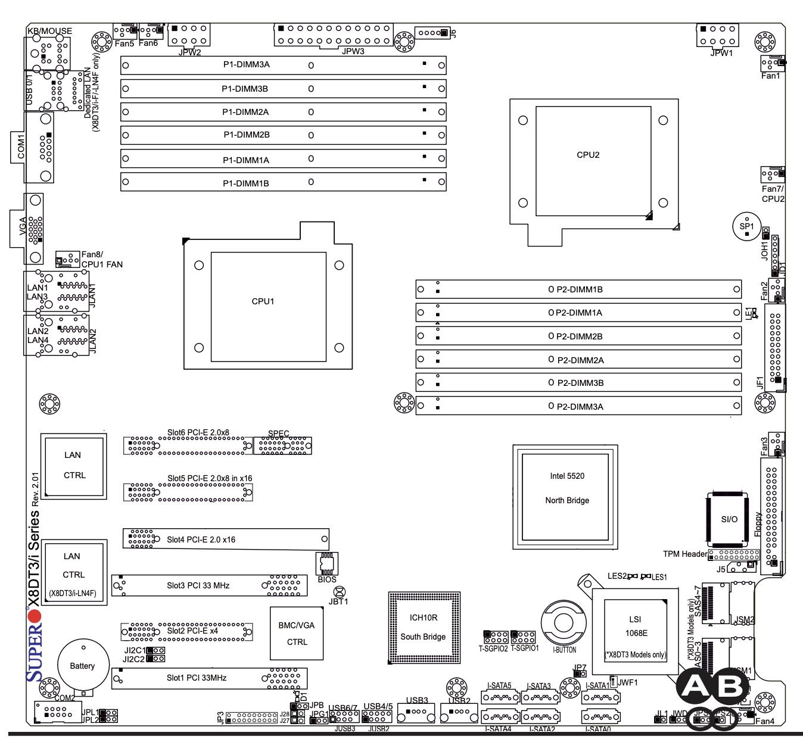
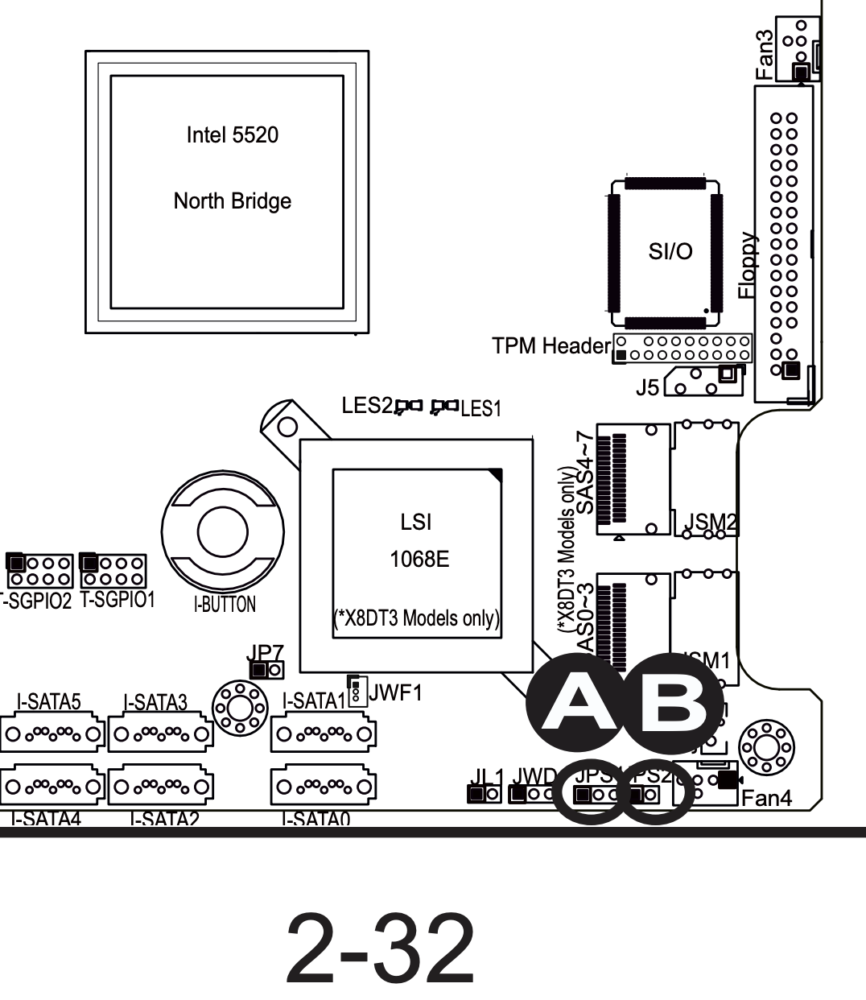
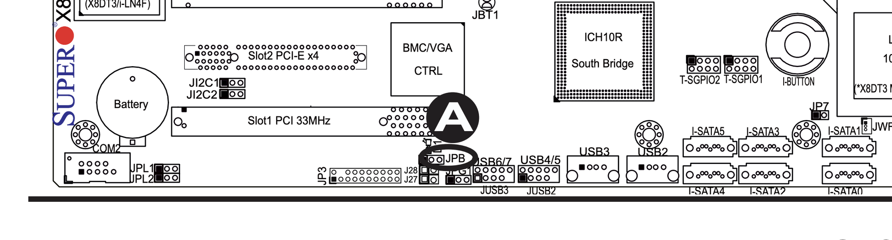
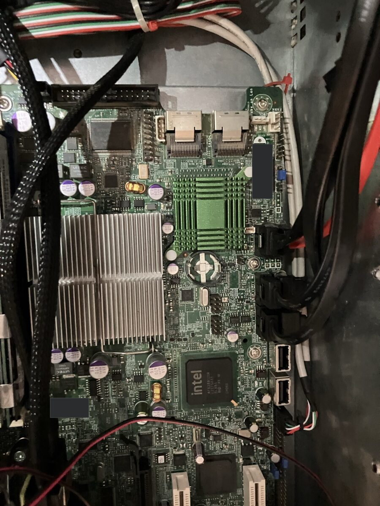
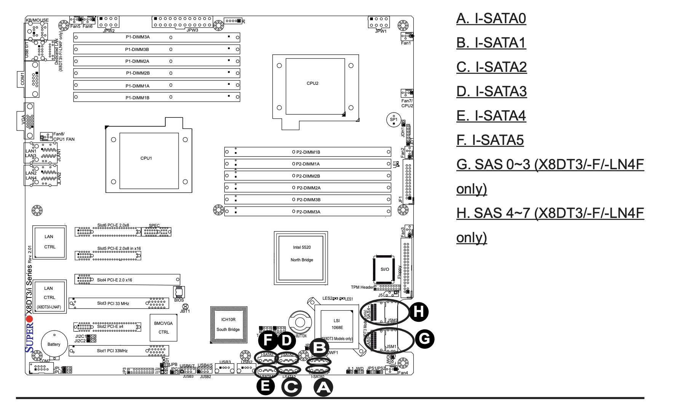

# An Old Server, Warm Again: the Supermicro X8DT3-LN4F's Jumpers and BIOS, and Copal from a USB Stick on a Board with No UEFI

*Paul Richeson · Lab Report — IEEE Format · 4 November 2026*

Copyright (c) 2026 Paul Richeson. MIT licensed, as orrery.

Companions: the recovery checklist of 3 November (*X8DT3-LN4F Recovery Checklist*, a private claude.ai artifact), which holds the steps; copal `docs/legacy-bios-lab-report.md`, which explains the stick's two boot paths; the board's manual, *X8DT3/X8DTi User's Manual*, Rev 2.01, chapter 2.

## Abstract

A Supermicro X8DT3-LN4F, two six-core Xeon E5645 processors (24 threads) and 48 GB of memory, had stopped booting after its BIOS settings were reset. It computes again. This report records the configuration that boots it, not the evening of steps that found it: the one jumper moved (JPS1 to pins 2-3, the onboard SAS controller off), every other jumper at its factory position, and the BIOS settings transcribed from photographs of every Setup screen. The board's firmware is legacy BIOS only, with no UEFI, so a USB stick must carry boot code in its first sector. Copal's `make sd-pc` writes a stick that does: a GRUB for UEFI as a file and a GRUB for a BIOS in sector 0 and the gap before the first partition, both reading one menu. With USB legacy support on and the stick in a rear port before power-on, the board boots Copal from it. Two identifiers are left out on purpose: the processor's CPUID and microcode row, and the stickers in the board's photograph (the SAS address and the IPMI MAC), which are covered.

## I. The machine

| | |
|---|---|
| Board | Supermicro X8DT3-LN4F (BIOS string `X8DT3/i/(-(LN4)(F))`) |
| Chipset | Intel 5520 north bridge, ICH10R south bridge |
| Processors | 2 × Intel Xeon E5645 at 2.40 GHz, 6 cores each, 24 logical |
| Memory | 49,144 MB (48 GB) |
| BIOS | AMI, build 2.1, 17 March 2012 (the family's last is 2.1c); legacy only, no UEFI |
| Storage controllers | ICH10R, six SATA ports (I-SATA0 to I-SATA5); LSI 1068E SAS, eight ports, **disabled by jumper** |
| Network | 2 × Intel 82576, four gigabit ports, driver `igb`; a dedicated IPMI port |
| Management | IPMI 2.0 BMC with KVM over LAN |
| Keys | DEL for Setup, F11 for the one-time boot menu, F10 to save and leave |

*Fig. 1. The manual's board layout (X8DT3/i series, Rev 2.01). Rear I/O on the left, front edge at the bottom. Every jumper named in Section III is on this drawing.*

## II. Copal from a USB stick, on a board with no UEFI

A UEFI firmware reads a file from a FAT partition; a legacy BIOS reads sector 0 and runs the code in its first 440 bytes. This board is the second kind only, so a stick written for UEFI alone (GPT, or a tool's "UEFI only" setting) is invisible to it however it is plugged in. Copal's `make sd-pc` (or `./copal build pc`) writes a stick that serves both: an MBR stick whose partition 1, FAT32 at sector 2048, is marked active and holds the UEFI GRUB as a file, while GRUB's BIOS boot code is written into sector 0 and its core image into the gap before partition 1. Both GRUBs read the same `grub.cfg`, so from the menu on the two boots are one. The build log says "Writing GRUB's legacy-BIOS boot code" when it does this. Copal's lab report on legacy BIOS (section IX there) draws the stick sector by sector.

What the board needs to start that code:

| Setting or practice | As set | Why |
|---|---|---|
| Legacy USB Support | Enabled | without it the BIOS cannot boot from USB at all |
| Port 64/60 Emulation | Enabled | the USB keyboard in Setup and at the GRUB menu |
| USB 2.0 Controller Mode | HiSpeed | the stick at USB 2.0 speed during the boot |
| BIOS EHCI Hand-Off | Enabled | the kernel takes the controller over cleanly |
| Quick Boot | Disabled | POST shows every device it finds |
| The stick's port | a rear port on the I/O shield | the front-panel headers gave descriptor read errors |
| When it goes in | before power-on | the BIOS lists USB devices only at POST |
| Where the BIOS files it | Boot > Hard Disk Drives, first | AMI lists a partitioned stick as a hard disk, not as removable |
| Or, once | F11 at POST, the stick's entry | the one-time boot menu |

Then the GRUB menu ("Copal Linux (lts -- real hardware)") and Copal's login prompt with its first-login message.

## III. The jumpers, as set

Only one jumper was moved. Pin 1 of every three-pin jumper on this board is the square pad; pins 1-2 enable, pins 2-3 disable. Move a jumper only with the AC cord out: the standby rail keeps the LAN controllers and the BMC powered.

| Jumper | Where on the board | What it does | As set |
|---|---|---|---|
| **JPS1** | bottom right, left of Fan4, beside JWD (A on page 2-32) | onboard LSI SAS | **pins 2-3: disabled** |
| JPS2 | right of JPS1 (B on page 2-32) | SAS mode: IR (1-2) or IT (2-3) | 1-2, factory; nothing while JPS1 disables the chip |
| JPL1 | bottom left, under the battery, beside COM2 | LAN1 and LAN2 (first 82576) | 1-2, enabled |
| JPL2 | directly below JPL1 | LAN3 and LAN4 (second 82576) | 1-2, enabled |
| JPG1 | bottom edge, left of USB6/7 | onboard VGA | 1-2, enabled |
| JPB | bottom edge, beside JPG1 | BMC and IPMI | 1-2, enabled |
| JWD | bottom right, between JL1 and JPS1 | watchdog action: reset (1-2) or NMI (2-3) | factory; the watchdog is off in Setup |
| JI2C1, JI2C2 | left side, between the battery and Slot1 | SMBus to the PCI-E slots | open, factory (disabled) |
| JBT1 | below the BIOS chip | clear CMOS: two pads, no jumper | open |
| JL1 | bottom right, left of JWD | chassis intrusion header | open |

!html(x8dt3/jps1.html)

With JPS1 at 2-3 the LSI 1068E leaves the PCI bus: no LSI banner at POST, no 1068E in `lspci`, no heartbeat on its LED header. The two mini-SAS connectors beside it (JSM1, SAS0 to 3, and JSM2, SAS4 to 7) are empty on this machine, and the six I-SATA ports of the ICH10R are untouched by either SAS jumper.

!html(x8dt3/board.html)

*Fig. 4. The manual's page 2-32, the SAS corner. A is JPS1, the SAS enable, now at 2-3. B is JPS2, the SAS mode. JSM1 and JSM2 are the mini-SAS connectors; the I-SATA ports to their left belong to the ICH10R.*

*Fig. 5. The bottom-left edge from the manual. A is JPB, the BMC enable, at 1-2. JPG1, the VGA enable, is just below it. JPL1 and JPL2, the LAN enables, are at the far left beside COM2; both at 1-2.*

*Fig. 6. The installed board, its SAS corner, turned a quarter turn from the manual's drawing (the manual's front edge runs down the right side here). The two mini-SAS sockets at the top are empty; the green heatsink is the LSI 1068E; the row JL1, JWD, JPS1, JPS2 runs beside the fan header at the top right; three of the I-SATA sockets are cabled. The SAS address sticker and the IPMI MAC sticker are covered.*

*Fig. 7. The manual's port map. A to F are the ICH10R's six SATA ports, in two rows of three at the front edge, where the cabled drives are. G and H are the mini-SAS connectors, off with the controller.*

## IV. The BIOS settings, as set

Transcribed from photographs of the Setup screens, 3 November 2026, 22:45 to 22:48, the settings on the board when it booted the stick. Anything not listed is at the value the BIOS reset gave it. The processor's CPUID and microcode revision are left out.

**Main.**

| Field | Value |
|---|---|
| Board string | Supermicro X8DT3/i/(-(LN4)(F)) |
| BIOS build and date | 2.1, 03/17/12 |
| AMI core | v02.69 |
| Processor | Intel Xeon E5645 at 2.40 GHz, 2 physical, 24 logical |
| System memory | 49,144 MB |
| Date and time | set to the present (a reset leaves 2009) |

**Advanced > Boot Features and Power Configuration.**

| Setting | Value |
|---|---|
| Quick Boot | Disabled |
| Quiet Boot | Disabled |
| AddOn ROM Display Mode | Force BIOS |
| Boots Graphic Adapter Priority | Onboard VGA |
| Bootup Num-Lock | On |
| Wait For 'F1' If Error | Enabled |
| Hit 'DEL' Message Display | Enabled |
| Interrupt 19 Capture | Enabled |
| Power Button Function | Instant Off |
| Restore on AC Power Loss | Last State |
| Watch Dog Function | Disabled |

**Advanced > Processor and Clock Options.**

| Setting | Value |
|---|---|
| Cache L1 / L2 / L3 | 384 KB / 1,536 KB / 12,288 KB |
| Ratio status | unlocked (min 12, max 18), actual 18 |
| Ratio CMOS setting | 18 |
| C1E Support | Enabled |
| Hardware Prefetcher | Enabled |
| Adjacent Cache Line Prefetch | Enabled |
| DCU Prefetcher | Enabled |
| Data Reuse Optimization | Enabled |
| MPS and ACPI MADT ordering | Modern ordering |
| Max CPUID Value Limit | Disabled |
| Intel Virtualization Tech | Enabled |
| Execute-Disable Bit Capability | Enabled |
| Intel AES-NI | Disabled |
| Simultaneous Multi-Threading | Enabled |
| Active Processor Cores | All |
| Intel EIST tech | Enabled |
| Intel Turbo Boost | Enabled |
| Performance/Watt select | Traditional |
| Intel C-STATE tech | Enabled |
| C State package limit setting | Auto |
| C1 Auto Demotion | Enabled |
| C3 Auto Demotion | Enabled |
| Clock Spread Spectrum | Disabled |

**Advanced > South Bridge Chipset Configuration (USB).**

| Setting | Value |
|---|---|
| USB Functions | Enabled |
| Legacy USB Support | Enabled |
| Port 64/60 Emulation | Enabled |
| USB 2.0 Controller | Enabled (follows USB Functions) |
| USB 2.0 Controller Mode | HiSpeed |
| BIOS EHCI Hand-Off | Enabled |
| Reserved Page Route | PCI |

**Advanced > Advanced PCI/PnP Settings.**

| Setting | Value |
|---|---|
| Clear NVRAM | No |
| Plug & Play O/S | No |
| PCI Latency Timer | 64 |
| PCI IDE BusMaster | Disabled |
| SR-IOV Supported | Disabled |
| Slot 1 to Slot 6 Option ROM | Enabled |
| Onboard LAN Option ROM Select | PXE |
| LAN1 Option ROM | Enabled |
| LAN2, LAN3, LAN4 Option ROM | Enabled |

*The LAN option ROM rows load each port's PXE network-boot code at POST; they do not turn a port on. On this board the LAN controllers are enabled by the jumpers JPL1 and JPL2, and Setup has no "Onboard LAN enable" row at all. The slot and LAN2 to LAN4 option ROMs were switched on while the Ethernet was looked for; set back to Disabled they only shorten POST. Intel AES-NI can be Enabled at no cost, for disk encryption and TLS. The IDE/SATA screens and the boot order were not photographed.*

## V. What decided the configuration

1. **The firmware is legacy BIOS only.** Every stick written for UEFI alone was invisible to it. The stick from Copal's `make sd-pc` carries BIOS boot code in sector 0 and boots.
2. **USB boots only with legacy support, from the back, present at POST.** The four USB settings of Section IV, a rear port, and the stick in before the power button.
3. **The Ethernet had no fault.** The cable was in the wrong jack: the back-panel port labelled 0 is the one the BIOS calls LAN1, the port nearest the VGA connector. No setting was at fault.
4. **The SAS controller had nothing on it.** Disabled by JPS1 at 2-3, it no longer scans at POST. The disk timeouts that had stopped the old Ubuntu install came from a drive behind a separate add-in LSI card, not from the board.

## VI. Still open

1. Join the machine to the fleet: orrery's Machines screen (probe, apply a recipe, join). It is not yet in the fleet's registry.
2. If Setup forgets its values after a cold start again, replace the CR2032 CMOS battery; a reset is how this began.
3. Photograph the IDE/SATA and Boot screens, so Section IV is whole.

## Appendix A. Reading the model number

The BIOS shows one image for a family of boards, written as a pattern: `X8DT3/i/(-(LN4)(F))`. One item from each group names a real board.

| Piece | Meaning |
|---|---|
| X8 | Supermicro's eighth generation: the Intel 5500/5520 "Tylersburg" chipset, LGA1366 Xeon 5500 (Nehalem) and 5600 (Westmere) |
| D | two processor sockets |
| T | the 5520 IOH with ICH10R, the family's extended-ATX layout |
| 3 or i | 3: the onboard LSI 1068E SAS, eight ports at 3 Gb/s; i: the same board without the SAS chip |
| -LN4 | four gigabit LAN ports (two Intel 82576) instead of two |
| F | the IPMI 2.0 BMC with KVM over LAN and its own RJ45 |

So the X8DT3-LN4F is the fully fitted member: two sockets, LSI SAS, four LAN ports, IPMI. The board tells which it is by the chips that answer at POST and in `lspci`.
